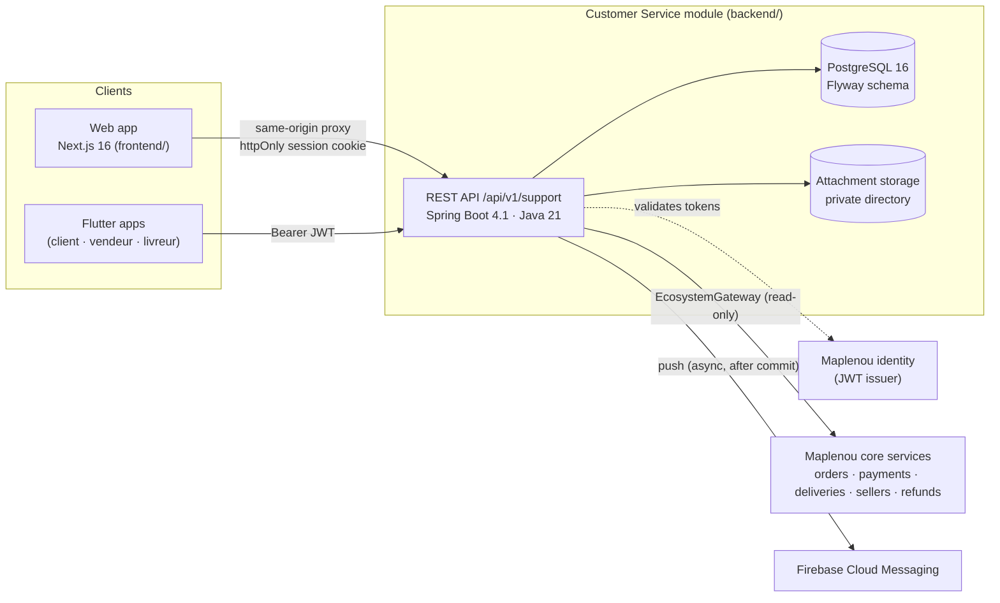

# Architecture — CS-03 foundation

**Work package:** CS-03 — Database + Backend/API Foundation
**Status:** Implemented and validated — awaiting project-owner approval (see [CS-03 validation](../validation/CS-03-VALIDATION.md))

## Overview

The Flutter apps are not part of this repository; they call the same API with the user's access token.
The web app never handles the token in JavaScript: its server-side proxy adds it from an httpOnly cookie.

## Backend layout (`backend/src/main/java/com/maplenou/support`)

| Package | Responsibility |
| --- | --- |
| `ticket` | Ticket aggregate, lifecycle commands (`TicketCommandService`), reads (`TicketQueryService`), resource-level authorization (`TicketAccessPolicy`), search criteria |
| `ticket.domain` | Framework-free rules: statuses, priorities, allowed transitions, ticket numbers |
| `ticket.web` | REST controllers and request/response records |
| `sla` | Business calendar (Mon–Fri 08:00–18:00, holidays), SLA targets and states, SLA periods. *Amended 2026-10-29 by DEC-CS10-16: 24/7 calendar by default (`BusinessCalendar.continuous`, `SLA_MODE=always`); the business-hours calendar is `SLA_MODE=business-hours`.* |
| `attachment` | Attachment rules (type by content, size, count, ticket total) and storage port |
| `notification` | In-app notifications, Firebase push dispatcher with retries, device tokens |
| `context` | `EcosystemGateway` port to orders/payments/deliveries/sellers/refunds, reference validation; `HttpLegacyTicketSource` (former core tickets) |
| `identity` | Sign-in with a Maplenou account through Bakend, role mapping, support roles by phone number (DEC-CS10-17) |
| `security` | JWT resource server, roles, current user, user projection sync |
| `user` | Local projection of Maplenou users (`support_users`) |
| `report` | Support dashboard and basic report |
| `admin` | Agents activation, categories, business calendar |
| `demo` | Demo personas, demo login, seed data — active only with the `demo` profile |
| `common` | RFC 9457 error handling, configuration properties, OpenAPI |

Rules are enforced in the backend; the UI only reflects them (`allowedActions` in every ticket response).

## Documents

- [Reference architecture](reference-architecture.md) — which plan and architecture the project follows, the conformance review, and how to reuse the ticketing core in other systems
- [Architecture decisions](decisions.md) — the CS-03 technical choices and the interpretations that need owner confirmation
- [Database model](database-model.md)
- [API specification](api-specification.md) — including FR-014 search/filter — and the generated [OpenAPI contract](openapi.json)
- [Ecosystem integration](ecosystem-integration.md) — proposed contract with the Maplenou core services (CS-07)
- [Notifications](notifications.md) (CS-08)
- [Security review](security.md) (CS-09)
