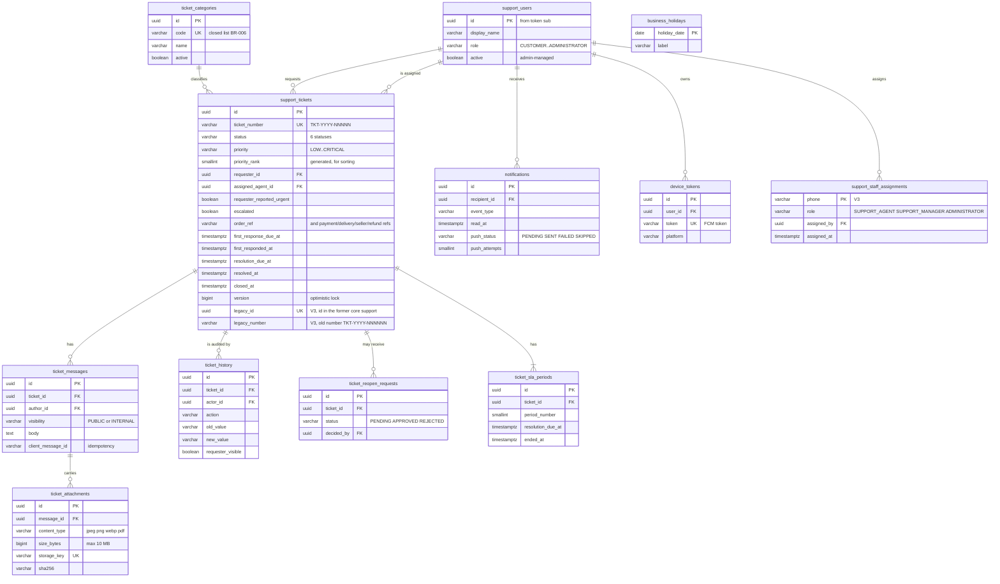

# Database Model

**Source of truth:** `backend/src/main/resources/db/migration/V1__support_schema.sql`,
`V2__notification_i18n.sql` and `V3__maplenou_integration.sql` (Flyway).

This is the support service's **own** database. The Maplenou core (Bakend) has a separate database, which also has a
table named `support_tickets` (its former support module, V46); the two are never shared (DEC-CS10-17).
The application validates the schema at start-up (`ddl-auto: validate`); it never alters it.

## Rules enforced by the database itself

| Rule | Mechanism |
| --- | --- |
| BR-001 / BR-002 unique, never-reused identifiers | UUID primary keys; `ticket_number` unique, generated from `ticket_number_seq` (no cycle) |
| BR-005 / BR-006 one category from the closed list | `category_id` NOT NULL FK; seeded categories |
| BR-007, FR-005 allowed priorities and statuses | `CHECK` constraints |
| Closed/resolved tickets carry timestamps | `chk_closed_has_timestamp`, `chk_resolved_has_timestamp` |
| BR-016 internal notes are structurally separate | `visibility` column (`PUBLIC`/`INTERNAL`) on every message |
| BR-040 / BR-041 allowed types, 10 MB max | `CHECK` on `content_type` and `size_bytes` (also validated by the application) |
| BR-018 history cannot be edited | trigger `trg_ticket_history_append_only` rejects `UPDATE` and `DELETE` |
| One pending reopening request per ticket | partial unique index `uq_one_pending_reopen_per_ticket` |
| AC-SB-006 no duplicate messages on retry | unique `(ticket_id, author_id, client_message_id)` |
| BR-055 SLA history preserved on reopening | one row per resolution period in `ticket_sla_periods` |
| A former core ticket is imported at most once (DEC-CS10-17) | partial unique index `uk_support_tickets_legacy_id` (`WHERE legacy_id IS NOT NULL`) |
| Only support roles can be given by phone number | `CHECK (role IN ('SUPPORT_AGENT', 'SUPPORT_MANAGER', 'ADMINISTRATOR'))` on `support_staff_assignments` |

Concurrent changes to the same ticket are serialized with a row lock (`SELECT … FOR UPDATE`) in every command,
plus an optimistic `version` column as a safety net.

## Indexes

Requester lists (`requester_id, created_at`), support queue (`status, priority_rank, created_at`), assignee workload
(`assigned_agent_id, status`), category and date filters, order/delivery reference lookups, conversation order
(`ticket_id, created_at`), notification inbox and the push queue (`push_next_attempt_at WHERE push_status = 'PENDING'`), old numbers of
imported tickets (`idx_support_tickets_legacy_number WHERE legacy_number IS NOT NULL`).

## Migration V3 — Maplenou integration (2026-10-29, DEC-CS10-17)

| Change | Purpose |
| --- | --- |
| `support_tickets.legacy_id UUID` + unique index `uk_support_tickets_legacy_id` (partial) | id of the ticket in Bakend's former support module; makes the import idempotent |
| `support_tickets.legacy_number VARCHAR(30)` + index `idx_support_tickets_legacy_number` (partial) | the old number users know (`TKT-YYYY-NNNNNN`, 6 digits), shown next to the new number and matched by the search `q` |
| table `support_staff_assignments (phone PK, role, assigned_by → support_users.id, assigned_at)` | support role given by an administrator to a Maplenou account, by phone number; read at each sign-in with a Maplenou account |

## Migration V4 — configurable vocabulary (2026-10-30, DEC-CS11-02, DEC-CS11-03)

| Table / column | Content |
| --- | --- |
| `ticket_statuses` | `code` (PK), `kind` (NEW, ASSIGNED, IN_PROGRESS, WAITING_REQUESTER, ON_HOLD, RESOLVED, CLOSED), `label_fr`, `label_en`, `sort_order`, `sla_paused`, `system`, `active`. One system status per kind (unique partial index); custom statuses only IN_PROGRESS or ON_HOLD (`chk_custom_status_kind`). Seed: the six statuses of CS-01 |
| `ticket_transitions` | `(from_status, to_status)` manual transitions an agent may make; seeded with the former `TicketLifecycle` table |
| `ticket_priorities` | `code` (PK), `rank` (unique, **higher = more urgent**), `label_fr`, `label_en`, `requester_selectable`, `is_default` (unique), `system`, `active`. Seed: LOW 1, MEDIUM 2 (default), HIGH 3, CRITICAL 4 (not requester-selectable, BR-036) |
| `sla_policies` | `priority_code` (PK, no FK: module boundary), `first_response_minutes`, `resolution_minutes` **or** `resolution_days` (exactly one). Seed: the former `SlaTargets` |
| `permission_rules` | `(role, action, scope)` with scope OWN, ASSIGNED, UNASSIGNED or ANY — 73 seed rows reproducing the CS-01 matrix plus the CS-11 actions |
| `support_tickets` | status and priority checks dropped; FKs to `ticket_statuses(code)` and `ticket_priorities(code)`; `priority_rank` becomes a plain `INTEGER` kept in step with the priority's rank; `category_code` (FK `ticket_categories(code)`) replaces `category_id`; `sla_paused_since`; the five reference columns move to `ticket_context_refs` |
| `ticket_context_refs` | `(ticket_id, ref_type, ref)` — ORDER, PAYMENT, DELIVERY, SELLER, REFUND… (data migrated from the former columns) |
| `ticket_categories.name_en` | English name of a category |
| `ticket_sla_periods.paused_minutes` | time the resolution clock was paused in the period |

## Migration V5 — outbox, feedback and AI (2026-10-30, DEC-CS11-01, 05, 07, 08, 09)

| Table / column | Content |
| --- | --- |
| `outbox_events` | `id`, `event_type`, `payload` (JSON), `created_at`, `published_at`, `attempts`, `next_attempt_at`, `last_error`, `failed`; partial index on due events |
| `support_users.language` | `fr` or `en` (default `fr`): language of the person's notifications |
| `notification_templates` | `(event_type, language)` → `title`, `body` with `{ticket}`, `{subject}`, `{status}`, `{decision}`; 24 seed rows (12 events × FR/EN) |
| `ticket_satisfaction` | one row per ticket: `rating` 1–5, `comment`, `rated_by`, `rated_at` |
| `canned_replies` | `title`, `body`, `language`, `category_code` (optional), `active`, `updated_by`, `updated_at`; 3 seed rows |
| `ticket_ai_suggestions` | one row per ticket: suggested `category_code`, `priority_code`, `confidence`, `reason`, `model`, `decision` (APPLIED/DISMISSED), `decided_by`, `decided_at` |
| `ticket_external_actions` | actions asked to Maplenou: `action_type` (REFUND_REQUEST, DELIVERY_RESCHEDULE, DRIVER_MESSAGE), `target_ref`, `succeeded`, `result_ref`, `error`, `requested_by`, `created_at` |

Upgrade: V4 and V5 run by themselves on an existing database (tested from the iteration-5 schema with its demo data:
tickets, references and history are kept).

## Migration V6 — legacy sync and category texts (2026-10-31, DEC-CS12-02)

| Table / column | Content |
| --- | --- |
| `legacy_ticket_sync` | one row per ticket imported from Bakend's former support module: `legacy_id` (PK), `ticket_id` (FK, cascade), `legacy_status` last seen (NULL for tickets imported before V6), `synced_at`; filled from existing imports. Lets the import, run by hand or every `LEGACY_SYNC_INTERVAL`, note a status change made in the old module once (history `LEGACY_UPDATED`, staff only) |
| `ticket_categories.description_en` | English description of a category (the seven seed categories are filled; administrators edit it on « Catégories ») |

