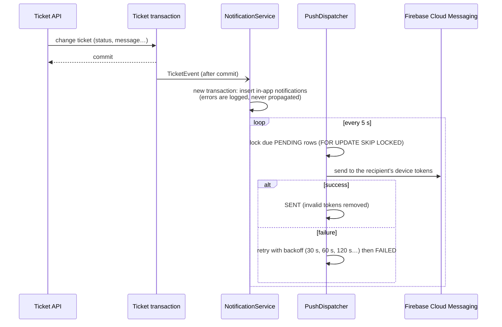

# Notifications (CS-08)

**Rules:** FR-013, BR-020 — "notification delivery is an asynchronous side effect and must not invalidate a
successful core ticket mutation".

## Flow

## Events

| Event | Recipient | Text (FR) |
| --- | --- | --- |
| Ticket created | requester (confirmation) and active managers ("Nouveau ticket") | « Votre ticket TKT-… a été créé… » |
| Ticket assigned | assigned agent | « TKT-… vous a été attribué » |
| Agent reply | requester | « Votre ticket TKT-… a reçu une nouvelle réponse. » |
| Requester reply | assigned agent (or managers) | « TKT-… : le demandeur a répondu. » |
| Information requested (`WAITING_FOR_CUSTOMER`) | requester | « Le support a besoin d'informations supplémentaires… » |
| Status changed / resolved / closed | requester | « … a été résolu. » / « … est fermé. » |
| Reopening requested / decided | support / requester | |
| Escalated | active managers | |

Users are not notified about their own actions (except the creation confirmation).

## Configuration

| Setting | Default | Purpose |
| --- | --- | --- |
| `FIREBASE_CREDENTIALS_FILE` | empty | Path to a Firebase service-account JSON. Empty = push is logged only (in-app notifications still work). |
| `maplenou.notifications.dispatch-interval` | `5s` | Push queue polling |
| `maplenou.notifications.max-attempts` | `5` | Attempts before `FAILED` |

Apps register their FCM token with `POST /api/v1/support/notifications/devices {token, platform}` after login.

## Verification

`NotificationIT` (in-app events, push sent / skipped / failing provider leaves the ticket intact, retries counted),
`NotificationServiceTest` (a database failure while creating notifications is contained), and the browser scenario
(the requester sees "Informations demandées" and "Ticket fermé" in the notifications screen).

## Languages

The backend writes the notification `title` and `body` in French (the reference language of the requirements).
Since migration `V2__notification_i18n.sql`, each notification also stores language-neutral facts:

| Field | Content |
| --- | --- |
| `type` | the trigger (`NotificationEvent`) |
| `ticketNumber` | e.g. `TKT-2026-00042` |
| `detail` | the new status for `STATUS_CHANGED`, `APPROVED`/`REJECTED` for `REOPEN_DECIDED`, otherwise empty |

The web app shows the French text as written and, in English, renders a template per `type` with these facts
(`frontend/src/lib/i18n/messages/notifications.ts`). Notifications created before V2 have no `ticketNumber` and are
shown in French. Push messages (Firebase) are still sent in French; per-user language for push and e-mail is in the
[upgrade plan](../governance/UPGRADE-PLAN.md) ("Message templates per language").
