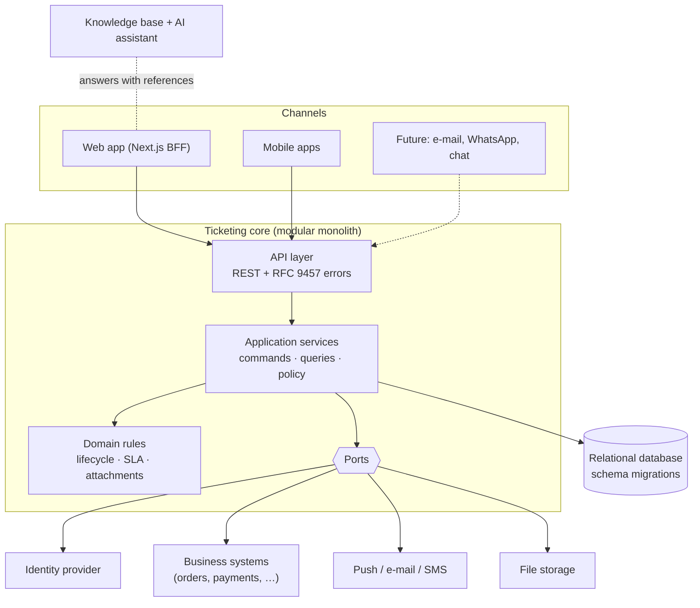
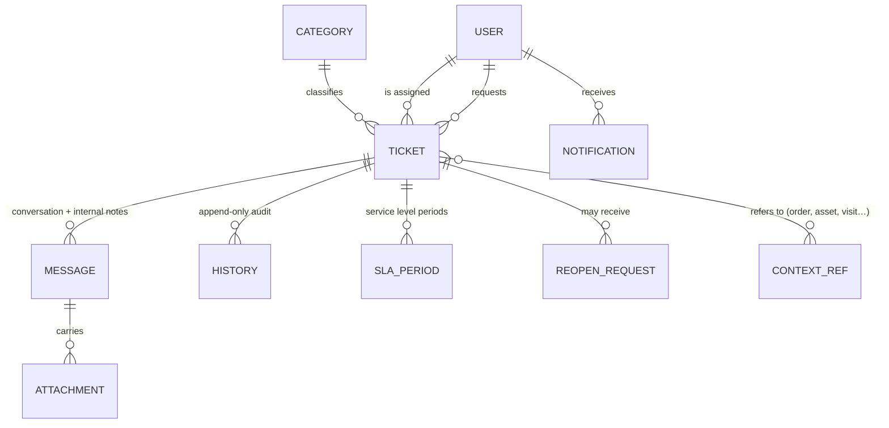
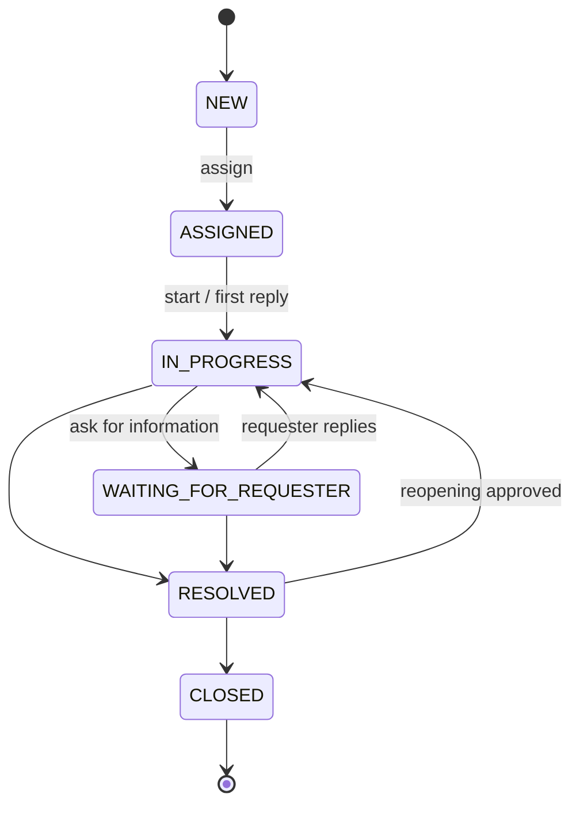

# Reference Architecture for Ticketing Systems

**Purpose.** This document answers three questions:

1. Which delivery plan and which software architecture does the Maplenou Customer Service follow?
2. Does the current implementation actually follow them?
3. How can the same architecture be reused for any other system that needs ticketing (IT help desk, school,
   hospital, municipality, logistics, SaaS support…)?

It is written to be read without knowing Maplenou. Section 3 is the reusable plan; section 4 shows how to adapt it.

---

## 1. What this project follows

### 1.1 Delivery plan — phase-gated, incremental

| Aspect | What the project uses | Where it is recorded |
| --- | --- | --- |
| Life cycle | **Stage-gate with incremental delivery**: each work package (CS-01 … CS-09) has a dependency, a deliverable, a validation report and an explicit owner approval before it is `DONE` | `docs/project/DEVELOPMENT-MATRIX.md`, `docs/validation/` |
| Requirements | ISO/IEC/IEEE 29148 style: functional requirements → business rules → decisions → acceptance criteria → traceability | `docs/requirements/` |
| Order of work | Requirements → UX → data/API foundation → frontend → domain backend → integration → ecosystem → notifications/tests → security/final validation | `docs/project/PROJECT-PLAN.md` |
| Change control | Approved items are not changed silently; new ideas go to the upgrade plan first | `CONTRIBUTING.md`, `docs/governance/UPGRADE-PLAN.md` |
| Continuity | A checkpoint file states the current phase and the next step, so anyone (or any AI agent) can continue | `docs/project/PROJECT-CONTINUITY.md`, `AGENTS.md` |

This is a sound plan for a small team: decisions are written down before code, and every phase can be audited.

### 1.2 Software architecture — modular monolith with ports and adapters

| Style | Meaning here |
| --- | --- |
| **Modular monolith** | One deployable backend, split into modules by business capability (`ticket`, `sla`, `notification`, `context`, `attachment`, `identity`, `report`), plus the `shared` kernel and the technical `platform`. Simple to run and to test; modules can be extracted later if one needs to scale on its own. |
| **Hexagonal inside each module** | `domain` (framework-free rules and aggregates) ← `application` (use cases such as `TicketCommandService`, `TicketQueryService`, and the `port` interfaces they need) ← `adapter.in.*` (web controllers, event listeners, schedulers, security filters) and `adapter.out.*` (JPA persistence, Maplenou HTTP clients, storage, antivirus, push, assistant). One `<Module>Config` wires the adapters. |
| **Ports and adapters (strict)** | Everything outside the use cases goes through a port with replaceable adapters, including the database: `TicketStore`/`TicketSearch` (JPA), `EcosystemGateway` and `EcosystemActions` (demo / Bakend HTTP), `PushSender` (log / Firebase), `MobilePushRelay` (Bakend), `BinaryStorage` (local / Cloudinary), `MalwareScanner` (none / ClamAV), `AiAssistant` (none / assistant HTTP), `AccessTokenIssuer` (JWT). `ArchitectureTest` (ArchUnit) fails the build if a layer or module boundary is crossed. |
| **Policy object for authorization** | `TicketAccessPolicy` decides every action from the configurable permission matrix (role × action × relationship) + state guards; the UI only displays the `allowedActions` it returns. |
| **Domain events through a transactional outbox** | Ticket changes write their events to `outbox_events` in the same transaction; they are delivered after commit (and retried by a poller), so a notification failure can never undo a ticket change and a crash can no longer lose it. |
| **Backend-for-frontend (BFF)** | The Next.js server proxies the API and keeps the access token in an httpOnly cookie. |
| **Database as a safety net** | Constraints, a sequence for ticket numbers, and an append-only trigger on history enforce the most important rules even if application code is wrong. |

### 1.3 Does the implementation follow it? — conformance review

| Principle | Status | Evidence / gap |
| --- | --- | --- |
| Business rules isolated from frameworks | **Yes (CS-11)** | Every `*.domain` package is plain Java: the `Ticket` aggregate is restored from a snapshot by its JPA adapter (`TicketEntity`), so it carries no annotation. `ArchitectureTest` forbids Spring, JPA, Jackson and adapters in the domain. |
| External systems behind ports | **Yes** | See the "strict ports" row above; each port has a demo/local adapter and a production adapter. |
| One place for authorization | **Yes** | `TicketAccessPolicy` (matrix as data + state guards) + endpoint role guards; unit tests and ~30 integration tests. |
| Every change in one transaction, side effects after commit | **Yes (CS-11)** | Transactional outbox (`OutboxEventPublisher`, `OutboxRelay`, metrics `support.outbox.pending/failed`). |
| Module boundaries enforced | **Yes (CS-11)** | `ArchitectureTest`: domain pure, application without technology, inbound adapters never use outbound ones, a module's adapters are private, no cycles between modules, entities only in persistence adapters. |
| Configuration instead of code for business vocabularies | **Yes (CS-11)** | Statuses (with a kind), transitions, priorities, SLA policies, permission matrix, categories, notification texts and generic context references are data, edited from the back-office (§4.3). The lifecycle *kinds* stay in code: they are what makes the rules checkable. |
| Internationalization | **Yes** | Frontend and documentation in French and English; notifications use templates per language and each person's language. API error `detail` is French with stable `code`s that clients translate. |
| Observability | **Yes (CS-11)** | Request id on every response and log line, JSON logs (`LOG_FORMAT=ecs`), Prometheus metrics (`METRICS_TOKEN`), alert rules and Grafana in the `monitoring` profile. Tracing: upgrade candidate. |

**Verdict:** the implementation follows the plan and the architecture. The four gaps (outbox, enforced module
boundaries, configurable vocabularies, observability) are listed in `docs/governance/UPGRADE-PLAN.md`.

---

## 2. Architecture principles (reusable)

1. **The ticket is the single source of truth.** Every interaction (message, note, status change, attachment,
   reassignment) is attached to a ticket and audited in an append-only history.
2. **Rules live on the server.** Clients show what the server says is allowed (`allowedActions`); the server
   re-checks every action. Deny by default.
3. **Configuration over code for vocabulary**: categories, priorities, statuses, SLA targets, roles.
4. **Ports for everything you don't own**: identity, business context, notifications, storage, AI.
5. **Side effects never break the core**: notifications, integrations and AI run after commit and degrade gracefully.
6. **Requester sees less than support**: separate views for external requesters and staff (no internal notes,
   no SLA internals, no third-party data).
7. **Measurable service levels**: business calendar + per-priority targets + breach detection.
8. **Accessible and multilingual from day one**: WCAG 2.2 baseline, text never hard-coded in components.
9. **Documentation is part of the product**: one guide per audience, searchable, with an assistant that cites its sources.
10. **Reproducible**: one command to run, one command to test, written agent guides (`AGENTS.md`).

---

## 3. Reference architecture — "Ticketing Core"

### 3.1 Capabilities (bounded contexts)

| Capability | Responsibility | Generic? | Maplenou module |
| --- | --- | --- | --- |
| **Ticket management** | create, number, classify, lifecycle, conversation, internal notes, history | Generic | `ticket` |
| **Attachments** | validation by content, size/count limits, private storage, authorized download | Generic | `attachment` |
| **Routing & assignment** | queue, self-assignment, reassignment, escalation, workload | Generic | `ticket`, `admin` |
| **Service levels** | business calendar, targets per priority, breach detection, periods on reopening | Generic | `sla` |
| **Access control** | identity from tokens, roles, resource-level policy | Generic (roles configurable) | `security`, `ticket.TicketAccessPolicy` |
| **Notifications** | in-app inbox, push/e-mail/SMS adapters, retries | Generic | `notification` |
| **Business context** | read-only views of the domain objects tickets refer to | **Domain-specific** (adapter) | `context` (orders, payments, deliveries) |
| **Reporting** | dashboards, basic indicators | Generic | `report` |
| **Knowledge & assistance** | audience-specific documentation, search, AI assistant with references | Generic | `documentation/`, `assistant/` |

Only **business context** is specific to Maplenou. Everything else is reusable as is.

### 3.2 Ports (contracts to implement for a new system)

| Port | Contract | Maplenou adapters | Examples elsewhere |
| --- | --- | --- | --- |
| `IdentityProvider` (JWT) | `sub` = stable user id, `roles` claim, `name`, `email` | demo HS256 · OIDC issuer | Keycloak, Entra ID, Auth0, school SSO |
| `ContextGateway` | `find(ref)` for each referenced object; `ownedBy(user)` for the create form | demo data · HTTP to core services | CMDB assets, student records, patient visits, parcels |
| `PushSender` / notifier | send to a user's devices; report invalid tokens | log · Firebase | e-mail (SMTP), SMS, WhatsApp, Teams |
| `BinaryStorage` + `MalwareScanner` | `store/load/delete(key)`, `scan(bytes)` | local disk · Cloudinary (authenticated) · ClamAV | S3, Azure Blob, MinIO; any antivirus |
| `EcosystemActions` | ask the core system to act (return, re-delivery, message) and report the outcome | demo · Bakend `/internal/v1` | ITSM change request, school office workflow |
| `KnowledgeAssistant` / `AiAssistant` | `ask(question, audience, lang)` → answer + references; `triage`, `draftReply` for agents | Ollama cloud or local | any LLM provider, or search-only |

### 3.3 Generic data model

`CONTEXT_REF` is the only generalization of the Maplenou schema: Maplenou stores five typed reference columns
(`order_ref`, `payment_ref`, …); a reusable core would store `(type, ref)` pairs in a child table.

### 3.4 Ticket lifecycle (configurable state machine)

Keep the **transition table as data** (from, to, required permission, automatic trigger). Most organizations
use these six states; some add `ON_HOLD` (waiting for a third party) or `CANCELLED`.

### 3.5 Deployment views

| Size | Topology |
| --- | --- |
| Demo / pilot | Docker Compose on one machine: database, backend, frontend, documentation, assistant (Ollama cloud); optional profiles `antivirus`, `monitoring`, `public` (Caddy with HTTPS on three domains) |
| Small production | Managed PostgreSQL + 2 backend instances behind a load balancer + object storage + CDN for docs; assistant on a GPU-capable host or a hosted model |
| Large | Same modules; extract notifications and the assistant first (different scaling profile), then reporting (read replica / warehouse) |

The push dispatcher already uses `FOR UPDATE SKIP LOCKED`, so several backend instances can run safely.

### 3.6 Quality attributes and how they are achieved

| Attribute | Mechanism |
| --- | --- |
| Security | deny-by-default, resource policy, append-only audit, content-checked uploads, BFF cookies, no internal data in requester views |
| Reliability | one transaction per command, row locks per ticket, idempotent messages, after-commit side effects, retries |
| Usability | role-specific UIs, mobile-first requester app, FR/EN, light/dark themes, WCAG 2.2 baseline |
| Maintainability | modules + ports, RFC 9457 error codes, OpenAPI contract, 140+ automated tests, agent guides |
| Supportability | three audience-specific documentation sites with search and an assistant that cites sources |

---

## 4. Adapting the architecture to another system

### 4.1 Step-by-step

1. **Requirements first** — reuse the CS-01 templates: actors, categories, priorities, statuses, SLA targets,
   attachment limits, reopening policy, permission matrix. Change values, keep the structure.
2. **Map your actors to roles** — requester roles (who opens tickets) and staff roles (agent, supervisor, admin).
3. **Define the business context** — which objects tickets refer to, who may link them, what staff must see.
   Implement one `ContextGateway` adapter.
4. **Pick adapters** — identity provider, notification channels, storage, assistant model.
5. **Configure vocabularies** — categories, priorities, SLA calendar (time zone, working hours, holidays).
6. **Write the three guides** — copy the documentation skeleton (user / staff / developer), replace content.
7. **Validate with the same gates** — acceptance criteria → automated tests → validation report → approval.

### 4.2 What changes for typical domains

| Domain | Requesters | Context objects | Typical categories | Notes |
| --- | --- | --- | --- | --- |
| E-commerce (Maplenou) | customers, sellers, drivers | order, payment, delivery, seller, refund | order, payment, delivery, account | done |
| IT help desk | employees | device/asset, software licence, user account | incident, access request, hardware | add `ON_HOLD`; e-mail channel |
| University | students, staff | enrolment, course, invoice | registration, fees, exams, IT | academic calendar for SLA |
| Hospital front desk | patients, families | appointment, invoice | appointment, billing, records | stricter privacy: no AI on patient data without approval |
| Municipality | citizens | address, permit, tax account | roads, waste, permits | public status page; map location as context |
| B2B SaaS support | customer admins | workspace, subscription | bug, billing, feature request | link to issue tracker |

### 4.3 What to change in this code base to make it fully generic

Done in CS-11 (DEC-CS11-02, migrations V4 and V5) — kept here as the map of what a new system configures:

| Before CS-11 | Now (configurable) | Where it is edited |
| --- | --- | --- |
| `TicketPriority`, `TicketStatus` enums, `TicketLifecycle` table in code | tables `ticket_priorities`, `ticket_statuses` (with a kind), `ticket_transitions` | « Statuts et priorités » (`/support/admin/flux`), `PUT /admin/workflow`, `PUT /admin/priorities` |
| `SlaTargets` switch | `sla_policies (priority_code, first_response_minutes, resolution_minutes \| resolution_days)` | « Calendrier SLA », `PUT /admin/sla-policies/{priority}` |
| `Role` enum + `TicketAccessPolicy` switches | `permission_rules (role, action, scope)` checked by `PermissionMatrix.problems()` | « Droits », `PUT /admin/permissions` |
| five reference columns on tickets | `ticket_context_refs (ticket_id, ref_type, ref)` + `ContextRefs` | set by the context module from what the requester links |
| French notification texts in code | `notification_templates (event_type, language, title, body)` + `support_users.language` | « Réponses et messages », `PUT /admin/notification-templates/{type}/{lang}` |

To reuse the core for another domain: keep the kinds, rename the statuses and priorities, add the "on hold" statuses
the domain needs, adjust the matrix, then write one `EcosystemGateway`/`EcosystemActions` adapter for the domain's
objects (§3.2). Roles remain an enum (six roles) because identity providers map onto them.

---

## 5. Decision checklist for a new ticketing project

- [ ] Actors, roles and who may see what (authorization matrix) are written and approved.
- [ ] Lifecycle states and transitions, including reopening and closure rules.
- [ ] SLA: targets per priority, business calendar, time zone, what pauses the clock.
- [ ] Attachments: types, sizes, retention, malware scanning.
- [ ] Context objects and their ownership rules.
- [ ] Identity provider and token claims.
- [ ] Notification channels and texts per language.
- [ ] Languages, accessibility level, themes.
- [ ] Documentation audiences and where each is published (public / internal).
- [ ] AI assistant: model, hosting (local vs cloud), which documents it may read, and that answers cite sources.
- [ ] Hosting topology, backups, observability, incident procedure.

## References

- ISO/IEC/IEEE 29148:2018 — requirements engineering.
- Alistair Cockburn, *Hexagonal Architecture (Ports and Adapters)*, 2005.
- Simon Brown, *The C4 model for visualising software architecture*.
- Chris Richardson, *Transactional outbox pattern* (microservices.io).
- OWASP Authorization Cheat Sheet; OWASP File Upload Cheat Sheet.
- RFC 9457 — Problem Details for HTTP APIs.
- W3C WCAG 2.2.
