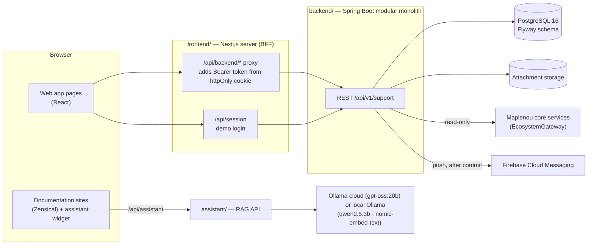

# Architecture

This page summarizes how the system is built. The authoritative records are the
[reference architecture](../architecture/reference-architecture.md), the [architecture overview](../architecture/README.md)
and the [architecture decisions](../architecture/decisions.md).

## System context

The Flutter mobile apps (outside this repository) call the same API with a bearer token.

## Modular monolith

The backend is one deployable application split into modules by business capability: `ticket`, `sla`,
`attachment`, `notification`, `context`, `security`, `user`, `report`, `admin`, plus `demo` and `common`. Modules
are Java packages under `com.maplenou.support`; their boundaries are a convention, not yet enforced by a tool
(Spring Modulith or ArchUnit are listed as upgrade candidates in the reference architecture).

Inside a module the layers are:

| Layer | Example |
| --- | --- |
| Web | `ticket.web.TicketController`, request/response records `TicketRequests`, `TicketViews` |
| Application services | `TicketCommandService` (commands), `TicketQueryService` (reads) |
| Policy | `TicketAccessPolicy` — every authorization decision for a ticket |
| Domain rules | `ticket.domain.Workflow`, `TicketNumbers`, `sla.BusinessCalendar` (framework-free) |
| Persistence | Spring Data JPA repositories over the Flyway schema |

## Ports and adapters

Everything the module does not own is behind an interface with replaceable adapters:

| Port | Adapters in the repository | Selected by |
| --- | --- | --- |
| `context.EcosystemGateway` | `DemoEcosystemGateway`, `HttpEcosystemGateway` | `ECOSYSTEM_MODE` = `demo` / `http` |
| `notification.PushSender` | `LoggingPushSender`, `FirebasePushSender` | `FIREBASE_CREDENTIALS_FILE` empty / set |
| `attachment.BinaryStorage` | `LocalFileStorage` | `ATTACHMENTS_DIR` |
| JWT decoding | HS256 `JwtConfig` (demo, tests), or an issuer URI | `JWT_SECRET` set / `issuer-uri` configured |

## Backend-for-frontend

The browser never sees the access token. The Next.js server stores it in the httpOnly cookie `maplenou_session`
and forwards calls from `/api/backend/api/v1/support/**` to the API with an `Authorization: Bearer` header. Only
`api/v1/support` paths are forwarded, and state-changing requests must come from the same origin. Details are in
[Frontend](frontend.md).

## Rules on the server, side effects after commit

- The server decides; the UI shows what the API allows. Every ticket response carries `allowedActions`, computed by
  `TicketAccessPolicy`, and every command re-checks it. Anything not listed is denied.
- Each ticket command runs in one transaction with a row lock on the ticket (`findForUpdate`).
- Ticket changes publish a `TicketEvent`. `NotificationService` handles it **after the commit**, in its own
  transaction, and swallows its own failures: a notification problem can never undo a ticket change. Push delivery
  is a separate scheduled dispatcher with retries.
- The database is a safety net: constraints, a sequence for ticket numbers and an append-only trigger on
  `ticket_history`.

!!! note "Known limit"
    If the process stops between the commit and the event listener, that notification is lost. The reference
    architecture recommends a transactional outbox before production.

## Documentation and assistant

Three audiences (user, staff, developer) × two languages (French, English) are built as six Zensical sites. A
separate assistant service answers questions from a site's search index and cites the sections it used. See
[Documentation sites](documentation.md) and [Documentation assistant](assistant.md).

## Architecture records

| Record | Content |
| --- | --- |
| [Reference architecture](../architecture/reference-architecture.md) | plan, styles, conformance review, how to reuse the ticketing core |
| [Architecture overview](../architecture/README.md) | system diagram and backend package table |
| [Decisions](../architecture/decisions.md) | DEC-CS03-xx technical choices and interpretations |
| [Database model](../architecture/database-model.md) | tables, database-enforced rules, indexes |
| [API specification](../architecture/api-specification.md) | endpoints, errors, search and filters |
| [Ecosystem integration](../architecture/ecosystem-integration.md) | `EcosystemGateway` and the proposed HTTP contract |
| [Notifications](../architecture/notifications.md) | events, push, languages |
| [Security review](../architecture/security.md) | controls and the "before production" list |
| [Ticket state](../diagrams/uml/ticket-state.md), [sequence](../diagrams/uml/ticket-sequence.md), [domain](../diagrams/uml/ticket-domain-class.md) | UML diagrams |
