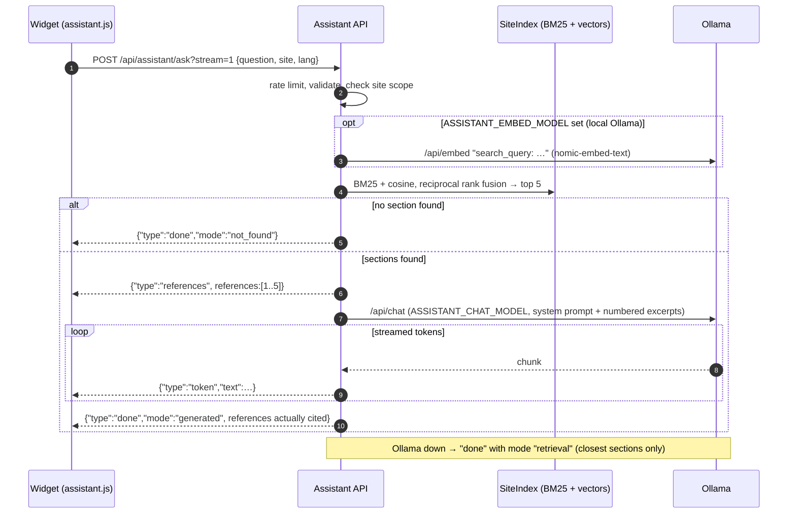

# Documentation assistant

The assistant (`assistant/`) answers questions about one documentation site in one language, using only that
site's content, and cites the exact sections it used. Its language model is served by [Ollama](https://ollama.com):
by default **Ollama cloud** (`OLLAMA_URL=https://ollama.com` with an API key, owner decision DEC-CS10-18 of
2026-10-29 — nothing to install, no model on the disk), or an Ollama on the computer or in a container (see
[Ollama: cloud, on the computer or in Docker](#ollama-cloud-on-the-computer-or-in-docker)). With Ollama cloud the
question and the selected documentation excerpts are sent to ollama.com; with a local Ollama nothing leaves the
machine that hosts it.

## How it works

1. **Index.** At start-up the service reads `<site>/<lang>/search.json` for every allowed site and both languages.
   In Docker it fetches them over HTTP from the documentation server (`ASSISTANT_INDEX_URL=http://docs` →
   `http://docs/<site>/<lang>/search.json`), so the sites are built only once, in the docs image; without Docker it
   reads them from a folder (`ASSISTANT_INDEX_ROOT`). These are the search indexes Zensical writes when it builds a
   site: each item is a page section with its `location` (page path + anchor), title, breadcrumb (`path`) and HTML
   text. Using them means a reference points to exactly the section the reader sees.
2. **Lexical ranking.** Each section is tokenized (accent-insensitive, French and English stop words, light plural
   stemming) and ranked with **BM25**; titles and breadcrumbs count twice.
3. **Semantic ranking (optional).** Only when `ASSISTANT_EMBED_MODEL` is set (local Ollama: **`nomic-embed-text`**):
   in the background, the service embeds every section (`search_document:` prefix, cached in `ASSISTANT_CACHE_DIR`
   per site, language and content hash). A question is embedded with the `search_query:` prefix and compared by
   cosine similarity; sections below 0.55 are ignored. With `ASSISTANT_EMBED_MODEL` empty — the default with Ollama
   cloud, which serves chat models — nothing is embedded and retrieval is BM25 only.
4. **Fusion.** Both rankings are merged by **reciprocal rank fusion** (score `1 / (60 + rank)`), and the best
   `ASSISTANT_TOP_K` sections (5) are kept. Until the embeddings are ready, retrieval is lexical only.
5. **Generation.** The sections are numbered `[1]…[n]` and sent with a language-specific system prompt to Ollama
   `/api/chat` with the chat model `ASSISTANT_CHAT_MODEL` — **`gpt-oss:20b`** on Ollama cloud (reasoning effort
   `think: "low"` from `ASSISTANT_THINK`), **`qwen2.5:3b`** with a local Ollama — temperature 0.1, context 4,096
   tokens. With `OLLAMA_API_KEY` set, every request carries `Authorization: Bearer <key>`.
6. **Citations.** The answer cites passages as `[n]`. The service keeps only the references actually cited; if the
   model cited none, it returns the three best sections marked `cited: false` (the widget shows them as "See also").
   Each reference carries `title`, `breadcrumb`, an excerpt and the absolute `url` of the section
   (`ASSISTANT_PUBLIC_BASE_URL` + `/<site>/<lang>/<location>`).
7. **Fallbacks.** No matching section → `mode: "not_found"` with a fixed message. Ollama unreachable or the chat
   model missing → `mode: "retrieval"`: the closest sections, listed as references, without generated text.
8. **Answer cache.** A generated answer is kept in memory and returned directly for the same question (same site
   and language; case and extra spaces ignored) — see [Answer cache](#answer-cache).



## Code map

| File | Responsibility |
| --- | --- |
| `app/main.py` | Starlette app factory `create_app`, routes, rate limiter, request validation, CORS, background start-up tasks (indexes over HTTP, model pull, embeddings) |
| `app/service.py` | `Assistant`: loading indexes (`load` from a folder, `load_from_url`), `embed_all`, `retrieve`, `ask`, `ask_stream`, references, fallbacks, answer cache |
| `app/index.py` | `Section`, `load_sections` (search.json file), `parse_sections` (search.json content), `Bm25`, `cosine`, `SiteIndex.search` (rank fusion) |
| `app/text.py` | HTML to text, accent folding, tokens, stop words |
| `app/ollama.py` | `Ollama` client: `/api/tags`, `/api/pull`, `/api/embed`, `/api/chat` (plain and streamed); `Authorization: Bearer` header when an API key is set (Ollama cloud), `think` option |
| `app/cache.py` | `TtlLru`: bounded least-recently-used cache with a time-to-live and hit/miss counters |
| `app/prompts.py` | system prompts, context message, `not_found` and retrieval-only texts in FR and EN |
| `app/config.py` | `Settings` from environment variables |
| `documentation/shared/assistant/assistant.js` | the widget on every site; reads `window.MAPLENOU_DOCS` from `config.js` |

Run it with `uvicorn --factory app.main:create_app`. A background task then runs, in this order:

1. **Indexes.** With `ASSISTANT_INDEX_URL`, the service fetches every `search.json` from the documentation server,
   retrying (every 10 s, then every 60 s) until all of them are read — the docs server may start after the
   assistant. Without it, the indexes are read from `ASSISTANT_INDEX_ROOT` at start-up. Until an index is loaded,
   `POST /api/assistant/ask` answers `503 INDEX_LOADING`.
2. **Models.** With `ASSISTANT_PULL_MODELS=true` and a local Ollama, it waits up to 5 minutes for Ollama, then
   downloads the embedding model and the chat model through `/api/pull` when they are not installed yet (first start
   only). A failed pull is logged and the service keeps running. With Ollama cloud (`OLLAMA_API_KEY` set) it never
   pulls: the models are already on ollama.com (`.env.example` sets `ASSISTANT_PULL_MODELS=false`).
3. **Embeddings.** Skipped when `ASSISTANT_EMBED_MODEL` is empty (lexical retrieval). Otherwise it computes the
   section vectors, retrying every 20 s (30 attempts) while Ollama is not ready; lexical answers work meanwhile.

## API

### GET /api/assistant/health

```json
{ "status": "ok", "ollama": true, "ollamaCloud": true, "chatModel": "gpt-oss:20b", "embeddings": false, "indexReady": true,
  "answerCache": { "entries": 12, "hits": 30, "misses": 14 },
  "sites": { "user/fr": 42, "user/en": 41, "staff/fr": 30, "staff/en": 30, "developer/fr": 120, "developer/en": 400 } }
```

`ollama` is `false` when Ollama is unreachable (with Ollama cloud: also when the API key is refused),
`ollamaCloud` is `true` when an `OLLAMA_API_KEY` is configured, `chatModel` is `null` when the chat model is not
installed (or not offered by Ollama cloud), `embeddings` tells whether semantic ranking is active (always `false`
without an embedding model), `indexReady` whether at least one index is loaded (questions
are accepted), `answerCache` gives the cached answers and the cache hits and misses since start-up, and `sites` gives
the number of indexed sections (the numbers above are only an example). The endpoint always answers `200` once the
service is up; the Docker health check uses it.

### POST /api/assistant/ask

```bash
curl -s http://localhost:8006/api/assistant/ask \
  -H 'Content-Type: application/json' \
  -d '{"question": "How do I add an attachment?", "site": "user", "lang": "en"}'
```

```json
{ "answer": "Attach JPG, PNG, WEBP or PDF files up to 10 MB [1].",
  "references": [ { "n": 1, "title": "Add an attachment", "breadcrumb": "Create a ticket › Add an attachment",
                    "url": "http://localhost:8006/user/en/create-ticket/#add-an-attachment",
                    "excerpt": "…", "cited": true } ],
  "mode": "generated", "model": "gpt-oss:20b", "timings": { "retrieval": 0.04, "generation": 3.2 } }
```

`mode` is `generated`, `retrieval` or `not_found`. With `?stream=1` (or `?stream=true`) the response is NDJSON
(`application/x-ndjson`), one JSON object per line: first `{"type": "references"}`, then `{"type": "token"}` pieces,
and finally `{"type": "done", …}` with the same fields as the plain answer. An answer served from the answer
cache comes as a single `done` event with `"cached": true`. The widget uses the streaming form.

Errors are problem details (`application/problem+json`):

| Status | `code` | When |
| --- | --- | --- |
| 400 | `MALFORMED_REQUEST` | body is not a JSON object |
| 400 | `QUESTION_REQUIRED` | empty question |
| 400 | `QUESTION_TOO_LONG` | more than 500 characters |
| 400 | `UNKNOWN_LANGUAGE` | `lang` other than `fr` or `en` |
| 404 | `UNKNOWN_SITE` | `site` not in `ASSISTANT_SITES` (same answer whether the site exists or not) |
| 429 | `RATE_LIMITED` | more than `ASSISTANT_RATE_LIMIT` questions per minute from one client address |
| 503 | `INDEX_LOADING` | the documentation indexes are not loaded yet (start-up); try again in a moment |

## Configuration

All settings come from environment variables (`assistant/app/config.py`):

| Variable | Default | Meaning |
| --- | --- | --- |
| `ASSISTANT_INDEX_URL` | empty | base URL of the documentation server; when set, indexes are read from `<url>/<site>/<lang>/search.json` (`http://docs` in Compose) |
| `ASSISTANT_INDEX_ROOT` | `/srv/site` | folder containing `<site>/<lang>/search.json`, used when `ASSISTANT_INDEX_URL` is empty (native runs) |
| `ASSISTANT_PULL_MODELS` | `true` (`.env.example`: `false`) | download missing models into a local Ollama at start-up; ignored with Ollama cloud |
| `ASSISTANT_SITES` | `user,staff,developer` | sites this instance may answer about; an unknown name stops the service at start-up |
| `OLLAMA_URL` | `http://localhost:11434` | Ollama base URL; in Compose it comes from `.env`: `https://ollama.com` (Ollama cloud, `.env.example`), `http://host.docker.internal:11434` (Ollama on the computer) or `http://ollama:11434` (container) |
| `OLLAMA_API_KEY` | empty | **secret** — Ollama cloud API key, created at <https://ollama.com/settings/keys>; sent as `Authorization: Bearer <key>` by the assistant only (server side, never to the browser); empty for a local Ollama |
| `ASSISTANT_CHAT_MODEL` | `qwen2.5:3b` (`.env.example`: `gpt-oss:20b`) | chat model; on Ollama cloud, a model of your plan (list: <https://ollama.com/api/tags>) |
| `ASSISTANT_EMBED_MODEL` | `nomic-embed-text` (`.env.example`: empty) | embedding model; empty = no embeddings, keyword (BM25) search only — the usual choice with Ollama cloud, which serves chat models |
| `ASSISTANT_THINK` | empty (`.env.example`: `low`) | reasoning effort of "thinking" models such as `gpt-oss` (`low`, `medium`, `high`, or `true`/`false`); empty = not sent (models without thinking, e.g. `qwen2.5:3b`); any other value stops the service at start-up |
| `ASSISTANT_PUBLIC_BASE_URL` | empty | base of the reference URLs, e.g. `http://localhost:8006` |
| `ASSISTANT_ALLOWED_ORIGINS` | `http://localhost:8006` | CORS origins (only needed when the widget is served from another origin) |
| `ASSISTANT_CACHE_DIR` | `/tmp/assistant-cache` (`/var/cache/assistant` in the image, volume `assistant-cache`) | embedding cache |
| `ASSISTANT_ANSWER_CACHE_SIZE` | `256` | answers kept in memory; `0` disables the answer cache |
| `ASSISTANT_ANSWER_CACHE_TTL` | `3600` | lifetime of a cached answer, in seconds |
| `ASSISTANT_TOP_K` | `5` | sections sent to the model |
| `ASSISTANT_RATE_LIMIT` | `20` | questions per minute per client address |
| `ASSISTANT_CHAT_TIMEOUT` | `120` | seconds allowed for a generation |

The maximum question length (500 characters) is fixed in `Settings`. The rate limiter uses `X-Real-IP` when the
proxy sets it, otherwise the client address; it keeps its counters in memory, per container.

## Ollama: cloud, on the computer or in Docker

The assistant only needs an Ollama server it can reach. `OLLAMA_URL` in `.env` chooses which one; three modes are
supported (DEC-CS10-18, 2026-10-29: Ollama cloud is the default, because the owner removed Ollama from his
computer):

| Mode | `.env` | Start command | When |
| --- | --- | --- | --- |
| **Ollama cloud** (default) | `OLLAMA_URL=https://ollama.com`, `OLLAMA_API_KEY=<key>`, `ASSISTANT_CHAT_MODEL=gpt-oss:20b`, `ASSISTANT_EMBED_MODEL=` (empty), `ASSISTANT_THINK=low`, `ASSISTANT_PULL_MODELS=false` | `docker compose --profile docs up -d --build --wait` | nothing to install and no model on the disk; needs an Internet connection and an ollama.com account |
| **Ollama installed on the computer** | `OLLAMA_URL=http://host.docker.internal:11434`, `OLLAMA_API_KEY=` (empty), `ASSISTANT_CHAT_MODEL=qwen2.5:3b`, `ASSISTANT_EMBED_MODEL=nomic-embed-text`, `ASSISTANT_THINK=` (empty), `ASSISTANT_PULL_MODELS=true` | `docker compose --profile docs up -d --build --wait` | Ollama for Windows/macOS is installed: no Ollama image, models already downloaded are reused, nothing leaves the computer |
| **Ollama container** | `OLLAMA_URL=http://ollama:11434`, otherwise the same values as the computer mode | `docker compose --profile docs --profile ollama up -d --build --wait` | offline, or a server without Ollama installed |

### Set up Ollama cloud

1. Create an account on <https://ollama.com>, then a key at <https://ollama.com/settings/keys>.
2. Paste it in `.env` as `OLLAMA_API_KEY=…`. It is a **secret**: `.env` is never committed, the key is read only by
   the `assistant` container and is never sent to the browser (the widget calls `/api/assistant/`, not ollama.com).
3. Keep `ASSISTANT_CHAT_MODEL=gpt-oss:20b`, a model of the free plan, or choose another one listed by
   <https://ollama.com/api/tags>. `ASSISTANT_THINK=low` keeps the reasoning of `gpt-oss` short (faster answers);
   leave it empty for a model without "thinking".
4. Leave `ASSISTANT_EMBED_MODEL` empty: Ollama cloud serves chat models, so retrieval is keyword-based (BM25) only.
5. Start the stack, then check `curl -s http://localhost:8006/api/assistant/health`: `"ollama": true`,
   `"ollamaCloud": true` and `"chatModel": "gpt-oss:20b"`. `scripts/doctor.sh` (Windows: `scripts\doctor.ps1`)
   checks that the key is set and that ollama.com offers the configured model.

In cloud mode the assistant never pulls models. The free plan has limited usage and handles one request at a time
(see <https://ollama.com/pricing>); when a request fails, the assistant answers with the closest sections only
(`mode: "retrieval"`), as when a local Ollama is down.

### Use a local Ollama instead

In the computer and container modes the assistant downloads the missing models into that Ollama on its first start
(`ASSISTANT_PULL_MODELS=true`, about 2.3 GB once), or you can run `ollama pull qwen2.5:3b` and
`ollama pull nomic-embed-text` yourself. The assistant does not wait for Ollama to start the documentation: while
Ollama is unreachable it answers with search results only, and it keeps checking every 30 seconds — starting the
Ollama app later is enough.

To free the disk space of the container mode after switching to Ollama cloud or to the computer's Ollama:
`docker compose --profile ollama down`, `docker image rm ollama/ollama`, then
`docker volume rm <project>_ollama` (`docker volume ls` shows the exact name).

## Troubleshooting

Run `scripts\doctor.ps1` (Windows) or `scripts/doctor.sh`: it checks Docker, `.env`, the host ports, Ollama (with Ollama cloud: the API key
and the model on ollama.com), the Maplenou platform and every container, and prints the last log lines of a container that does not start.

| Symptom | Cause and fix |
| --- | --- |
| `curl http://localhost:8006/api/assistant/health` shows `"ollama": false` with the computer's Ollama | Ollama is not running → start the Ollama app (or `ollama serve`). Still false: the Ollama app listens only on `127.0.0.1`; set the Windows environment variable `OLLAMA_HOST=0.0.0.0`, quit and restart Ollama, allow it in the firewall for private networks |
| `"ollama": false` with `OLLAMA_URL=https://ollama.com` | the key is missing or refused (ollama.com answers `401 Unauthorized`, visible in `docker compose logs assistant`) → create a key at <https://ollama.com/settings/keys>, paste it as `OLLAMA_API_KEY` in `.env`, then `docker compose --profile docs up -d --wait`; otherwise the computer has no Internet access |
| `"chatModel": null` with Ollama cloud | ollama.com does not offer the configured model (wrong name, or not in your plan) → choose one listed by <https://ollama.com/api/tags>, e.g. `ASSISTANT_CHAT_MODEL=gpt-oss:20b` |
| Ollama cloud answers sometimes fail or stop | the plan's usage limit is reached, or another request is running (the free plan handles one at a time) → wait, or see <https://ollama.com/pricing>; meanwhile the assistant answers with search results only |
| `"ollama": false` with the container | it was not started → add `--profile ollama` and set `OLLAMA_URL=http://ollama:11434` |
| `"chatModel": null` with a local Ollama | the model is still downloading (`docker compose logs -f assistant`) or the download failed (network) → `ollama pull qwen2.5:3b` |
| `docker compose up` fails with `required variable … is missing a value` | `.env` is older than `.env.example` → copy the new variables (`scripts\doctor.ps1` lists them) |
| `Bind for 0.0.0.0:8006 failed: port is already allocated` | another program uses the port → change `DOCS_HOST_PORT` (and `DOCS_PUBLIC_URL`) in `.env` |
| `--wait` stops with `container … is unhealthy` | `docker compose logs <service>`; for the docs image, a broken link fails the strict build: `uv run python documentation/build.py --strict` shows it |
| Answers are slow (30 s or more) | CPU only and little memory: give Docker Desktop at least 6 GB (Settings → Resources), or use a smaller chat model (`ASSISTANT_CHAT_MODEL=qwen2.5:1.5b`) |

## Answer cache

Answering with the chat model takes seconds on a CPU, and visitors often ask the same question. `Assistant` keeps
generated answers in a `TtlLru` (`app/cache.py`):

- **key:** site, language and the question in lower case with spaces normalized;
- **bound:** `ASSISTANT_ANSWER_CACHE_SIZE` answers (256), least recently used first out, each for
  `ASSISTANT_ANSWER_CACHE_TTL` seconds (3600);
- **only generated answers** are stored: `retrieval` and `not_found` results are recomputed, so an answer improves
  as soon as Ollama or the chat model is back;
- **cleared** whenever the indexes are (re)loaded, so a new documentation version is never answered from old text.

The cache lives in memory, per container; `/api/assistant/health` reports its entries, hits and misses. See
[Caching and disk space](caching.md).

## Security

- **Site scope per instance.** An instance only loads and answers about `ASSISTANT_SITES`. A public instance runs
  with `ASSISTANT_SITES=user` next to a docs server built with the user site only (`DOCS_SITES=user`), so internal
  content is neither indexed nor reachable. Never expose an instance that serves `staff` or `developer` on a public network.
- **Bounded input.** Questions are limited to 500 characters, `site` and `lang` are validated, and each client
  address is rate-limited.
- **Prompt-injection guard.** The system prompt restricts answers to the numbered excerpts, requires a citation per
  statement, forbids inventing procedures, time limits or links, and tells the model to ignore any instruction in
  the question or the excerpts that asks it to change these rules.
- **No HTML from the model.** The widget renders the answer as text (only `[n]` citations and `**bold**` are turned
  into elements), and links only to the reference URLs computed by the service.
- **Where questions go.** Questions are sent only to the configured Ollama (ollama.com in cloud mode, with the
  selected excerpts) and are not written to the logs. The Ollama cloud key stays on the server
  (`OLLAMA_API_KEY`, `.env`); a site that must keep its questions on its own machines uses a local Ollama.
- **Never in the browser.** `OLLAMA_API_KEY` is not part of `config.js` nor of any answer of the service.

## Change the models

The models are configuration, not code. Set them in `.env`. With Ollama cloud, pick a model listed by
<https://ollama.com/api/tags> (nothing is downloaded); with a local Ollama and `ASSISTANT_PULL_MODELS=true`, the
assistant pulls them into Ollama on start-up:

```bash
ASSISTANT_CHAT_MODEL=qwen2.5:7b
ASSISTANT_EMBED_MODEL=nomic-embed-text
ASSISTANT_THINK=
```

```bash
docker compose --profile docs up -d --build --wait   # the assistant restarts (and pulls the new models into a local Ollama)
curl -s http://localhost:8006/api/assistant/health
```

- A bigger chat model answers better but is slower on CPU; `qwen2.5:3b` is the default because it runs on an
  ordinary laptop. With a larger model, consider raising `ASSISTANT_CHAT_TIMEOUT`.
- Changing the embedding model invalidates the cache automatically (the model name is part of the cache key).
- The settings below concern the `ollama` container only. Ollama keeps at most one model in memory (`OLLAMA_MAX_LOADED_MODELS=1`), handles one request at a time
  (`OLLAMA_NUM_PARALLEL=1`) and unloads an idle model after `OLLAMA_KEEP_ALIVE` (`10m`), to limit RAM use.
- To use an NVIDIA GPU, uncomment the `deploy.resources.reservations.devices` block of the `ollama` service in
  `docker-compose.yml` (requires the NVIDIA Container Toolkit).

## Python project and Docker image

The assistant is a [uv](https://docs.astral.sh/uv/) project of its own (not a package: `package = false`):

| File | Content |
| --- | --- |
| `assistant/pyproject.toml` | Python `>=3.12`; pinned dependencies `starlette==0.48.0`, `uvicorn==0.37.0`, `httpx==0.28.1`; `dev` group `pytest==8.4.2`; pytest settings (`[tool.pytest.ini_options]`) |
| `assistant/uv.lock` | exact versions of every dependency, written by uv 0.13.0 |
| `assistant/.python-version` | `3.12` |

To change a dependency, edit its pinned version in `pyproject.toml`, run `uv lock` and commit both files; the image
build fails (`uv sync --locked`) when `uv.lock` is out of date.

`assistant/Dockerfile` has three stages on `python:3.12-slim-bookworm`, with uv 0.13.0 copied from
`ghcr.io/astral-sh/uv:0.13.0` and the uv cache as a BuildKit cache mount:

| Stage | Content |
| --- | --- |
| `builder` | `uv sync --locked --no-dev`: runtime dependencies in `/app/.venv`, then the code |
| `test` | `builder` + `uv sync --locked` (dev group) + `tests/`; its command runs `python -m pytest -q` |
| `runtime` | only the virtual environment and `app/`, user `assistant` (uid 10001), `HEALTHCHECK` on `/api/assistant/health`, `uvicorn` on port 8000 |

```bash
docker build -t maplenou-assistant assistant                                     # runtime image
docker build --target test -t maplenou-assistant-test assistant && docker run --rm maplenou-assistant-test
```

## Tests

`assistant/tests/` (24 tests) runs without Ollama: `conftest.py` provides small `search.json` fixtures and a `FakeOllama` behind
`httpx.MockTransport` (deterministic embeddings, canned answer citing `[1]`). The suite covers cited references and
URLs, the English prompt, uncited answers ("see also"), the retrieval-only fallback, `not_found`, streaming events,
site scope, validation, health, the embedding cache, the answer cache (`test_cache.py`), the rate limiter, text
helpers and lexical ranking. `test_cloud.py` covers Ollama cloud: the `Authorization: Bearer` header and the
`think` level on chat requests, no embedding request without an embedding model, no model pull and
`"ollamaCloud": true` in cloud mode, and no `Authorization` header with a local Ollama.

```bash
./scripts/test.sh assistant                         # in Docker (builds the test stage)
cd assistant && uv sync && uv run pytest            # natively (Python 3.12+, uv)
```

After `uv sync`, `.venv/bin/python -m pytest` (Windows: `.venv\Scripts\python -m pytest`) works too.

## AI help for support agents and help-centre search

The same service has two more uses (DEC-CS11-08):

| Endpoint | Who calls it | What it does |
| --- | --- | --- |
| `GET /api/assistant/search?q=&site=user&lang=fr&limit=8` | the web app's help home (browser, CORS allowed for `CORS_ALLOWED_ORIGINS`) | returns the closest sections of the public guide — no language model, rate-limited, cached 1 minute |
| `POST /api/assistant/internal/triage` | the backend, header `X-Assistant-Token` | proposes one category and one priority **from the lists the backend sends**; the ticket text is treated as untrusted (the model is told to ignore instructions in it); an answer outside the lists is refused (`503 AI_UNAVAILABLE`) |
| `POST /api/assistant/internal/draft-reply` | the backend, header `X-Assistant-Token` | writes a reply draft from the **user guide only**, in the agent's language, signed with the agent's name; citations are removed; the agent edits it before sending |

The internal endpoints do not exist when `ASSISTANT_INTERNAL_TOKEN` is empty (404), answer `401` with a wrong token,
and are blocked by the documentation server (`location ^~ /api/assistant/internal/ { return 404; }`) and by Caddy.
Turn the AI help on with `AI_ASSIST_ENABLED=true`, a token of 24+ characters in `ASSISTANT_INTERNAL_TOKEN` and
`--profile docs`. Only the subject, the description and public messages are sent — never names, phone numbers,
e-mails or payment data. Tests: `assistant/tests/test_support.py`.
