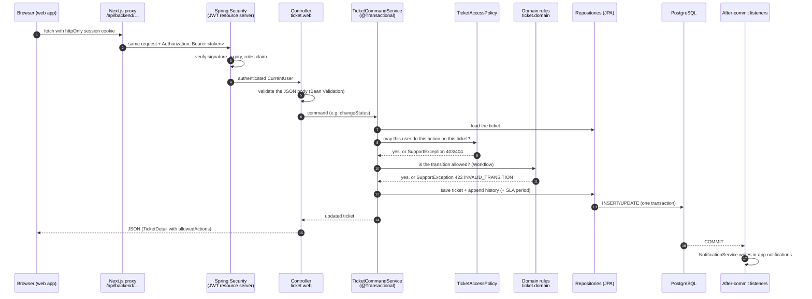
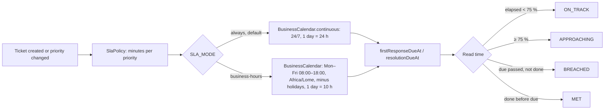
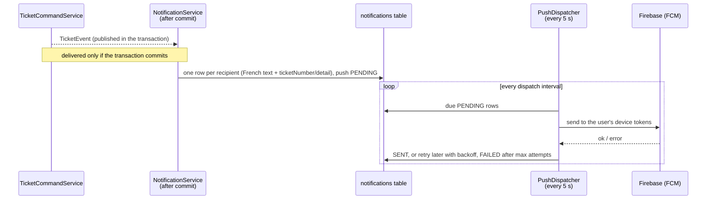

# How the backend processes a request

This page follows a request through the Spring Boot API, then describes the main business flows
(ticket creation, reply, status change, SLA, reopening, notifications) and how to test each of them by hand.
Code lives in `backend/src/main/java/com/maplenou/support`.
An interactive version of this page (request path, lifecycle, SLA calculator) is the
[Maplenou Backend Map](https://claude.ai/artifact/Q6SwyLc83ptXLWtPKMHMNM) (owner's Claude account, private until shared).

## The request pipeline

| Step | Where | What can stop the request |
| --- | --- | --- |
| Authentication | `security/SecurityConfig`, JWT decoder | `401 UNAUTHENTICATED` (missing, expired or invalid token) |
| Validation | request records in `ticket/web/TicketRequests` (`@NotBlank`, `@Size`, `@Pattern`) | `400 VALIDATION_FAILED` with the field errors |
| Role check | `@PreAuthorize` on admin, report and dashboard endpoints | `403 FORBIDDEN` |
| Resource authorization | `ticket/TicketAccessPolicy` (who may see / act on *this* ticket) | `404 NOT_FOUND` (other people's tickets are invisible), `403 FORBIDDEN` |
| Business rules | `TicketCommandService`, `ticket/domain/Workflow`, `attachment/AttachmentPolicy`, `sla/SlaService` | `422` with a stable `code` and the rule id (`BR-xxx`) |
| Errors | `common/ApiExceptionHandler` | every error is an RFC 9457 problem: `status`, `code`, `detail` (French), `rule` |

The response of every ticket command contains `allowedActions`: the web app only shows the buttons the backend
would accept, but the backend checks again on every call.

## Flow 1 — a requester creates a ticket

`POST /api/v1/support/tickets` → `TicketCommandService.create`:

1. **Who:** only customers, sellers and delivery drivers (`BR-003`).
2. **Priority:** Low/Medium/High; `CRITICAL` is refused with `422 CRITICAL_PRIORITY_RESERVED` (`BR-036`); "urgent"
   is recorded as a flag (`BR-037`).
3. **Category:** must exist and be active (`UNKNOWN_CATEGORY`); the list comes from the reference cache.
4. **References:** an order or delivery reference is checked against the requester's own data through the
   `EcosystemGateway` port (`REFERENCE_NOT_ACCESSIBLE`, `REFERENCE_MISMATCH`, `ECOSYSTEM_UNAVAILABLE`).
5. **Attachments:** type detected from the file content, size and count limits (`AttachmentPolicy`); files are
   written to private storage and **deleted again if the transaction rolls back**.
6. **Number:** `TKT-<year>-<sequence>` from a PostgreSQL sequence that never reuses values.
7. **SLA:** first-response and resolution due dates computed on the SLA calendar (24/7 by default, `SLA_MODE`); a
   first `SlaPeriod` row.
8. **History:** `CREATED` entry (append-only).
9. **Event:** `TICKET_CREATED` → after commit: confirmation for the requester, "new ticket" for managers.

## Flow 2 — messages and internal notes

`POST /tickets/{id}/messages` (public) and `POST /tickets/{id}/internal-notes` (support only):

- `clientMessageId` makes a retry idempotent: sending the same id twice stores one message.
- The **first public reply from support** sets `firstRespondedAt` (first-response SLA met or breached).
- A requester's reply on a `WAITING_FOR_CUSTOMER` ticket moves it back to `IN_PROGRESS`.
- Internal notes are never returned to requesters (`TicketQueryService` filters by visibility).

## Flow 3 — status, priority, category, assignment, escalation

| Command | Rule highlights |
| --- | --- |
| `PUT /status` | allowed transitions in `Workflow`; `CLOSED` refused while a reopening request is pending (`REOPEN_PENDING`) |
| `PUT /priority` | support only; recalculates the SLA from the creation date, keeps the history (`BR-034`) |
| `PUT /assign` | `agentId` null = "assign to me"; target must be an active support agent (`INVALID_ASSIGNEE`) |
| `POST /escalate` | flag + reason, managers notified (`DEC-CS03-10`) |

Every command writes a history entry and publishes an event; notifications follow after commit.

## Flow 4 — SLA clock (24/7 or business hours)

Since 2026-10-29 (DEC-CS10-16) `SLA_MODE=always` is the default: `SlaService.calendar()` returns
`BusinessCalendar.continuous`, deadlines are plain elapsed time (a HIGH ticket created on Friday at 22:00 is due
for a first response on Saturday at 02:00 and for resolution on Saturday at 22:00), and holidays are not read.
With `SLA_MODE=business-hours`, the holiday list is read from the database once per cache period
(`REFERENCE_CACHE_TTL`) and immediately after an administrator changes it. `GET /api/v1/support/admin/sla-settings`
returns `{mode, zone, opening, closing, minutesPerDay}` (opening and closing are `null` in 24/7 mode) for the
« Calendrier SLA » screen. Due dates are stored when they are computed (creation, priority change, reopening), so
changing the mode does not move the due dates of existing tickets. SLA data is never shown to requesters
(`BR-014`).

## Flow 5 — reopening

1. The requester asks on a `RESOLVED` ticket (`POST /reopen-requests`); a closed ticket cannot be reopened
   (`TICKET_CLOSED`) and only one request may be pending (`REOPEN_ALREADY_PENDING`).
2. Support approves or rejects (`PUT /reopen-requests/{requestId}`); approval returns the ticket to `IN_PROGRESS`
   (or another valid status) and opens a new resolution SLA period (`BR-055`); the decision is notified.

## Flow 6 — notifications and push

A user is never notified of their own action (except the creation confirmation). Push failures never change the
ticket. Without Firebase credentials the push is only logged (`LoggingPushSender`).

## Reads, search and caching

- `TicketQueryService` builds the search from `TicketSearchCriteria` (JPA Specification): text, status, priority,
  category, assignee (`me`, `unassigned`, id), requester role, escalated, SLA breached, dates; a complete ticket
  number is an exact lookup.
- Requesters only ever get their own tickets; agents see the queue; read-only views for colleagues' tickets.
- Reference data (active categories, business calendar) is cached in memory with a size and time limit; ticket
  data is never cached. See [Caching and disk space](caching.md).

## Test the backend

| Goal | Command |
| --- | --- |
| All automated tests, no Java on your machine | `scripts/test.ps1 backend` (Windows) · `scripts/test.sh backend` |
| All automated tests with Java 21 | `cd backend && ./mvnw verify` (Testcontainers) or with `TEST_DATABASE_URL` |
| One test class | `./mvnw -Dtest=BusinessCalendarTest test` · integration: `./mvnw -Dit.test=CachingIT verify` |
| Click through the API | open `backend/http/support-api.http` in VS Code (REST Client) or IntelliJ and send the requests in order |
| Interactive documentation | <http://localhost:8081/swagger-ui.html> (demo profile) |
| Smoke test of a running stack | `scripts/smoke-test.ps1` · `scripts/smoke-test.sh` |

What the automated suites cover: unit tests for the business calendar, SLA targets and states, attachment
validation, the access policy and notification rules; integration tests (`*IT`, real PostgreSQL) for the full lifecycle, authorization
(who can see and do what), search and filters, attachments, SLA, reopening, notifications and push retries,
ecosystem references, caching (`CachingIT`) and the API error format.
