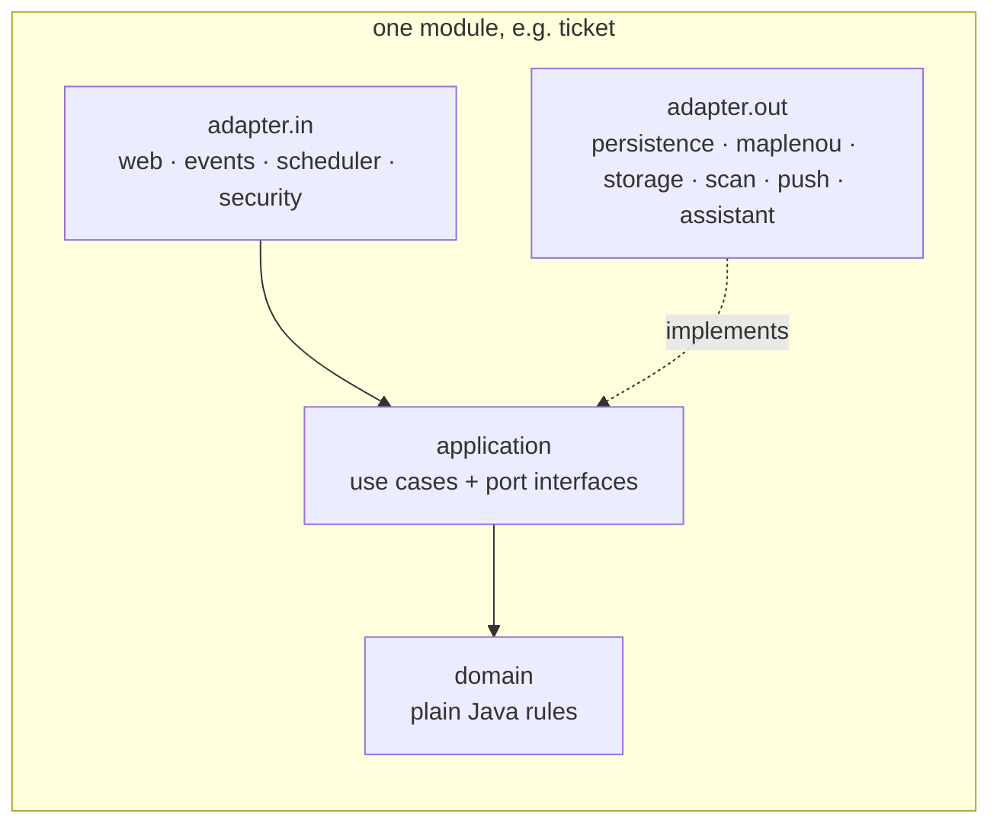
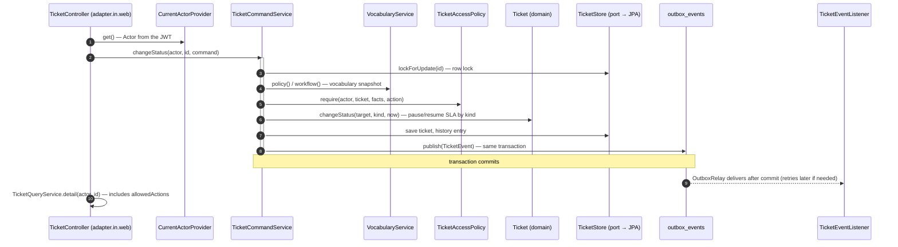

# Backend

The backend is a Spring Boot 4.1.1 application on Java 21 (`backend/`), with PostgreSQL 16, Flyway, Spring
Security (OAuth2 resource server), Micrometer/Prometheus, springdoc-openapi 3.1.1 and the Firebase Admin SDK
9.11.0; ArchUnit 1.4.1 checks the architecture. Integration tests use Testcontainers 2.0.5.

This page describes the structure of the code. For a walk through one request and the business flows, with the
manual test collection, see [How the backend processes a request](backend-processing.md).

## Package layout — hexagonal modules

All code is under `backend/src/main/java/com/maplenou/support/`. Each business module has the same three layers
(DEC-CS11-01), and `ArchitectureTest` (ArchUnit) fails the build when a rule is broken:



| Module | `domain` | `application` (use cases, ports) | adapters |
| --- | --- | --- | --- |
| `ticket` | `Ticket` aggregate (restored from a `Snapshot`), `vocabulary` (`StatusKind`, `Workflow`, `Priorities`), `PermissionMatrix`, `TicketAccessPolicy`, `Category`, `Satisfaction`, `CannedReply`, `AiSuggestion`, `ExternalAction`, `event.TicketEvent` | `TicketCommandService`, `TicketQueryService`, `VocabularyService`, `CategoryService`, `AutoCloseService`, `AiAssistService`, `ExternalActionService`, `CannedReplyService`, `TicketStatistics`, `LegacyImportService`; ports `TicketStore`, `TicketSearch`, `ConversationStore`, `HistoryStore`, `VocabularyStore`, `AiAssistant`… | `in.web` (`TicketController`, `SupportToolsController`, `VocabularyController`, `CategoryController`, `CannedReplyController`), `in.events.AiTriageListener`, `in.scheduler.AutoCloseScheduler`, `out.persistence` (JPA entities and repositories), `out.assistant.HttpAiAssistant` |
| `sla` | `BusinessCalendar`, `SlaPolicy`, `SlaState` (with `PAUSED`), `SlaPeriod`, `Holiday` | `SlaService`, `SlaPeriodService`, `SlaAdminService`; ports `HolidayStore`, `SlaPolicyStore`, `SlaPeriodStore` | `in.web.SlaAdminController`, `out.persistence` |
| `notification` | `Notification`, `MessageTemplate`, `DeviceToken` | `NotificationService`, `PushDispatcher`, `TemplateService`, `PushDiagnostics`; ports `PushSender`, `MobilePushRelay`, `NotificationStore`, `TemplateStore` | `in.events.TicketEventListener`, `in.scheduler.PushDispatchScheduler`, `in.web.NotificationController`, `out.push` (Firebase, log), `out.maplenou.BakendPushRelay`, `out.persistence` |
| `attachment` | `AttachmentPolicy` | `AttachmentService`; ports `BinaryStorage`, `MalwareScanner` | `out.storage` (`LocalFileStorage`, `CloudinaryStorage`), `out.scan` (`NoMalwareScanner`, `ClamAvScanner`) |
| `context` | `Ecosystem` (order with sub-orders, payment, delivery, seller, refund summaries) | `EcosystemService`, `ReferenceService`; ports `EcosystemGateway`, `EcosystemActions`, `LegacyTicketSource` | `out.maplenou` (`BakendClient`, `HttpEcosystemGateway`, `HttpEcosystemActions`, `HttpLegacyTicketSource`), `in.web.MyReferencesController` |
| `identity` | `SupportUser`, `StaffAssignment`, `MaplenouRoles` | `UserDirectory`, `StaffRoleService`, `CoreLoginService`; ports `UserStore`, `CoreAccounts`, `AccessTokenIssuer` | `in.security.UserSyncFilter`, `in.web` (`MeController`, `CoreLoginController`, `StaffAdminController`), `out.maplenou.CoreAccountClient`, `out.security.JwtAccessTokenIssuer`, `out.persistence` |
| `report` | — | uses `ticket.application.TicketStatistics` | `in.web.DashboardController` |

| Shared package | Content |
| --- | --- |
| `shared` | kernel used by every module: `Actor` (the caller), `Role`, `SupportException` (stable `code` + kind), `PageQuery`/`PageResult`, `event.DomainEvent`/`DomainEventPublisher` |
| `platform` | technical base: `config.MaplenouProperties`, `security` (`SecurityConfig`, `JwtConfig`, `CurrentActorProvider`), `web.ApiExceptionHandler`, `outbox` (`OutboxEventPublisher`, `OutboxRelay`), `observability` (`RequestIdFilter`, `RateLimitFilter`, `MetricsAccessFilter`), `persistence.BaseEntity` |
| `demo` | demo profile only: `DemoUsers`, `DevAuthController`, `DemoDataSeeder`, demo ecosystem adapters |

Rules checked by `ArchitectureTest`: `domain` depends on no framework and no other layer; `application` uses only
Spring's `stereotype` and `transaction` packages; `adapter.in` never uses `adapter.out`; a module's adapters are
private to it; modules depend on each other's `application`/`domain` only, without cycles; `shared` and `platform`
depend on no module; JPA entities live only in `adapter.out.persistence` (or `platform`); controllers only in
`adapter.in.web`.

`MaplenouSupportApplication` enables scheduling, async work and the `maplenou.*` configuration properties, and
declares the `Clock` bean (UTC) that services use instead of calling `Instant.now()` — tests can control time.

## Request flow

A ticket command goes through the same steps every time: controller → use case → policy → domain → port.



- **Controller** (`adapter.in.web`): binds and validates the request (`@Valid` records in `TicketRequests`), gets the
  caller from `CurrentActorProvider`, maps it to a command (`TicketCommands`), calls one use case, then returns a view
  from `TicketQueryService`.
- **Use case** (`TicketCommandService`): one `@Transactional` method per command. It locks the ticket through the
  `TicketStore` port, checks the policy, applies domain rules, writes the append-only history and publishes a
  `TicketEvent` to the outbox.
- **Policy** (`TicketAccessPolicy`): computes `allowedActions` from the configurable `PermissionMatrix` (role ×
  action × relationship OWN/ASSIGNED/UNASSIGNED/ANY) and the state guards of the `Workflow`; `require(...)` throws
  when the action is not allowed. Requesters get `404` for tickets that are not theirs.
- **Domain** (`ticket.domain`): plain Java, unit-tested without Spring (`WorkflowTest`, `TicketAccessPolicyTest`).
  Rules use the status *kind*, never a status code, so administrators can rename or add statuses.
- **Persistence adapter** (`adapter.out.persistence`): Spring Data JPA entities mapped to and from the domain
  snapshot. The schema is owned by Flyway (`ddl-auto: validate`).

Endpoint-level role guards use `@PreAuthorize` (dashboard, reports, administration), on top of the resource-level
policy.

## Error model (RFC 9457)

Every error is `application/problem+json` with a stable machine-readable `code` and, when relevant, the business
rule `rule`:

```json
{ "status": 422, "title": "Unprocessable Content", "detail": "La priorité Critique est attribuée uniquement par le support…",
  "code": "CRITICAL_PRIORITY_RESERVED", "rule": "BR-036" }
```

Throw `common.SupportException` through its factories; `common.ApiExceptionHandler` turns it into a `ProblemDetail`:

| Factory | Status | Use |
| --- | --- | --- |
| `SupportException.notFound(what)` | 404 | missing resource, or a resource the caller may not know exists |
| `SupportException.forbidden(message, rule)` | 403 | authenticated but not allowed |
| `SupportException.businessRule(code, message, rule)` | 422 | well-formed request that violates a business rule |
| `SupportException.conflict(code, message, rule)` | 409 | conflicting state (duplicate pending request…) |
| `SupportException.badRequest(code, message, rule)` | 400 | invalid input |

The handler also maps framework exceptions to codes: `VALIDATION_FAILED` (with an `errors` map per field),
`MALFORMED_REQUEST`, `UNSUPPORTED_MEDIA_TYPE`, `METHOD_NOT_ALLOWED`, `MISSING_PART`, `MISSING_PARAMETER`,
`INVALID_PARAMETER`, `ATTACHMENT_TOO_LARGE` (413), `INVALID_MULTIPART`, `CONCURRENT_MODIFICATION` (optimistic lock),
`DATA_CONFLICT`, `FORBIDDEN`, `NOT_FOUND` and `INTERNAL_ERROR`. Stack traces and messages of unexpected errors are
never returned (`server.error.include-message: never`, `include-stacktrace: never`).

`detail` texts are written in French for end users. Clients must branch on `code`, never on `detail`: the web app
translates codes into English in `frontend/src/lib/i18n/messages/errors.ts` (`ERROR_CODES_EN`). When you add a code,
add its English text there.

## Database and Flyway migrations

The schema lives in `backend/src/main/resources/db/migration/`:

| Migration | Content |
| --- | --- |
| `V1__support_schema.sql` | users projection, categories, `ticket_number_seq`, tickets, messages, attachments, append-only `ticket_history` (trigger `trg_ticket_history_append_only`), reopen requests, SLA periods, holidays, notifications, device tokens |
| `V2__notification_i18n.sql` | `notifications.ticket_number` and `notifications.detail` so clients can render notifications in their language |
| `V3__maplenou_integration.sql` | `support_tickets.legacy_id` (unique when set) and `legacy_number` for the tickets imported from Bakend; table `support_staff_assignments` (support roles by phone number) — DEC-CS10-17 |

Flyway runs at start-up; Hibernate only validates the mapping (`spring.jpa.hibernate.ddl-auto: validate`).

To add **V4**:

1. Create `backend/src/main/resources/db/migration/V4__<short_description>.sql` (two underscores; the next free
   number). Never edit `V1`, `V2` or `V3`: they may already be applied somewhere.
2. Update the JPA entity (and repository queries) to match; start-up fails if the mapping and schema disagree.
3. Run the integration tests: they apply every migration to a fresh PostgreSQL 16 (see [Testing](testing.md)).
4. Update [Database model](../architecture/database-model.md) and, if the API changes, the OpenAPI contract below.

## Configuration

All module settings are under `maplenou.*` in `application.yml` and bound to the record
`common.MaplenouProperties` (`security`, `sla`, `attachments`, `notifications`, `ecosystem`, `cors`, `cache`, `core`). To add a
setting, add it to `application.yml` (with `${ENV_VAR:default}` when it must be configurable) and to the matching
nested record. Environment variables are listed in [Operations](operations.md).

## Caching and response compression

Reference data that almost every request reads and that changes rarely is cached in memory; ticket data never is.
The full picture, including the browser and the assistant, is in [Caching and disk space](caching.md).

| What | How | Bound | Invalidation |
| --- | --- | --- | --- |
| Categories, vocabulary (statuses, transitions, priorities, permissions), SLA calendar and policies, notification templates | one immutable snapshot per service (`CategoryService`, `VocabularyService`, `SlaService`, `TemplateService`), reloaded when older than `maplenou.cache.reference-ttl` | one small object each; `REFERENCE_CACHE_TTL` (default `PT10M`) | dropped **after commit** of an administrator's change |

Invalidation uses `TransactionSynchronization.afterCommit`: the snapshot is dropped only once the administrator's
transaction has committed, so a concurrent request cannot refill it with data that is about to be rolled back. With
several backend instances, another instance sees a change at the latest after the TTL.

HTTP caching: `GET /api/v1/support/categories` (`ticket.web.CategoryController`) answers with
`Cache-Control: private, max-age=300` and an `ETag` computed from the list. The browser reuses the response for five
minutes, then revalidates it with `If-None-Match`; an unchanged list returns `304 Not Modified` without a body.

Compression: `server.compression` in `application.yml` gzips `application/json` and `application/problem+json`
responses larger than 1 KB.

## Security, JWT and the demo profile

- `security.SecurityConfig` is deny-by-default: `/actuator/health/**`, the OpenAPI/Swagger paths,
  `GET /api/v1/dev/users`, `POST /api/v1/dev/token` and `POST /api/v1/auth/maplenou/login` / `/mfa` (which only
  exist when `MAPLENOU_LOGIN_ENABLED=true`) are public; every other `/api/v1/**` call needs a valid JWT;
  everything else is denied. Sessions are stateless, CSRF is disabled (bearer tokens, no cookies), CORS is limited to
  `maplenou.cors.allowed-origins`.
- The `roles` claim is mapped to `ROLE_*` authorities (unknown names are ignored); `sub` is the user id, `name`,
  `email` and `phone` are optional claims. When a token carries several roles, the most privileged one wins
  (`Role.highest`).
- `security.JwtConfig` is active only when `maplenou.security.jwt-secret` (`JWT_SECRET`) is non-blank: it verifies
  HS256 tokens (secret of at least 32 bytes, expected issuer `JWT_ISSUER`) and provides the `TokenIssuer` used by
  the demo login, the Maplenou sign-in and the tests. With Maplenou sign-in, `JWT_SECRET` is required (a random
  value, never the demo default); otherwise production may leave it empty and set
  `spring.security.oauth2.resourceserver.jwt.issuer-uri` to an identity provider.
- `identity.CoreLoginService` (only with `MAPLENOU_LOGIN_ENABLED=true`) checks the phone number and password with
  Bakend (`POST /api/auth/login`, then `/api/auth/2fa/verify-login`), maps the account to a support role
  (`MaplenouRoles`, a `support_staff_assignments` row wins), issues the support service's own 8-hour token and
  closes the core session (`POST /api/auth/logout`). See [Maplenou platform integration](maplenou-integration.md).
- `security.UserSyncFilter` runs after token validation: it refreshes the caller's row in `support_users` and
  rejects support accounts deactivated by an administrator (`403 ACCOUNT_DISABLED`).
- The `demo` profile (`SPRING_PROFILES_ACTIVE=demo`) sets a default `JWT_SECRET` and `dev-login-enabled: true`.
  This activates `demo.DevAuthController` (`GET /api/v1/dev/users`, `POST /api/v1/dev/token`) and
  `demo.DemoDataSeeder` (`@Profile("demo")`). The web proxy never forwards `/api/v1/dev/**`; only the server-side
  `/api/session` route calls it.

!!! danger "Never in production"
    Do not run the `demo` profile, `DEV_LOGIN_ENABLED=true` or the default `JWT_SECRET` outside local demos.

## Notifications and push

1. A use case publishes a `TicketEvent` (type, ticket number, subject, requester, assignee, actor, status and its
   kind, detail) through `DomainEventPublisher`: `OutboxEventPublisher` stores it in `outbox_events` in the same
   transaction.
2. After commit, `OutboxRelay` delivers it to the `@EventListener`s in a new transaction and marks it published; a
   poller (`maplenou.outbox.poll-interval`, 5 s) retries the events that were not delivered (crash, error), with
   backoff, and marks them failed after `maplenou.outbox.max-attempts`. Gauges: `support.outbox.pending`,
   `support.outbox.failed`.
3. `NotificationService.onTicketEvent` creates the in-app notifications from `notification_templates`, in each
   recipient's language (`support_users.language`), keeping the language-neutral `ticket_number` and `detail`.
4. `PushDispatcher` runs every `maplenou.notifications.dispatch-interval` (5 s). It locks up to 50 due notifications
   with `FOR UPDATE SKIP LOCKED` (safe with several backend instances), sends them to the recipient's devices and, for
   requesters when `MAPLENOU_PUSH_RELAY=true`, to the Maplenou mobile app through Bakend
   (`POST /internal/v1/users/{id}/push`). Push data: `type`, `ticketId`, `source=support`, `url`
   (`<SUPPORT_APP_URL>/?ticket=<id>`). Failures are retried with exponential backoff up to `max-attempts` (5); tokens
   reported invalid are deleted.
5. `NotificationConfig` picks the adapter: `LoggingPushSender` when `FIREBASE_CREDENTIALS_FILE` is empty (push is
   only logged), `FirebasePushSender` when it points to a service-account JSON.

Clients register devices with `POST /api/v1/support/notifications/devices` and remove them with
`DELETE /api/v1/support/notifications/devices/{token}`. See [Notifications](../architecture/notifications.md).

Two diagnostic endpoints help when connecting Firebase: `GET /api/v1/support/notifications/push-status` returns the
push channel (`firebase` or `log-only`), whether the mobile relay is on and the number of devices registered for the
caller, and `POST /api/v1/support/notifications/devices/test` sends a test push to the caller's devices. Setup,
browser push and the Flutter app: [Firebase push notifications](firebase.md).

## Business context and actions on Maplenou

`context.adapter.EcosystemConfig` creates the demo adapters (sample data, actions accepted without calling anything)
unless `ECOSYSTEM_MODE=http`, in which case `HttpEcosystemGateway` reads and `HttpEcosystemActions` asks Bakend's
internal API `/internal/v1/**` at `MAPLENOU_CORE_URL` with the header `X-Maplenou-Service-Token:
<SUPPORT_SERVICE_TOKEN>`. Bakend refusals (400/409/422) become `MAPLENOU_REFUSED` with Bakend's message, 404 becomes
`MAPLENOU_NOT_FOUND`, anything else `ECOSYSTEM_UNAVAILABLE`. `ExternalActionService` records the outcome
(`ticket_external_actions`) even when Bakend refuses. `HttpLegacyTicketSource` reads the former tickets for
`LegacyImportService`. Contract test: `BakendContractTest`. See [Maplenou platform integration](maplenou-integration.md).

## AI help (assistant)

With `AI_ASSIST_ENABLED=true`, `ticket.adapter.out.assistant.HttpAiAssistant` calls the assistant's
`/api/assistant/internal/triage` and `/draft-reply` with `X-Assistant-Token: <ASSISTANT_INTERNAL_TOKEN>`
(otherwise `NoAiAssistant`). `AiTriageListener` asks for a suggestion asynchronously after a ticket is created; the
codes returned are checked against the vocabulary before being stored (`ticket_ai_suggestions`). Applying a
suggestion changes the category and priority like an agent would, with history `AI_SUGGESTION_APPLIED`.

## How to add an endpoint

- [ ] The behaviour is in an approved matrix item and covered by a requirement or decision.
- [ ] Request/response types are records (in `adapter.in.web` — e.g. `TicketRequests` — and `application.view`)
      with Bean Validation annotations; no entity is returned directly.
- [ ] The controller method is thin: `currentUser.get()`, one use-case call, a view. Path under `/api/v1/support/…`
      (the web proxy forwards nothing else). Add `@Operation(summary = …)` when the behaviour is not obvious.
- [ ] Authorization: an `@PreAuthorize` role guard for role-only endpoints and/or a `TicketAccessPolicy` check for
      ticket resources. A new ticket action goes into `TicketAction`, the default `PermissionMatrix` and a migration
      that adds its `permission_rules`.
- [ ] Commands are `@Transactional` in an `application` service, lock the ticket through `TicketStore.lockForUpdate`,
      record history and publish a `TicketEvent` when users must be notified.
- [ ] Anything outside the use case (database, HTTP, files) goes through a `port` interface implemented in
      `adapter.out`; `ArchitectureTest` must stay green.
- [ ] Errors use `SupportException` factories with a new stable `code` (and `rule` when a business rule applies);
      the English text is added to `ERROR_CODES_EN` in the frontend.
- [ ] Schema changes are a new Flyway migration.
- [ ] A change of reference data drops the service's snapshot after commit; a new cache is bounded in size and time
      (see [Caching and disk space](caching.md)).
- [ ] Tests: a unit test for domain/policy rules and an integration test extending `it.IntegrationTest`.
- [ ] Docs: [API specification](../architecture/api-specification.md), the regenerated `openapi.json`, Postman and
      `.http`, and the user/staff guides in both languages when the behaviour is visible.

## Regenerate the OpenAPI contract

`docs/architecture/openapi.json` is generated from the running application (springdoc, `/v3/api-docs`). Start the
stack, then overwrite the file:

=== "Bash"

    ```bash
    docker compose up -d --build backend
    curl -s http://localhost:8081/v3/api-docs | python3 -m json.tool --indent 2 > docs/architecture/openapi.json
    ```

=== "PowerShell"

    ```powershell
    docker compose up -d --build backend
    (Invoke-WebRequest http://localhost:8081/v3/api-docs).Content | python -m json.tool --indent 2 | Set-Content -Encoding utf8 docs/architecture/openapi.json
    ```

Review the diff before committing: every change in the contract must be intended. The live Swagger UI is at
<http://localhost:8081/swagger-ui.html>.
