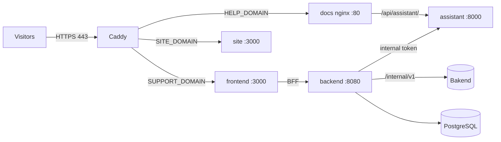

# Deployment on a server (domains and HTTPS)

The `public` Compose profile publishes the customer service on the Internet with HTTPS, on three domain names, from
one server. It adds [Caddy](https://caddyserver.com/docs/), which obtains and renews the certificates by itself
(Let's Encrypt), and the public website `../Site_vitrine`.

| Domain (`.env`) | Example | What it serves | Container |
| --- | --- | --- | --- |
| `SUPPORT_DOMAIN` | `support.maplenou.tg` | the web app (requesters and support staff) | `frontend` |
| `HELP_DOMAIN` | `aide.maplenou.tg` | the public help centre: user guide (FR/EN) and its assistant | `docs` + `assistant` |
| `SITE_DOMAIN` | `www.maplenou.tg` | the public marketplace website | `site` |

Nothing else is reachable from the Internet: the API, the database, the staff and developer guides, the
assistant's internal AI endpoints (`/api/assistant/internal/*`) and Prometheus stay inside the Docker network. Bakend
keeps its own deployment (its internal API `/internal/v1/**` must never be public either).



## What you need

1. A server (Linux, 2 vCPU and 4 GB of RAM are enough without the `antivirus` profile; add 1 GB for ClamAV) with
   Docker and ports **80 and 443 open**.
2. The three domain names, with DNS `A` (and `AAAA` if the server has IPv6) records pointing to the server's
   address. Caddy cannot get a certificate before the DNS answers.
3. The repository on the server, and an `.env` made from `.env.example` (`scripts/env-sync.sh` adds the variables a
   new version introduces to an existing `.env`).

## `.env` for a public deployment

| Variable | Value | Why |
| --- | --- | --- |
| `SUPPORT_DOMAIN`, `HELP_DOMAIN`, `SITE_DOMAIN`, `ACME_EMAIL` | your domains and an e-mail | certificates and routing |
| `SPRING_PROFILES_ACTIVE` | `default` | the `demo` profile (demo login, fake data) must never be public — Caddy refuses to start with it |
| `AUTH_MODE` / `MAPLENOU_LOGIN_ENABLED` | `maplenou` / `true` | sign-in with Maplenou accounts (required by the guard) |
| `ECOSYSTEM_MODE`, `SUPPORT_SERVICE_TOKEN`, `MAPLENOU_CORE_URL` | `http`, the shared token, Bakend's private address | real orders and deliveries |
| `DOCS_SITES`, `ASSISTANT_SITES` | `user`, `user` | only the user guide is published and known by the public assistant (required by the guard) |
| `SESSION_COOKIE_SECURE` | `true` | the session cookie only travels over HTTPS (required by the guard) |
| `FORWARD_HEADERS_STRATEGY` | `native` | the API sees the visitor's address (rate limits, logs) |
| `CORS_ALLOWED_ORIGINS` | `https://<SUPPORT_DOMAIN>` | the only browser origin of the app |
| `DOCS_PUBLIC_URL` | `https://<HELP_DOMAIN>` | links to the help centre, assistant references and the help search of the app |
| `SUPPORT_APP_URL` | `https://<SUPPORT_DOMAIN>` | links in push notifications |
| `JWT_SECRET`, `POSTGRES_PASSWORD`, `METRICS_TOKEN`, `ASSISTANT_INTERNAL_TOKEN` | new random values | never the examples |
| `HOST_BIND_ADDRESS` | `127.0.0.1` | the direct ports (3001, 8081, 8006) stay closed to the network; Caddy is the only entry |

Generate random values with `openssl rand -base64 36` (PowerShell:
`[Convert]::ToBase64String((1..36 | ForEach-Object { Get-Random -Maximum 256 }))`).

## Start, check, update

```bash
scripts/doctor.sh                                           # checks the public settings listed above
docker compose --profile docs --profile public up -d --build --wait
docker compose logs caddy --tail 50                          # "certificate obtained successfully" for each domain
curl -fsS https://<SUPPORT_DOMAIN>/login -o /dev/null && curl -fsS https://<HELP_DOMAIN>/api/assistant/health
curl -s -o /dev/null -w '%{http_code}\n' https://<HELP_DOMAIN>/staff/fr/      # 404: internal guides are not published
```

Add `--profile antivirus` (with `ANTIVIRUS=clamav`) and `--profile monitoring` (with `METRICS_TOKEN`) when you want
them. To update: `git pull`, `scripts/env-sync.sh`, then the same `up` command; database migrations run by
themselves at start-up (back up first: `scripts/backup.sh`).

If Caddy stops with `public profile refused: …`, the guard (`deploy/guard.sh`) found an unsafe setting: fix the
variable it names. If a certificate is not issued, check that the DNS points to the server and that ports 80 and
443 are reachable from the Internet.

## The public assistant

The assistant of `HELP_DOMAIN` answers only from the user guide (`ASSISTANT_SITES=user`), cites its sources and
limits each visitor (`ASSISTANT_RATE_LIMIT`). Its key `OLLAMA_API_KEY` stays on the server. The same assistant gives
agents their AI help (DEC-CS11-08) through `/api/assistant/internal/*`, which neither nginx nor Caddy publishes.
Staff keep their internal guides on a private instance (a second checkout with `DOCS_SITES=user,staff,developer`,
reachable only from your network or a VPN).
