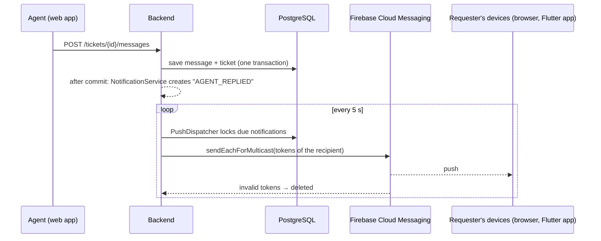

# Firebase push notifications

The roadmap (*Semaine 4 — Notifications et tests*) and the ticket specification (§15) ask for **Firebase Cloud
Messaging (FCM)** notifications to customers, sellers and delivery drivers. This page explains what is already in
the code, how to connect a Firebase project and how to check that pushes arrive.

## What is sent, and when

The backend creates an in-app notification for every event below, **after the ticket transaction has committed**
(a notification problem never blocks or rolls back a ticket change). The dispatcher then sends it as a push to
every registered device of the recipient, with retries and back-off.

| Roadmap event | Recipient | Notification type | Example text (French, as sent) |
| --- | --- | --- | --- |
| New ticket | requester (confirmation), support managers | `TICKET_CREATED`, `NEW_TICKET_IN_QUEUE` | « Votre ticket TKT-2026-00012 a été créé… » |
| Agent reply | requester | `AGENT_REPLIED` | « Votre ticket TKT-2026-00012 a reçu une nouvelle réponse. » |
| Status change | requester | `STATUS_CHANGED`, `TICKET_RESOLVED`, `TICKET_CLOSED` | « Votre ticket TKT-2026-00012 a été résolu. » |
| Request for more information | requester | `INFORMATION_REQUESTED` (status *En attente du client*) | « Le support a besoin d'informations supplémentaires… » |
| Also | agents, managers | `TICKET_ASSIGNED`, `REQUESTER_REPLIED`, `REOPEN_REQUESTED`, `TICKET_ESCALATED`, `REOPEN_DECIDED` | |

Every push carries `type` and `ticketId` in its data, so the apps open the right ticket. Push texts are French
(the in-app list is translated in the English UI); see the UPGRADE-PLAN item "Message templates per language".



## The pieces

| Piece | Where | Role |
| --- | --- | --- |
| Device registration | `POST /api/v1/support/notifications/devices` `{token, platform: ANDROID \| IOS \| WEB}`, `DELETE …/devices/{token}` | stores the FCM token of a device for the signed-in user (`device_tokens` table) |
| Push channel | `NotificationConfig` | uses `FirebasePushSender` when `FIREBASE_CREDENTIALS_FILE` points to a service-account key, otherwise `LoggingPushSender` (pushes written to the log only) |
| Queue and retries | `PushDispatcher` | every 5 s, up to `maplenou.notifications.max-attempts` attempts with back-off; removes tokens Firebase reports as unregistered |
| Diagnostics | `GET /notifications/push-status`, `POST /notifications/devices/test` | shows `firebase` or `log-only` and sends a test push to the caller's devices |
| Browser push | `frontend/src/lib/push.ts`, `src/components/PushNotifications.tsx`, `public/push-sw.js`, `/api/push-config` | "Push notifications" card on the **Notifications** screens: turn on, send a test, turn off |
| Flutter apps | Maplenou mobile apps (other repositories) | get the FCM token with `firebase_messaging` and register it (see below) |

## Use Maplenou's existing Firebase project (`maplenou-c21c2`)

The Maplenou apps already have a Firebase project, **`maplenou-c21c2`** (Flutter `frontend/lib/firebase_options.dart`,
Bakend's `firebase-service-account.json`). The customer service reuses it, so a requester gets the same pushes in
the browser and, through Bakend's relay, in the mobile app. What is ready and what is left:

| Step | State | What to do |
| --- | --- | --- |
| Web app of the project (public values) | **ready** — copied into `.env.example` and `render.yaml` | nothing |
| Push data opens the ticket in the Flutter app (`source=support`, `url`) | **ready** (CS-11) | test on a phone (section 5) |
| Relay to the mobile app through Bakend | **ready** — `MAPLENOU_PUSH_RELAY=true` + the shared `SUPPORT_SERVICE_TOKEN` | see the last section |
| VAPID key (browser push) | **to do once** | console → *Project settings → Cloud Messaging → Web Push certificates → Generate key pair*; paste the public key in `FIREBASE_WEB_VAPID_KEY` (`.env`, or Render dashboard) |
| Service-account key (sending) | **to do once** | console → *Project settings → Service accounts → Generate new private key*; save it as `secrets/firebase-service-account.json` (Compose) or as a Render **Secret File** (see [Render](render.md#firebase-on-render)) — never in Git or a chat |

Sections 1 to 3 below describe the same steps for a new, separate project.

## 1. Create the Firebase project

1. Open the [Firebase console](https://console.firebase.google.com/) with the Google account that will own the
   project, then **Create a project** — for example `maplenou-support`. Google Analytics is not needed.
2. In **Project settings → Cloud Messaging**, check that **Firebase Cloud Messaging API (V1)** is *Enabled*
   (it is for new projects). The legacy API is not used.

## 2. Backend: the service-account key (secret)

1. **Project settings → Service accounts → Firebase Admin SDK → Generate new private key**. A JSON file is
   downloaded.
2. Save it as `secrets/firebase-service-account.json` in the repository folder. The `secrets/` folder is ignored by
   Git and by the Docker builds, and mounted **read-only** into the backend container at `/run/secrets/maplenou`.
3. In `.env`:

    ```properties
    FIREBASE_CREDENTIALS_FILE=/run/secrets/maplenou/firebase-service-account.json
    ```

4. Restart the backend: `docker compose up -d backend`. The log shows
   `Firebase Cloud Messaging enabled (project maplenou-support).` If the file cannot be read, the backend stops at
   start-up with a message that names the variable — fix the path or empty the variable.

!!! warning "This key is a password"
    It can send pushes to every Maplenou user. Never commit it, send it by e-mail or paste it in a chat. If it
    leaks, delete it in **Service accounts → Manage service account permissions** and generate a new one.

Without Docker (native backend), point the variable at the file directly, for example
`FIREBASE_CREDENTIALS_FILE=C:\Users\<you>\maplenou\secrets\firebase-service-account.json`.

## 3. Web app: browser push (public values)

1. **Project settings → General → Your apps → Add app → Web** (`</>`), name it `maplenou-support-web`
   (Firebase Hosting is not needed). The console shows a `firebaseConfig` object.
2. **Project settings → Cloud Messaging → Web configuration → Web Push certificates → Generate key pair**. Copy
   the key pair (the public "VAPID" key).
3. Copy the values into `.env` — they are public by design (every browser receives them):

    ```properties
    FIREBASE_WEB_API_KEY=AIza...            # firebaseConfig.apiKey
    FIREBASE_WEB_AUTH_DOMAIN=maplenou-support.firebaseapp.com
    FIREBASE_WEB_PROJECT_ID=maplenou-support
    FIREBASE_WEB_MESSAGING_SENDER_ID=123456789012
    FIREBASE_WEB_APP_ID=1:123456789012:web:abc123
    FIREBASE_WEB_VAPID_KEY=B...             # Web Push certificate key pair
    ```

4. Restart the web app: `docker compose up -d frontend`. The values are read at run time by
   `/api/push-config`; no rebuild is needed.

Browsers allow push only on **HTTPS** or on `http://localhost`. In production the web app must be served over
HTTPS.

## 4. Check that it works

1. Sign in to the web app (for example as *Jean K.*), open **Notifications** and click
   **Activer les notifications push / Turn on push notifications**. Allow notifications when the browser asks.
2. Click **Envoyer une notification de test / Send a test notification**: a system notification "Notification de
   test" appears within a few seconds. The toast says `log-only` if the backend has no key (step 2).
3. Real flow: in another browser (or a private window) sign in as *Sophie N.*, take one of Jean's tickets and
   reply: Jean's browser shows « Votre ticket … a reçu une nouvelle réponse. » Clicking it opens the ticket.

API only (Postman, Swagger UI or `backend/http/support-api.http`): `GET /notifications/push-status` returns
`{"mode":"firebase","devices":1}`; `POST /notifications/devices/test` returns `{"mode":"firebase","devices":1,
"invalidRemoved":0}`. With a fake token and a real key, Firebase rejects the token: the answer is
`502 PUSH_DELIVERY_FAILED` or `invalidRemoved: 1`.

`scripts/smoke-test.ps1` (or `.sh`) prints the push channel of the running backend.

## 5. Flutter apps (customers, sellers, delivery drivers)

The mobile apps live in other repositories. Each app adds its Android and iOS apps to **the same Firebase
project** (`flutterfire configure`), then registers its token after sign-in and whenever it changes:

```dart
import 'package:firebase_messaging/firebase_messaging.dart';

Future<void> registerPushToken(ApiClient api) async {
  final messaging = FirebaseMessaging.instance;
  await messaging.requestPermission();                       // iOS and Android 13+
  final token = await messaging.getToken();
  if (token != null) {
    await api.post('/api/v1/support/notifications/devices',
        {'token': token, 'platform': Platform.isIOS ? 'IOS' : 'ANDROID'});
  }
  messaging.onTokenRefresh.listen((t) => api.post('/api/v1/support/notifications/devices',
      {'token': t, 'platform': Platform.isIOS ? 'IOS' : 'ANDROID'}));
}
// On sign-out: DELETE /api/v1/support/notifications/devices/{token}, then messaging.deleteToken().
// On tap: read message.data['ticketId'] and open the ticket screen.
```

iOS also needs an APNs authentication key uploaded in **Project settings → Cloud Messaging → Apple app
configuration**.

## Privacy and caching

- The web app stores nothing itself; once push is turned on, the Firebase SDK keeps its registration in the
  browser's IndexedDB (required by Firebase). Signing out unsubscribes the browser, so the next person using it
  does not receive the previous user's pushes; Firebase then reports the token as unregistered and the backend
  deletes it.
- The service worker `push-sw.js` only shows notifications: it caches nothing and makes no network request.
- Push texts contain the ticket number and a generic sentence, never the content of a message.

## Troubleshooting

| Symptom | Cause and fix |
| --- | --- |
| Card says "not configured on this server" | One of the `FIREBASE_WEB_*` values is empty → fill all six, `docker compose up -d frontend` |
| Card says notifications are **blocked** | The browser permission was refused → site settings (icon left of the address) → Notifications → Allow, reload |
| Test toast says `log-only` | `FIREBASE_CREDENTIALS_FILE` is empty in `.env` → step 2 |
| Backend does not start: "FIREBASE_CREDENTIALS_FILE=… cannot be read" | Wrong path or file name in `secrets/` → the path must start with `/run/secrets/maplenou/` in Docker |
| `502 PUSH_DELIVERY_FAILED` | The web app and the key belong to different Firebase projects, or the Cloud Messaging API (V1) is disabled |
| Nothing appears although the test succeeded | Windows "Focus assist"/"Do not disturb", or browser notifications disabled in the operating system settings |

## Requesters on the Maplenou mobile app (relay through Bakend)

Customers, sellers and couriers use the Maplenou Flutter app, whose device tokens are registered in **Bakend**
(`POST /api/notifications/tokens`), not in this service. With `MAPLENOU_PUSH_RELAY=true` (and
`SUPPORT_SERVICE_TOKEN` set on both sides), `PushDispatcher` also sends each requester notification to Bakend
(`POST /internal/v1/users/{id}/push`), which delivers it with its own Firebase project (`FcmService.sendToUser`).
Nothing has to be configured in the app.

| Push data | Value |
| --- | --- |
| `source` | `support` |
| `type` | the notification type (`AGENT_REPLIED`, `TICKET_RESOLVED`…) |
| `ticketId` | the ticket |
| `url` | `<SUPPORT_APP_URL>/?ticket=<id>` — the app opens it in the browser when the notification is tapped (`frontend/lib/services/push_notification_service.dart`, `_openSupportTicket`, `http`/`https` links only) |

Test it: sign in to the Maplenou app on a phone with a customer account, open a ticket in the web app with the same
account, answer it as an agent; the phone receives "Nouvelle réponse" (or "New reply" when the customer chose English)
and tapping it opens the ticket. Without the relay, requesters still get the in-app notification and, in a browser
where they turned push on, the web push.
