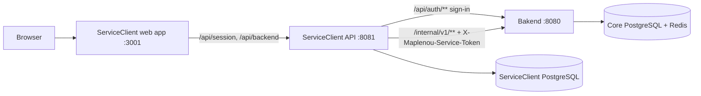
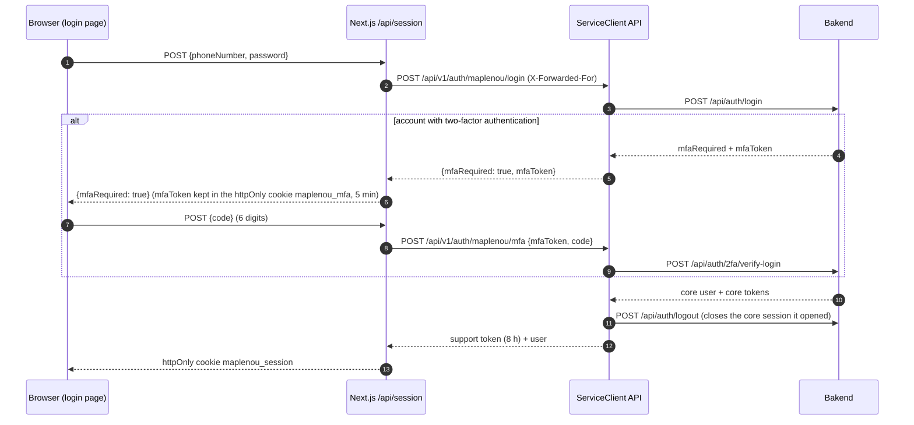

# Maplenou platform integration

This page explains how the customer service runs inside the Maplenou platform (owner decision **DEC-CS10-17** of
2026-10-29): this project becomes the `ServiceClient/` folder of the Maplenou repository, people sign in with their
Maplenou account, support roles are given by phone number, real orders and deliveries are read from the core API
(Bakend), and the tickets of the core's former support module are imported once.

## Layout of the Maplenou repository

| Folder                       | What it is                                                                                         | Port on the computer                          |
| ---------------------------- | -------------------------------------------------------------------------------------------------- | --------------------------------------------- |
| `Bakend/`                  | Maplenou core API (Spring Boot); started with `Bakend/start-all.ps1`; needs PostgreSQL and Redis | `8080`                                      |
| `frontend/`                | Maplenou Flutter app (buyers, sellers, delivery drivers)                                           | —                                            |
| `Admin_frontend/maplenou/` | Next.js admin back-office of the platform                                                          | `3000`                                      |
| `ServiceClient/`           | **this project**: support API, support web app, documentation                                | API `8081`, web app `3001`, docs `8006` |
| `Site_vitrine/`            | public marketplace website (separate Next.js app, added in the same iteration, DEC-CS10-19)        | `3002`                                      |

The support service keeps **its own PostgreSQL database** (`POSTGRES_DB`, Docker volume `pgdata`). It never uses the
core's database: both have a table named `support_tickets`, with different contents. Everything the support
service needs from the core goes through Bakend's HTTP APIs described below.

## Sign in with a Maplenou account

Three settings switch the support service from the demo personas to real Maplenou accounts:

| Setting                    | Where   | Value                                                                                  |
| -------------------------- | ------- | -------------------------------------------------------------------------------------- |
| `MAPLENOU_LOGIN_ENABLED` | backend | `true` — exposes `POST /api/v1/auth/maplenou/login` and `/mfa`                  |
| `AUTH_MODE`              | web app | `maplenou` — the login page shows the Maplenou sign-in form instead of the personas |
| `SPRING_PROFILES_ACTIVE` | backend | `default` — no demo login, no seeded data                                           |

`JWT_SECRET` must then be a real random value of at least 32 characters: it signs the support service's own tokens.

1. The login form asks for the phone number and the password of the Maplenou account, then the 6-digit code when
   the account has two-factor authentication.
2. The Next.js route `/api/session` forwards them to the ServiceClient API, which calls Bakend
   `POST /api/auth/login` (and `POST /api/auth/2fa/verify-login`).
3. When Bakend accepts, ServiceClient issues **its own token** (valid 8 hours) and immediately closes the core
   session it opened (`POST /api/auth/logout`). Passwords and core tokens are never stored nor logged.
4. Attempts are limited to **10 per phone number and per minute** by ServiceClient, on top of Bakend's own lock
   after 5 failures.

| Error `code`          | Meaning                                                                                      |
| ----------------------- | -------------------------------------------------------------------------------------------- |
| `INVALID_CREDENTIALS` | wrong phone number or password                                                               |
| `INVALID_PHONE`       | the phone number is malformed                                                                |
| `INVALID_MFA_CODE`    | wrong or expired two-factor code                                                             |
| `TOO_MANY_ATTEMPTS`   | the per-phone limit, or Bakend's limit, is reached                                           |
| `ACCOUNT_DISABLED`    | the Maplenou account is disabled, or the support account was deactivated by an administrator |
| `CORE_UNAVAILABLE`    | Bakend does not answer or answers unexpectedly                                               |

The web app also returns `MFA_EXPIRED` when the 5-minute MFA cookie is gone (the person must start again).

!!! warning "Bakend's rate limit on /api/auth/**"
    Bakend limits `/api/auth/**` per IP address (10 per minute by default). All sign-ins reach Bakend from the
    ServiceClient backend, so they share one address. ServiceClient forwards the visitor's address in
    `X-Forwarded-For`; in production, list the ServiceClient backend's address in Bakend's
    `app.trusted-proxy-ips` so that this header is trusted, or raise `AUTH_RATE_LIMIT_PER_MINUTE` in Bakend.

## Support roles of Maplenou accounts

A Maplenou account becomes a support role at each sign-in (`identity.MaplenouRoles`):

| Maplenou account                              | Support role                                                           |
| --------------------------------------------- | ---------------------------------------------------------------------- |
| a role given on the « Agents » page (below) | that role: `SUPPORT_AGENT`, `SUPPORT_MANAGER` or `ADMINISTRATOR` |
| core `role = ADMIN`                         | `ADMINISTRATOR`                                                      |
| core `role = DELIVERY_AGENT`                | `DELIVERY_DRIVER`                                                    |
| seller profile `APPROVED`                   | `SELLER`                                                             |
| anything else                                 | `CUSTOMER`                                                           |

Maplenou accounts have no support-agent or support-manager role. An administrator gives one **by phone number** on
the « Agents » admin page, section « Rôles support » (table `support_staff_assignments`, migration V3):

| Endpoint                                             | Who           | Effect                                                                                    |
| ---------------------------------------------------- | ------------- | ----------------------------------------------------------------------------------------- |
| `GET /api/v1/support/admin/staff-roles`            | administrator | list `{phone, role, assignedAt}`                                                        |
| `PUT /api/v1/support/admin/staff-roles`            | administrator | `{phone, role}` creates or changes the role (`INVALID_PHONE`, `INVALID_STAFF_ROLE`) |
| `DELETE /api/v1/support/admin/staff-roles/{phone}` | administrator | removes the role                                                                          |

The role applies at the **next sign-in**: a token already issued keeps its role until it expires (up to 8 hours).
To cut access at once, also deactivate the support account on the same page. Staff procedure:
[staff guide, Administration](/staff/en/administration/).

## Connect real orders and deliveries

With `ECOSYSTEM_MODE=http`, the ticket screens show real orders, payments, deliveries, sellers and refunds read
from Bakend instead of the demo data.

1. Generate a shared secret of 32 random characters or more:

   === "Bash"

   ``bash openssl rand -hex 32 ``

   === "PowerShell"

   ``powershell [guid]::NewGuid().ToString('N') + [guid]::NewGuid().ToString('N') ``
2. Put the **same value** in `SUPPORT_SERVICE_TOKEN` in ServiceClient's `.env` and in Bakend's environment
   (`SUPPORT_SERVICE_TOKEN`). On Windows with `start-all.ps1`, add the line
   `$env:SUPPORT_SERVICE_TOKEN = "<value>"` to `Bakend/.env.local.ps1` (never committed) and restart Bakend; with
   Bakend's `docker-compose.yml`, put `SUPPORT_SERVICE_TOKEN=<value>` in `Bakend/.env`.
3. Set `ECOSYSTEM_MODE=http` and `MAPLENOU_CORE_URL` (default `http://host.docker.internal:8080`, Bakend as seen
   from the containers).

!!! note "Delivered as a patch"
    `supportbridge` lives outside this folder, so it is delivered as `ServiceClient/integration/bakend/supportbridge.patch`
    for the repository owner to review and apply (`ServiceClient/integration/README.md`). Until it is applied, keep
    `ECOSYSTEM_MODE=demo`; Maplenou sign-in already works with the unchanged Bakend.

Bakend's package `com.maplenou.backend.supportbridge` exposes the **read-only** internal API `/internal/v1/**`:

| Endpoint                                       | Content                                                 |
| ---------------------------------------------- | ------------------------------------------------------- |
| `GET /internal/v1/orders/{orderNumber}`      | an order                                                |
| `GET /internal/v1/payments/{orderNumber}`    | the payment of an order                                 |
| `GET /internal/v1/deliveries/{id}`           | a delivery                                              |
| `GET /internal/v1/sellers/{shopSlug}`        | a seller (shop)                                         |
| `GET /internal/v1/refunds/{returnRequestId}` | a refund                                                |
| `GET /internal/v1/users/{id}/orders`         | the orders of a user                                    |
| `GET /internal/v1/drivers/{id}/deliveries`   | the deliveries of a driver                              |
| `GET /internal/v1/support-tickets?page&size` | the tickets of the former support module (import below) |

Every call carries the header `X-Maplenou-Service-Token`, which Bakend compares in constant time. Without the token
configured, Bakend answers `404` on these paths: the bridge is **disabled by default**, like `FEDAPAY_ENABLED`.

!!! danger "Never expose /internal/ on the Internet"
    Block `/internal/` in the reverse proxy in front of Bakend; only the ServiceClient backend may reach it.

Mapping: an order reference is the order number; the seller, delivery and refund references are filled when the
order has a single shop; an order with several shops shows "N boutiques"; amounts are in XOF.

## Import the former Maplenou tickets

The core's former support module (Bakend table `support_tickets`, migration V46, numbers `SUP-…`, used by the
Flutter screens « Mes tickets » and the courier ticket screen, and by the admin back-office page
`support-tickets`) **stays untouched**. An administrator copies its tickets into ServiceClient once:

1. On the « Agents » admin page, click « Importer les anciens tickets »
   (`POST /api/v1/support/admin/legacy-import`, administrators only; needs `MAPLENOU_CORE_URL` and
   `SUPPORT_SERVICE_TOKEN`, otherwise `LEGACY_IMPORT_NOT_CONFIGURED`).
2. ServiceClient reads `/internal/v1/support-tickets` page by page and answers `{imported, skipped, totalInSource}`.

What the import does (`ticket.LegacyTicketImporter`):

- **Idempotent:** the legacy id is stored (`legacy_id`, unique); a ticket already imported is skipped, so the
  import can be run again safely.
- **Kept:** creation date, requester, subject, description, related delivery, the photo URL (as a text line of the
  first message) and the old number (`legacy_number`). The old number is shown next to the new number and is found
  by the search (`q` also matches `legacyNumber`; the ticket detail returns `legacyNumber`).
- **Priority:** `MEDIUM`; SLA deadlines start from the original creation date.
- **Category** by keywords of the old category and subject: livraison → `DELIVERY`, paiement → `PAYMENT`,
  commande → `ORDER`, vendeur/boutique → `SELLER`, compte → `ACCOUNT`, retour/rembours → `RETURN_REFUND`, otherwise
  `OTHER`.
- **Status:** `OPEN` → `NEW`; `IN_PROGRESS` → `NEW` with an internal note « à reprendre » (not assigned);
  `RESOLVED` → `RESOLVED`, with the resolution notes as a public reply.
- **No notification** is sent.

Migration `V3__maplenou_integration.sql` adds the columns `legacy_id` and `legacy_number` to ServiceClient's
`support_tickets` — see [Database model](../architecture/database-model.md).

## Rollout steps

1. Start Bakend (`Bakend/start-all.ps1`, port 8080, with its PostgreSQL and Redis).
2. Set the same `SUPPORT_SERVICE_TOKEN` on both sides (Bakend's environment and ServiceClient's `.env`).
3. In ServiceClient's `.env`: `MAPLENOU_CORE_URL=http://host.docker.internal:8080`, `MAPLENOU_LOGIN_ENABLED=true`,
   `AUTH_MODE=maplenou`, `ECOSYSTEM_MODE=http`, `SPRING_PROFILES_ACTIVE=default` and a real random `JWT_SECRET`.
4. In `ServiceClient/`: `docker compose up -d --build --wait`. `scripts/doctor.sh` (Windows: `scripts\doctor.ps1`)
   checks in its section "Maplenou platform" that Bakend answers on port 8080 and that the token is set.
5. Sign in on [http://localhost:3001](http://localhost:3001) with a Maplenou administrator account, give the support roles on the
   « Agents » page, then run « Importer les anciens tickets ».
6. **Proposed next step (not done):** point the Flutter app and the admin back-office to the new service — open the
   ServiceClient web app from the Flutter help centre / « Mes tickets », and register FCM tokens with ServiceClient
   (the Firebase project `maplenou-c21c2` already used by Bakend can be reused, see
   [Firebase push notifications](firebase.md)).
7. Retire the old support module only after the owner approves.

## Tests of the integration

| Side          | Test                                                             | What it checks                                                                                                                                                   |
| ------------- | ---------------------------------------------------------------- | ---------------------------------------------------------------------------------------------------------------------------------------------------------------- |
| Bakend        | `SupportBridgeIntegrationTest`                                 | the internal API with the service token                                                                                                                          |
| Bakend        | `SupportBridgeDisabledIntegrationTest`                         | without the token, the internal API answers 404                                                                                                                  |
| Bakend        | `OrderLifecycleIntegrationTest`, step 13                       | the support bridge within the order lifecycle scenario                                                                                                           |
| ServiceClient | `it/MaplenouIntegrationIT` (fake core `it/FakeMaplenouCore`) | sign-in of a buyer and an approved seller, wrong password, two-factor code, core session closed, support role by phone number, legacy import with its old number |
| ServiceClient | `scripts/doctor.*`, section "Maplenou platform"                | Bakend reachable on 8080, `SUPPORT_SERVICE_TOKEN` set when `ECOSYSTEM_MODE=http`                                                                             |

Run the ServiceClient test with `./mvnw -Dit.test=MaplenouIntegrationIT verify` in `backend/`, or every suite with
`scripts/test.sh backend` — see [Testing](testing.md).
