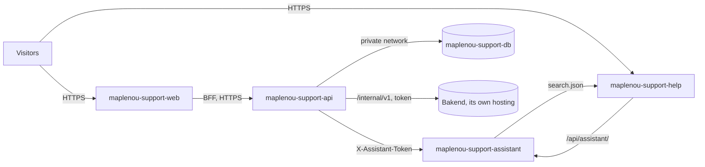

# Deployment on Render

`ServiceClient/render.yaml` (kept inside this folder so the Maplenou repository root is not touched) is a [Render Blueprint](https://render.com/docs/yaml-spec):
it creates the customer service and its public help centre on [Render](https://render.com) in one go (DEC-CS12-03).
Bakend, the Flutter app and `Site_vitrine` keep their own hosting; the Blueprint deploys nothing else.

| Render service | What it is | Address (if Render keeps the name) |
| --- | --- | --- |
| `maplenou-support-db` | PostgreSQL 16, private network only (`ipAllowList: []`) | — |
| `maplenou-support-api` | Spring Boot API (`ServiceClient/backend`) | `https://maplenou-support-api.onrender.com` |
| `maplenou-support-web` | web app for requesters and staff (`ServiceClient/frontend`) | `https://maplenou-support-web.onrender.com` |
| `maplenou-support-help` | public help centre: **user guide only** (FR/EN) | `https://maplenou-support-help.onrender.com` |
| `maplenou-support-assistant` | documentation assistant (Ollama cloud), knows the user guide only | `https://maplenou-support-assistant.onrender.com` |



## What you need

1. A Render account connected to GitHub, with access to the `Maplenou` repository.
2. **Bakend reachable over HTTPS** (for example `https://api.maplenou.tg`): sign-in uses Maplenou accounts
   (`AUTH_MODE=maplenou`) and orders/deliveries are read from Bakend. Block `/internal/` on Bakend's public proxy
   for everyone except this API (Bakend's `MANUEL.md`, §5).
3. These secrets, ready to paste **in the Render dashboard** (never in a file or a chat):
    - `SUPPORT_SERVICE_TOKEN` — the same value as Bakend's (32+ random characters, `openssl rand -base64 36`);
    - `CLOUDINARY_URL` — `cloudinary://<api_key>:<api_secret>@<cloud_name>` (attachments; the disk of a Render
      service is wiped at every restart);
    - `OLLAMA_API_KEY` — ollama.com → Settings → Keys;
    - `FIREBASE_WEB_VAPID_KEY` — Firebase console → Cloud Messaging → Web Push certificates (public key; leave
      empty to start without browser push).
4. Optional, for pushes: the Firebase service-account key (JSON file), see [below](#firebase-on-render).

`JWT_SECRET`, `METRICS_TOKEN` and the shared `ASSISTANT_INTERNAL_TOKEN` are generated by Render (`generateValue`).

## Create the services

1. Merge the branch into `main` (or choose the branch in the next step).
2. Render dashboard → **New → Blueprint** → choose the `Maplenou` repository, set **Blueprint Path** to `ServiceClient/render.yaml` → Render reads it and lists
   the five resources.
3. Fill the values Render asks for (`MAPLENOU_CORE_URL`, `SUPPORT_SERVICE_TOKEN`, `CLOUDINARY_URL`,
   `OLLAMA_API_KEY`, `FIREBASE_WEB_VAPID_KEY`) → **Apply**. The first build takes about 10 to 15 minutes.
4. If Render added a suffix to a name (name already taken), open **Environment** of each service and correct the
   addresses (`*_URL`, `CORS_ALLOWED_ORIGINS`, `ASSISTANT_*`), then **Manual Deploy → Deploy latest commit**.
5. Sign in on `https://maplenou-support-web.onrender.com` with a Maplenou **administrator** account, then give the
   support roles on the « Agents » page.

## Check the deployment

```bash
curl -fsS https://maplenou-support-api.onrender.com/actuator/health          # {"status":"UP"}
curl -fsS https://maplenou-support-web.onrender.com/login -o /dev/null && echo web ok
curl -fsS https://maplenou-support-help.onrender.com/healthz                 # ok
curl -fsS https://maplenou-support-assistant.onrender.com/api/assistant/health   # "indexReady": true after a minute
curl -s -o /dev/null -w '%{http_code}\n' https://maplenou-support-help.onrender.com/staff/fr/   # 404: internal guides not published
curl -s -o /dev/null -w '%{http_code}\n' -X POST https://maplenou-support-help.onrender.com/api/assistant/internal/triage   # 404
```

PowerShell: replace `curl` with `curl.exe`. `scripts/smoke-test.sh https://maplenou-support-api.onrender.com`
is not meant for a public deployment (it uses the demo login).

## Safety built in

- The API refuses to start on Render with the `demo` profile or a weak `JWT_SECRET` (`PublicDeploymentGuard`:
  Render sets `RENDER=true`; elsewhere set `PUBLIC_DEPLOYMENT=true` to get the same check).
- The help centre is built with `DOCS_SITES=user` and its assistant runs with `ASSISTANT_SITES=user`: staff and
  developer guides are never online.
- The assistant's internal endpoints (`/api/assistant/internal/*`) are refused by the help-centre server and, on
  the assistant's own address, need the generated `ASSISTANT_INTERNAL_TOKEN` (compared in constant time).
- The session cookie is `Secure` (`SESSION_COOKIE_SECURE=true`); CORS allows only the web app.
- `DATABASE_URL` comes from the database (`fromDatabase.connectionString`, converted to JDBC at start-up); the
  database accepts no connection from the Internet.

## Firebase on Render

1. Firebase console (project `maplenou-c21c2`) → **Project settings → Service accounts → Generate new private key**.
2. Render dashboard → `maplenou-support-api` → **Environment → Secret Files → Add**: name
   `firebase-service-account.json`, paste the content of the JSON file → **Save**. Render mounts it at
   `/etc/secrets/firebase-service-account.json`.
3. Same page, **Environment Variables → Add**: `FIREBASE_CREDENTIALS_FILE=/etc/secrets/firebase-service-account.json`
   → **Save, rebuild and deploy**. The log shows `Firebase Cloud Messaging enabled (project maplenou-c21c2)`.
4. Browser push: set `FIREBASE_WEB_VAPID_KEY` on `maplenou-support-web` (the other `FIREBASE_WEB_*` values are
   already in `render.yaml`). Mobile push: Bakend relays it (`MAPLENOU_PUSH_RELAY=true`, needs
   `SUPPORT_SERVICE_TOKEN`). Test: [Firebase push notifications](firebase.md#4-check-that-it-works).

## Free plan limits

| Limit (Render free plan) | Effect here | What to do |
| --- | --- | --- |
| A web service sleeps after 15 minutes without traffic, about 1 minute to wake up | first page after a quiet period is slow; scheduled jobs (outbox, auto-closure, legacy sync) run only while the API is awake | paid plan for the API (`starter`) |
| 750 free instance hours per month for the whole workspace | four services awake all the time would need ~2,900 hours | fine for a trial; paid plans for production |
| Free PostgreSQL expires 30 days after creation (1 GB) | the data is deleted after the 14-day grace period | upgrade the database plan before day 30 |
| Free web services cannot receive private-network traffic | the services call each other through their public HTTPS addresses | see Production |
| Disk wiped at restart | attachments must be on Cloudinary (`ATTACHMENT_STORAGE=cloudinary`) | already set |

Sources: [Render free plan](https://render.com/docs/free), [Blueprint reference](https://render.com/docs/yaml-spec).

## Production

1. Plans: database `basic-256mb` or more; `maplenou-support-api` and `maplenou-support-assistant` on a paid plan.
2. Make the API and the assistant private: in `render.yaml` change their `type: web` to `type: pserv` (and remove
   `healthCheckPath`), then on the web app replace `BACKEND_URL` by

    ```yaml
    - key: BACKEND_HOSTPORT
      fromService: { type: pserv, name: maplenou-support-api, property: hostport }
    ```

    and set `ASSISTANT_INTERNAL_URL`/`ASSISTANT_UPSTREAM` to `http://<host:port>` of the assistant the same way
    (`fromService … property: hostport` gives `host:port`; the web app adds `http://` itself, for the other two
    write the full URL in the dashboard). Only the web app and the help centre then have a public address.
3. Your domains: each web service → **Settings → Custom Domains** (for example `support.maplenou.tg`,
   `aide.maplenou.tg`); then update `CORS_ALLOWED_ORIGINS`, `SUPPORT_APP_URL`, `DOCS_BASE_URL`,
   `ASSISTANT_PUBLIC_BASE_URL` and `ASSISTANT_ALLOWED_ORIGINS`.
4. Backups: paid databases have daily backups; also see `scripts/backup.sh`.

## Updates

Every push to `main` that touches a service's folder redeploys it (`buildFilter`); database migrations run by
themselves at start-up. To deploy only once the GitHub Actions checks of the commit are green, set
`autoDeployTrigger: checksPass` in `render.yaml`. Work on a branch first (`ci/…`): its checks run on GitHub
before the merge — see [Repository](repository.md#branches-and-checks).

## Troubleshooting

| Symptom | Cause and fix |
| --- | --- |
| API stops with `Public deployment refused: …` | the guard names the variable: `SPRING_PROFILES_ACTIVE=default`, a generated `JWT_SECRET` |
| API stops with `ATTACHMENT_STORAGE=cloudinary requires CLOUDINARY_URL` | paste `CLOUDINARY_URL` in the dashboard |
| Sign-in says « The Maplenou sign-in service is temporarily unavailable » (`CORE_UNAVAILABLE`) | `MAPLENOU_CORE_URL` wrong, or Bakend asleep/unreachable; `SUPPORT_SERVICE_TOKEN` must be identical on both sides |
| Browser shows a CORS error | `CORS_ALLOWED_ORIGINS` must be exactly the web app's address (no trailing slash) |
| Help centre answers 502 on `/api/assistant/` | the assistant is waking up (try again after a minute) or `ASSISTANT_UPSTREAM` is wrong |
| Assistant `indexReady: false` | `ASSISTANT_INDEX_URL` must be the help centre's address; it retries every 10 s |
