# Design deliverables — mockups and screens

The design system of CS-02 (`design-system.md`) exists in three synchronised forms:

| Form | Where | Content |
| --- | --- | --- |
| **Design canvas (Claude Design)** | [Maplenou Service client — Mockups](https://claude.ai/artifact/GEnhzdFMLMLW8kWWd6hhcm) (owner's Claude account, private until shared) | 163 artboards on five pages: *Overview* (cover, colours, status badges, the six screen components) and one page per language × theme — *English · Light*, *English · Dark*, *Français · Clair*, *Français · Sombre*. Each language page holds thirteen screens at desktop 1440×900, tablet 834×1112 and mobile 390×844 — requester: help home (with the help search), new ticket, my tickets, resolved ticket (rating and reopening), notifications (push), account; support: dashboard (with satisfaction), queue (CSV export), ticket workspace (canned replies, assistant draft, actions on Maplenou), reports, statuses and priorities, permissions per role, replies and messages (CS-12). A page never mixes languages or themes. Components: `HelpHome`, `NewTicket`, `SupportDashboard`, `TicketWorkspace`, `RequesterScreens` and `SupportScreens` (`screen` property). |
| **Design catalogue in the app** | `/design` (`frontend/src/app/design/page.tsx`) | every token and shared component rendered by the real CSS and React components, switchable between FR/EN and light/dark/system |
| **Screens as built** | this page (`docs/ux-ui/screens/`) | screenshots of the running application and documentation, both languages and both themes |

The canvas uses the colour values of `frontend/src/app/globals.css` (light and dark) and the texts of
`frontend/src/lib/i18n/messages/`. When a token or a label changes, update the code first, then the matching
screen component of the canvas (`HelpHome`, `NewTicket`, `SupportDashboard`, `TicketWorkspace`, `RequesterScreens`, `SupportScreens`): every artboard
of every page is an instance of these four components with `locale`, `theme` and `device` set, so one change
reaches all 48 screens.

!!! info "Figma file retired"
    The earlier Figma file (iteration 2) is replaced by the design canvas on the owner's request (iteration 3). It
    is no longer updated and may be deleted by its owner.

!!! note "How the screenshots were produced"
    With the demo stack (`docker compose up`), Playwright opens each screen with the `maplenou_locale` and
    `maplenou_theme` cookies set, at 1440×900 (desktop) or 390×844 (mobile). They show demo data only.

## Screens as built

| Screen | Image |
| --- | --- |
| 01 Login — FR light | 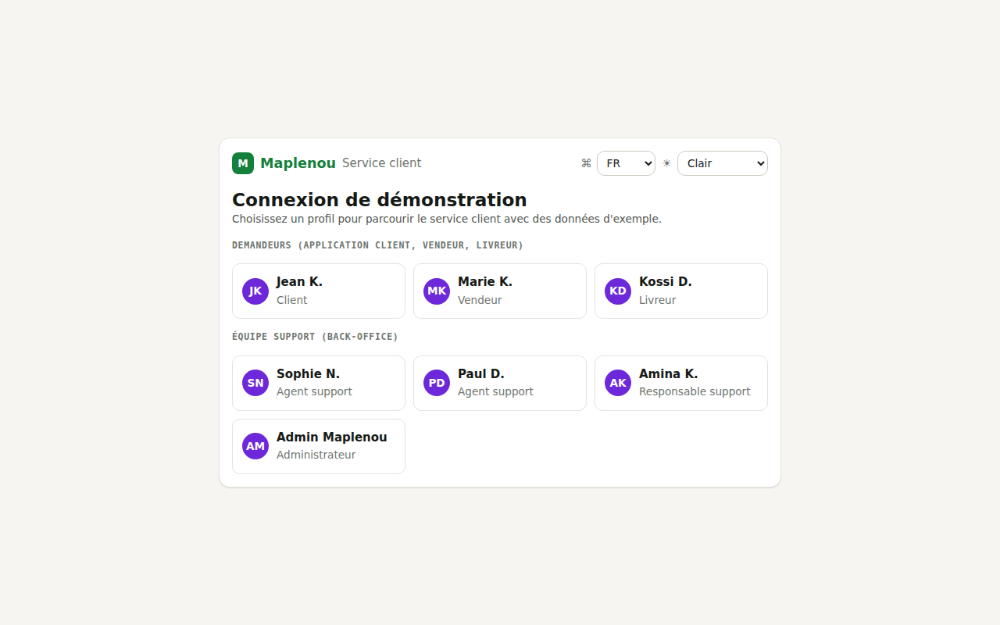{ width="360" loading=lazy } |
| 02 Login — EN dark | 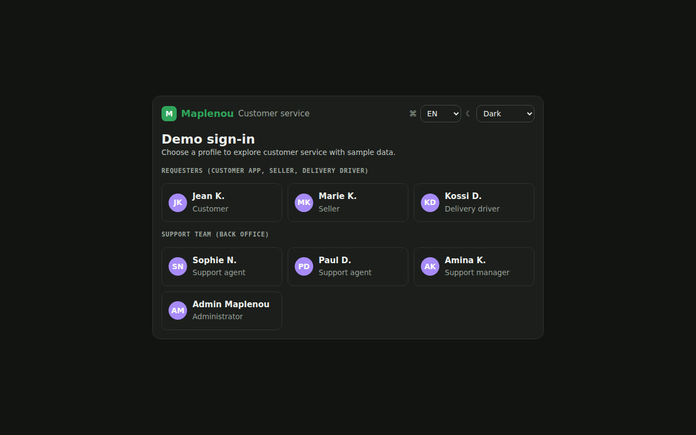{ width="360" loading=lazy } |
| 03 Requester help home — FR light (mobile) | 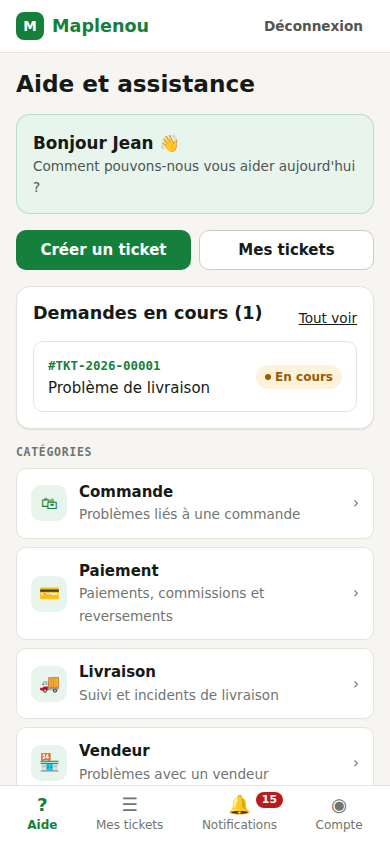{ width="360" loading=lazy } |
| 04 Requester help home — EN dark (mobile) | 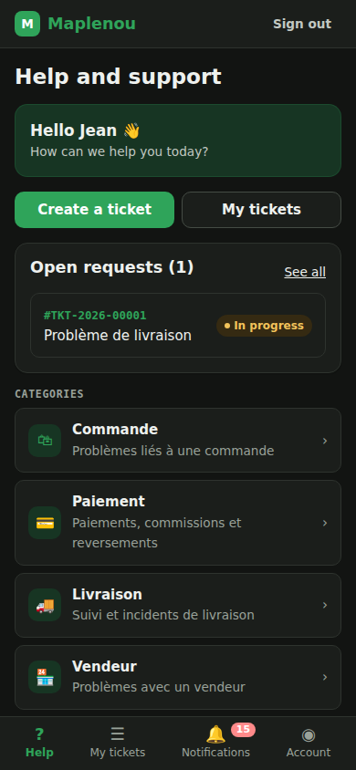{ width="360" loading=lazy } |
| 05 Create ticket — FR light (mobile) | 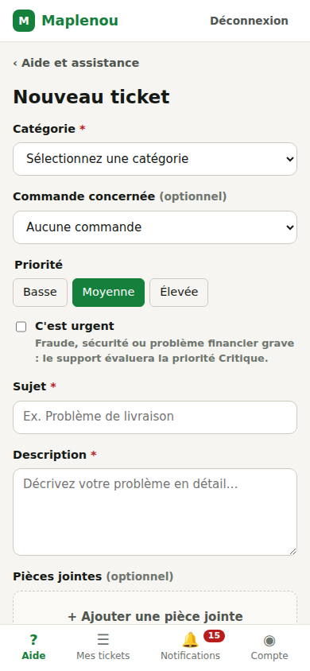{ width="360" loading=lazy } |
| 06 My tickets — EN light (mobile) | 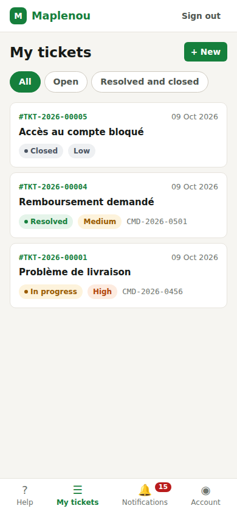{ width="360" loading=lazy } |
| 07 Notifications — FR dark (mobile) | 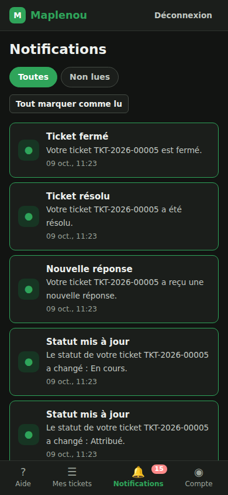{ width="360" loading=lazy } |
| 08 Account & preferences — EN light (mobile) | 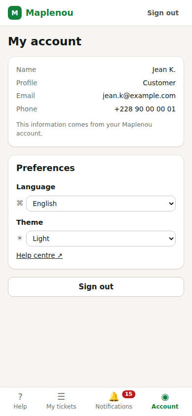{ width="360" loading=lazy } |
| 09 Support dashboard — FR light | 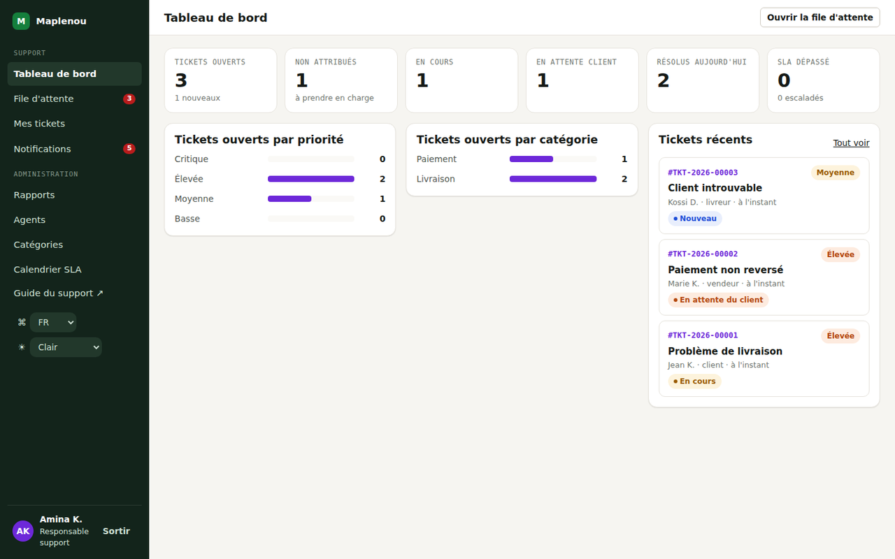{ width="360" loading=lazy } |
| 10 Support dashboard — EN dark | 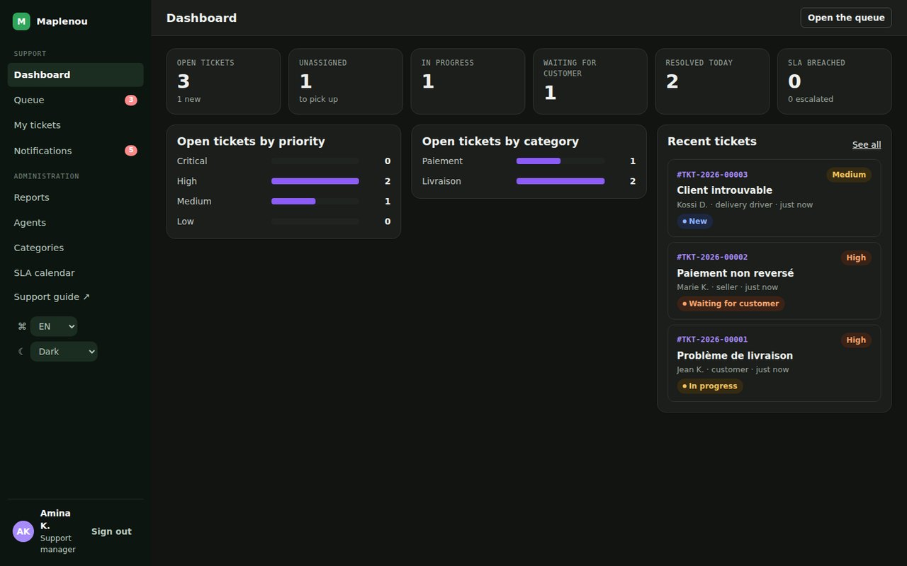{ width="360" loading=lazy } |
| 11 Queue — EN light | 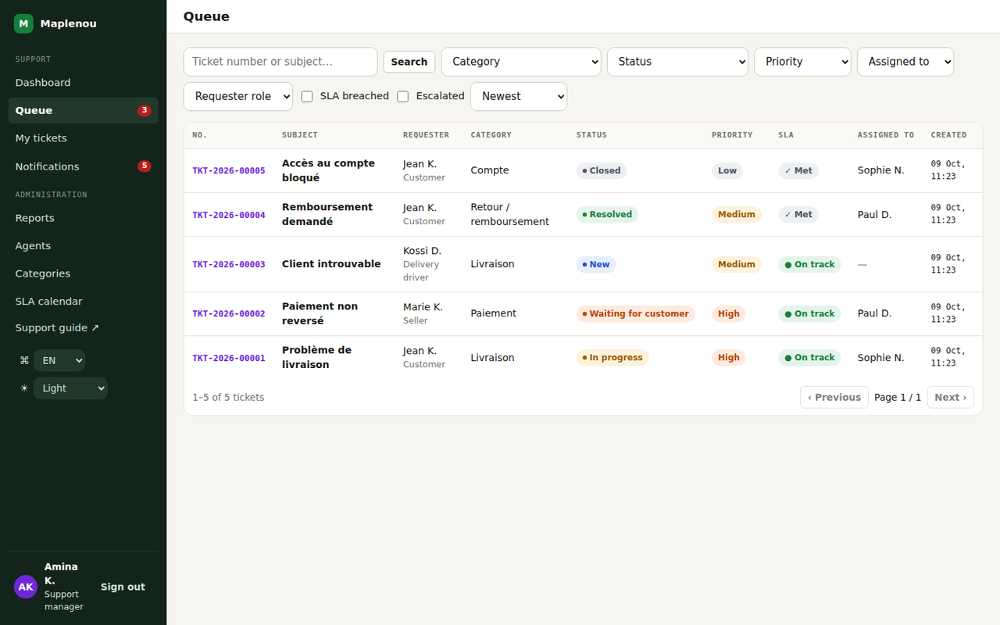{ width="360" loading=lazy } |
| 12 Ticket workspace — FR light | 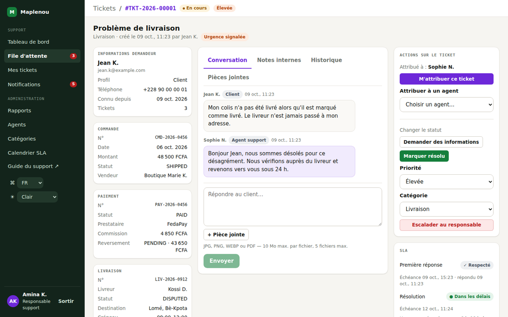{ width="360" loading=lazy } |
| 12b Ticket workspace — EN dark | 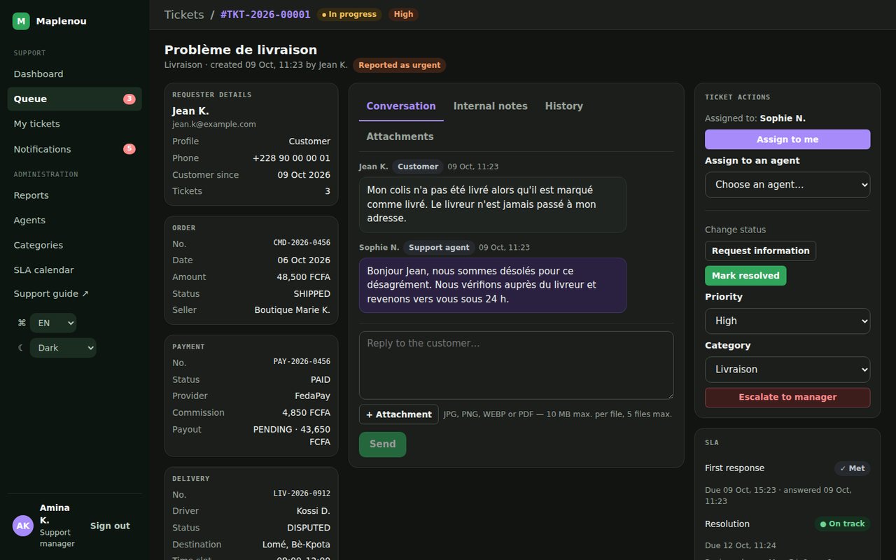{ width="360" loading=lazy } |
| 13 Reports — FR light | 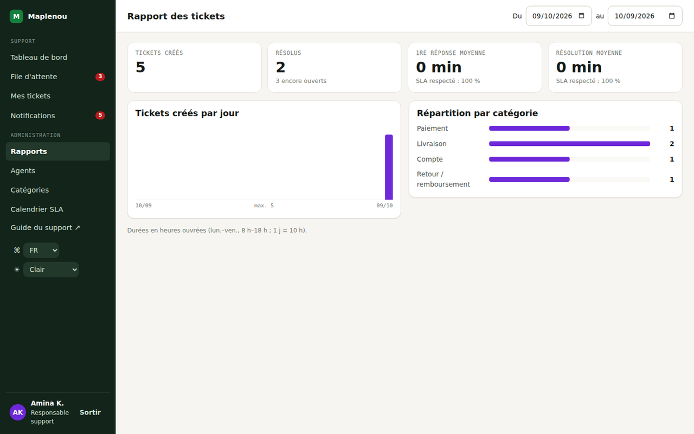{ width="360" loading=lazy } |
| 14 Admin categories — EN dark | 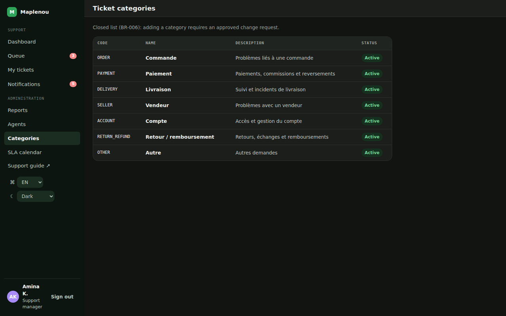{ width="360" loading=lazy } |
| 15 Docs user guide — FR light with assistant | 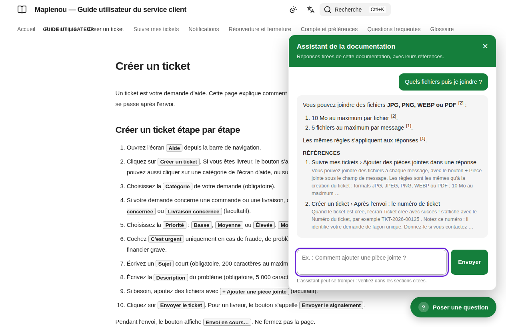{ width="360" loading=lazy } |
| 16 Docs staff guide — EN dark with assistant | 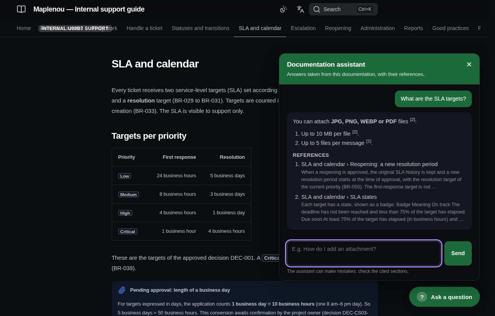{ width="360" loading=lazy } |
