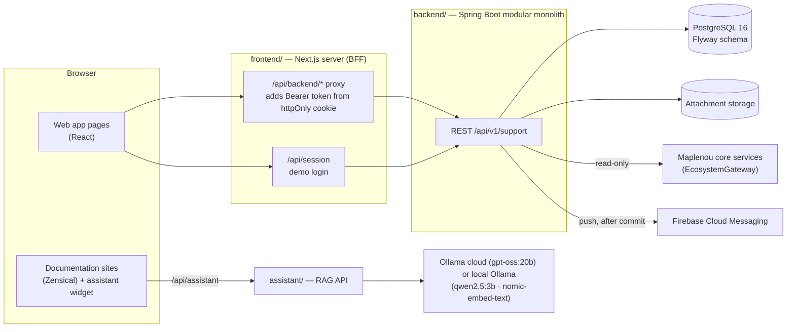

# Architecture

Cette page résume la construction du système. Les documents de référence (en anglais) sont la
[reference architecture](/developer/en/architecture/reference-architecture/), l'[architecture overview](/developer/en/architecture/)
et les [architecture decisions](/developer/en/architecture/decisions/).

## Contexte du système

Les applications mobiles Flutter (hors de ce dépôt) appellent la même API avec un jeton bearer.

## Monolithe modulaire

Le backend est une seule application déployable, découpée en modules par capacité métier : `ticket`, `sla`,
`attachment`, `notification`, `context`, `security`, `user`, `report`, `admin`, plus `demo` et `common`. Les modules
sont des paquets Java sous `com.maplenou.support` ; leurs frontières sont une convention, pas encore imposée par un
outil (Spring Modulith ou ArchUnit figurent parmi les améliorations candidates de la reference architecture).

À l'intérieur d'un module, les couches sont :

| Couche | Exemple |
| --- | --- |
| Web | `ticket.web.TicketController`, enregistrements de requête/réponse `TicketRequests`, `TicketViews` |
| Services applicatifs | `TicketCommandService` (commandes), `TicketQueryService` (lectures) |
| Politique | `TicketAccessPolicy` — toutes les décisions d'autorisation sur un ticket |
| Règles du domaine | `ticket.domain.Workflow`, `TicketNumbers`, `sla.BusinessCalendar` (sans framework) |
| Persistance | dépôts Spring Data JPA sur le schéma Flyway |

## Ports et adaptateurs

Tout ce que le module ne maîtrise pas passe par une interface aux adaptateurs interchangeables :

| Port | Adaptateurs dans le dépôt | Choisi par |
| --- | --- | --- |
| `context.EcosystemGateway` | `DemoEcosystemGateway`, `HttpEcosystemGateway` | `ECOSYSTEM_MODE` = `demo` / `http` |
| `notification.PushSender` | `LoggingPushSender`, `FirebasePushSender` | `FIREBASE_CREDENTIALS_FILE` vide / renseigné |
| `attachment.BinaryStorage` | `LocalFileStorage` | `ATTACHMENTS_DIR` |
| Décodage des JWT | `JwtConfig` HS256 (démo, tests) ou une URI d'émetteur | `JWT_SECRET` défini / `issuer-uri` configurée |

## Backend-for-frontend

Le navigateur ne voit jamais le jeton d'accès. Le serveur Next.js le conserve dans le cookie httpOnly
`maplenou_session` et transmet les appels de `/api/backend/api/v1/support/**` à l'API avec un en-tête
`Authorization: Bearer`. Seuls les chemins `api/v1/support` sont transmis, et les requêtes qui modifient l'état
doivent venir de la même origine. Les détails sont dans [Frontend](frontend.md).

## Règles côté serveur, effets de bord après commit

- Le serveur décide ; l'interface affiche ce que l'API autorise. Chaque réponse de ticket contient `allowedActions`,
  calculé par `TicketAccessPolicy`, et chaque commande le vérifie de nouveau. Tout ce qui n'est pas listé est refusé.
- Chaque commande sur un ticket s'exécute dans une transaction avec un verrou de ligne sur le ticket (`findForUpdate`).
- Les modifications de ticket publient un `TicketEvent`. `NotificationService` le traite **après le commit**, dans sa
  propre transaction, et absorbe ses propres erreurs : un problème de notification ne peut jamais annuler une
  modification de ticket. L'envoi des push est un répartiteur planifié séparé, avec nouvelles tentatives.
- La base de données sert de filet de sécurité : contraintes, séquence pour les numéros de ticket et déclencheur
  « ajout seul » sur `ticket_history`.

!!! note "Limite connue"
    Si le processus s'arrête entre le commit et l'écouteur d'événement, la notification correspondante est perdue.
    La reference architecture recommande une boîte d'envoi transactionnelle (outbox) avant la production.

## Documentation et assistant

Trois publics (utilisateur, personnel, développeur) × deux langues (français, anglais) donnent six sites Zensical.
Un service distinct, l'assistant, répond aux questions à partir de l'index de recherche d'un site et cite les sections
utilisées. Voir [Sites de documentation](documentation.md) et [Assistant de documentation](assistant.md).

## Documents d'architecture

| Document (anglais) | Contenu |
| --- | --- |
| [Reference architecture](/developer/en/architecture/reference-architecture/) | plan, styles, revue de conformité, réutilisation du cœur de ticketing |
| [Architecture overview](/developer/en/architecture/) | schéma du système et tableau des paquets du backend |
| [Decisions](/developer/en/architecture/decisions/) | choix techniques et interprétations DEC-CS03-xx |
| [Database model](/developer/en/architecture/database-model/) | tables, règles imposées par la base, index |
| [API specification](/developer/en/architecture/api-specification/) | endpoints, erreurs, recherche et filtres |
| [Ecosystem integration](/developer/en/architecture/ecosystem-integration/) | `EcosystemGateway` et contrat HTTP proposé |
| [Notifications](/developer/en/architecture/notifications/) | événements, push, langues |
| [Security review](/developer/en/architecture/security/) | contrôles et liste « avant la production » |
| [Ticket state](/developer/en/diagrams/uml/ticket-state/), [sequence](/developer/en/diagrams/uml/ticket-sequence/), [domain](/developer/en/diagrams/uml/ticket-domain-class/) | diagrammes UML |
