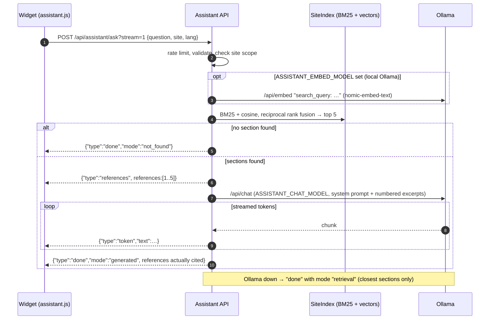

# Assistant de documentation

L'assistant (`assistant/`) répond aux questions portant sur un site de documentation dans une langue, en utilisant
uniquement le contenu de ce site, et cite les sections exactes qu'il a utilisées. Son modèle de langage est servi
par [Ollama](https://ollama.com) : par défaut **Ollama cloud** (`OLLAMA_URL=https://ollama.com` avec une clé d'API,
décision du responsable DEC-CS10-18 du 2026-10-29 — rien à installer, aucun modèle sur le disque), ou un Ollama sur
l'ordinateur ou dans un conteneur (voir [Ollama : cloud, sur l'ordinateur ou dans Docker](#ollama-cloud-sur-lordinateur-ou-dans-docker)).
Avec Ollama cloud, la question et les extraits de documentation sélectionnés sont envoyés à ollama.com ; avec un
Ollama local, rien ne quitte la machine qui l'héberge.

## Fonctionnement

1. **Index.** Au démarrage, le service lit `<site>/<lang>/search.json` pour chaque site autorisé et les deux
   langues. Dans Docker, il les récupère en HTTP sur le serveur de documentation (`ASSISTANT_INDEX_URL=http://docs`
   → `http://docs/<site>/<lang>/search.json`) : les sites ne sont construits qu'une fois, dans l'image docs ; sans
   Docker, il les lit dans un dossier (`ASSISTANT_INDEX_ROOT`). Ce sont les index de recherche que Zensical écrit en
   construisant un site : chaque élément est une section de page avec sa `location` (chemin de la page + ancre), son
   titre, son fil d'Ariane (`path`) et son texte HTML. Ainsi, une référence pointe exactement vers la section que voit
   le lecteur.
2. **Classement lexical.** Chaque section est découpée en mots (sans accents, mots vides français et anglais,
   racinisation légère du pluriel) et classée avec **BM25** ; titres et fils d'Ariane comptent double.
3. **Classement sémantique (facultatif).** Seulement si `ASSISTANT_EMBED_MODEL` est renseigné (Ollama local :
   **`nomic-embed-text`**) : en arrière-plan, le service calcule l'embedding de chaque section (préfixe
   `search_document:`, mis en cache dans `ASSISTANT_CACHE_DIR` par site, langue et empreinte du contenu). La question
   est vectorisée avec le préfixe `search_query:` et comparée par similarité cosinus ; les sections sous 0,55 sont
   ignorées. Avec `ASSISTANT_EMBED_MODEL` vide — le défaut avec Ollama cloud, qui sert des modèles de conversation —
   rien n'est vectorisé et la recherche est uniquement BM25.
4. **Fusion.** Les deux classements sont fusionnés par **reciprocal rank fusion** (score `1 / (60 + rang)`) et les
   `ASSISTANT_TOP_K` meilleures sections (5) sont conservées. Tant que les embeddings ne sont pas prêts, la recherche
   est uniquement lexicale.
5. **Génération.** Les sections sont numérotées `[1]…[n]` et envoyées avec un prompt système propre à la langue à
   Ollama `/api/chat` avec le modèle de conversation `ASSISTANT_CHAT_MODEL` — **`gpt-oss:20b`** sur Ollama cloud
   (effort de raisonnement `think: "low"` venant de `ASSISTANT_THINK`), **`qwen2.5:3b`** avec un Ollama local —
   température 0,1, contexte de 4 096 jetons. Si `OLLAMA_API_KEY` est renseignée, chaque requête porte
   `Authorization: Bearer <clé>`.
6. **Citations.** La réponse cite les passages sous la forme `[n]`. Le service ne garde que les références
   réellement citées ; si le modèle n'en cite aucune, il renvoie les trois meilleures sections marquées
   `cited: false` (le widget les affiche comme « Voir aussi »). Chaque référence porte `title`, `breadcrumb`, un
   extrait et l'`url` absolue de la section (`ASSISTANT_PUBLIC_BASE_URL` + `/<site>/<lang>/<location>`).
7. **Solutions de repli.** Aucune section correspondante → `mode: "not_found"` avec un message fixe. Ollama
   injoignable ou modèle de conversation absent → `mode: "retrieval"` : les sections les plus proches, listées comme
   références, sans texte généré.
8. **Cache des réponses.** Une réponse générée est gardée en mémoire et renvoyée directement pour la même question
   (même site et même langue ; casse et espaces superflus ignorés) — voir la section « Cache des réponses ».



## Carte du code

| Fichier | Responsabilité |
| --- | --- |
| `app/main.py` | fabrique d'application Starlette `create_app`, routes, limitation de débit, validation des requêtes, CORS, tâches de démarrage en arrière-plan (index en HTTP, téléchargement des modèles, embeddings) |
| `app/service.py` | `Assistant` : chargement des index (`load` depuis un dossier, `load_from_url`), `embed_all`, `retrieve`, `ask`, `ask_stream`, références, solutions de repli, cache des réponses |
| `app/index.py` | `Section`, `load_sections` (fichier search.json), `parse_sections` (contenu de search.json), `Bm25`, `cosine`, `SiteIndex.search` (fusion des classements) |
| `app/text.py` | HTML vers texte, suppression des accents, découpage en mots, mots vides |
| `app/ollama.py` | client `Ollama` : `/api/tags`, `/api/pull`, `/api/embed`, `/api/chat` (simple et en flux) ; en-tête `Authorization: Bearer` quand une clé d'API est définie (Ollama cloud), option `think` |
| `app/cache.py` | `TtlLru` : cache LRU borné avec durée de vie et compteurs de succès/échecs |
| `app/prompts.py` | prompts système, message de contexte, textes `not_found` et « recherche seule » en FR et EN |
| `app/config.py` | `Settings` lus dans les variables d'environnement |
| `documentation/shared/assistant/assistant.js` | le widget présent sur chaque site ; lit `window.MAPLENOU_DOCS` dans `config.js` |

Lancez-le avec `uvicorn --factory app.main:create_app`. Une tâche d'arrière-plan s'exécute alors, dans cet ordre :

1. **Index.** Avec `ASSISTANT_INDEX_URL`, le service récupère chaque `search.json` sur le serveur de documentation,
   en réessayant (toutes les 10 s, puis toutes les 60 s) jusqu'à les avoir tous lus — le serveur docs peut démarrer
   après l'assistant. Sans cette variable, les index sont lus dans `ASSISTANT_INDEX_ROOT` au démarrage. Tant
   qu'aucun index n'est chargé, `POST /api/assistant/ask` répond `503 INDEX_LOADING`.
2. **Modèles.** Avec `ASSISTANT_PULL_MODELS=true` et un Ollama local, il attend Ollama jusqu'à 5 minutes, puis
   télécharge le modèle d'embeddings et le modèle de conversation via `/api/pull` s'ils ne sont pas encore installés
   (premier démarrage uniquement). Un échec de téléchargement est journalisé et le service continue de fonctionner.
   Avec Ollama cloud (`OLLAMA_API_KEY` renseignée), il ne télécharge jamais rien : les modèles sont déjà sur
   ollama.com (`.env.example` fixe `ASSISTANT_PULL_MODELS=false`).
3. **Embeddings.** Étape sautée si `ASSISTANT_EMBED_MODEL` est vide (recherche lexicale). Sinon, il calcule les
   vecteurs des sections, en réessayant toutes les 20 s (30 tentatives) tant
   qu'Ollama n'est pas prêt ; les réponses lexicales fonctionnent pendant ce temps.

## API

### GET /api/assistant/health

```json
{ "status": "ok", "ollama": true, "ollamaCloud": true, "chatModel": "gpt-oss:20b", "embeddings": false, "indexReady": true,
  "answerCache": { "entries": 12, "hits": 30, "misses": 14 },
  "sites": { "user/fr": 42, "user/en": 41, "staff/fr": 30, "staff/en": 30, "developer/fr": 120, "developer/en": 400 } }
```

`ollama` vaut `false` si Ollama est injoignable (avec Ollama cloud : aussi si la clé d'API est refusée),
`ollamaCloud` vaut `true` si une `OLLAMA_API_KEY` est configurée, `chatModel` vaut `null` si le modèle de
conversation n'est pas installé (ou pas proposé par Ollama cloud), `embeddings` indique si le classement sémantique
est actif (toujours `false` sans modèle d'embeddings), `indexReady` si au moins un index est chargé
(les questions sont acceptées), `answerCache` donne le nombre de réponses en cache et les succès et échecs du cache
depuis le démarrage, et `sites` donne le nombre de sections indexées (les nombres ci-dessus ne sont qu'un exemple).
Le point de terminaison répond toujours `200` dès que le service tourne ; le contrôle de santé Docker l'utilise.

### POST /api/assistant/ask

```bash
curl -s http://localhost:8006/api/assistant/ask \
  -H 'Content-Type: application/json' \
  -d '{"question": "How do I add an attachment?", "site": "user", "lang": "en"}'
```

```json
{ "answer": "Attach JPG, PNG, WEBP or PDF files up to 10 MB [1].",
  "references": [ { "n": 1, "title": "Add an attachment", "breadcrumb": "Create a ticket › Add an attachment",
                    "url": "http://localhost:8006/user/en/create-ticket/#add-an-attachment",
                    "excerpt": "…", "cited": true } ],
  "mode": "generated", "model": "gpt-oss:20b", "timings": { "retrieval": 0.04, "generation": 3.2 } }
```

`mode` vaut `generated`, `retrieval` ou `not_found`. Avec `?stream=1` (ou `?stream=true`), la réponse est en NDJSON
(`application/x-ndjson`), un objet JSON par ligne : d'abord `{"type": "references"}`, puis des morceaux
`{"type": "token"}`, enfin `{"type": "done", …}` avec les mêmes champs que la réponse simple. Une réponse servie par
le cache des réponses arrive en un seul événement `done` avec `"cached": true`. Le widget utilise la forme en flux.

Les erreurs sont des « problem details » (`application/problem+json`) :

| Statut | `code` | Cas |
| --- | --- | --- |
| 400 | `MALFORMED_REQUEST` | le corps n'est pas un objet JSON |
| 400 | `QUESTION_REQUIRED` | question vide |
| 400 | `QUESTION_TOO_LONG` | plus de 500 caractères |
| 400 | `UNKNOWN_LANGUAGE` | `lang` autre que `fr` ou `en` |
| 404 | `UNKNOWN_SITE` | `site` absent de `ASSISTANT_SITES` (même réponse que le site existe ou non) |
| 429 | `RATE_LIMITED` | plus de `ASSISTANT_RATE_LIMIT` questions par minute depuis une même adresse client |
| 503 | `INDEX_LOADING` | les index de la documentation ne sont pas encore chargés (démarrage) ; réessayez dans un instant |

## Configuration

Tous les paramètres viennent de variables d'environnement (`assistant/app/config.py`) :

| Variable | Défaut | Signification |
| --- | --- | --- |
| `ASSISTANT_INDEX_URL` | vide | URL de base du serveur de documentation ; si elle est définie, les index sont lus sur `<url>/<site>/<lang>/search.json` (`http://docs` dans Compose) |
| `ASSISTANT_INDEX_ROOT` | `/srv/site` | dossier contenant `<site>/<lang>/search.json`, utilisé quand `ASSISTANT_INDEX_URL` est vide (exécution native) |
| `ASSISTANT_PULL_MODELS` | `true` (`.env.example` : `false`) | télécharger dans un Ollama local les modèles manquants au démarrage ; ignoré avec Ollama cloud |
| `ASSISTANT_SITES` | `user,staff,developer` | sites sur lesquels cette instance peut répondre ; un nom inconnu arrête le service au démarrage |
| `OLLAMA_URL` | `http://localhost:11434` | URL de base d'Ollama ; dans Compose elle vient de `.env` : `https://ollama.com` (Ollama cloud, `.env.example`), `http://host.docker.internal:11434` (Ollama sur l'ordinateur) ou `http://ollama:11434` (conteneur) |
| `OLLAMA_API_KEY` | vide | **secret** — clé d'API Ollama cloud, créée sur <https://ollama.com/settings/keys> ; envoyée en `Authorization: Bearer <clé>` par l'assistant seulement (côté serveur, jamais au navigateur) ; vide pour un Ollama local |
| `ASSISTANT_CHAT_MODEL` | `qwen2.5:3b` (`.env.example` : `gpt-oss:20b`) | modèle de conversation ; sur Ollama cloud, un modèle de votre offre (liste : <https://ollama.com/api/tags>) |
| `ASSISTANT_EMBED_MODEL` | `nomic-embed-text` (`.env.example` : vide) | modèle d'embeddings ; vide = pas d'embeddings, recherche par mots-clés (BM25) seulement — le choix habituel avec Ollama cloud, qui sert des modèles de conversation |
| `ASSISTANT_THINK` | vide (`.env.example` : `low`) | effort de raisonnement des modèles « thinking » comme `gpt-oss` (`low`, `medium`, `high`, ou `true`/`false`) ; vide = non envoyé (modèles sans raisonnement, par exemple `qwen2.5:3b`) ; toute autre valeur arrête le service au démarrage |
| `ASSISTANT_PUBLIC_BASE_URL` | vide | base des URL des références, par exemple `http://localhost:8006` |
| `ASSISTANT_ALLOWED_ORIGINS` | `http://localhost:8006` | origines CORS (utile seulement si le widget est servi depuis une autre origine) |
| `ASSISTANT_CACHE_DIR` | `/tmp/assistant-cache` (`/var/cache/assistant` dans l'image, volume `assistant-cache`) | cache des embeddings |
| `ASSISTANT_ANSWER_CACHE_SIZE` | `256` | réponses gardées en mémoire ; `0` désactive le cache des réponses |
| `ASSISTANT_ANSWER_CACHE_TTL` | `3600` | durée de vie d'une réponse en cache, en secondes |
| `ASSISTANT_TOP_K` | `5` | sections envoyées au modèle |
| `ASSISTANT_RATE_LIMIT` | `20` | questions par minute et par adresse client |
| `ASSISTANT_CHAT_TIMEOUT` | `120` | secondes accordées à une génération |

La longueur maximale d'une question (500 caractères) est fixée dans `Settings`. Le limiteur de débit utilise
`X-Real-IP` lorsque le proxy le fournit, sinon l'adresse du client ; il garde ses compteurs en mémoire, par conteneur.

## Ollama : cloud, sur l'ordinateur ou dans Docker

L'assistant a seulement besoin d'un serveur Ollama qu'il peut joindre. `OLLAMA_URL` dans `.env` choisit lequel ;
trois modes sont possibles (DEC-CS10-18, 2026-10-29 : Ollama cloud est le défaut, car le responsable a retiré Ollama
de son ordinateur) :

| Mode | `.env` | Commande de démarrage | Quand |
| --- | --- | --- | --- |
| **Ollama cloud** (par défaut) | `OLLAMA_URL=https://ollama.com`, `OLLAMA_API_KEY=<clé>`, `ASSISTANT_CHAT_MODEL=gpt-oss:20b`, `ASSISTANT_EMBED_MODEL=` (vide), `ASSISTANT_THINK=low`, `ASSISTANT_PULL_MODELS=false` | `docker compose --profile docs up -d --build --wait` | rien à installer et aucun modèle sur le disque ; nécessite une connexion Internet et un compte ollama.com |
| **Ollama installé sur l'ordinateur** | `OLLAMA_URL=http://host.docker.internal:11434`, `OLLAMA_API_KEY=` (vide), `ASSISTANT_CHAT_MODEL=qwen2.5:3b`, `ASSISTANT_EMBED_MODEL=nomic-embed-text`, `ASSISTANT_THINK=` (vide), `ASSISTANT_PULL_MODELS=true` | `docker compose --profile docs up -d --build --wait` | Ollama pour Windows/macOS est installé : pas d'image Ollama, les modèles déjà téléchargés sont réutilisés, rien ne quitte l'ordinateur |
| **Conteneur Ollama** | `OLLAMA_URL=http://ollama:11434`, sinon les mêmes valeurs que le mode ordinateur | `docker compose --profile docs --profile ollama up -d --build --wait` | hors ligne, ou sur un serveur sans Ollama installé |

### Configurer Ollama cloud

1. Créez un compte sur <https://ollama.com>, puis une clé sur <https://ollama.com/settings/keys>.
2. Collez-la dans `.env` : `OLLAMA_API_KEY=…`. C'est un **secret** : `.env` n'est jamais commité, la clé n'est lue
   que par le conteneur `assistant` et n'est jamais envoyée au navigateur (le widget appelle `/api/assistant/`, pas
   ollama.com).
3. Gardez `ASSISTANT_CHAT_MODEL=gpt-oss:20b`, un modèle de l'offre gratuite, ou choisissez-en un autre listé par
   <https://ollama.com/api/tags>. `ASSISTANT_THINK=low` garde court le raisonnement de `gpt-oss` (réponses plus
   rapides) ; laissez-la vide pour un modèle sans « thinking ».
4. Laissez `ASSISTANT_EMBED_MODEL` vide : Ollama cloud sert des modèles de conversation, la recherche se fait donc
   uniquement par mots-clés (BM25).
5. Démarrez la pile, puis vérifiez `curl -s http://localhost:8006/api/assistant/health` : `"ollama": true`,
   `"ollamaCloud": true` et `"chatModel": "gpt-oss:20b"`. `scripts/doctor.sh` (Windows : `scripts\doctor.ps1`)
   vérifie que la clé est définie et qu'ollama.com propose le modèle configuré.

En mode cloud, l'assistant ne télécharge jamais de modèle. L'offre gratuite a une utilisation limitée et traite une
requête à la fois (voir <https://ollama.com/pricing>) ; quand une requête échoue, l'assistant répond avec les seules
sections les plus proches (`mode: "retrieval"`), comme lorsqu'un Ollama local est arrêté.

### Utiliser plutôt un Ollama local

Dans les modes ordinateur et conteneur, l'assistant télécharge les modèles manquants dans cet Ollama à son premier
démarrage (`ASSISTANT_PULL_MODELS=true`, environ 2,3 Go une seule fois) ; vous pouvez aussi lancer vous-même
`ollama pull qwen2.5:3b` et `ollama pull nomic-embed-text`. L'assistant n'attend pas Ollama pour démarrer la
documentation : tant qu'Ollama est injoignable, il répond avec les seuls résultats de recherche, et il revérifie
toutes les 30 secondes — il suffit de lancer l'application Ollama plus tard.

Pour libérer l'espace disque du mode conteneur après être passé à Ollama cloud ou à l'Ollama de l'ordinateur :
`docker compose --profile ollama down`, `docker image rm ollama/ollama`, puis
`docker volume rm <projet>_ollama` (`docker volume ls` affiche le nom exact).

## Dépannage

Lancez `scripts\doctor.ps1` (Windows) ou `scripts/doctor.sh` : il vérifie Docker, `.env`, les ports de l'hôte, Ollama
(avec Ollama cloud : la clé d'API et le modèle sur ollama.com), la plateforme Maplenou et chaque conteneur, et affiche les dernières lignes de journal d'un conteneur qui ne démarre pas.

| Symptôme | Cause et solution |
| --- | --- |
| `curl http://localhost:8006/api/assistant/health` affiche `"ollama": false` avec l'Ollama de l'ordinateur | Ollama ne tourne pas → lancez l'application Ollama (ou `ollama serve`). Toujours false : l'application Ollama n'écoute que sur `127.0.0.1` ; définissez la variable d'environnement Windows `OLLAMA_HOST=0.0.0.0`, quittez et relancez Ollama, autorisez-le dans le pare-feu pour les réseaux privés |
| `"ollama": false` avec `OLLAMA_URL=https://ollama.com` | la clé manque ou est refusée (ollama.com répond `401 Unauthorized`, visible dans `docker compose logs assistant`) → créez une clé sur <https://ollama.com/settings/keys>, collez-la dans `OLLAMA_API_KEY` de `.env`, puis `docker compose --profile docs up -d --wait` ; sinon l'ordinateur n'a pas d'accès à Internet |
| `"chatModel": null` avec Ollama cloud | ollama.com ne propose pas le modèle configuré (nom erroné, ou absent de votre offre) → choisissez un modèle listé par <https://ollama.com/api/tags>, par exemple `ASSISTANT_CHAT_MODEL=gpt-oss:20b` |
| Les réponses d'Ollama cloud échouent ou s'arrêtent parfois | la limite d'utilisation de l'offre est atteinte, ou une autre requête est en cours (l'offre gratuite en traite une à la fois) → patientez, ou voyez <https://ollama.com/pricing> ; en attendant, l'assistant répond avec les seuls résultats de recherche |
| `"ollama": false` avec le conteneur | il n'a pas été démarré → ajoutez `--profile ollama` et définissez `OLLAMA_URL=http://ollama:11434` |
| `"chatModel": null` avec un Ollama local | le modèle est encore en cours de téléchargement (`docker compose logs -f assistant`) ou le téléchargement a échoué (réseau) → `ollama pull qwen2.5:3b` |
| `docker compose up` échoue avec `required variable … is missing a value` | `.env` est plus ancien que `.env.example` → copiez les nouvelles variables (`scripts\doctor.ps1` les liste) |
| `Bind for 0.0.0.0:8006 failed: port is already allocated` | un autre programme utilise le port → changez `DOCS_HOST_PORT` (et `DOCS_PUBLIC_URL`) dans `.env` |
| `--wait` s'arrête avec `container … is unhealthy` | `docker compose logs <service>` ; pour l'image de documentation, un lien cassé fait échouer la construction stricte : `uv run python documentation/build.py --strict` le montre |
| Les réponses sont lentes (30 s ou plus) | CPU seul et peu de mémoire : donnez au moins 6 Go à Docker Desktop (Settings → Resources), ou utilisez un modèle de conversation plus petit (`ASSISTANT_CHAT_MODEL=qwen2.5:1.5b`) |

## Cache des réponses

Répondre avec le modèle de conversation prend plusieurs secondes sur un CPU, et les visiteurs posent souvent la même
question. `Assistant` garde les réponses générées dans un `TtlLru` (`app/cache.py`) :

- **clé :** site, langue et question en minuscules avec les espaces normalisés ;
- **limite :** `ASSISTANT_ANSWER_CACHE_SIZE` réponses (256), la moins récemment utilisée sortant en premier, chacune
  pendant `ASSISTANT_ANSWER_CACHE_TTL` secondes (3600) ;
- **seules les réponses générées** sont conservées : les résultats `retrieval` et `not_found` sont recalculés, pour
  qu'une réponse s'améliore dès qu'Ollama ou le modèle de conversation revient ;
- **vidé** à chaque (re)chargement des index, pour qu'une nouvelle version de la documentation ne reçoive jamais de
  réponse fondée sur l'ancien texte.

Le cache vit en mémoire, par conteneur ; `/api/assistant/health` indique ses entrées, succès et échecs. Voir
[Cache et espace disque](caching.md).

## Sécurité

- **Périmètre de sites par instance.** Une instance ne charge et ne répond que sur `ASSISTANT_SITES`. Une instance
  publique tourne avec `ASSISTANT_SITES=user`, à côté d'un serveur docs construit avec le seul site utilisateur
  (`DOCS_SITES=user`) : le contenu interne n'est ni indexé ni accessible. N'exposez jamais sur un réseau public une instance qui sert `staff` ou `developer`.
- **Entrées bornées.** Les questions sont limitées à 500 caractères, `site` et `lang` sont validés, et chaque adresse
  client est soumise à une limitation de débit.
- **Protection contre l'injection de prompt.** Le prompt système limite les réponses aux extraits numérotés, exige
  une citation par affirmation, interdit d'inventer procédures, délais ou liens, et demande au modèle d'ignorer toute
  instruction de la question ou des extraits qui voudrait changer ces règles.
- **Pas de HTML venant du modèle.** Le widget affiche la réponse comme du texte (seules les citations `[n]` et le
  `**gras**` deviennent des éléments) et ne pointe que vers les URL de références calculées par le service.
- **Où partent les questions.** Les questions ne sont envoyées qu'à l'Ollama configuré (ollama.com en mode cloud,
  avec les extraits sélectionnés) et ne sont pas écrites dans les journaux. La clé Ollama cloud reste sur le serveur
  (`OLLAMA_API_KEY`, `.env`) ; un site qui doit garder ses questions sur ses propres machines utilise un Ollama local.
- **Jamais dans le navigateur.** `OLLAMA_API_KEY` ne fait partie ni de `config.js` ni d'aucune réponse du service.

## Changer de modèles

Les modèles sont de la configuration, pas du code. Définissez-les dans `.env`. Avec Ollama cloud, choisissez un
modèle listé par <https://ollama.com/api/tags> (rien n'est téléchargé) ; avec un Ollama local et
`ASSISTANT_PULL_MODELS=true`, l'assistant les télécharge dans Ollama au démarrage :

```bash
ASSISTANT_CHAT_MODEL=qwen2.5:7b
ASSISTANT_EMBED_MODEL=nomic-embed-text
ASSISTANT_THINK=
```

```bash
docker compose --profile docs up -d --build --wait   # the assistant restarts (and pulls the new models into a local Ollama)
curl -s http://localhost:8006/api/assistant/health
```

- Un modèle de conversation plus gros répond mieux mais est plus lent sur CPU ; `qwen2.5:3b` est le défaut car il
  tourne sur un portable ordinaire. Avec un modèle plus gros, envisagez d'augmenter `ASSISTANT_CHAT_TIMEOUT`.
- Changer de modèle d'embeddings invalide automatiquement le cache (le nom du modèle fait partie de la clé du cache).
- Les réglages suivants ne concernent que le conteneur `ollama`. Ollama garde au plus un modèle en mémoire (`OLLAMA_MAX_LOADED_MODELS=1`), traite une requête à la fois
  (`OLLAMA_NUM_PARALLEL=1`) et décharge un modèle inactif après `OLLAMA_KEEP_ALIVE` (`10m`), pour limiter la RAM
  utilisée.
- Pour utiliser un GPU NVIDIA, décommentez le bloc `deploy.resources.reservations.devices` du service `ollama` dans
  `docker-compose.yml` (nécessite le NVIDIA Container Toolkit).

## Projet Python et image Docker

L'assistant est un projet [uv](https://docs.astral.sh/uv/) à part entière (pas un paquet : `package = false`) :

| Fichier | Contenu |
| --- | --- |
| `assistant/pyproject.toml` | Python `>=3.12` ; dépendances fixées `starlette==0.48.0`, `uvicorn==0.37.0`, `httpx==0.28.1` ; groupe `dev` `pytest==8.4.2` ; réglages de pytest (`[tool.pytest.ini_options]`) |
| `assistant/uv.lock` | versions exactes de toutes les dépendances, écrites par uv 0.13.0 |
| `assistant/.python-version` | `3.12` |

Pour changer une dépendance, modifiez sa version fixée dans `pyproject.toml`, lancez `uv lock` et committez les deux
fichiers ; la construction de l'image échoue (`uv sync --locked`) si `uv.lock` n'est pas à jour.

`assistant/Dockerfile` a trois étapes sur `python:3.12-slim-bookworm`, avec uv 0.13.0 copié depuis
`ghcr.io/astral-sh/uv:0.13.0` et le cache d'uv en cache mount BuildKit :

| Étape | Contenu |
| --- | --- |
| `builder` | `uv sync --locked --no-dev` : dépendances d'exécution dans `/app/.venv`, puis le code |
| `test` | `builder` + `uv sync --locked` (groupe dev) + `tests/` ; sa commande lance `python -m pytest -q` |
| `runtime` | uniquement l'environnement virtuel et `app/`, utilisateur `assistant` (uid 10001), `HEALTHCHECK` sur `/api/assistant/health`, `uvicorn` sur le port 8000 |

```bash
docker build -t maplenou-assistant assistant                                     # runtime image
docker build --target test -t maplenou-assistant-test assistant && docker run --rm maplenou-assistant-test
```

## Tests

`assistant/tests/` (24 tests) fonctionne sans Ollama : `conftest.py` fournit de petits fichiers `search.json` et un `FakeOllama`
derrière `httpx.MockTransport` (embeddings déterministes, réponse préparée citant `[1]`). La suite couvre les
références citées et leurs URL, le prompt anglais, les réponses sans citation (« voir aussi »), le repli « recherche
seule », `not_found`, les événements en flux, le périmètre des sites, la validation, la santé, le cache des
embeddings, le cache des réponses (`test_cache.py`), le limiteur de débit, les utilitaires de texte et le classement
lexical. `test_cloud.py` couvre Ollama cloud : l'en-tête `Authorization: Bearer` et le niveau `think` des requêtes
de conversation, aucune requête d'embedding sans modèle d'embeddings, aucun téléchargement de modèle et
`"ollamaCloud": true` en mode cloud, et aucun en-tête `Authorization` avec un Ollama local.

```bash
./scripts/test.sh assistant                         # in Docker (builds the test stage)
cd assistant && uv sync && uv run pytest            # natively (Python 3.12+, uv)
```

Après `uv sync`, `.venv/bin/python -m pytest` (Windows : `.venv\Scripts\python -m pytest`) fonctionne aussi.

## Aide IA des agents et recherche du centre d'aide

Le même service a deux autres usages (DEC-CS11-08) :

| Endpoint | Qui l'appelle | Ce qu'il fait |
| --- | --- | --- |
| `GET /api/assistant/search?q=&site=user&lang=fr&limit=8` | l'accueil d'aide de l'application web (navigateur, CORS autorisé pour `CORS_ALLOWED_ORIGINS`) | renvoie les sections les plus proches du guide public — sans modèle de langage, débit limité, mis en cache 1 minute |
| `POST /api/assistant/internal/triage` | le backend, en-tête `X-Assistant-Token` | propose une catégorie et une priorité **parmi les listes envoyées par le backend** ; le texte du ticket est considéré comme non fiable (le modèle doit ignorer les instructions qu'il contient) ; une réponse hors des listes est refusée (`503 AI_UNAVAILABLE`) |
| `POST /api/assistant/internal/draft-reply` | le backend, en-tête `X-Assistant-Token` | rédige un brouillon de réponse à partir du **guide utilisateur seulement**, dans la langue de l'agent, signé de son nom ; les citations sont retirées ; l'agent le relit avant d'envoyer |

Les endpoints internes n'existent pas quand `ASSISTANT_INTERNAL_TOKEN` est vide (404), répondent `401` avec un
mauvais jeton, et sont bloqués par le serveur de documentation (`location ^~ /api/assistant/internal/ { return 404; }`)
et par Caddy. Activez l'aide IA avec `AI_ASSIST_ENABLED=true`, un jeton de 24 caractères ou plus dans
`ASSISTANT_INTERNAL_TOKEN` et `--profile docs`. Seuls le sujet, la description et les messages publics sont envoyés —
jamais de nom, de numéro de téléphone, d'e-mail ni de donnée de paiement. Tests : `assistant/tests/test_support.py`.
