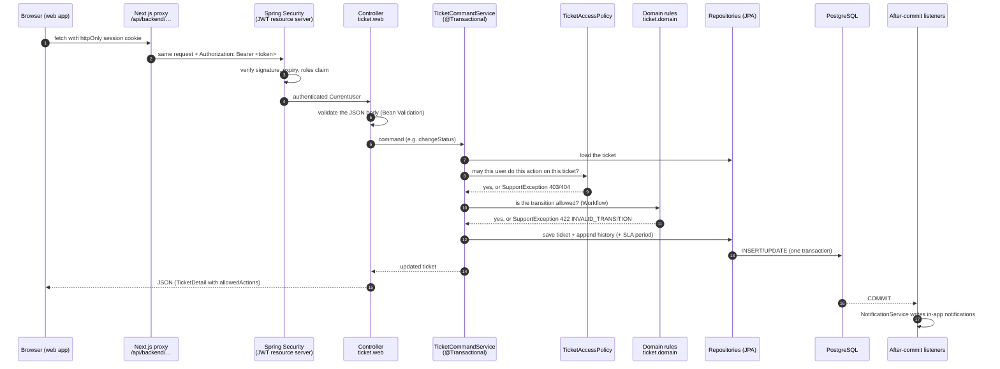
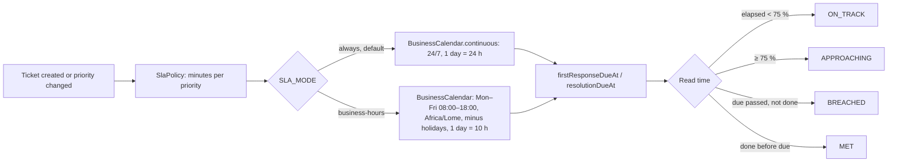
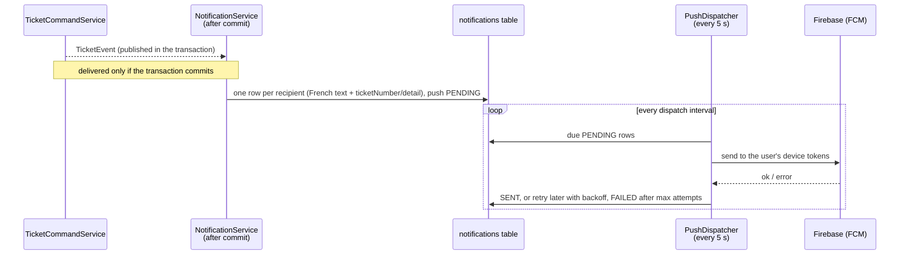

# Comment le backend traite une requête

Cette page suit une requête à travers l'API Spring Boot, puis décrit les principaux flux métier (création d'un
ticket, réponse, changement de statut, SLA, réouverture, notifications) et la façon de tester chacun d'eux à la main.
Le code se trouve dans `backend/src/main/java/com/maplenou/support`.
Une version interactive de cette page (chemin d'une requête, cycle de vie, calculateur de SLA) est la
[Maplenou Backend Map](https://claude.ai/artifact/Q6SwyLc83ptXLWtPKMHMNM) (compte Claude du propriétaire, privée tant qu'elle n'est pas partagée).

## Le chemin d'une requête

| Étape | Où | Ce qui peut arrêter la requête |
| --- | --- | --- |
| Authentification | `security/SecurityConfig`, décodeur JWT | `401 UNAUTHENTICATED` (jeton absent, expiré ou invalide) |
| Validation | enregistrements de requête de `ticket/web/TicketRequests` (`@NotBlank`, `@Size`, `@Pattern`) | `400 VALIDATION_FAILED` avec les erreurs par champ |
| Contrôle du rôle | `@PreAuthorize` sur les endpoints d'administration, de rapports et de tableau de bord | `403 FORBIDDEN` |
| Autorisation sur la ressource | `ticket/TicketAccessPolicy` (qui peut voir / agir sur *ce* ticket) | `404 NOT_FOUND` (les tickets des autres sont invisibles), `403 FORBIDDEN` |
| Règles métier | `TicketCommandService`, `ticket/domain/Workflow`, `attachment/AttachmentPolicy`, `sla/SlaService` | `422` avec un `code` stable et l'identifiant de la règle (`BR-xxx`) |
| Erreurs | `common/ApiExceptionHandler` | chaque erreur est un problème RFC 9457 : `status`, `code`, `detail` (en français), `rule` |

La réponse de chaque commande sur un ticket contient `allowedActions` : l'application web n'affiche que les boutons
que le backend accepterait, mais le backend vérifie de nouveau à chaque appel.

## Flux 1 — un demandeur crée un ticket

`POST /api/v1/support/tickets` → `TicketCommandService.create` :

1. **Qui :** uniquement les clients, vendeurs et livreurs (`BR-003`).
2. **Priorité :** Basse/Moyenne/Haute ; `CRITICAL` est refusée avec `422 CRITICAL_PRIORITY_RESERVED` (`BR-036`) ;
   « urgent » est enregistré comme un indicateur (`BR-037`).
3. **Catégorie :** elle doit exister et être active (`UNKNOWN_CATEGORY`) ; la liste vient du cache des données de
   référence.
4. **Références :** une référence de commande ou de livraison est vérifiée dans les propres données du demandeur via
   le port `EcosystemGateway` (`REFERENCE_NOT_ACCESSIBLE`, `REFERENCE_MISMATCH`, `ECOSYSTEM_UNAVAILABLE`).
5. **Pièces jointes :** type détecté d'après le contenu du fichier, limites de taille et de nombre
   (`AttachmentPolicy`) ; les fichiers sont écrits dans un stockage privé et **supprimés si la transaction est
   annulée**.
6. **Numéro :** `TKT-<année>-<séquence>` tiré d'une séquence PostgreSQL qui ne réutilise jamais une valeur.
7. **SLA :** échéances de première réponse et de résolution calculées sur le calendrier SLA (24 h/24 par défaut,
   `SLA_MODE`) ; une première ligne
   `SlaPeriod`.
8. **Historique :** entrée `CREATED` (ajout seul).
9. **Événement :** `TICKET_CREATED` → après le commit : confirmation pour le demandeur, « nouveau ticket » pour les
   responsables.

## Flux 2 — messages et notes internes

`POST /tickets/{id}/messages` (public) et `POST /tickets/{id}/internal-notes` (support uniquement) :

- `clientMessageId` rend une nouvelle tentative idempotente : envoyer deux fois le même identifiant n'enregistre
  qu'un message.
- La **première réponse publique du support** renseigne `firstRespondedAt` (SLA de première réponse respecté ou
  dépassé).
- La réponse d'un demandeur sur un ticket `WAITING_FOR_CUSTOMER` le fait repasser en `IN_PROGRESS`.
- Les notes internes ne sont jamais renvoyées aux demandeurs (`TicketQueryService` filtre selon la visibilité).

## Flux 3 — statut, priorité, catégorie, attribution, escalade

| Commande | Points clés des règles |
| --- | --- |
| `PUT /status` | transitions autorisées dans `Workflow` ; `CLOSED` refusé tant qu'une demande de réouverture est en attente (`REOPEN_PENDING`) |
| `PUT /priority` | support uniquement ; recalcule le SLA depuis la date de création, conserve l'historique (`BR-034`) |
| `PUT /assign` | `agentId` nul = « me l'attribuer » ; la cible doit être un agent du support actif (`INVALID_ASSIGNEE`) |
| `POST /escalate` | indicateur + motif, responsables notifiés (`DEC-CS03-10`) |

Chaque commande écrit une entrée d'historique et publie un événement ; les notifications suivent après le commit.

## Flux 4 — horloge SLA (24 h/24 ou heures ouvrées)

Depuis le 2026-10-29 (DEC-CS10-16), `SLA_MODE=always` est le défaut : `SlaService.calendar()` renvoie
`BusinessCalendar.continuous`, les échéances sont du simple temps écoulé (un ticket HIGH créé le vendredi à 22:00 doit
recevoir une première réponse le samedi à 02:00 et être résolu le samedi à 22:00), et les jours fériés ne sont pas
lus. Avec `SLA_MODE=business-hours`, la liste des jours fériés est lue en base une fois par période de cache
(`REFERENCE_CACHE_TTL`) et immédiatement après qu'un administrateur l'a modifiée.
`GET /api/v1/support/admin/sla-settings` renvoie `{mode, zone, opening, closing, minutesPerDay}` (opening et closing
valent `null` en mode 24 h/24) pour l'écran « Calendrier SLA ». Les échéances sont enregistrées au moment de leur
calcul (création, changement de priorité, réouverture) : changer de mode ne déplace donc pas les échéances des tickets
existants. Les données SLA ne sont jamais montrées aux demandeurs (`BR-014`).

## Flux 5 — réouverture

1. Le demandeur la demande sur un ticket `RESOLVED` (`POST /reopen-requests`) ; un ticket fermé ne peut pas être
   rouvert (`TICKET_CLOSED`) et une seule demande peut être en attente (`REOPEN_ALREADY_PENDING`).
2. Le support accepte ou refuse (`PUT /reopen-requests/{requestId}`) ; l'acceptation remet le ticket en
   `IN_PROGRESS` (ou un autre statut valide) et ouvre une nouvelle période SLA de résolution (`BR-055`) ; la décision
   est notifiée.

## Flux 6 — notifications et push

Un utilisateur n'est jamais notifié de sa propre action (sauf la confirmation de création). Les échecs du push ne
modifient jamais le ticket. Sans identifiants Firebase, le push est seulement journalisé (`LoggingPushSender`).

## Lectures, recherche et cache

- `TicketQueryService` construit la recherche à partir de `TicketSearchCriteria` (JPA Specification) : texte, statut,
  priorité, catégorie, agent attribué (`me`, `unassigned`, identifiant), rôle du demandeur, escaladé, SLA dépassé,
  dates ; un numéro de ticket complet donne une recherche exacte.
- Les demandeurs n'obtiennent jamais que leurs propres tickets ; les agents voient la file d'attente ; les tickets
  des collègues sont en lecture seule.
- Les données de référence (catégories actives, calendrier ouvré) sont mises en cache en mémoire avec une limite de
  taille et de durée ; les données des tickets ne sont jamais mises en cache. Voir
  [Cache et espace disque](caching.md).

## Tester le backend

| Objectif | Commande |
| --- | --- |
| Tous les tests automatisés, sans Java sur votre machine | `scripts/test.ps1 backend` (Windows) · `scripts/test.sh backend` |
| Tous les tests automatisés avec Java 21 | `cd backend && ./mvnw verify` (Testcontainers) ou avec `TEST_DATABASE_URL` |
| Une seule classe de test | `./mvnw -Dtest=BusinessCalendarTest test` · intégration : `./mvnw -Dit.test=CachingIT verify` |
| Parcourir l'API à la main | ouvrez `backend/http/support-api.http` dans VS Code (REST Client) ou IntelliJ et envoyez les requêtes dans l'ordre |
| Documentation interactive | <http://localhost:8081/swagger-ui.html> (profil demo) |
| Test de fumée d'une pile démarrée | `scripts/smoke-test.ps1` · `scripts/smoke-test.sh` |

Ce que couvrent les suites automatisées : des tests unitaires pour le calendrier ouvré, les objectifs et états SLA,
la validation des pièces jointes, la politique d'accès et les règles de notification ; des tests d'intégration
(`*IT`, vrai PostgreSQL) pour le cycle de vie complet, l'autorisation (qui peut voir et faire quoi), la recherche et
les filtres, les pièces jointes, le SLA, la réouverture, les notifications et les nouvelles tentatives du push, les
références de l'écosystème, le cache (`CachingIT`) et le format des erreurs de l'API.
