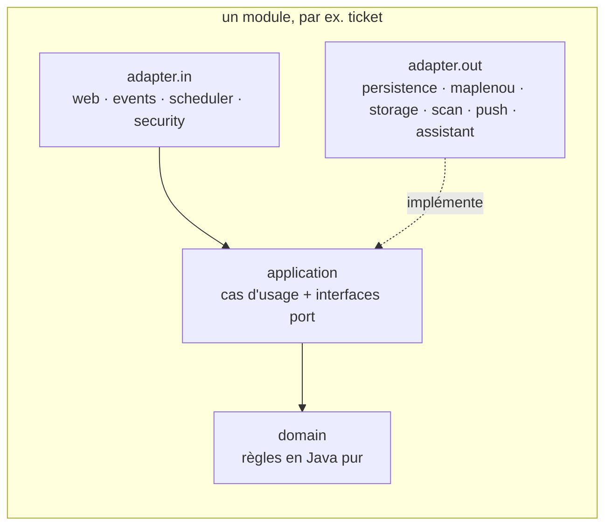
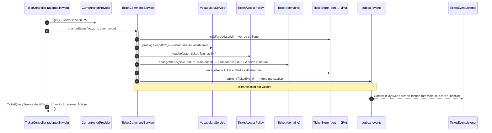

# Backend

Le backend est une application Spring Boot 4.1.1 sur Java 21 (`backend/`), avec PostgreSQL 16, Flyway, Spring
Security (serveur de ressources OAuth2), Micrometer/Prometheus, springdoc-openapi 3.1.1 et le SDK Firebase
Admin 9.11.0. Les tests d'intégration utilisent Testcontainers 2.0.5.

Cette page décrit la structure du code. Pour suivre une requête et les flux métier, avec la collection de tests
manuels, voir [Comment le backend traite une requête](backend-processing.md).

## Organisation des paquets — modules hexagonaux

Tout le code est sous `backend/src/main/java/com/maplenou/support/`. Chaque module métier a les trois mêmes couches
(DEC-CS11-01), et `ArchitectureTest` (ArchUnit) fait échouer la construction quand une règle est enfreinte :



| Module | `domain` | `application` (cas d'usage, ports) | adaptateurs |
| --- | --- | --- | --- |
| `ticket` | agrégat `Ticket` (reconstruit depuis un `Snapshot`), `vocabulary` (`StatusKind`, `Workflow`, `Priorities`), `PermissionMatrix`, `TicketAccessPolicy`, `Category`, `Satisfaction`, `CannedReply`, `AiSuggestion`, `ExternalAction`, `event.TicketEvent` | `TicketCommandService`, `TicketQueryService`, `VocabularyService`, `CategoryService`, `AutoCloseService`, `AiAssistService`, `ExternalActionService`, `CannedReplyService`, `TicketStatistics`, `LegacyImportService` ; ports `TicketStore`, `TicketSearch`, `ConversationStore`, `HistoryStore`, `VocabularyStore`, `AiAssistant`… | `in.web` (`TicketController`, `SupportToolsController`, `VocabularyController`, `CategoryController`, `CannedReplyController`), `in.events.AiTriageListener`, `in.scheduler.AutoCloseScheduler`, `out.persistence` (entités et dépôts JPA), `out.assistant.HttpAiAssistant` |
| `sla` | `BusinessCalendar`, `SlaPolicy`, `SlaState` (avec `PAUSED`), `SlaPeriod`, `Holiday` | `SlaService`, `SlaPeriodService`, `SlaAdminService` ; ports `HolidayStore`, `SlaPolicyStore`, `SlaPeriodStore` | `in.web.SlaAdminController`, `out.persistence` |
| `notification` | `Notification`, `MessageTemplate`, `DeviceToken` | `NotificationService`, `PushDispatcher`, `TemplateService`, `PushDiagnostics` ; ports `PushSender`, `MobilePushRelay`, `NotificationStore`, `TemplateStore` | `in.events.TicketEventListener`, `in.scheduler.PushDispatchScheduler`, `in.web.NotificationController`, `out.push` (Firebase, journal), `out.maplenou.BakendPushRelay`, `out.persistence` |
| `attachment` | `AttachmentPolicy` | `AttachmentService` ; ports `BinaryStorage`, `MalwareScanner` | `out.storage` (`LocalFileStorage`, `CloudinaryStorage`), `out.scan` (`NoMalwareScanner`, `ClamAvScanner`) |
| `context` | `Ecosystem` (résumés de commande avec sous-commandes, paiement, livraison, vendeur, remboursement) | `EcosystemService`, `ReferenceService` ; ports `EcosystemGateway`, `EcosystemActions`, `LegacyTicketSource` | `out.maplenou` (`BakendClient`, `HttpEcosystemGateway`, `HttpEcosystemActions`, `HttpLegacyTicketSource`), `in.web.MyReferencesController` |
| `identity` | `SupportUser`, `StaffAssignment`, `MaplenouRoles` | `UserDirectory`, `StaffRoleService`, `CoreLoginService` ; ports `UserStore`, `CoreAccounts`, `AccessTokenIssuer` | `in.security.UserSyncFilter`, `in.web` (`MeController`, `CoreLoginController`, `StaffAdminController`), `out.maplenou.CoreAccountClient`, `out.security.JwtAccessTokenIssuer`, `out.persistence` |
| `report` | — | utilise `ticket.application.TicketStatistics` | `in.web.DashboardController` |

| Paquet partagé | Contenu |
| --- | --- |
| `shared` | noyau utilisé par tous les modules : `Actor` (l'appelant), `Role`, `SupportException` (`code` stable + nature), `PageQuery`/`PageResult`, `event.DomainEvent`/`DomainEventPublisher` |
| `platform` | socle technique : `config.MaplenouProperties`, `security` (`SecurityConfig`, `JwtConfig`, `CurrentActorProvider`), `web.ApiExceptionHandler`, `outbox` (`OutboxEventPublisher`, `OutboxRelay`), `observability` (`RequestIdFilter`, `RateLimitFilter`, `MetricsAccessFilter`), `persistence.BaseEntity` |
| `demo` | profil de démonstration seulement : `DemoUsers`, `DevAuthController`, `DemoDataSeeder`, adaptateurs d'écosystème de démonstration |

Règles vérifiées par `ArchitectureTest` : `domain` ne dépend d'aucun framework ni d'aucune autre couche ;
`application` n'utilise que les paquets `stereotype` et `transaction` de Spring ; `adapter.in` n'utilise jamais
`adapter.out` ; les adaptateurs d'un module lui sont privés ; les modules ne dépendent que de l'`application` et du
`domain` des autres, sans cycle ; `shared` et `platform` ne dépendent d'aucun module ; les entités JPA ne vivent que
dans `adapter.out.persistence` (ou `platform`) ; les contrôleurs seulement dans `adapter.in.web`.

`MaplenouSupportApplication` active la planification, le travail asynchrone et les propriétés de configuration
`maplenou.*`, et déclare le bean `Clock` (UTC) que les services utilisent au lieu d'appeler `Instant.now()` — les
tests peuvent ainsi contrôler le temps.

## Flux d'une requête

Une commande sur un ticket passe toujours par les mêmes étapes : contrôleur → cas d'usage → politique → domaine → port.



- **Contrôleur** (`adapter.in.web`) : lie et valide la requête (enregistrements `@Valid` de `TicketRequests`), obtient
  l'appelant via `CurrentActorProvider`, le transforme en commande (`TicketCommands`), appelle un seul cas d'usage,
  puis renvoie une vue de `TicketQueryService`.
- **Cas d'usage** (`TicketCommandService`) : une méthode `@Transactional` par commande. Il verrouille le ticket via le
  port `TicketStore`, vérifie la politique, applique les règles du domaine, écrit l'historique en ajout seul et publie
  un `TicketEvent` dans l'outbox.
- **Politique** (`TicketAccessPolicy`) : calcule `allowedActions` à partir de la `PermissionMatrix` configurable
  (rôle × action × relation OWN/ASSIGNED/UNASSIGNED/ANY) et des gardes d'état du `Workflow` ; `require(...)` lève une
  erreur quand l'action n'est pas autorisée. Les demandeurs reçoivent `404` pour les tickets qui ne sont pas les leurs.
- **Domaine** (`ticket.domain`) : Java pur, testé sans Spring (`WorkflowTest`, `TicketAccessPolicyTest`). Les règles
  utilisent la *nature* du statut, jamais son code, pour que les administrateurs puissent renommer ou ajouter des
  statuts.
- **Adaptateur de persistance** (`adapter.out.persistence`) : entités Spring Data JPA converties depuis et vers
  l'instantané du domaine. Le schéma appartient à Flyway (`ddl-auto: validate`).

Les gardes de rôle au niveau des endpoints utilisent `@PreAuthorize` (tableau de bord, rapports, administration),
en plus de la politique au niveau de la ressource.

## Modèle d'erreur (RFC 9457)

Chaque erreur est un `application/problem+json` avec un `code` stable lisible par une machine et, si utile, la règle
métier `rule` :

```json
{ "status": 422, "title": "Unprocessable Content", "detail": "La priorité Critique est attribuée uniquement par le support…",
  "code": "CRITICAL_PRIORITY_RESERVED", "rule": "BR-036" }
```

Levez `common.SupportException` via ses fabriques ; `common.ApiExceptionHandler` la transforme en `ProblemDetail` :

| Fabrique | Statut | Usage |
| --- | --- | --- |
| `SupportException.notFound(what)` | 404 | ressource absente, ou ressource dont l'appelant ne doit pas connaître l'existence |
| `SupportException.forbidden(message, rule)` | 403 | authentifié mais non autorisé |
| `SupportException.businessRule(code, message, rule)` | 422 | requête bien formée qui viole une règle métier |
| `SupportException.conflict(code, message, rule)` | 409 | état conflictuel (demande en attente en double…) |
| `SupportException.badRequest(code, message, rule)` | 400 | saisie invalide |

Le gestionnaire associe aussi des codes aux exceptions du framework : `VALIDATION_FAILED` (avec une table `errors`
par champ), `MALFORMED_REQUEST`, `UNSUPPORTED_MEDIA_TYPE`, `METHOD_NOT_ALLOWED`, `MISSING_PART`, `MISSING_PARAMETER`,
`INVALID_PARAMETER`, `ATTACHMENT_TOO_LARGE` (413), `INVALID_MULTIPART`, `CONCURRENT_MODIFICATION` (verrou optimiste),
`DATA_CONFLICT`, `FORBIDDEN`, `NOT_FOUND` et `INTERNAL_ERROR`. Les traces de pile et les messages des erreurs
inattendues ne sont jamais renvoyés (`server.error.include-message: never`, `include-stacktrace: never`).

Les textes `detail` sont rédigés en français pour les utilisateurs finaux. Les clients doivent se fonder sur `code`,
jamais sur `detail` : l'application web traduit les codes en anglais dans
`frontend/src/lib/i18n/messages/errors.ts` (`ERROR_CODES_EN`). Quand vous ajoutez un code, ajoutez-y son texte anglais.

## Base de données et migrations Flyway

Le schéma se trouve dans `backend/src/main/resources/db/migration/` :

| Migration | Contenu |
| --- | --- |
| `V1__support_schema.sql` | projection des utilisateurs, catégories, `ticket_number_seq`, tickets, messages, pièces jointes, `ticket_history` en ajout seul (déclencheur `trg_ticket_history_append_only`), demandes de réouverture, périodes SLA, jours fériés, notifications, jetons d'appareil |
| `V2__notification_i18n.sql` | `notifications.ticket_number` et `notifications.detail` pour que les clients affichent les notifications dans leur langue |
| `V3__maplenou_integration.sql` | `support_tickets.legacy_id` (unique s'il est renseigné) et `legacy_number` pour les tickets importés de Bakend ; table `support_staff_assignments` (rôles support par numéro de téléphone) — DEC-CS10-17 |

Flyway s'exécute au démarrage ; Hibernate se contente de valider le mapping (`spring.jpa.hibernate.ddl-auto: validate`).

Pour ajouter **V4** :

1. Créez `backend/src/main/resources/db/migration/V4__<courte_description>.sql` (deux tirets bas ; le prochain
   numéro libre). Ne modifiez jamais `V1`, `V2` ni `V3` : elles peuvent déjà être appliquées quelque part.
2. Mettez à jour l'entité JPA (et les requêtes des dépôts) en conséquence ; le démarrage échoue si le mapping et le
   schéma ne concordent pas.
3. Lancez les tests d'intégration : ils appliquent toutes les migrations sur un PostgreSQL 16 vierge (voir
   [Tests](testing.md)).
4. Mettez à jour le [database model](/developer/en/architecture/database-model/) et, si l'API change, le contrat
   OpenAPI ci-dessous.

## Configuration

Tous les paramètres du module sont sous `maplenou.*` dans `application.yml` et liés à l'enregistrement
`common.MaplenouProperties` (`security`, `sla`, `attachments`, `notifications`, `ecosystem`, `cors`, `cache`, `core`). Pour ajouter un
paramètre, ajoutez-le dans `application.yml` (avec `${ENV_VAR:default}` s'il doit être configurable) et dans
l'enregistrement imbriqué correspondant. Les variables d'environnement sont listées dans [Exploitation](operations.md).

## Cache et compression des réponses

Les données de référence que presque chaque requête lit et qui changent rarement sont mises en cache en mémoire ; les
données des tickets ne le sont jamais. La vue complète, navigateur et assistant compris, est dans
[Cache et espace disque](caching.md).

| Quoi | Comment | Limite | Invalidation |
| --- | --- | --- | --- |
| Catégories, vocabulaire (statuts, transitions, priorités, droits), calendrier et objectifs SLA, modèles de notification | un instantané immuable par service (`CategoryService`, `VocabularyService`, `SlaService`, `TemplateService`), rechargé quand il est plus vieux que `maplenou.cache.reference-ttl` | un petit objet chacun ; `REFERENCE_CACHE_TTL` (`PT10M` par défaut) | abandonné **après la validation** d'une modification d'un administrateur |

L'invalidation utilise `TransactionSynchronization.afterCommit` : l'instantané n'est abandonné qu'une fois la
transaction de l'administrateur validée, pour qu'une requête concurrente ne le remplisse pas avec des données sur le
point d'être annulées. Avec plusieurs instances du backend, une autre instance voit le changement au plus tard après
la durée de vie.

Cache HTTP : `GET /api/v1/support/categories` (`ticket.web.CategoryController`) répond avec
`Cache-Control: private, max-age=300` et un `ETag` calculé à partir de la liste. Le navigateur réutilise la réponse
pendant cinq minutes, puis la revalide avec `If-None-Match` ; une liste inchangée renvoie `304 Not Modified` sans
corps.

Compression : `server.compression` dans `application.yml` compresse en gzip les réponses `application/json` et
`application/problem+json` de plus de 1 Ko.

## Sécurité, JWT et profil de démonstration

- `security.SecurityConfig` refuse par défaut : `/actuator/health/**`, les chemins OpenAPI/Swagger,
  `GET /api/v1/dev/users`, `POST /api/v1/dev/token` et `POST /api/v1/auth/maplenou/login` / `/mfa` (qui n'existent
  qu'avec `MAPLENOU_LOGIN_ENABLED=true`) sont publics ; tout autre appel `/api/v1/**` exige un JWT
  valide ; tout le reste est refusé. Les sessions sont sans état, le CSRF est désactivé (jetons bearer, pas de
  cookies), le CORS est limité à `maplenou.cors.allowed-origins`.
- La revendication `roles` est convertie en autorités `ROLE_*` (les noms inconnus sont ignorés) ; `sub` est
  l'identifiant de l'utilisateur, `name`, `email` et `phone` sont facultatifs. Si un jeton porte plusieurs rôles, le
  plus privilégié l'emporte (`Role.highest`).
- `security.JwtConfig` n'est actif que si `maplenou.security.jwt-secret` (`JWT_SECRET`) n'est pas vide : il vérifie
  les jetons HS256 (secret d'au moins 32 octets, émetteur attendu `JWT_ISSUER`) et fournit le `TokenIssuer` utilisé
  par la connexion de démonstration, la connexion Maplenou et les tests. Avec la connexion Maplenou, `JWT_SECRET` est
  obligatoire (une valeur aléatoire, jamais celle de démonstration) ; sinon la production peut le laisser vide et
  renseigner `spring.security.oauth2.resourceserver.jwt.issuer-uri` avec un fournisseur d'identité.
- `identity.CoreLoginService` (seulement avec `MAPLENOU_LOGIN_ENABLED=true`) vérifie le numéro de téléphone et le mot
  de passe auprès de Bakend (`POST /api/auth/login`, puis `/api/auth/2fa/verify-login`), associe le compte à un rôle
  support (`MaplenouRoles`, une ligne de `support_staff_assignments` l'emporte), émet le jeton propre au service
  support (8 heures) et ferme la session du cœur (`POST /api/auth/logout`). Voir
  [Intégration à la plateforme Maplenou](maplenou-integration.md).
- `security.UserSyncFilter` s'exécute après la validation du jeton : il met à jour la ligne de l'appelant dans
  `support_users` et rejette les comptes du support désactivés par un administrateur (`403 ACCOUNT_DISABLED`).
- Le profil `demo` (`SPRING_PROFILES_ACTIVE=demo`) définit un `JWT_SECRET` par défaut et `dev-login-enabled: true`.
  Cela active `demo.DevAuthController` (`GET /api/v1/dev/users`, `POST /api/v1/dev/token`) et `demo.DemoDataSeeder`
  (`@Profile("demo")`). Le proxy web ne transmet jamais `/api/v1/dev/**` ; seule la route serveur `/api/session`
  l'appelle.

!!! danger "Jamais en production"
    N'utilisez pas le profil `demo`, `DEV_LOGIN_ENABLED=true` ni le `JWT_SECRET` par défaut en dehors des
    démonstrations locales.

## Notifications et push

1. Un cas d'usage publie un `TicketEvent` (type, numéro de ticket, sujet, demandeur, agent attribué, auteur, statut et
   sa nature, détail) via `DomainEventPublisher` : `OutboxEventPublisher` l'enregistre dans `outbox_events` dans la
   même transaction.
2. Après la validation, `OutboxRelay` le livre aux `@EventListener` dans une nouvelle transaction et le marque publié ;
   un relais périodique (`maplenou.outbox.poll-interval`, 5 s) réessaie les événements non livrés (plantage, erreur),
   avec un délai croissant, et les marque en échec après `maplenou.outbox.max-attempts`. Jauges :
   `support.outbox.pending`, `support.outbox.failed`.
3. `NotificationService.onTicketEvent` crée les notifications in-app à partir de `notification_templates`, dans la
   langue de chaque destinataire (`support_users.language`), en gardant `ticket_number` et `detail` indépendants de la
   langue.
4. `PushDispatcher` s'exécute toutes les `maplenou.notifications.dispatch-interval` (5 s). Il verrouille jusqu'à 50
   notifications dues avec `FOR UPDATE SKIP LOCKED` (sûr avec plusieurs instances), les envoie aux appareils du
   destinataire et, pour les demandeurs quand `MAPLENOU_PUSH_RELAY=true`, à l'app mobile Maplenou via Bakend
   (`POST /internal/v1/users/{id}/push`). Données du push : `type`, `ticketId`, `source=support`, `url`
   (`<SUPPORT_APP_URL>/?ticket=<id>`). Les échecs sont réessayés avec un délai exponentiel jusqu'à `max-attempts`
   (5) ; les jetons signalés invalides sont supprimés.
5. `NotificationConfig` choisit l'adaptateur : `LoggingPushSender` quand `FIREBASE_CREDENTIALS_FILE` est vide (le
   push est seulement journalisé), `FirebasePushSender` quand il désigne un JSON de compte de service.

Les clients enregistrent leurs appareils avec `POST /api/v1/support/notifications/devices` et les retirent avec
`DELETE /api/v1/support/notifications/devices/{token}`. Voir [Notifications](/developer/en/architecture/notifications/).

Deux endpoints de diagnostic aident à brancher Firebase : `GET /api/v1/support/notifications/push-status` renvoie le
canal (`firebase` ou `log-only`), l'état du relais mobile et le nombre d'appareils de l'appelant, et
`POST /api/v1/support/notifications/devices/test` envoie un push de test aux appareils de l'appelant. Mise en place,
push navigateur et app Flutter : [Notifications push Firebase](firebase.md).

## Contexte métier et actions sur Maplenou

`context.adapter.EcosystemConfig` crée les adaptateurs de démonstration (données d'exemple, actions acceptées sans
rien appeler) sauf si `ECOSYSTEM_MODE=http` : alors `HttpEcosystemGateway` lit et `HttpEcosystemActions` demande à
l'API interne de Bakend `/internal/v1/**` sur `MAPLENOU_CORE_URL`, avec l'en-tête `X-Maplenou-Service-Token:
<SUPPORT_SERVICE_TOKEN>`. Les refus de Bakend (400/409/422) deviennent `MAPLENOU_REFUSED` avec le message de Bakend,
404 devient `MAPLENOU_NOT_FOUND`, le reste `ECOSYSTEM_UNAVAILABLE`. `ExternalActionService` enregistre le résultat
(`ticket_external_actions`) même quand Bakend refuse. `HttpLegacyTicketSource` lit les anciens tickets pour
`LegacyImportService`. Test de contrat : `BakendContractTest`. Voir
[Intégration à la plateforme Maplenou](maplenou-integration.md).

## Aide IA (assistant)

Avec `AI_ASSIST_ENABLED=true`, `ticket.adapter.out.assistant.HttpAiAssistant` appelle `/api/assistant/internal/triage`
et `/draft-reply` de l'assistant avec `X-Assistant-Token: <ASSISTANT_INTERNAL_TOKEN>` (sinon `NoAiAssistant`).
`AiTriageListener` demande une suggestion en arrière-plan après la création d'un ticket ; les codes renvoyés sont
vérifiés contre le vocabulaire avant d'être enregistrés (`ticket_ai_suggestions`). Appliquer une suggestion change la
catégorie et la priorité comme le ferait un agent, avec l'historique `AI_SUGGESTION_APPLIED`.

## Ajouter un endpoint

- [ ] Le comportement fait partie d'un élément approuvé de la matrice et d'une exigence ou décision.
- [ ] Les types de requête et de réponse sont des enregistrements (dans `adapter.in.web` — par ex. `TicketRequests`
      — et `application.view`) avec des annotations Bean Validation ; aucune entité n'est renvoyée directement.
- [ ] La méthode du contrôleur est mince : `currentUser.get()`, un appel de cas d'usage, une vue. Chemin sous
      `/api/v1/support/…` (le proxy web ne transmet rien d'autre). Ajoutez `@Operation(summary = …)` quand le
      comportement n'est pas évident.
- [ ] Autorisation : une garde de rôle `@PreAuthorize` pour les endpoints réservés à des rôles et/ou un contrôle
      `TicketAccessPolicy` pour les ressources ticket. Une nouvelle action va dans `TicketAction`, la
      `PermissionMatrix` par défaut et une migration qui ajoute ses `permission_rules`.
- [ ] Les commandes sont `@Transactional` dans un service `application`, verrouillent le ticket via
      `TicketStore.lockForUpdate`, enregistrent l'historique et publient un `TicketEvent` quand il faut prévenir.
- [ ] Tout ce qui sort du cas d'usage (base, HTTP, fichiers) passe par une interface `port` implémentée dans
      `adapter.out` ; `ArchitectureTest` doit rester vert.
- [ ] Les erreurs utilisent les fabriques de `SupportException` avec un nouveau `code` stable (et `rule` quand une
      règle métier s'applique) ; le texte anglais est ajouté à `ERROR_CODES_EN` dans le frontend.
- [ ] Les changements de schéma sont une nouvelle migration Flyway.
- [ ] Une modification des données de référence abandonne l'instantané du service après validation ; un nouveau
      cache est borné en taille et en durée (voir [Cache et espace disque](caching.md)).
- [ ] Tests : un test unitaire pour les règles du domaine ou de la politique et un test d'intégration qui étend
      `it.IntegrationTest`.
- [ ] Documentation : [spécification de l'API](/developer/en/architecture/api-specification/), le `openapi.json`
      régénéré, Postman et `.http`, et les guides utilisateur/support dans les deux langues quand c'est visible.

## Régénérer le contrat OpenAPI

`docs/architecture/openapi.json` est généré à partir de l'application en fonctionnement (springdoc, `/v3/api-docs`).
Démarrez la pile, puis écrasez le fichier :

=== "Bash"

    ```bash
    docker compose up -d --build backend
    curl -s http://localhost:8081/v3/api-docs | python3 -m json.tool --indent 2 > docs/architecture/openapi.json
    ```

=== "PowerShell"

    ```powershell
    docker compose up -d --build backend
    (Invoke-WebRequest http://localhost:8081/v3/api-docs).Content | python -m json.tool --indent 2 | Set-Content -Encoding utf8 docs/architecture/openapi.json
    ```

Relisez le diff avant de committer : chaque changement du contrat doit être voulu. L'interface Swagger est disponible
sur <http://localhost:8081/swagger-ui.html>.
