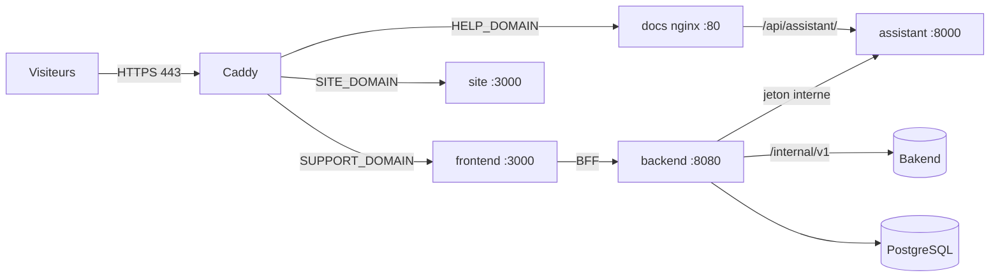

# Déploiement sur un serveur (domaines et HTTPS)

Le profil Compose `public` publie le service client sur Internet en HTTPS, sur trois noms de domaine, depuis un seul
serveur. Il ajoute [Caddy](https://caddyserver.com/docs/), qui obtient et renouvelle lui-même les certificats
(Let's Encrypt), et le site public `../Site_vitrine`.

| Domaine (`.env`) | Exemple | Ce qu'il sert | Conteneur |
| --- | --- | --- | --- |
| `SUPPORT_DOMAIN` | `support.maplenou.tg` | l'application web (demandeurs et équipe support) | `frontend` |
| `HELP_DOMAIN` | `aide.maplenou.tg` | le centre d'aide public : guide utilisateur (FR/EN) et son assistant | `docs` + `assistant` |
| `SITE_DOMAIN` | `www.maplenou.tg` | le site public de la marketplace | `site` |

Rien d'autre n'est accessible depuis Internet : l'API, la base de données, les guides du personnel et des
développeurs, les points d'accès IA internes de l'assistant (`/api/assistant/internal/*`) et Prometheus restent dans
le réseau Docker. Bakend garde son propre déploiement (son API interne `/internal/v1/**` ne doit jamais être publique
non plus).



## Ce qu'il faut

1. Un serveur (Linux ; 2 vCPU et 4 Go de RAM suffisent sans le profil `antivirus`, comptez 1 Go de plus pour ClamAV)
   avec Docker et les ports **80 et 443 ouverts**.
2. Les trois noms de domaine, avec des enregistrements DNS `A` (et `AAAA` si le serveur a une adresse IPv6) qui
   pointent vers l'adresse du serveur. Caddy ne peut pas obtenir de certificat tant que le DNS ne répond pas.
3. Le dépôt sur le serveur et un `.env` créé depuis `.env.example` (`scripts/env-sync.sh` ajoute à un `.env`
   existant les variables apportées par une nouvelle version).

## Le `.env` d'un déploiement public

| Variable | Valeur | Pourquoi |
| --- | --- | --- |
| `SUPPORT_DOMAIN`, `HELP_DOMAIN`, `SITE_DOMAIN`, `ACME_EMAIL` | vos domaines et un e-mail | certificats et routage |
| `SPRING_PROFILES_ACTIVE` | `default` | le profil `demo` (connexion de démonstration, fausses données) ne doit jamais être public — Caddy refuse de démarrer avec |
| `AUTH_MODE` / `MAPLENOU_LOGIN_ENABLED` | `maplenou` / `true` | connexion avec les comptes Maplenou (exigé par le garde-fou) |
| `ECOSYSTEM_MODE`, `SUPPORT_SERVICE_TOKEN`, `MAPLENOU_CORE_URL` | `http`, le jeton partagé, l'adresse privée de Bakend | commandes et livraisons réelles |
| `DOCS_SITES`, `ASSISTANT_SITES` | `user`, `user` | seul le guide utilisateur est publié et connu de l'assistant public (exigé par le garde-fou) |
| `SESSION_COOKIE_SECURE` | `true` | le cookie de session ne circule qu'en HTTPS (exigé par le garde-fou) |
| `FORWARD_HEADERS_STRATEGY` | `native` | l'API voit l'adresse du visiteur (limites de débit, journaux) |
| `CORS_ALLOWED_ORIGINS` | `https://<SUPPORT_DOMAIN>` | seule origine navigateur de l'application |
| `DOCS_PUBLIC_URL` | `https://<HELP_DOMAIN>` | liens vers le centre d'aide, références de l'assistant et recherche d'aide de l'application |
| `SUPPORT_APP_URL` | `https://<SUPPORT_DOMAIN>` | liens des notifications push |
| `JWT_SECRET`, `POSTGRES_PASSWORD`, `METRICS_TOKEN`, `ASSISTANT_INTERNAL_TOKEN` | de nouvelles valeurs aléatoires | jamais les exemples |
| `HOST_BIND_ADDRESS` | `127.0.0.1` | les ports directs (3001, 8081, 8006) restent fermés au réseau ; Caddy est la seule entrée |

Générez des valeurs aléatoires avec `openssl rand -base64 36` (PowerShell :
`[Convert]::ToBase64String((1..36 | ForEach-Object { Get-Random -Maximum 256 }))`).

## Démarrer, vérifier, mettre à jour

```bash
scripts/doctor.sh                                           # vérifie les réglages publics listés ci-dessus
docker compose --profile docs --profile public up -d --build --wait
docker compose logs caddy --tail 50                          # « certificate obtained successfully » pour chaque domaine
curl -fsS https://<SUPPORT_DOMAIN>/login -o /dev/null && curl -fsS https://<HELP_DOMAIN>/api/assistant/health
curl -s -o /dev/null -w '%{http_code}\n' https://<HELP_DOMAIN>/staff/fr/      # 404: internal guides are not published
```

Ajoutez `--profile antivirus` (avec `ANTIVIRUS=clamav`) et `--profile monitoring` (avec `METRICS_TOKEN`) quand vous
en avez besoin. Pour mettre à jour : `git pull`, `scripts/env-sync.sh`, puis la même commande `up` ; les migrations
de la base s'exécutent seules au démarrage (sauvegardez d'abord : `scripts/backup.sh`).

Si Caddy s'arrête avec `public profile refused: …`, le garde-fou (`deploy/guard.sh`) a trouvé un réglage dangereux :
corrigez la variable qu'il nomme. Si un certificat n'est pas délivré, vérifiez que le DNS pointe vers le serveur et
que les ports 80 et 443 sont joignables depuis Internet.

## L'assistant public

L'assistant de `HELP_DOMAIN` ne répond qu'à partir du guide utilisateur (`ASSISTANT_SITES=user`), cite ses sources
et limite chaque visiteur (`ASSISTANT_RATE_LIMIT`). Sa clé `OLLAMA_API_KEY` reste sur le serveur. Le même assistant
fournit l'aide IA des agents (DEC-CS11-08) par `/api/assistant/internal/*`, que ni nginx ni Caddy ne publient. Le
personnel garde ses guides internes sur une instance privée (une deuxième copie avec
`DOCS_SITES=user,staff,developer`, accessible seulement depuis votre réseau ou un VPN).
