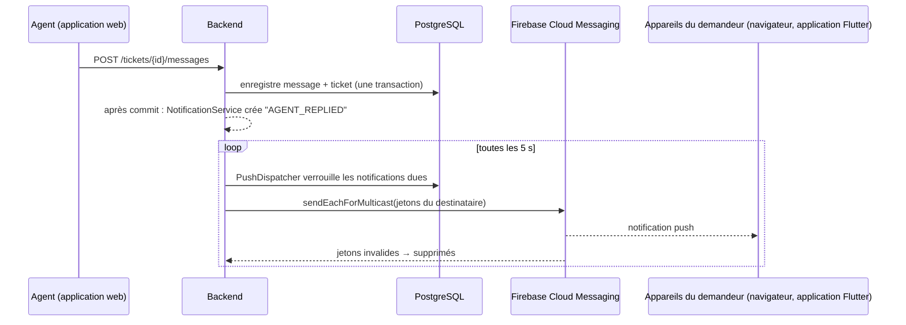

# Notifications push Firebase

La feuille de route (*Semaine 4 — Notifications et tests*) et la spécification du ticket (§15) demandent des
notifications **Firebase Cloud Messaging (FCM)** pour les clients, les vendeurs et les livreurs. Cette page explique ce
qui est déjà dans le code, comment brancher un projet Firebase et comment vérifier que les notifications push
arrivent.

## Ce qui est envoyé, et quand

Le backend crée une notification dans l'application pour chaque événement ci-dessous, **après la validation (commit)
de la transaction du ticket** (un problème de notification ne bloque ni n'annule jamais une modification de ticket).
Le dispatcher l'envoie ensuite en push à chaque appareil enregistré du destinataire, avec nouvelles tentatives et délai
croissant.

| Événement de la feuille de route | Destinataire | Type de notification | Exemple de texte (en français, tel qu'envoyé) |
| --- | --- | --- | --- |
| Nouveau ticket | demandeur (confirmation), responsables support | `TICKET_CREATED`, `NEW_TICKET_IN_QUEUE` | « Votre ticket TKT-2026-00012 a été créé… » |
| Réponse d'un agent | demandeur | `AGENT_REPLIED` | « Votre ticket TKT-2026-00012 a reçu une nouvelle réponse. » |
| Changement de statut | demandeur | `STATUS_CHANGED`, `TICKET_RESOLVED`, `TICKET_CLOSED` | « Votre ticket TKT-2026-00012 a été résolu. » |
| Demande d'informations complémentaires | demandeur | `INFORMATION_REQUESTED` (statut *En attente du client*) | « Le support a besoin d'informations supplémentaires… » |
| Également | agents, responsables | `TICKET_ASSIGNED`, `REQUESTER_REPLIED`, `REOPEN_REQUESTED`, `TICKET_ESCALATED`, `REOPEN_DECIDED` | |

Chaque notification push porte `type` et `ticketId` dans ses données, pour que les applications ouvrent le bon ticket.
Les textes des notifications push sont en français (la liste dans l'application est traduite dans l'interface
anglaise) ; voir l'élément « Message templates per language » de l'UPGRADE-PLAN.



## Les éléments

| Élément | Où | Rôle |
| --- | --- | --- |
| Enregistrement des appareils | `POST /api/v1/support/notifications/devices` `{token, platform: ANDROID \| IOS \| WEB}`, `DELETE …/devices/{token}` | enregistre le jeton FCM d'un appareil pour l'utilisateur connecté (table `device_tokens`) |
| Canal push | `NotificationConfig` | utilise `FirebasePushSender` quand `FIREBASE_CREDENTIALS_FILE` désigne une clé de compte de service, sinon `LoggingPushSender` (notifications push écrites seulement dans le journal) |
| File d'attente et nouvelles tentatives | `PushDispatcher` | toutes les 5 s, jusqu'à `maplenou.notifications.max-attempts` tentatives avec délai croissant ; supprime les jetons que Firebase signale comme désinscrits |
| Diagnostic | `GET /notifications/push-status`, `POST /notifications/devices/test` | indique `firebase` ou `log-only` et envoie une notification push de test aux appareils de l'appelant |
| Push dans le navigateur | `frontend/src/lib/push.ts`, `src/components/PushNotifications.tsx`, `public/push-sw.js`, `/api/push-config` | carte <span class="ui">Notifications push</span> des écrans <span class="ui">Notifications</span> : activer, envoyer un test, désactiver |
| Applications Flutter | applications mobiles Maplenou (autres dépôts) | obtiennent le jeton FCM avec `firebase_messaging` et l'enregistrent (voir plus bas) |

## Utiliser le projet Firebase existant de Maplenou (`maplenou-c21c2`)

Les applications Maplenou ont déjà un projet Firebase, **`maplenou-c21c2`** (Flutter
`frontend/lib/firebase_options.dart`, `firebase-service-account.json` de Bakend). Le service client le réutilise :
un demandeur reçoit donc les mêmes notifications dans le navigateur et, par le relais de Bakend, dans l'application
mobile. Ce qui est prêt et ce qui reste :

| Étape | État | À faire |
| --- | --- | --- |
| Application web du projet (valeurs publiques) | **prêt** — recopiées dans `.env.example` et `render.yaml` | rien |
| Les données push ouvrent le ticket dans l'app Flutter (`source=support`, `url`) | **prêt** (CS-11) | tester sur un téléphone (section 5) |
| Relais vers l'application mobile par Bakend | **prêt** — `MAPLENOU_PUSH_RELAY=true` + le `SUPPORT_SERVICE_TOKEN` partagé | voir la dernière section |
| Clé VAPID (push navigateur) | **à faire une fois** | console → *Paramètres du projet → Cloud Messaging → Certificats Web Push → Générer une paire de clés* ; collez la clé publique dans `FIREBASE_WEB_VAPID_KEY` (`.env`, ou tableau de bord Render) |
| Clé du compte de service (envoi) | **à faire une fois** | console → *Paramètres du projet → Comptes de service → Générer une nouvelle clé privée* ; enregistrez-la sous `secrets/firebase-service-account.json` (Compose) ou comme **Secret File** Render (voir [Render](render.md#firebase-sur-render)) — jamais dans Git ni dans une conversation |

Les sections 1 à 3 ci-dessous décrivent les mêmes étapes pour un nouveau projet séparé.

## 1. Créer le projet Firebase

1. Ouvrez la [console Firebase](https://console.firebase.google.com/) avec le compte Google qui sera propriétaire du
   projet, puis **Create a project** (*Créer un projet*) — par exemple `maplenou-support`. Google Analytics n'est pas
   nécessaire.
2. Dans **Project settings → Cloud Messaging** (*Paramètres du projet*), vérifiez que **Firebase Cloud Messaging API
   (V1)** est *Enabled* (c'est le cas pour les nouveaux projets). L'ancienne API (legacy) n'est pas utilisée.

## 2. Backend : la clé du compte de service (secret)

1. **Project settings → Service accounts → Firebase Admin SDK → Generate new private key** (*Paramètres du projet →
   Comptes de service → Générer une nouvelle clé privée*). Un fichier JSON est téléchargé.
2. Enregistrez-le sous `secrets/firebase-service-account.json` dans le dossier du dépôt. Le dossier `secrets/` est
   ignoré par Git et par les constructions Docker, et monté **en lecture seule** dans le conteneur du backend sur
   `/run/secrets/maplenou`.
3. Dans `.env` :

    ```properties
    FIREBASE_CREDENTIALS_FILE=/run/secrets/maplenou/firebase-service-account.json
    ```

4. Redémarrez le backend : `docker compose up -d backend`. Le journal affiche
   `Firebase Cloud Messaging enabled (project maplenou-support).` Si le fichier ne peut pas être lu, le backend
   s'arrête au démarrage avec un message qui nomme la variable — corrigez le chemin ou videz la variable.

!!! warning "Cette clé est un mot de passe"
    Elle permet d'envoyer des notifications push à tous les utilisateurs de Maplenou. Ne la committez jamais, ne
    l'envoyez pas par e-mail et ne la collez pas dans une discussion. En cas de fuite, supprimez-la dans **Service
    accounts → Manage service account permissions** et générez-en une nouvelle.

Sans Docker (backend natif), faites pointer la variable directement sur le fichier, par exemple
`FIREBASE_CREDENTIALS_FILE=C:\Users\<vous>\maplenou\secrets\firebase-service-account.json`.

## 3. Application web : push dans le navigateur (valeurs publiques)

1. **Project settings → General → Your apps → Add app → Web** (*Paramètres du projet → Général → Vos applications →
   Ajouter une application*, icône `</>`), nommez-la `maplenou-support-web` (Firebase Hosting n'est pas nécessaire).
   La console affiche un objet `firebaseConfig`.
2. **Project settings → Cloud Messaging → Web configuration → Web Push certificates → Generate key pair**
   (*Générer une paire de clés*). Copiez la paire de clés (la clé publique « VAPID »).
3. Copiez les valeurs dans `.env` — elles sont publiques par nature (chaque navigateur les reçoit) :

    ```properties
    FIREBASE_WEB_API_KEY=AIza...            # firebaseConfig.apiKey
    FIREBASE_WEB_AUTH_DOMAIN=maplenou-support.firebaseapp.com
    FIREBASE_WEB_PROJECT_ID=maplenou-support
    FIREBASE_WEB_MESSAGING_SENDER_ID=123456789012
    FIREBASE_WEB_APP_ID=1:123456789012:web:abc123
    FIREBASE_WEB_VAPID_KEY=B...             # Web Push certificate key pair
    ```

4. Redémarrez l'application web : `docker compose up -d frontend`. Les valeurs sont lues à l'exécution par
   `/api/push-config` ; aucune reconstruction n'est nécessaire.

Les navigateurs n'autorisent les notifications push qu'en **HTTPS** ou sur `http://localhost`. En production,
l'application web doit être servie en HTTPS.

## 4. Vérifier que cela fonctionne

1. Connectez-vous à l'application web (par exemple en tant que *Jean K.*), ouvrez
   <span class="ui">Notifications</span> et cliquez sur <span class="ui">Activer les notifications push</span>.
   Autorisez les notifications quand le navigateur le demande.
2. Cliquez sur <span class="ui">Envoyer une notification de test</span> : une notification système « Notification
   de test » apparaît en quelques secondes. Le message de confirmation indique que la notification a seulement été
   écrite dans le journal du serveur (`log-only`) si le backend n'a pas de clé (étape 2).
3. Parcours réel : dans un autre navigateur (ou une fenêtre privée), connectez-vous en tant que *Sophie N.*, prenez
   l'un des tickets de Jean et répondez : le navigateur de Jean affiche « Votre ticket … a reçu une nouvelle
   réponse. » Un clic dessus ouvre le ticket.

API seule (Postman, Swagger UI ou `backend/http/support-api.http`) : `GET /notifications/push-status` renvoie
`{"mode":"firebase","devices":1}` ; `POST /notifications/devices/test` renvoie `{"mode":"firebase","devices":1,
"invalidRemoved":0}`. Avec un faux jeton et une vraie clé, Firebase refuse le jeton : la réponse est
`502 PUSH_DELIVERY_FAILED` ou `invalidRemoved: 1`. Voir [Tester l'API (Swagger, Postman)](api-testing.md).

`scripts/smoke-test.ps1` (ou `.sh`) affiche le canal push du backend en cours d'exécution.

## 5. Applications Flutter (clients, vendeurs, livreurs)

Les applications mobiles vivent dans d'autres dépôts. Chaque application ajoute ses applications Android et iOS
**au même projet Firebase** (`flutterfire configure`), puis enregistre son jeton après la connexion et à chaque
changement :

```dart
import 'package:firebase_messaging/firebase_messaging.dart';

Future<void> registerPushToken(ApiClient api) async {
  final messaging = FirebaseMessaging.instance;
  await messaging.requestPermission();                       // iOS and Android 13+
  final token = await messaging.getToken();
  if (token != null) {
    await api.post('/api/v1/support/notifications/devices',
        {'token': token, 'platform': Platform.isIOS ? 'IOS' : 'ANDROID'});
  }
  messaging.onTokenRefresh.listen((t) => api.post('/api/v1/support/notifications/devices',
      {'token': t, 'platform': Platform.isIOS ? 'IOS' : 'ANDROID'}));
}
// On sign-out: DELETE /api/v1/support/notifications/devices/{token}, then messaging.deleteToken().
// On tap: read message.data['ticketId'] and open the ticket screen.
```

iOS a aussi besoin d'une clé d'authentification APNs téléversée dans **Project settings → Cloud Messaging → Apple
app configuration**.

## Confidentialité et cache

- L'application web n'enregistre rien elle-même ; une fois le push activé, le SDK Firebase garde son inscription dans
  l'IndexedDB du navigateur (exigé par Firebase). La déconnexion désinscrit le navigateur, pour que la personne
  suivante qui l'utilise ne reçoive pas les notifications push de l'utilisateur précédent ; Firebase signale ensuite
  le jeton comme désinscrit et le backend le supprime.
- Le service worker `push-sw.js` ne fait qu'afficher les notifications : il ne met rien en cache et ne fait aucune
  requête réseau.
- Les textes des notifications push contiennent le numéro du ticket et une phrase générique, jamais le contenu d'un
  message.

## Dépannage des notifications push

| Symptôme | Cause et solution |
| --- | --- |
| La carte indique que les notifications ne sont pas configurées sur ce serveur | une des valeurs `FIREBASE_WEB_*` est vide → renseignez les six, `docker compose up -d frontend` |
| La carte indique que les notifications sont **bloquées** | l'autorisation du navigateur a été refusée → réglages du site (icône à gauche de l'adresse) → Notifications → Autoriser, puis rechargez |
| Le message du test indique `log-only` (seulement écrite dans le journal du serveur) | `FIREBASE_CREDENTIALS_FILE` est vide dans `.env` → étape 2 |
| Le backend ne démarre pas : « FIREBASE_CREDENTIALS_FILE=… cannot be read » | chemin ou nom de fichier erroné dans `secrets/` → dans Docker, le chemin doit commencer par `/run/secrets/maplenou/` |
| `502 PUSH_DELIVERY_FAILED` | l'application web et la clé appartiennent à des projets Firebase différents, ou l'API Cloud Messaging (V1) est désactivée |
| Rien n'apparaît alors que le test a réussi | « Assistant de concentration » / « Ne pas déranger » de Windows, ou notifications du navigateur désactivées dans les réglages du système d'exploitation |

## Demandeurs sur l'app mobile Maplenou (relais par Bakend)

Les clients, vendeurs et livreurs utilisent l'app Flutter Maplenou, dont les jetons d'appareil sont enregistrés dans
**Bakend** (`POST /api/notifications/tokens`), pas dans ce service. Avec `MAPLENOU_PUSH_RELAY=true` (et
`SUPPORT_SERVICE_TOKEN` renseigné des deux côtés), `PushDispatcher` envoie aussi chaque notification d'un demandeur à
Bakend (`POST /internal/v1/users/{id}/push`), qui la délivre avec son propre projet Firebase
(`FcmService.sendToUser`). Rien n'est à configurer dans l'app.

| Donnée du push | Valeur |
| --- | --- |
| `source` | `support` |
| `type` | le type de notification (`AGENT_REPLIED`, `TICKET_RESOLVED`…) |
| `ticketId` | le ticket |
| `url` | `<SUPPORT_APP_URL>/?ticket=<id>` — l'app l'ouvre dans le navigateur quand on touche la notification (`frontend/lib/services/push_notification_service.dart`, `_openSupportTicket`, liens `http`/`https` seulement) |

Pour tester : connectez-vous à l'app Maplenou sur un téléphone avec un compte client, ouvrez un ticket dans
l'application web avec le même compte, répondez-y comme agent ; le téléphone reçoit « Nouvelle réponse » (ou
« New reply » si le client a choisi l'anglais) et la notification ouvre le ticket. Sans le relais, les demandeurs
reçoivent toujours la notification dans l'application et, dans un navigateur où ils ont activé le push, le push web.
