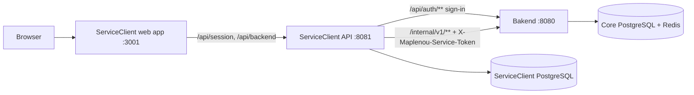
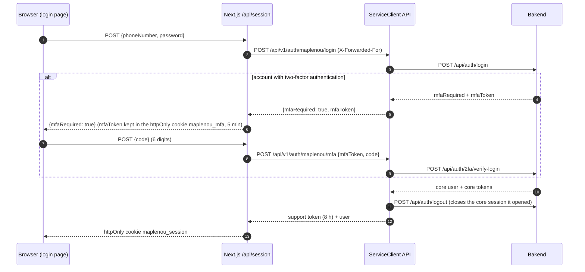

# Intégration à la plateforme Maplenou

Cette page explique comment le service client fonctionne au sein de la plateforme Maplenou (décision du responsable
**DEC-CS10-17** du 2026-10-29) : ce projet devient le dossier `ServiceClient/` du dépôt Maplenou, chacun se connecte
avec son compte Maplenou, les rôles support se donnent par numéro de téléphone, les vraies commandes et livraisons
sont lues dans l'API cœur (Bakend), et les tickets de l'ancien module de support du cœur sont importés une fois.

## Organisation du dépôt Maplenou

| Dossier | Contenu | Port sur l'ordinateur |
| --- | --- | --- |
| `Bakend/` | API cœur de Maplenou (Spring Boot) ; démarrée avec `Bakend/start-all.ps1` ; nécessite PostgreSQL et Redis | `8080` |
| `frontend/` | application Flutter Maplenou (acheteurs, vendeurs, livreurs) | — |
| `Admin_frontend/maplenou/` | back-office d'administration Next.js de la plateforme | `3000` |
| `ServiceClient/` | **ce projet** : API support, application web support, documentation | API `8081`, application web `3001`, docs `8006` |
| `Site_vitrine/` | site public de la place de marché (application Next.js séparée, ajoutée dans la même itération, DEC-CS10-19) | `3002` |

Le service support garde **sa propre base PostgreSQL** (`POSTGRES_DB`, volume Docker `pgdata`). Il n'utilise jamais
la base du cœur : les deux ont une table nommée `support_tickets`, au contenu différent. Tout ce dont le service
support a besoin du cœur passe par les API HTTP de Bakend décrites ci-dessous.



## Se connecter avec un compte Maplenou

Trois réglages font passer le service support des personas de démonstration aux vrais comptes Maplenou :

| Réglage | Où | Valeur |
| --- | --- | --- |
| `MAPLENOU_LOGIN_ENABLED` | backend | `true` — expose `POST /api/v1/auth/maplenou/login` et `/mfa` |
| `AUTH_MODE` | application web | `maplenou` — la page de connexion affiche le formulaire de connexion Maplenou au lieu des personas |
| `SPRING_PROFILES_ACTIVE` | backend | `default` — pas de connexion de démonstration, pas de données d'exemple |

`JWT_SECRET` doit alors être une vraie valeur aléatoire d'au moins 32 caractères : il signe les jetons propres au
service support.



1. Le formulaire de connexion demande le numéro de téléphone et le mot de passe du compte Maplenou, puis le code à
   6 chiffres si le compte a la vérification en deux étapes.
2. La route Next.js `/api/session` les transmet à l'API ServiceClient, qui appelle Bakend `POST /api/auth/login`
   (et `POST /api/auth/2fa/verify-login`).
3. Quand Bakend accepte, ServiceClient émet **son propre jeton** (valable 8 heures) et ferme aussitôt la session du
   cœur qu'il a ouverte (`POST /api/auth/logout`). Les mots de passe et les jetons du cœur ne sont jamais stockés ni
   journalisés.
4. ServiceClient limite les tentatives à **10 par numéro de téléphone et par minute**, en plus du verrouillage propre
   à Bakend après 5 échecs.

| `code` d'erreur | Signification |
| --- | --- |
| `INVALID_CREDENTIALS` | numéro de téléphone ou mot de passe incorrect |
| `INVALID_PHONE` | numéro de téléphone mal formé |
| `INVALID_MFA_CODE` | code de vérification incorrect ou expiré |
| `TOO_MANY_ATTEMPTS` | la limite par numéro, ou celle de Bakend, est atteinte |
| `ACCOUNT_DISABLED` | le compte Maplenou est désactivé, ou le compte support a été désactivé par un administrateur |
| `CORE_UNAVAILABLE` | Bakend ne répond pas, ou répond de façon inattendue |

L'application web renvoie aussi `MFA_EXPIRED` quand le cookie MFA de 5 minutes a disparu (il faut recommencer).

!!! warning "Limite de débit de Bakend sur /api/auth/**"
    Bakend limite `/api/auth/**` par adresse IP (10 par minute par défaut). Toutes les connexions arrivent à Bakend
    depuis le backend ServiceClient : elles partagent donc une seule adresse. ServiceClient transmet l'adresse du
    visiteur dans `X-Forwarded-For` ; en production, inscrivez l'adresse du backend ServiceClient dans
    `app.trusted-proxy-ips` de Bakend pour que cet en-tête soit pris en compte, ou augmentez
    `AUTH_RATE_LIMIT_PER_MINUTE` dans Bakend.

## Rôles support des comptes Maplenou

Un compte Maplenou reçoit un rôle support à chaque connexion (`identity.MaplenouRoles`) :

| Compte Maplenou | Rôle support |
| --- | --- |
| un rôle donné sur la page « Agents » (ci-dessous) | ce rôle : `SUPPORT_AGENT`, `SUPPORT_MANAGER` ou `ADMINISTRATOR` |
| `role = ADMIN` dans le cœur | `ADMINISTRATOR` |
| `role = DELIVERY_AGENT` dans le cœur | `DELIVERY_DRIVER` |
| profil vendeur `APPROVED` | `SELLER` |
| tout autre cas | `CUSTOMER` |

Les comptes Maplenou n'ont pas de rôle agent ni responsable support. Un administrateur le donne **par numéro de
téléphone** sur la page d'administration « Agents », section « Rôles support » (table `support_staff_assignments`,
migration V3) :

| Point de terminaison | Qui | Effet |
| --- | --- | --- |
| `GET /api/v1/support/admin/staff-roles` | administrateur | liste `{phone, role, assignedAt}` |
| `PUT /api/v1/support/admin/staff-roles` | administrateur | `{phone, role}` crée ou change le rôle (`INVALID_PHONE`, `INVALID_STAFF_ROLE`) |
| `DELETE /api/v1/support/admin/staff-roles/{phone}` | administrateur | retire le rôle |

Le rôle s'applique à la **prochaine connexion** : un jeton déjà émis garde son rôle jusqu'à son expiration (8 heures
au plus). Pour couper l'accès tout de suite, désactivez aussi le compte support sur la même page. Procédure pour le
personnel : [guide du support, Administration](/staff/fr/administration/).

## Relier les commandes et livraisons réelles

Avec `ECOSYSTEM_MODE=http`, les écrans des tickets montrent les vraies commandes, paiements, livraisons, vendeurs et
remboursements lus dans Bakend au lieu des données de démonstration.

1. Générez un secret partagé de 32 caractères aléatoires ou plus :

    === "Bash"

        ```bash
        openssl rand -hex 32
        ```

    === "PowerShell"

        ```powershell
        [guid]::NewGuid().ToString('N') + [guid]::NewGuid().ToString('N')
        ```

2. Mettez la **même valeur** dans `SUPPORT_SERVICE_TOKEN` du `.env` de ServiceClient et dans l'environnement de
   Bakend (`SUPPORT_SERVICE_TOKEN`). Sous Windows avec `start-all.ps1`, ajoutez la ligne
   `$env:SUPPORT_SERVICE_TOKEN = "<valeur>"` dans `Bakend/.env.local.ps1` (jamais committé) puis relancez Bakend ;
   avec le `docker-compose.yml` de Bakend, mettez `SUPPORT_SERVICE_TOKEN=<valeur>` dans `Bakend/.env`.
3. Définissez `ECOSYSTEM_MODE=http` et `MAPLENOU_CORE_URL` (par défaut `http://host.docker.internal:8080`, Bakend vu
   depuis les conteneurs).

!!! note "Livré sous forme de correctif"
    `supportbridge` est hors de ce dossier : il est livré dans `ServiceClient/integration/bakend/supportbridge.patch`,
    que le propriétaire du dépôt relit et applique (`ServiceClient/integration/README.md`). Tant qu'il n'est pas
    appliqué, gardez `ECOSYSTEM_MODE=demo` ; la connexion par compte Maplenou fonctionne déjà avec Bakend inchangé.

Le paquet `com.maplenou.backend.supportbridge` de Bakend expose l'API interne **en lecture seule** `/internal/v1/**` :

| Point de terminaison | Contenu |
| --- | --- |
| `GET /internal/v1/orders/{orderNumber}` | une commande |
| `GET /internal/v1/payments/{orderNumber}` | le paiement d'une commande |
| `GET /internal/v1/deliveries/{id}` | une livraison |
| `GET /internal/v1/sellers/{shopSlug}` | un vendeur (boutique) |
| `GET /internal/v1/refunds/{returnRequestId}` | un remboursement |
| `GET /internal/v1/users/{id}/orders` | les commandes d'un utilisateur |
| `GET /internal/v1/drivers/{id}/deliveries` | les livraisons d'un livreur |
| `GET /internal/v1/support-tickets?page&size` | les tickets de l'ancien module de support (import ci-dessous) |

Chaque appel porte l'en-tête `X-Maplenou-Service-Token`, que Bakend compare en temps constant. Sans jeton configuré,
Bakend répond `404` sur ces chemins : le pont est **désactivé par défaut**, comme `FEDAPAY_ENABLED`.

!!! danger "N'exposez jamais /internal/ sur Internet"
    Bloquez `/internal/` dans le proxy inverse placé devant Bakend ; seul le backend ServiceClient doit l'atteindre.

Correspondance : la référence d'une commande est son numéro ; les références vendeur, livraison et remboursement sont
renseignées quand la commande a une seule boutique ; une commande à plusieurs boutiques affiche « N boutiques » ; les
montants sont en XOF.

## Importer les anciens tickets Maplenou

L'ancien module de support du cœur (table `support_tickets` de Bakend, migration V46, numéros `TKT-AAAA-NNNNNN` à 6 chiffres — les nouveaux en ont 5, utilisé par
les écrans Flutter « Mes tickets » et l'écran de ticket du livreur, et par la page `support-tickets` du back-office
d'administration) **reste en place** : l'application Flutter y ouvre toujours des tickets. ServiceClient les copie,
et continue de copier les nouveaux tant que l'application n'est pas basculée (DEC-CS12-02) :

1. Sur la page d'administration « Agents », cliquez sur « Importer les anciens tickets »
   (`POST /api/v1/support/admin/legacy-import`, administrateurs uniquement ; nécessite `MAPLENOU_CORE_URL` et
   `SUPPORT_SERVICE_TOKEN`, sinon `LEGACY_IMPORT_NOT_CONFIGURED`).
2. ServiceClient lit `/internal/v1/support-tickets` page par page et répond
   `{imported, skipped, updated, totalInSource}`.
3. Avec `LEGACY_SYNC_ENABLED=true`, le même import s'exécute tout seul toutes les `LEGACY_SYNC_INTERVAL` (par défaut
   `PT15M`) : les tickets créés depuis dans l'application Flutter arrivent dans la file sans que personne ne clique.

Ce que fait l'import (`ticket.LegacyImportService`) :

- **Idempotent :** l'identifiant d'origine est conservé (`legacy_id`, unique, et `legacy_ticket_sync`, V6) ; un
  ticket déjà importé n'est pas recopié, l'import peut donc être relancé sans risque. Les identifiants déjà importés
  sont cherchés une fois par page de 50 (une requête), pas une fois par ticket.
- **Changements faits ensuite dans l'ancien module :** quand le statut d'un ticket importé y a changé (par exemple
  un administrateur l'a résolu dans l'ancienne page du back-office), une entrée d'historique réservée au personnel
  « Modifié dans l'ancien support » (`LEGACY_UPDATED`, ancien → nouveau statut et notes de résolution) est ajoutée ;
  le ticket lui-même reste à la décision de l'agent. `updated` compte ces entrées.
- **Conservés :** date de création, demandeur, sujet, description, livraison concernée, l'URL de la photo (une ligne
  de texte du premier message) et l'ancien numéro (`legacy_number`). L'ancien numéro s'affiche à côté du nouveau et
  la recherche le retrouve (`q` porte aussi sur `legacyNumber` ; le détail du ticket renvoie `legacyNumber`).
- **Priorité :** `MEDIUM` ; les échéances SLA partent de la date de création d'origine.
- **Catégorie** selon les mots de l'ancienne catégorie et du sujet : livraison → `DELIVERY`, paiement → `PAYMENT`,
  commande → `ORDER`, vendeur/boutique → `SELLER`, compte → `ACCOUNT`, retour/rembours → `RETURN_REFUND`, sinon
  `OTHER`.
- **Statut :** `OPEN` → `NEW` ; `IN_PROGRESS` → `NEW` avec une note interne « à reprendre » (non attribué) ;
  `RESOLVED` → `RESOLVED`, avec les notes de résolution comme réponse publique.
- **Aucune notification** n'est envoyée.

La migration `V3__maplenou_integration.sql` ajoute les colonnes `legacy_id` et `legacy_number` à la table
`support_tickets` de ServiceClient — voir le [database model](/developer/en/architecture/database-model/).

## Étapes de déploiement

1. Démarrez Bakend (`Bakend/start-all.ps1`, port 8080, avec son PostgreSQL et son Redis).
2. Définissez le même `SUPPORT_SERVICE_TOKEN` des deux côtés (environnement de Bakend et `.env` de ServiceClient).
3. Dans le `.env` de ServiceClient : `MAPLENOU_CORE_URL=http://host.docker.internal:8080`,
   `MAPLENOU_LOGIN_ENABLED=true`, `AUTH_MODE=maplenou`, `ECOSYSTEM_MODE=http`, `SPRING_PROFILES_ACTIVE=default` et un
   vrai `JWT_SECRET` aléatoire.
4. Dans `ServiceClient/` : `docker compose up -d --build --wait`. `scripts/doctor.sh` (Windows :
   `scripts\doctor.ps1`) vérifie dans sa section « Maplenou platform » que Bakend répond sur le port 8080 et que le
   jeton est défini.
5. Connectez-vous sur <http://localhost:3001> avec un compte administrateur Maplenou, donnez les rôles support sur la
   page « Agents », puis lancez « Importer les anciens tickets ».
6. Tant que l'application Flutter utilise l'ancien module, mettez `LEGACY_SYNC_ENABLED=true` dans le `.env` de
   ServiceClient et `SUPPORT_LEGACY_READ_ONLY=true` dans l'environnement de Bakend : l'ancienne page du back-office
   refuse alors de résoudre (`409`, « Ce ticket est désormais traité dans le service client »), un ticket n'est donc
   jamais traité à deux endroits, et les clients continuent de créer des tickets depuis l'application.
7. **Étape suivante proposée (non réalisée) :** faire pointer l'application Flutter et le back-office
   d'administration vers le nouveau service — ouvrir l'application web ServiceClient depuis le centre d'aide Flutter /
   « Mes tickets », et enregistrer les jetons FCM auprès de ServiceClient (le projet Firebase `maplenou-c21c2` déjà
   utilisé par Bakend peut être réutilisé, voir [Notifications push Firebase](firebase.md)).
8. Retirez l'ancien module de support seulement après l'accord du responsable du projet.

!!! note "Même préfixe, longueur différente"
    Les deux modules numérotent les tickets `TKT-<année>-…` : l'ancien module de Bakend utilise **6 chiffres**
    (`TKT-2026-000017`), ServiceClient **5** (`TKT-2026-00017`). La recherche traite un numéro complet comme une
    recherche exacte sur le numéro *ou* l'ancien numéro : taper l'un ou l'autre retrouve le bon ticket.

## Tests de l'intégration

| Côté | Test | Ce qui est vérifié |
| --- | --- | --- |
| Bakend | `SupportBridgeIntegrationTest` | l'API interne avec le jeton de service |
| Bakend | `SupportBridgeDisabledIntegrationTest` | sans jeton, l'API interne répond 404 |
| Bakend | `OrderLifecycleIntegrationTest`, étape 13 | le pont support dans le scénario du cycle de vie d'une commande |
| ServiceClient | `it/MaplenouIntegrationIT` (faux cœur `it/FakeMaplenouCore`) | connexion d'un acheteur et d'un vendeur approuvé, mauvais mot de passe, code à deux facteurs, session du cœur fermée, rôle support par numéro de téléphone, import des anciens tickets avec leur ancien numéro |
| ServiceClient | `scripts/doctor.*`, section « Maplenou platform » | Bakend joignable sur 8080, `SUPPORT_SERVICE_TOKEN` défini quand `ECOSYSTEM_MODE=http` |

Lancez le test ServiceClient avec `./mvnw -Dit.test=MaplenouIntegrationIT verify` dans `backend/`, ou toutes les
suites avec `scripts/test.sh backend` — voir [Tests](testing.md).

## Actions sur Maplenou depuis un ticket (DEC-CS11-07)

Un agent à qui le ticket est attribué (ou un responsable) peut demander à Maplenou d'agir, depuis la carte « Actions
sur Maplenou » du ticket. Le service client envoie la demande à l'API interne de Bakend ; **Bakend décide** avec ses
propres règles et trace l'action (`AuditLog`, actions `SUPPORT_*`, avec le numéro du ticket et le nom de l'agent).

| Action | Il faut sur le ticket | Endpoint Bakend | Règle de Bakend |
| --- | --- | --- | --- |
| Demande de retour / remboursement pour l'acheteur | une commande | `POST /internal/v1/orders/{numéro}/return-requests` `{subOrderId?, reason, productCondition}` | `ReturnRequestService.create` : sous-commande livrée, dans les 30 jours, une demande par sous-commande ; le vendeur décide ensuite |
| Remettre la course à disposition | une livraison | `POST /internal/v1/deliveries/{id}/reschedule` `{reason}` | seulement `ASSIGNED` ou `FAILED` → `PENDING` (livreur retiré et prévenu) ; refusé quand le livreur est en route |
| Message au livreur | une livraison avec un livreur | `POST /internal/v1/drivers/{id}/support-messages` `{message}` | écrit dans la conversation support du livreur, signé par `SUPPORT_SENDER_USER_ID` (sinon le plus ancien admin actif) |
| Relais des push | — | `POST /internal/v1/users/{id}/push` `{title, body, data}` | envoyé avec le projet Firebase de Bakend (voir [Firebase](firebase.md)) |

Chaque demande porte aussi `ticketNumber`, `agentName` et `agentId`. La réponse est `{ref, status}` ; un refus
(400/409/422) est montré à l'agent avec le message de Bakend (`MAPLENOU_REFUSED`) et enregistré sur le ticket comme
une réussite. Avec `ECOSYSTEM_MODE=demo`, les actions sont acceptées sans appeler Bakend. Tests :
`BakendContractTest` (ce service) et `OrderLifecycleIntegrationTest` n° 14 (Bakend).
