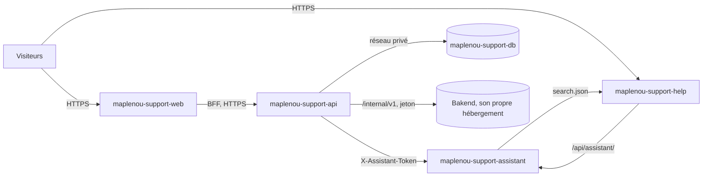

# Déploiement sur Render

Le fichier `ServiceClient/render.yaml` (gardé dans ce dossier pour ne pas toucher la racine du dépôt Maplenou) est un [Blueprint Render](https://render.com/docs/yaml-spec) :
il crée d'un coup le service client et son centre d'aide public sur [Render](https://render.com) (DEC-CS12-03).
Bakend, l'application Flutter et `Site_vitrine` gardent leur propre hébergement ; le Blueprint ne déploie rien
d'autre.

| Service Render | Ce que c'est | Adresse (si Render garde le nom) |
| --- | --- | --- |
| `maplenou-support-db` | PostgreSQL 16, réseau privé uniquement (`ipAllowList: []`) | — |
| `maplenou-support-api` | API Spring Boot (`ServiceClient/backend`) | `https://maplenou-support-api.onrender.com` |
| `maplenou-support-web` | application web des demandeurs et du personnel (`ServiceClient/frontend`) | `https://maplenou-support-web.onrender.com` |
| `maplenou-support-help` | centre d'aide public : **guide utilisateur seulement** (FR/EN) | `https://maplenou-support-help.onrender.com` |
| `maplenou-support-assistant` | assistant de la documentation (Ollama cloud), ne connaît que le guide utilisateur | `https://maplenou-support-assistant.onrender.com` |



## Ce qu'il faut

1. Un compte Render relié à GitHub, avec accès au dépôt `Maplenou`.
2. **Bakend joignable en HTTPS** (par exemple `https://api.maplenou.tg`) : la connexion utilise les comptes
   Maplenou (`AUTH_MODE=maplenou`) et les commandes/livraisons sont lues dans Bakend. Bloquez `/internal/` sur le
   proxy public de Bakend pour tout le monde sauf cette API (`MANUEL.md` de Bakend, §5).
3. Ces secrets, prêts à coller **dans le tableau de bord Render** (jamais dans un fichier ni une conversation) :
    - `SUPPORT_SERVICE_TOKEN` — la même valeur que celle de Bakend (32 caractères aléatoires ou plus,
      `openssl rand -base64 36`) ;
    - `CLOUDINARY_URL` — `cloudinary://<api_key>:<api_secret>@<cloud_name>` (pièces jointes ; le disque d'un
      service Render est effacé à chaque redémarrage) ;
    - `OLLAMA_API_KEY` — ollama.com → Settings → Keys ;
    - `FIREBASE_WEB_VAPID_KEY` — console Firebase → Cloud Messaging → Certificats Web Push (clé publique ; laissez
      vide pour démarrer sans notifications dans le navigateur).
4. Facultatif, pour les notifications : la clé du compte de service Firebase (fichier JSON), voir
   [plus bas](#firebase-sur-render).

`JWT_SECRET`, `METRICS_TOKEN` et le `ASSISTANT_INTERNAL_TOKEN` partagé sont générés par Render (`generateValue`).

## Créer les services

1. Fusionnez la branche dans `main` (ou choisissez la branche à l'étape suivante).
2. Tableau de bord Render → **New → Blueprint** → choisissez le dépôt `Maplenou`, renseignez **Blueprint Path** = `ServiceClient/render.yaml` → Render le lit et
   liste les cinq ressources.
3. Remplissez les valeurs demandées (`MAPLENOU_CORE_URL`, `SUPPORT_SERVICE_TOKEN`, `CLOUDINARY_URL`,
   `OLLAMA_API_KEY`, `FIREBASE_WEB_VAPID_KEY`) → **Apply**. La première construction dure 10 à 15 minutes environ.
4. Si Render a ajouté un suffixe à un nom (nom déjà pris), ouvrez **Environment** de chaque service et corrigez
   les adresses (`*_URL`, `CORS_ALLOWED_ORIGINS`, `ASSISTANT_*`), puis **Manual Deploy → Deploy latest commit**.
5. Connectez-vous sur `https://maplenou-support-web.onrender.com` avec un compte **administrateur** Maplenou, puis
   donnez les rôles support sur la page « Agents ».

## Vérifier le déploiement

```bash
curl -fsS https://maplenou-support-api.onrender.com/actuator/health          # {"status":"UP"}
curl -fsS https://maplenou-support-web.onrender.com/login -o /dev/null && echo web ok
curl -fsS https://maplenou-support-help.onrender.com/healthz                 # ok
curl -fsS https://maplenou-support-assistant.onrender.com/api/assistant/health   # "indexReady": true après une minute
curl -s -o /dev/null -w '%{http_code}\n' https://maplenou-support-help.onrender.com/staff/fr/   # 404 : guides internes non publiés
curl -s -o /dev/null -w '%{http_code}\n' -X POST https://maplenou-support-help.onrender.com/api/assistant/internal/triage   # 404
```

PowerShell : remplacez `curl` par `curl.exe`. `scripts/smoke-test.sh` n'est pas fait pour un déploiement public
(il utilise la connexion de démonstration).

## Sécurités intégrées

- L'API refuse de démarrer sur Render avec le profil `demo` ou un `JWT_SECRET` faible (`PublicDeploymentGuard` :
  Render définit `RENDER=true` ; ailleurs, `PUBLIC_DEPLOYMENT=true` active la même vérification).
- Le centre d'aide est construit avec `DOCS_SITES=user` et son assistant tourne avec `ASSISTANT_SITES=user` : les
  guides du personnel et des développeurs ne sont jamais en ligne.
- Les points d'accès internes de l'assistant (`/api/assistant/internal/*`) sont refusés par le serveur du centre
  d'aide et, sur l'adresse propre de l'assistant, exigent le `ASSISTANT_INTERNAL_TOKEN` généré (comparé en temps
  constant).
- Le cookie de session est `Secure` (`SESSION_COOKIE_SECURE=true`) ; CORS n'autorise que l'application web.
- `DATABASE_URL` vient de la base (`fromDatabase.connectionString`, convertie en JDBC au démarrage) ; la base
  n'accepte aucune connexion depuis Internet.

## Firebase sur Render

1. Console Firebase (projet `maplenou-c21c2`) → **Paramètres du projet → Comptes de service → Générer une
   nouvelle clé privée**.
2. Tableau de bord Render → `maplenou-support-api` → **Environment → Secret Files → Add** : nom
   `firebase-service-account.json`, collez le contenu du fichier JSON → **Save**. Render le place dans
   `/etc/secrets/firebase-service-account.json`.
3. Même page, **Environment Variables → Add** :
   `FIREBASE_CREDENTIALS_FILE=/etc/secrets/firebase-service-account.json` → **Save, rebuild and deploy**. Le journal
   affiche `Firebase Cloud Messaging enabled (project maplenou-c21c2)`.
4. Notifications du navigateur : définissez `FIREBASE_WEB_VAPID_KEY` sur `maplenou-support-web` (les autres
   valeurs `FIREBASE_WEB_*` sont déjà dans `render.yaml`). Notifications mobiles : Bakend les relaie
   (`MAPLENOU_PUSH_RELAY=true`, nécessite `SUPPORT_SERVICE_TOKEN`). Test :
   [Notifications push Firebase](firebase.md#4-verifier-que-cela-fonctionne).

## Limites du plan gratuit

| Limite (plan gratuit Render) | Effet ici | Que faire |
| --- | --- | --- |
| Un service web s'endort après 15 minutes sans trafic, environ 1 minute pour se réveiller | la première page après un moment calme est lente ; les tâches planifiées (outbox, fermeture automatique, synchronisation de l'ancien support) ne tournent que quand l'API est éveillée | plan payant pour l'API (`starter`) |
| 750 heures d'instance gratuites par mois pour tout l'espace de travail | quatre services éveillés en permanence demanderaient ~2 900 heures | suffisant pour un essai ; plans payants en production |
| La base PostgreSQL gratuite expire 30 jours après sa création (1 Go) | les données sont supprimées après 14 jours de grâce | passez la base à un plan payant avant le 30e jour |
| Les services web gratuits ne reçoivent pas de trafic du réseau privé | les services s'appellent par leurs adresses HTTPS publiques | voir Production |
| Disque effacé au redémarrage | les pièces jointes doivent être sur Cloudinary (`ATTACHMENT_STORAGE=cloudinary`) | déjà réglé |

Sources : [plan gratuit Render](https://render.com/docs/free), [référence des Blueprints](https://render.com/docs/yaml-spec).

## Production

1. Plans : base `basic-256mb` ou plus ; `maplenou-support-api` et `maplenou-support-assistant` sur un plan payant.
2. Rendez l'API et l'assistant privés : dans `render.yaml`, changez leur `type: web` en `type: pserv` (et retirez
   `healthCheckPath`), puis, sur l'application web, remplacez `BACKEND_URL` par

    ```yaml
    - key: BACKEND_HOSTPORT
      fromService: { type: pserv, name: maplenou-support-api, property: hostport }
    ```

    et mettez `ASSISTANT_INTERNAL_URL`/`ASSISTANT_UPSTREAM` à `http://<host:port>` de l'assistant
    (`fromService … property: hostport` donne `host:port` ; l'application web ajoute `http://` elle-même, pour les
    deux autres écrivez l'URL complète dans le tableau de bord). Seuls l'application web et le centre d'aide ont
    alors une adresse publique.
3. Vos domaines : chaque service web → **Settings → Custom Domains** (par exemple `support.maplenou.tg`,
   `aide.maplenou.tg`) ; mettez ensuite à jour `CORS_ALLOWED_ORIGINS`, `SUPPORT_APP_URL`, `DOCS_BASE_URL`,
   `ASSISTANT_PUBLIC_BASE_URL` et `ASSISTANT_ALLOWED_ORIGINS`.
4. Sauvegardes : les bases payantes ont des sauvegardes quotidiennes ; voir aussi `scripts/backup.sh`.

## Mises à jour

Chaque push sur `main` qui touche le dossier d'un service le redéploie (`buildFilter`) ; les migrations de la base
s'exécutent seules au démarrage. Pour ne déployer qu'une fois les vérifications GitHub Actions du commit vertes,
mettez `autoDeployTrigger: checksPass` dans `render.yaml`. Travaillez d'abord sur une branche (`ci/…`) : ses
vérifications tournent sur GitHub avant la fusion — voir [Dépôt](repository.md#branches-et-verifications).

## Dépannage

| Symptôme | Cause et solution |
| --- | --- |
| L'API s'arrête avec `Public deployment refused: …` | le garde-fou nomme la variable : `SPRING_PROFILES_ACTIVE=default`, un `JWT_SECRET` généré |
| L'API s'arrête avec `ATTACHMENT_STORAGE=cloudinary requires CLOUDINARY_URL` | collez `CLOUDINARY_URL` dans le tableau de bord |
| La connexion affiche « Le service de connexion Maplenou est momentanément indisponible » (`CORE_UNAVAILABLE`) | `MAPLENOU_CORE_URL` incorrect, ou Bakend endormi/injoignable ; `SUPPORT_SERVICE_TOKEN` doit être identique des deux côtés |
| Le navigateur affiche une erreur CORS | `CORS_ALLOWED_ORIGINS` doit être exactement l'adresse de l'application web (sans barre finale) |
| Le centre d'aide répond 502 sur `/api/assistant/` | l'assistant se réveille (réessayez après une minute) ou `ASSISTANT_UPSTREAM` est incorrect |
| Assistant `indexReady: false` | `ASSISTANT_INDEX_URL` doit être l'adresse du centre d'aide ; il réessaie toutes les 10 s |
