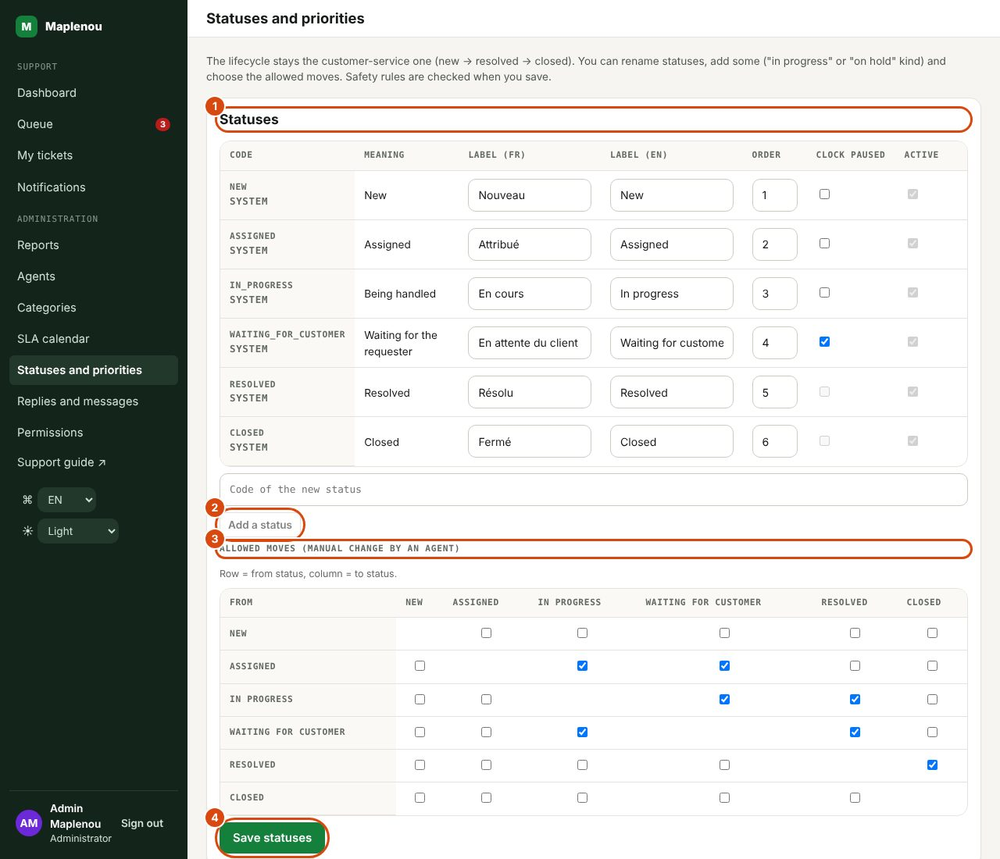
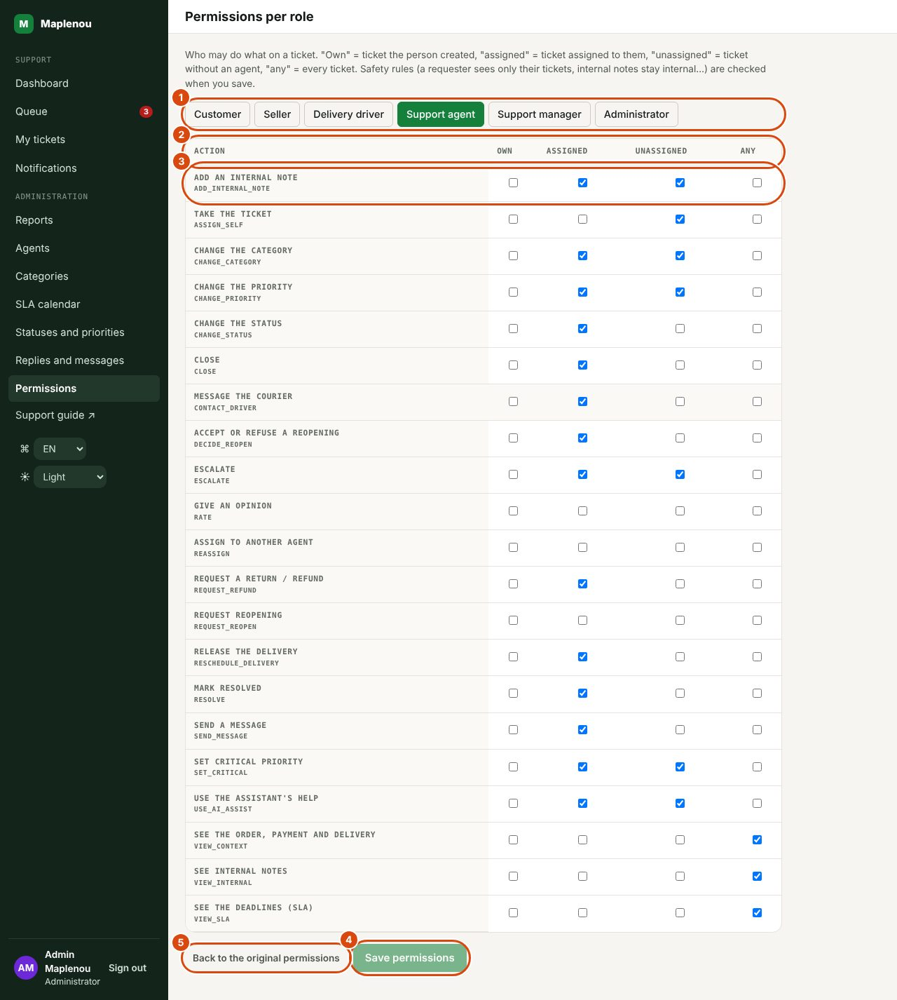
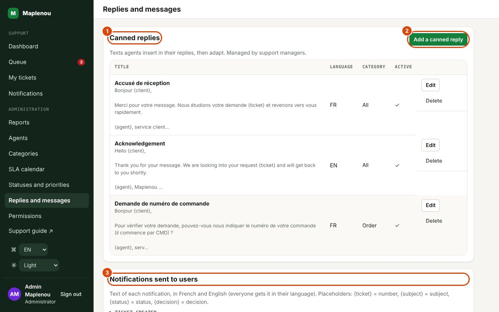

# Administration

The Administration section of the side menu is reserved for support managers and administrators. It contains Reports (see [Reports](reports.md)), Agents, Categories and SLA calendar.

!!! info "Who can make changes"
    **Support managers** view these screens in read-only mode. Only **administrators** can make changes: account activation, support roles, import of former tickets, categories, public holidays (BR-065). The Support roles and Former Maplenou tickets sections are shown to them only. Support agents have no access.

## Support agents: workload and activation

The Agents screen (title Support agents) lists the support accounts: agents, managers and administrators, with the columns Agent (name and e-mail), Role, Open tickets (current workload) and Status (Active or Deactivated).

For an administrator, each row offers Deactivate or Reactivate. You cannot deactivate your own account.

A deactivated account:

- can no longer use the support area: all its requests are refused;
- can no longer receive tickets and disappears from the Assign to an agent and Assigned to lists;
- no longer receives the notifications meant for managers.

!!! warning "Reassign the tickets of a deactivated agent"
    Deactivating an agent does not reassign their tickets: they stay in their name. A manager must reassign them (queue filtered on Assigned to, then Assign to an agent on each ticket). Do it before deactivation, while the agent still appears in the filter.

Creating a support account from this screen is not available: an account appears in the list when the person uses the application with a support role. The role is given in the next section.

## Support roles of Maplenou accounts

Support staff sign in with their Maplenou account: the same phone number and password as in the Maplenou app. A Maplenou account has no support role; at sign-in it gets the profile of its account: Administrator for an administrator of the Maplenou platform, Delivery driver for a delivery driver, Seller for a seller whose profile is approved, otherwise Customer. A role given here takes precedence over that profile.

To give a support role (administrators), in the Support roles section of the Agents screen:

1. Enter the Phone number of the Maplenou account, with the country code (for example +228 90 00 00 00).
2. Choose the Role: Support agent, Support manager or Administrator.
3. Click Save. The message "Role saved for …" confirms it.

Entering a number that is already listed changes its role. A malformed number is refused with "Invalid phone number.".

The table lists the roles given, with the columns Phone number, Role and Given on; when no role has been given it shows "No support role given yet.". To remove a role, click Remove on its row ("Role removed for …"): at their next sign-in, the person gets back the profile of their Maplenou account.

!!! warning "The role applies at the next sign-in"
    A person who is already signed in keeps their former role until their session ends (8 hours at most) and they sign in again. To cut a support member's access right away, also deactivate their account in the list above (Deactivate).

## Former Maplenou tickets

Before this service, the Maplenou app had its own support, with tickets numbered like `TKT-2026-000017` (6 digits; customer-service numbers have 5, like `TKT-2026-00042`). The Former Maplenou tickets section of the Agents screen brings them into customer service, so that nothing is lost.

To import (administrators): click Import former tickets. The message "… ticket(s) imported, … already there." gives the result.

- **The import is safe to run again**: a ticket already imported is skipped and counted as "already there".
- **Numbers**: each imported ticket gets a customer-service number. The old number (6 digits) is shown in brackets next to the new one, on the ticket screen (support and requester sides), and the queue search finds it.
- **Content kept**: creation date, requester, subject, description, related delivery; the link of an attached photo becomes a text line of the first message. The priority is Medium.
- **Category**: deduced from the words of the old category and subject — "retour" or "rembours…" → Return/Refund; "livraison", "livreur" or "colis" → Delivery; "paiement" or "mobile money" → Payment; "commande" → Order; "vendeur" or "boutique" → Seller; "compte", "connexion" or "mot de passe" → Account; otherwise Other.
- **Status**: an old open ticket becomes New; an in-progress ticket becomes New with an internal note saying it must be picked up again (it is not assigned); a resolved ticket becomes Resolved, and its resolution notes become a reply visible to the requester.
- **No notification** is sent to requesters.

SLA deadlines start from the original creation date: an old ticket that is still open therefore usually shows Overdue. Assign and handle them first.

If the import says "Import not possible: set MAPLENOU_CORE_URL and SUPPORT_SERVICE_TOKEN (on both sides)." or that the Maplenou platform does not answer, customer service is not connected to the platform yet: contact the technical team.

## Ticket categories

The Categories screen (title Ticket categories) lists the seven categories, with the columns Code, Name, Description and Status (Active or Inactive).

| Code | Business category | Default name (as stored) |
| --- | --- | --- |
| `ORDER` | Order | Commande |
| `PAYMENT` | Payment | Paiement |
| `DELIVERY` | Delivery | Livraison |
| `SELLER` | Seller | Vendeur |
| `ACCOUNT` | Account | Compte |
| `RETURN_REFUND` | Return/Refund | Retour / remboursement |
| `OTHER` | Other | Autre |

Category names are data entered by administrators, not interface labels: they are displayed as stored, in both languages.

To edit a category (administrators): click Edit, change the Name (mandatory, 80 characters maximum), the Description (255 characters maximum) or the Active checkbox, then Save.

Rules:

- **Administrators add categories** (amended BR-006, DEC-CS11-06) with New category: a code in CAPITALS (for example `DIGITAL_GOODS`), a name, an English name (shown to people who chose English) and a description. A category is never deleted: deactivate it.
- **The "Other" category (`OTHER`) must stay active.** An attempt to deactivate it is refused with "The “Other” category must stay active."
- An inactive category can no longer be chosen, neither by requesters when creating a ticket nor by support when changing a category. Tickets that already use it keep it.

## SLA calendar and public holidays

Since 29 October 2026 (DEC-CS10-16), SLA deadlines are counted **24/7** (see [SLA and calendar](sla.md)). The SLA calendar screen says so at the top: "SLA deadlines are counted 24/7: weekends and public holidays count. This list therefore has no effect on deadlines; it is only used if the business-hours mode is switched back on (SLA_MODE=business-hours)."

The public-holiday list can still be managed here. It only counts if the technical team switches the business-hours mode back on: the screen then reminds you that deadlines are counted Monday to Friday, 8 am to 6 pm (Lomé time), excluding the official public holidays listed. Hours and working days of that mode are fixed; only public holidays are managed here.

To add a public holiday (administrators): fill in the Date and the Label (for example the name of the holiday), then click Add. Entering a date that already exists updates its label. To remove a day, click Delete next to it.

!!! warning "Enter the official calendar in advance (business-hours mode)"
    The list is not pre-filled. Enter the year's official public holidays as soon as they are known. SLA deadlines are calculated when a ticket is created, when its priority changes or when it is reopened: a public holiday added afterwards does not move deadlines already calculated, it only applies to later calculations.

If the list is empty, the screen shows "No public holidays recorded" and "Add the official calendar for accurate SLAs."

## Statuses and priorities

*Marks on the screenshot:*

1. Statuses: French and English labels, meaning, order, clock paused.
2. Add a status.
3. The allowed moves: row = from status, column = to status.
4. Save statuses (priorities are set further down, the same way).

The Statuses and priorities screen (administrators; managers see it read-only) sets the ticket vocabulary (DEC-CS11-02).

- **Statuses**: rename a status in French and English, change the display order, tick Clock paused for waiting statuses. Add a status creates your own status, meaning Being handled or On hold (third party) — for example `WAITING_SELLER` "Waiting for the seller". System statuses cannot be removed or deactivated.
- **Allowed moves**: the grid shows, for each from status (row), which statuses an agent may move the ticket to by hand (column). New statuses then appear as buttons in the Ticket actions panel.
- **Priorities**: FR/EN labels, rank (higher = more urgent), Chosen by the requester (never for the critical priority) and the Default priority. A new priority gets default SLA targets, to adjust in SLA calendar.

Lifecycle rules are checked when you save: a status still used by a ticket cannot be removed, and a setting that would break the lifecycle (no closed status, for example) is refused with a message.

## Permissions per role

*Marks on the screenshot:*

1. The role to set.
2. The columns Own, Assigned, Unassigned and Any.
3. An action, with one box per case.
4. Save permissions.
5. Back to the original permissions.

The Permissions screen (administrators) shows, role by role, who may do what on a ticket: Own (ticket the person created), Assigned, Unassigned or Any. Tick or untick, then Save permissions; Back to the original permissions restores the starting matrix. Safety rules are checked: a requester can never see another person's ticket or internal notes.

## Canned replies and notification texts

*Marks on the screenshot:*

1. Canned replies: the texts agents insert.
2. Add a canned reply.
3. Notifications sent to users: the text of each notification, in French and English.

The Replies and messages screen has two parts:

- **Canned replies** (managers and administrators): Add a canned reply, with a title, a language, a category (or All) and the text. Agents insert them in their replies with the ticket's Canned replies list.
- **Notifications sent to users** (administrators): the title and message of each notification, in French and English. Everyone gets the notification in the language they chose in the app. Placeholders: `{ticket}`, `{subject}`, `{status}`, `{decision}`.
