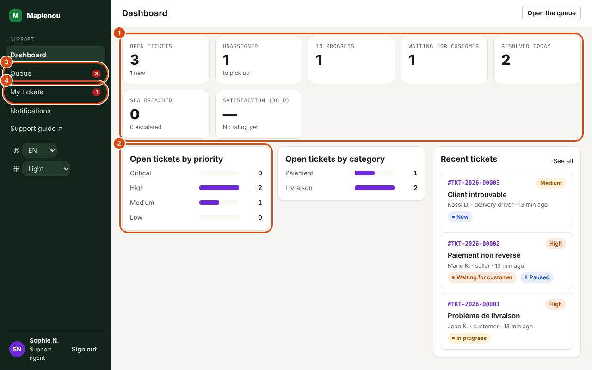
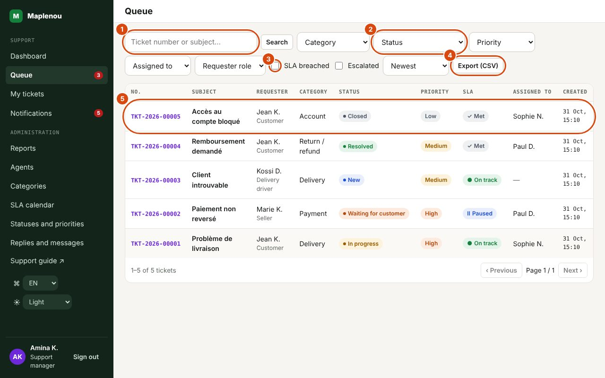

# Daily work

The support area is organised around a side menu. The Support section contains Dashboard, Queue, My tickets and Notifications. Managers and administrators also see the Administration section (Reports, Agents, Categories, SLA calendar). Badges show the number of open tickets (Queue), your open tickets (My tickets) and your unread notifications.

## The dashboard

*Marks on the screenshot:*

1. The counters: open, unassigned, in progress, waiting for the customer, resolved today, SLA breached, satisfaction. Each one opens the filtered queue.
2. Open tickets by priority (then by category and the recent tickets).
3. Queue: every ticket, with the number to handle.
4. My tickets: the tickets assigned to you.

The Dashboard shows the workload of the **whole team** (not just yours). Each tile is clickable and opens the queue already filtered.

| Tile | What it counts | Click |
| --- | --- | --- |
| Open tickets | Tickets that are New, Assigned, In progress or Waiting for customer. The note "N new" gives the number of New tickets. | Queue filtered on Open (all) |
| Unassigned | Open tickets nobody has taken ("to pick up"). | Queue filtered on Unassigned |
| In progress | Tickets with the status In progress. | Queue filtered on that status |
| Waiting for customer | Tickets with the status Waiting for customer. | Queue filtered on that status |
| Resolved today | Tickets marked resolved since midnight (Lomé time). | Queue filtered on Resolved (all resolved tickets) |
| SLA breached | Open tickets whose first-response or resolution deadline has passed. The note "N escalated" gives the number of open escalated tickets. | Queue filtered on SLA breached |

Below the tiles:

- Open tickets by priority: breakdown of open tickets between Critical, High, Medium and Low;
- Open tickets by category: breakdown of open tickets by category;
- Recent tickets: the five most recently created open tickets, with their status and an SLA badge when they are no longer On track. See all opens the queue.

The Open the queue button at the top of the screen goes straight to the queue.

## The queue

The Queue lists every ticket visible to support, 20 per page, newest first by default. The columns are No., Subject (with the Escalated badge when relevant), Requester (with their role), Category, Status, Priority, SLA, Assigned to and Created. Click the number or the subject to open the ticket.

The SLA column shows the worse of the first-response and resolution states (see [SLA and calendar](sla.md)).

## Searching and filtering the queue

*Marks on the screenshot:*

1. Search: a full number, or part of the number or subject.
2. The filters: Category, Status, Priority, Assigned to, Requester role.
3. SLA breached and Escalated: only late or escalated tickets.
4. Export (CSV): the filtered list in a file (managers and administrators).
5. A row: number, subject, requester, category, status, priority, SLA state, agent and date. Click the number or subject to open the ticket.

| Control | Use |
| --- | --- |
| Search | Type a full number (for example `TKT-2026-00042`) to find exactly that ticket, or part of the number or subject, then confirm. A ticket imported from the former support is also found by its old number (`TKT-2026-000017`: 6 digits, see [Former Maplenou tickets](administration.md#former-maplenou-tickets)). |
| Category | One ticket category. |
| Status | One specific status, or Open (all) for every ticket that is neither resolved nor closed. |
| Priority | Critical, High, Medium or Low. |
| Assigned to | Me, Unassigned or a named agent. |
| Requester role | Customer, Seller or Delivery driver. |
| SLA breached (checkbox) | Only open tickets with a passed SLA deadline. |
| Escalated (checkbox) | Only escalated tickets. |
| Sort | Newest, Oldest, Priority (Critical first) or Last activity. |
| Reset | Clears all filters. |

Filters combine (for example Unassigned + Priority High). If nothing matches, the screen shows "No tickets match these filters".

!!! tip "Saving a view"
    Filters are written into the page address: bookmark a filtered view or send its link to a colleague so they see the same list.

## My tickets

My tickets shows the same list as the queue, limited to the tickets assigned to you. All filters are available except Assigned to. To see only the remaining work, choose Status → Open (all).

## Notifications

The Notifications screen gathers in-app notifications. The All and Unread tabs filter the list; Mark all as read clears the counter. Clicking a notification opens the ticket and marks it as read.

| Notification | Who receives it |
| --- | --- |
| New ticket | Active support managers, whenever a ticket is created. |
| Ticket assigned | The agent the ticket has just been assigned to (unless they assigned it to themselves). |
| Requester replied | The assigned agent; if the ticket is unassigned, the active support managers. |
| Reopening request | The assigned agent; if the ticket is unassigned, the active support managers. |
| Ticket escalated | Active support managers. |

You are never notified of your own actions. Notifications are sent after the action has been saved: a notification problem never cancels a successful action on a ticket (BR-020). So keep checking the queue, even without notifications.

## Push notifications in the browser

To be alerted on your computer even when the support workspace is not on screen, turn on push notifications in your browser:

1. Open Notifications in the side menu.
2. In the Push notifications card, click Turn on push notifications, then allow notifications when the browser asks.
3. Click Send a test notification: a "Notification de test" notification should appear after a few seconds.

Clicking a push notification opens the ticket concerned. Push notification texts are in French. Turn off stops push notifications on this device; signing out also stops them for this browser, which matters on a shared computer.

If the card says notifications are blocked, click the icon to the left of the site address, allow notifications, then reload the page. If it says the browser does not support them or that they are not configured, the Notifications screen remains your reference. The mobile apps ask for permission to show notifications themselves.

## Suggested daily routine

This routine is an organisational suggestion, not a rule.

1. **Open the dashboard** and look at the SLA breached and Unassigned tiles.
2. **Handle the urgent cases**: queue filtered on SLA breached, then sorted by Priority.
3. **Read the unread notifications**, especially requester replies and reopening requests.
4. **Work through My tickets** (status Open (all), sort Priority): reply, request missing information, mark resolved what is fixed.
5. **Take unassigned tickets** according to your workload, starting with the highest-priority and oldest ones.
6. **Before you leave**, add an internal note on in-progress tickets that need follow-up.

For managers: also watch the Escalated checkbox and each agent's workload (Open tickets column of the Agents screen), and reassign when needed.
