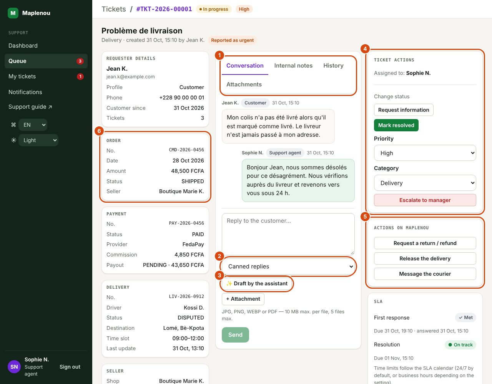

# Handle a ticket

The ticket screen brings together everything you need to handle it without switching tools: the requester and the Maplenou context (order, payment, delivery…) on the left, the exchanges in the middle, the actions and the SLA on the right. Only the buttons you are allowed to use on this ticket are shown.

## Opening a ticket and reading the header

*Marks on the screenshot:*

1. The tabs Conversation, Internal notes, History and Attachments.
2. Insert a canned reply: a text ready to adapt.
3. Draft by the assistant: a proposed reply to review (never sent without you).
4. Ticket actions: status, priority, category, escalation.
5. Actions on Maplenou: return request, delivery release, message to the courier.
6. The Maplenou context: Order, then payment, delivery and seller.

Open a ticket from the Queue, My tickets, the Dashboard or a notification. The header shows:

- the breadcrumb Tickets / ticket number (format `TKT-year-number`, never reused);
- the status badge, the priority badge and, when relevant, the Escalated badge;
- the subject, then the category, the creation date and the requester's name;
- the Reported as urgent badge if the requester ticked urgency when creating the ticket. It is information to help you set the priority: it **never** sets the ticket to Critical automatically (BR-037).

If the ticket is assigned to a colleague, the Read only box reminds you that only the assigned agent or a manager can change it.

## Checking the requester and the Maplenou context

The left column is reserved for support.

| Panel | Information |
| --- | --- |
| Requester details | Name, e-mail, Profile (Customer, Seller or Delivery driver), Phone, Customer since, number of the requester's Tickets. |
| Order | No., Date, Amount, Status, Seller. |
| Payment | No., Status, Provider (FedaPay, Stripe), Commission, Payout (status and amount). |
| Delivery | No., Driver, Status, Destination, Time slot, Last update. |
| Seller | Shop, Account (account status), Balance. |
| Refund | No., Status, Amount. |

!!! note "How the commission works (since November 2026)"
    The Maplenou commission is **included in the price the buyer sees**: 5 % of the seller's base price
    (Standard category) or 3 % (High-price category), rounded to the whole FCFA per unit, delivery excluded. The
    buyer pays nothing extra and the seller receives their base price: the commission is never taken from the
    payout. Orders placed before this change keep the former model (25 % / 22.5 % taken from the seller).

    - Example (Standard): base price 10,000 FCFA + commission 500 FCFA = **10,500 FCFA** shown, delivery extra.
    - **Monthly seller fee**: 500 FCFA (Standard) or 2,000 FCFA (High price). The first 3 completed sales are free;
      from the 4th, **one** fee per month, only for a month with at least one completed sale. It is deducted from
      the available balance **before** the payout (8,000 FCFA available − 500 FCFA = 7,500 FCFA paid); if the
      balance is too low, the rest stays due for the next payout. The same fee is never taken twice.
    - A **cancelled or refunded** order does not count as a sale; the commission included in its price is refunded
      with it.
    - The seller chooses the category at sign-up; Maplenou may ask for a correction if it does not match the
      products. An approved change applies from the 1st of the next month, to new orders only.
    - The seller is notified at the 4th sale (fee starts), at each deduction and at each refund that includes a
      commission. In the app, the seller sees the fee summary (category, amount, month, status), the history of
      deductions and the estimated net amount before a withdrawal.

Panels appear only when the ticket is linked to a reference. When creating the ticket, the requester can link an order or a delivery they are part of (a customer: an order they bought; a seller: an order they sold; a driver: a delivery assigned to them). The payment, delivery, seller and refund references are then derived automatically from the order.

!!! info "Service temporarily unavailable"
    Each panel loads separately. If a Maplenou service does not respond, the panel shows "Service temporarily unavailable."; the rest of the ticket remains usable. "Reference not found." means the linked reference could not be found.

Actions in other modules (refund, re-schedule a delivery, contact the driver from the application) are not available from the ticket: no approved rule defines them yet.

## Taking or assigning the ticket

The Ticket actions panel shows Assigned to: followed by the agent's name or Unassigned.

- **Agent**: on an unassigned ticket, click Take over. The ticket is assigned to you and moves from New to Assigned.
- **Manager**: Take over (unassigned ticket) or Assign to me (ticket already assigned); the Assign to an agent list → Choose an agent… assigns the ticket to an active agent or manager. Each option shows the agent's workload, in the form "Name (3 open)".
- **Administrator**: can assign to an agent with Assign to an agent, but cannot assign the ticket to themselves.

Every assignment or reassignment is recorded in the history (BR-013) and the agent receiving the ticket is notified.

## Adjusting priority and category

In Ticket actions:

- Priority: choose Low, Medium, High or Critical. The change is immediate, except for Critical, which opens the Set priority to Critical? dialog: enter a Reason (the field suggests "E.g. suspected fraud"), then Confirm Critical. Every priority change recalculates the SLA (see [SLA and calendar](sla.md)).
- Category: choose an active category; the message "Category changed." confirms it.

Both changes are recorded in the history with the old and new values (BR-008).

## Replying in the conversation

The Conversation tab contains the messages visible to the requester, including their initial description. Write in the Reply to the customer… field, then click Send.

- Your first visible reply records the **first response** for the SLA; if the ticket is Assigned, it automatically moves to In progress.
- The requester is notified of every reply.
- If sending fails, a message offers Retry: the message is never saved twice.
- A message can contain up to 5,000 characters.

To reply to or change the status of an unassigned ticket, take it first.

## Writing an internal note

The Internal notes tab is for exchanges between support staff: investigation, handover, asking for advice. Write in the Note visible to support only… field, then click Add note.

!!! danger "Never visible to the requester"
    Internal notes and their attachments are **never** visible to the requester (BR-016), neither in the application nor in notifications. Conversely, everything you write in the Conversation tab is visible to them: check the active tab before sending.

An internal note does not count as a first response for the SLA.

## Attaching files

Below the input field (conversation or note), + Attachment adds files to the message:

- accepted formats: JPG, JPEG, PNG, WEBP, PDF;
- 10 MB maximum per file, 5 files maximum per message, 50 MB maximum in total per ticket (DEC-003).

The type is checked against the file's real content: a renamed file is refused. The Attachments tab lists every file of the ticket with its size, author and date; files that come from an internal note carry the Internal note label. Click a file to download it.

## Changing the status

The Change status area offers only the changes allowed from the current status:

| Button | Effect |
| --- | --- |
| Start work | Assigned → In progress |
| Request information | → Waiting for customer; the requester is notified that support needs more information |
| Resume work | Waiting for customer → In progress |
| Mark resolved | → Resolved, after confirmation in Mark the ticket as resolved? |
| Close ticket | Resolved → Closed, after confirmation in Close the ticket? |

The confirmation dialogs offer a Comment (history, optional), saved in the history. Transition details are in [Statuses and transitions](statuses-and-transitions.md).

!!! warning "Closing is final"
    A Closed ticket can no longer be reopened by the requester: they will have to create a new ticket (BR-052, BR-053). Only close a resolved ticket the requester no longer needs.

## Escalating

Escalate to manager flags the ticket to the support managers. The reason is mandatory. See [Escalation](escalation.md).

## Checking the history

The History tab traces every significant event with its author and date: Ticket created, Status changed, Priority changed, Category changed, Assigned, Reassigned, Message sent, Internal note added, Attachment added, Ticket escalated, Reopening requested, Reopening approved, Reopening refused, SLA recalculated. Changes show the old and new values.

The history can be neither edited nor deleted (BR-018). The requester sees a reduced version: creation, changes of status, priority and category, attachments of visible messages and the reopening steps (with the reason and the decision note). They do not see assignments, internal notes, escalations, SLA recalculations or your comments and reasons.

## Reading the SLA panel

Below the actions, the SLA panel shows the state of the First response and of the Resolution, each with its deadline, and the reply or resolution date once reached. After a reopening, an expandable line lists the resolution periods. See [SLA and calendar](sla.md).

## Using a canned reply or an assistant draft

Below the reply box of the Conversation tab:

- the Canned replies list inserts a text prepared by managers (see [Administration](administration.md#canned-replies-and-notification-texts));
- the ✨ Draft by the assistant button (when AI help is on) writes a reply from the user guide, in your language, signed with your name. The titles of the sections used are shown next to it.

In both cases the text is only **inserted**: read it, adapt it to the requester, then click Send. The assistant only receives the subject, description and public messages of the ticket — never the name, phone, e-mail or payment data.

## Category and priority suggestion

When AI help is on, the assistant reads each new ticket and proposes a category and a priority in the ✨ Assistant suggestion card, with a confidence and a short reason. Click Apply to change the category and priority (written in the history), or Dismiss. Nothing is applied without you; the requester never sees the suggestion.

## Acting on Maplenou from the ticket

The Actions on Maplenou card appears when the ticket is assigned to you (or for a manager) and is linked to an order or a delivery:

| Button | What Maplenou does |
| --- | --- |
| Request a return / refund | opens a return request on behalf of the buyer (reason of at least 10 characters, product condition, shop concerned when the order has several); the usual rules apply: 30 days after delivery, one request per shop; the seller then decides |
| Release the delivery | takes the delivery away from the current courier so that another one can take it; not possible once the courier is on the way |
| Message the courier | sends your message to the courier's support conversation in the Maplenou app, with the ticket number and your name |

Maplenou may refuse a request: its message is shown (for example "the 30-day return window after delivery has passed"). Accepted or refused, every request is listed under Actions sent and in the ticket history.

## If an action fails

- "The ticket was changed by someone else. Reload and try again.": a colleague changed the ticket at the same time as you. Reload the page and repeat the action if it is still useful.
- "This status change is not allowed.": the requested status change is not allowed from the current status.
- "The ticket must be assigned to an active support agent.": the chosen agent is deactivated or cannot be assigned.
