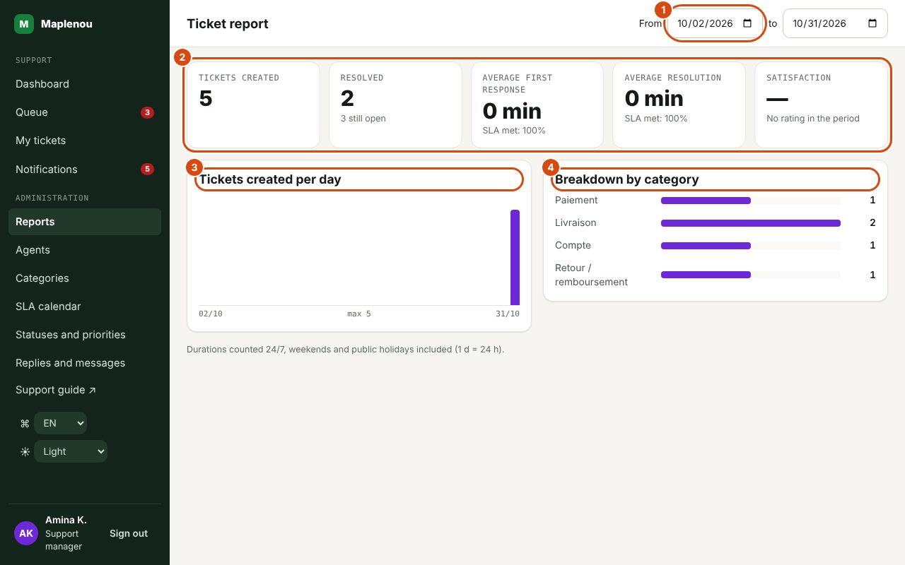

# Reports

The Reports screen (title Ticket report) gives a simple summary of support activity over a period. It is reserved for support managers and administrators.

## Choosing the period

*Marks on the screenshot:*

1. The period: From … to (366 days at most).
2. The key figures: tickets created, resolved, average times, SLA met, satisfaction.
3. Tickets created per day.
4. Breakdown by category.

At the top of the screen, fill in the dates From … to … . By default, the report covers the last 30 days, today included. The report updates as soon as you change a date.

- The period cannot exceed **366 days**; beyond that, the message "Invalid period (366 days maximum)." is shown.
- The end date cannot be before the start date.
- The report covers the **tickets created during the period**: a ticket created before the period and resolved during it is not included.

## What the report contains

| Metric | What it measures |
| --- | --- |
| Tickets created | Number of tickets created in the period. |
| Resolved | Among them, those that are currently resolved or closed (a ticket that was reopened and not yet resolved again is not counted). The note "N still open" counts those that are still New, Assigned, In progress or Waiting for customer. |
| Average first response | Average time between creation and support's first visible reply, for tickets that received a reply. |
| Average resolution | Average time between creation and resolution, for resolved tickets. |
| SLA met: …% (under first response) | Share of tickets that received a first response where the reply came on or before the deadline. |
| SLA met: …% (under resolution) | Share of resolved tickets resolved on or before the resolution deadline. For a ticket reopened and resolved again, the last resolution counts, compared with the deadline of the last resolution period. |
| Tickets created per day | Column chart of the number of tickets created each day of the period. |
| Breakdown by category | Number of tickets in the period per category. |

If no ticket was created in the period, the breakdown shows "No tickets in this period."; a metric without data shows "—".

## Reading durations and percentages

- Durations follow the SLA calendar, **24/7** since 29 October 2026 (DEC-CS10-16, see [SLA and calendar](sla.md)): all elapsed time counts, nights, weekends and public holidays included. A ticket created on Friday at 7 pm that receives its first reply on Monday at 9 am therefore counts 62 h of first response.
- The display groups hours as **1 d = 10 h**, as the note at the bottom of the screen says: `45 min`, `3 h 20`, `2 d 4 h`. The 62 h of the example are therefore shown as `6 d 2 h`. That note still mentions the business hours (Mon–Fri, 8 am–6 pm) of the former rule: in 24/7 mode, read each `d` as 10 hours of elapsed time.
- SLA percentages are measured against the targets of the ticket's priority (see [SLA and calendar](sla.md)). A low first-response rate may point to tickets left unassigned too long; a low resolution rate, to tickets that stall or wait for the customer (the clock keeps running in Waiting for customer).
- Tickets that are still open are counted neither in the average resolution nor in the resolution SLA rate: for a recent period, these metrics are therefore partial. Prefer comparing completed periods.

## Limits of the report

The report is deliberately simple: advanced analytics are outside the current scope. It shows the period's **satisfaction** (average of the 1–5 ratings and share of 4 or 5); the dashboard shows the last 30 days. To work on the data in a spreadsheet, use Export (CSV) in the queue: the file follows the filters on screen. For the real-time situation, use the [dashboard](daily-work.md).

!!! note "Pending approval"
    The content of this basic report (the metrics listed above) awaits confirmation by the project owner (decision DEC-CS03-16).
