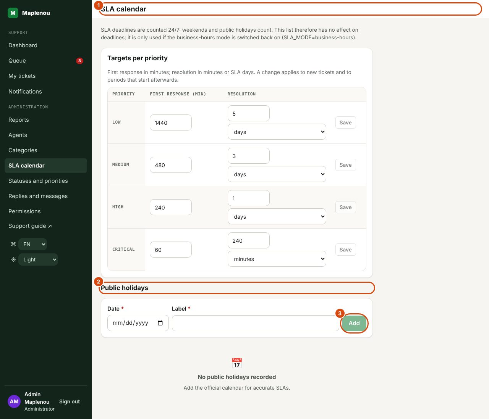

# SLA and calendar

Every ticket receives two service-level targets (SLA) set according to its priority: a **first-response** target and a **resolution** target (BR-029 to BR-031). Targets are counted from the ticket's creation (BR-033), **24 hours a day, 7 days a week** since the project owner's decision of 29 October 2026 (DEC-CS10-16). The SLA is visible to support only.

## Targets per priority

| Priority | First response | Resolution |
| --- | ---: | ---: |
| Low | 24 hours | 5 days |
| Medium | 8 hours | 3 days |
| High | 4 hours | 1 day |
| Critical | 1 hour | 4 hours |

These are the targets of the approved decision DEC-001. A Critical ticket always follows the Critical SLA (BR-039). For targets expressed in days, **1 day = 24 hours**: 5 days = 120 hours.

## Calendar 24/7

*Marks on the screenshot:*

1. SLA calendar: how deadlines are counted.
2. Public holidays: used only in the "business hours" mode.
3. Add: a public holiday (date and label).

Targets run all the time (DEC-CS10-16):

- **every day**, Saturday and Sunday included;
- **at any hour**, day and night (Lomé time);
- **public holidays included**: the list on the SLA calendar screen no longer affects deadlines (the screen says so at the top).

A ticket created on a Saturday evening therefore starts using its target immediately.

!!! example "Example"
    A High ticket is created on Friday at 10 pm. First response (4 h): due **Saturday at 2 am**. Resolution (1 day = 24 h): due **Saturday at 10 pm**.

Deadlines are calculated when the ticket is created, then again when the priority changes or a reopening is accepted (see below). A ticket created before the switch to 24/7 keeps the deadlines calculated at its creation until one of these events recalculates them.

## Former "business hours" mode

Until 29 October 2026, targets only ran during business hours (BR-032, DEC-CS03-05): Monday to Friday, 8 am to 6 pm (Lomé time), excluding the public holidays recorded in SLA calendar, with 1 business day = 10 business hours. This mode is still available: the technical team can switch it back on with a server setting (`SLA_MODE=business-hours`). The SLA calendar screen then shows the business-hours rule again, and the listed public holidays count again.

## What counts as a first response and as a resolution

- **First response**: the first message **visible to the requester** sent by a support member in the Conversation tab. An internal note, an assignment or a status change do not count.
- **Resolution**: the ticket moving to the Resolved status.

## SLA states

Each target has a state, shown as a badge:

| Badge | Meaning |
| --- | --- |
| On track | The deadline has not been reached and less than 75% of the target has elapsed. |
| Due soon | At least 75% of the target has elapsed and the deadline has not passed yet. |
| Overdue | The deadline has passed without the required action, or the action was done after the deadline (BR-035). |
| Met | The required action (reply or resolution) was done before the deadline. |

Where to see them:

- in the ticket's SLA panel: one state for the First response and one for the Resolution, with the deadline ("Due …") and the reply or resolution date;
- in the queue's SLA column: the worse of the two (in the order Overdue, Due soon, On track, Met);
- in the SLA breached tile and filter: **open** tickets whose first-response deadline (without a reply) or resolution deadline has passed.

## Priority change: SLA recalculation

Changing the priority recalculates the applicable SLA, while the previous priority is kept in the history (BR-034):

- **first response**: if support has not replied yet, the deadline is recalculated from the ticket's creation with the new priority; if the first response has already happened, it does not change;
- **resolution**: the deadline is recalculated with the new priority from the start of the current resolution period (the ticket's creation, or the last reopening).

The history records Priority changed and SLA recalculated (old and new deadlines).

!!! warning "Setting an old ticket to Critical"
    Because the calculation starts from the ticket's creation, setting to Critical a ticket created more than one hour ago with no reply makes its first response Overdue immediately. Reply without delay.

## Reopening: a new resolution period

When a reopening is approved, the original SLA history is kept and a **new resolution period** starts at the time of approval, with the resolution target of the current priority (BR-055). The first-response target is not recalculated.

In the SLA panel, the expandable line "N resolution periods (reopenings)" lists each period with its priority, start, deadline and end.

## Waiting for customer: the resolution clock is paused

Since decision DEC-CS11-03, the Waiting for customer status **pauses** the resolution target: the SLA panel shows Paused and "Resolution clock paused since … (waiting for the customer).". When the requester replies (the ticket goes back to In progress) or you resume work, the due date moves by the time spent waiting. The first-response target is never paused.

Statuses added by an administrator (for example "Waiting for the seller") can pause the clock too: it is the Clock paused box of the Statuses and priorities screen.

In practice: ask for all the information you need at once and follow up with the requester if necessary (see [Good practices](good-practices.md)).

## Targets can be changed

The targets in the table above are the starting values. Administrators change them per priority in SLA calendar, section Targets per priority (first response in minutes, resolution in minutes or days). A change applies to new tickets and to periods that start afterwards.
