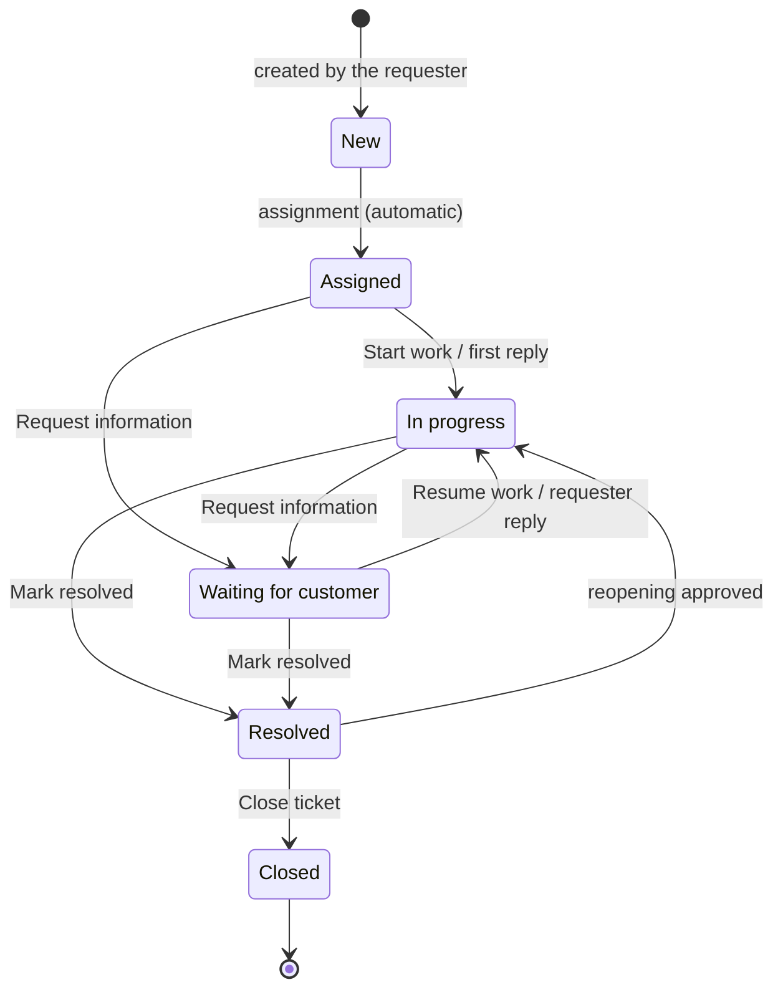

# Statuses and transitions

A ticket follows a controlled lifecycle: only some status changes are allowed (BR-010). The ticket screen only offers the buttons that are valid from the current status; any other request is refused and the status stays unchanged.

## The six statuses

| Status | Meaning | Open? |
| --- | --- | :---: |
| New | Ticket created by the requester; nobody has taken it yet. Every ticket starts here (BR-009). | Yes |
| Assigned | An agent is responsible for the ticket but has not started working on it yet. | Yes |
| In progress | Support is actively working on the request. | Yes |
| Waiting for customer | Support is waiting for information or an action from the requester. | Yes |
| Resolved | The problem has been addressed. The requester can still request reopening. | No |
| Closed | Ticket finalised. No further action possible; a new request needs a new ticket. | No |

"Open" tickets are the ones counted by the Open tickets tile and the Open (all) filter.

## Diagram of the allowed transitions

## Transition table and who can make each change

| From | To | How | Who |
| --- | --- | --- | --- |
| New | Assigned | Automatic on the first assignment (Take over or Assign to an agent). There is no status button for this step. | Agent (on an unassigned ticket), manager, administrator (assignment to an agent) |
| Assigned | In progress | Start work, or automatically on support's first visible reply | Assigned agent, manager, administrator |
| Assigned or In progress | Waiting for customer | Request information | Assigned agent, manager, administrator |
| Waiting for customer | In progress | Resume work, or automatically when the requester replies | Assigned agent, manager, administrator; the requester indirectly through their reply |
| In progress or Waiting for customer | Resolved | Mark resolved (with confirmation) | Assigned agent, manager, administrator |
| Resolved | Closed | Close ticket (with confirmation), only if no reopening request is pending | Assigned agent, manager, administrator |
| Resolved | In progress | Only by approving a reopening request from the requester (Reopen (In progress)) | Assigned agent, manager, administrator |

Every status change is recorded in the history with its author, date and, if provided, your comment (BR-017). The requester is notified of status changes on their ticket.

## Forbidden transitions

- New → Closed is explicitly forbidden (BR-010): a ticket must be handled and resolved before it is closed.
- Resolved → an active status without an approved reopening request is forbidden, including for support (BR-049). The requester cannot reopen directly.
- Closed is final: no status change is possible, neither by support nor by the requester (BR-052). A new request needs a new ticket (BR-053).
- An agent cannot change the status of a ticket assigned to a colleague, nor of an unassigned ticket until they have taken it.

When an attempt is refused, the application shows "This status change is not allowed."

## Automatic changes

| Event | Change |
| --- | --- |
| First assignment of a New ticket | New → Assigned |
| Support's first visible reply on an Assigned ticket | Assigned → In progress |
| Requester's reply on a Waiting for customer ticket | Waiting for customer → In progress |
| Reopening approved | Resolved → In progress |

An internal note never changes the status. A Resolved ticket that the requester does not reopen is **closed automatically after 7 days** (DEC-CS11-04); the history shows "Closed automatically". Administrators can add statuses and change the allowed moves (see [Administration](administration.md#statuses-and-priorities)).

!!! note "Target status of a reopening"
    Rule BR-051 states that an approved reopening returns the ticket to In progress, unless support explicitly selects another valid active status. The screen currently only offers Reopen (In progress).
