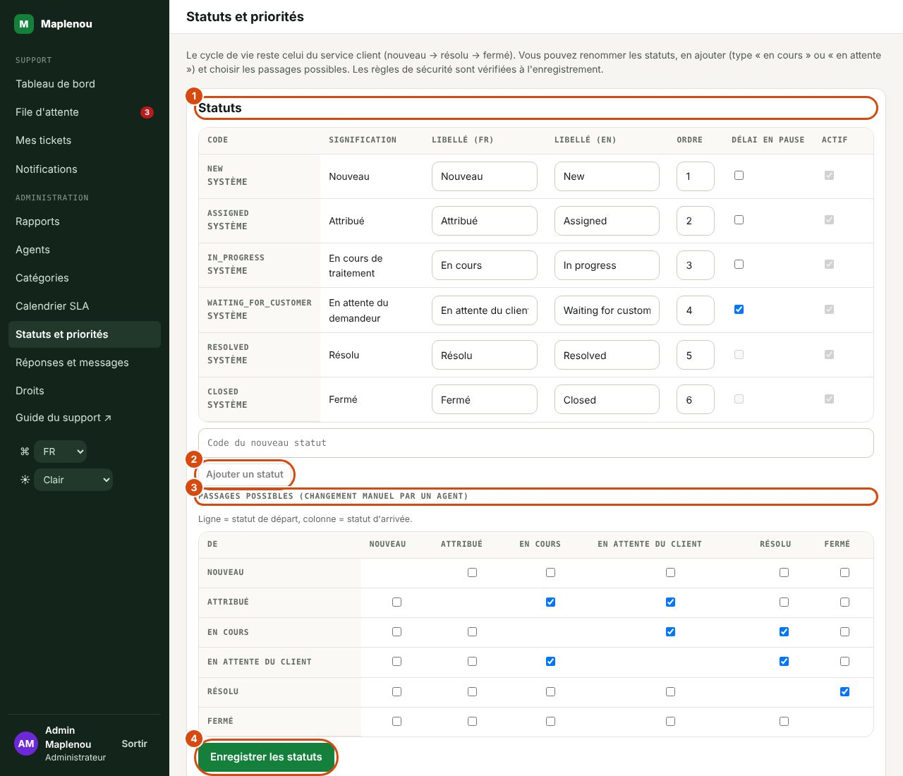
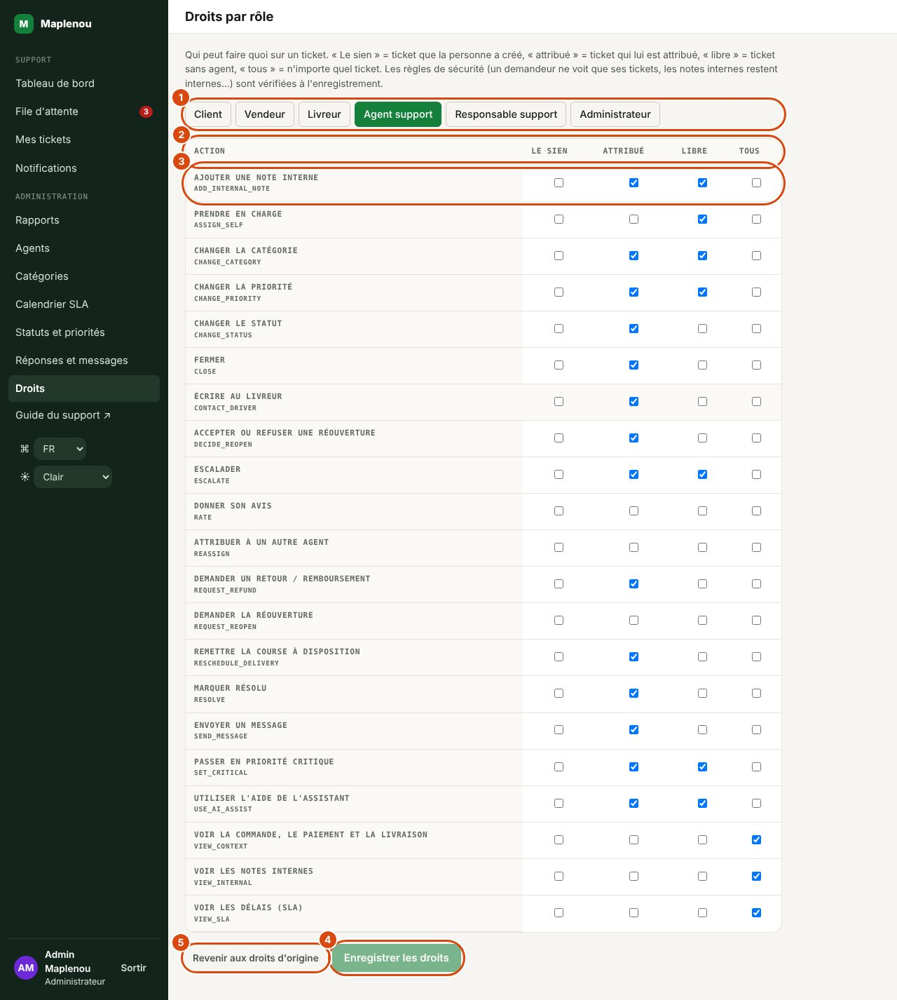
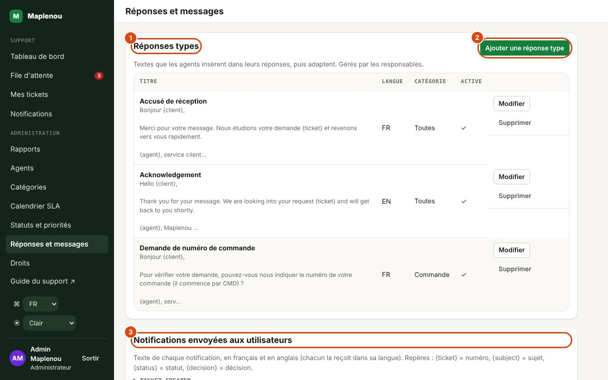

# Administration

La section Administration du menu latéral est réservée aux responsables support et aux administrateurs. Elle contient Rapports (voir [Rapports](reports.md)), Agents, Catégories et Calendrier SLA.

!!! info "Qui peut modifier"
    Les **responsables support** consultent ces écrans en lecture seule. Seuls les **administrateurs** peuvent modifier : activation des comptes, rôles support, import des anciens tickets, catégories, jours fériés (BR-065). Les sections Rôles support et Anciens tickets Maplenou ne s'affichent que pour eux. Les agents support n'y ont pas accès.

## Agents support : charge et activation

L'écran Agents (titre Agents support) liste les comptes support : agents, responsables et administrateurs, avec les colonnes Agent (nom et e-mail), Rôle, Tickets ouverts (charge actuelle) et Statut (Actif ou Désactivé).

Pour un administrateur, chaque ligne propose Désactiver ou Réactiver. Vous ne pouvez pas désactiver votre propre compte.

Un compte désactivé :

- ne peut plus utiliser l'espace support : toutes ses requêtes sont refusées (« Ce compte support est désactivé. ») ;
- ne peut plus recevoir de ticket et disparaît des listes Attribuer à un agent et Attribué à ;
- ne reçoit plus les notifications destinées aux responsables.

!!! warning "Réattribuer les tickets d'un agent désactivé"
    Désactiver un agent ne réattribue pas ses tickets : ils restent à son nom. Un responsable doit les réattribuer (file filtrée sur Attribué à, puis Attribuer à un agent sur chaque ticket). Faites-le avant la désactivation, tant que l'agent apparaît encore dans le filtre.

La création d'un compte support depuis cet écran n'est pas disponible : un compte apparaît dans la liste lorsque la personne utilise l'application avec un rôle support. Le rôle se donne dans la section suivante.

## Rôles support des comptes Maplenou

Le personnel du support se connecte avec son compte Maplenou : le même numéro de téléphone et le même mot de passe que dans l'application Maplenou. Un compte Maplenou n'a pas de rôle support ; à la connexion, il reçoit le profil de son compte : Administrateur pour un administrateur de la plateforme Maplenou, Livreur pour un livreur, Vendeur pour un vendeur dont le profil est approuvé, sinon Client. Un rôle donné ici l'emporte sur ce profil.

Pour donner un rôle support (administrateurs), dans la section Rôles support de l'écran Agents :

1. Saisissez le Numéro de téléphone du compte Maplenou, avec l'indicatif (par exemple +228 90 00 00 00).
2. Choisissez le Rôle : Agent support, Responsable support ou Administrateur.
3. Cliquez sur Enregistrer. Le message « Rôle enregistré pour … » confirme l'enregistrement.

Saisir un numéro déjà présent change son rôle. Un numéro mal formé est refusé avec « Numéro de téléphone invalide. ».

Le tableau liste les rôles donnés, avec les colonnes Numéro de téléphone, Rôle et Attribué le ; sans rôle donné, il affiche « Aucun rôle support attribué. ». Pour retirer un rôle, cliquez sur Retirer sur sa ligne (« Rôle retiré pour … ») : à sa prochaine connexion, la personne retrouve le profil de son compte Maplenou.

!!! warning "Le rôle s'applique à la prochaine connexion"
    Une personne déjà connectée garde son ancien rôle jusqu'à la fin de sa session (8 heures au plus) et sa prochaine connexion. Pour couper l'accès d'un membre du support tout de suite, désactivez aussi son compte dans la liste ci-dessus (Désactiver).

## Anciens tickets Maplenou

Avant ce service, l'application Maplenou avait son propre support, avec des tickets numérotés comme `TKT-2026-000017` (6 chiffres ; ceux du service client en ont 5, comme `TKT-2026-00042`). La section Anciens tickets Maplenou de l'écran Agents les reprend dans le service client, pour que rien ne soit perdu.

Pour importer (administrateurs) : cliquez sur Importer les anciens tickets. Le message « … ticket(s) importé(s), … déjà présent(s). » donne le résultat.

- **L'import peut être relancé sans risque** : un ticket déjà importé est ignoré et compté parmi les « déjà présents ».
- **Numéros** : chaque ticket importé reçoit un numéro du service client. L'ancien numéro (6 chiffres) s'affiche entre parenthèses à côté du nouveau, dans l'écran du ticket (côté support et côté demandeur), et la recherche de la file le retrouve.
- **Contenu repris** : date de création, demandeur, sujet, description, livraison concernée ; le lien d'une photo jointe devient une ligne de texte du premier message. La priorité est Moyenne.
- **Catégorie** : déduite des mots de l'ancienne catégorie et du sujet — « retour » ou « rembours… » → Retour / remboursement ; « livraison », « livreur » ou « colis » → Livraison ; « paiement » ou « mobile money » → Paiement ; « commande » → Commande ; « vendeur » ou « boutique » → Vendeur ; « compte », « connexion » ou « mot de passe » → Compte ; sinon Autre.
- **Statut** : un ancien ticket ouvert devient Nouveau ; un ticket en cours devient Nouveau avec une note interne indiquant qu'il est à reprendre (il n'est pas attribué) ; un ticket résolu devient Résolu, et ses notes de résolution deviennent une réponse visible du demandeur.
- **Aucune notification** n'est envoyée aux demandeurs.

Les échéances SLA partent de la date de création d'origine : un ancien ticket encore ouvert apparaît donc en général en Délai dépassé. Attribuez-les et traitez-les en priorité.

Si l'import affiche « Import impossible : renseignez MAPLENOU_CORE_URL et SUPPORT_SERVICE_TOKEN (des deux côtés). » ou indique que la plateforme Maplenou ne répond pas, le service client n'est pas encore relié à la plateforme : contactez l'équipe technique.

## Catégories de tickets

L'écran Catégories (titre Catégories de tickets) liste les sept catégories, avec les colonnes Code, Nom, Description et Statut (Actif ou Inactif).

| Code | Catégorie métier | Nom par défaut (tel qu'enregistré) |
| --- | --- | --- |
| `ORDER` | Commande | Commande |
| `PAYMENT` | Paiement | Paiement |
| `DELIVERY` | Livraison | Livraison |
| `SELLER` | Vendeur | Vendeur |
| `ACCOUNT` | Compte | Compte |
| `RETURN_REFUND` | Retour/Remboursement | Retour / remboursement |
| `OTHER` | Autre | Autre |

Les noms de catégories sont des données saisies par les administrateurs, et non des libellés de l'interface : ils s'affichent tels qu'enregistrés, dans les deux langues.

Pour modifier une catégorie (administrateurs) : cliquez sur Modifier, changez le Nom (obligatoire, 80 caractères maximum), la Description (255 caractères maximum) ou la case Active, puis Enregistrer.

Règles :

- **Les administrateurs ajoutent des catégories** (BR-006 modifiée, DEC-CS11-06) avec Nouvelle catégorie : un code en MAJUSCULES (par exemple `DIGITAL_GOODS`), un nom, un nom en anglais (affiché aux personnes qui ont choisi l'anglais) et une description. Une catégorie n'est jamais supprimée : désactivez-la.
- **La catégorie « Autre » (`OTHER`) doit rester active**. Une tentative de désactivation est refusée avec « La catégorie « Autre » doit rester active. ».
- Une catégorie inactive ne peut plus être choisie, ni par les demandeurs à la création, ni par le support lors d'un changement de catégorie. Les tickets qui l'utilisent déjà la conservent.

## Calendrier SLA et jours fériés

Depuis le 29 octobre 2026 (DEC-CS10-16), les délais SLA sont comptés **24 h/24 et 7 j/7** (voir [SLA et calendrier](sla.md)). L'écran Calendrier SLA le rappelle en haut de page : « Les délais SLA sont comptés 24 h/24, 7 j/7 : les week-ends et les jours fériés comptent. Cette liste n'a donc aucun effet sur les délais ; elle sert seulement si le mode « heures ouvrées » est réactivé (SLA_MODE=business-hours). »

La liste des jours fériés reste gérable ici. Elle ne compte que si l'équipe technique réactive le mode « heures ouvrées » : l'écran rappelle alors que les délais sont comptés du lundi au vendredi, de 8 h à 18 h (heure de Lomé), hors jours fériés officiels listés. Les horaires et les jours ouvrés de ce mode sont fixes ; seuls les jours fériés se gèrent ici.

Pour ajouter un jour férié (administrateurs) : renseignez la Date et le Libellé (par exemple le nom de la fête), puis cliquez sur Ajouter. Saisir une date déjà présente met à jour son libellé. Pour retirer un jour, cliquez sur Supprimer à côté de lui.

!!! warning "Saisir le calendrier officiel à l'avance (mode heures ouvrées)"
    La liste n'est pas pré-remplie. Saisissez les jours fériés officiels de l'année dès qu'ils sont connus. Les échéances SLA sont calculées au moment de la création du ticket, d'un changement de priorité ou d'une réouverture : un jour férié ajouté après coup ne déplace pas les échéances déjà calculées, il ne s'applique qu'aux calculs suivants.

Si la liste est vide, l'écran affiche « Aucun jour férié enregistré » et « Ajoutez le calendrier officiel pour des SLA exacts. ».

## Statuts et priorités

*Repères de la capture :*

1. Statuts : libellés français et anglais, signification, ordre, délai en pause.
2. Ajouter un statut.
3. Les passages possibles : ligne = statut de départ, colonne = statut d'arrivée.
4. Enregistrer les statuts (les priorités se règlent plus bas, de la même façon).

L'écran Statuts et priorités (administrateurs ; les responsables le consultent en lecture seule) règle le vocabulaire des tickets (DEC-CS11-02).

- **Statuts** : renommez un statut en français et en anglais, changez l'ordre d'affichage, cochez Délai en pause pour les statuts d'attente. Ajouter un statut crée un statut à vous, de signification En cours de traitement ou En attente (tiers) — par exemple `WAITING_SELLER` « En attente du vendeur ». Les statuts système ne peuvent être ni retirés ni désactivés.
- **Passages possibles** : la grille indique, pour chaque statut de départ (ligne), vers quels statuts un agent peut passer le ticket à la main (colonne). Les nouveaux statuts apparaissent ensuite comme boutons dans le panneau Actions sur le ticket.
- **Priorités** : libellés FR/EN, rang (plus grand = plus urgent), Choisie par le demandeur (jamais pour la priorité critique) et la priorité Par défaut. Une nouvelle priorité reçoit des objectifs SLA par défaut, à ajuster dans Calendrier SLA.

Les règles du cycle de vie sont vérifiées à l'enregistrement : un statut encore utilisé par un ticket ne peut pas être retiré, et un réglage qui casserait le cycle (plus de statut fermé, par exemple) est refusé avec un message.

## Droits par rôle

*Repères de la capture :*

1. Le rôle à régler.
2. Les colonnes Le sien, Attribué, Libre et Tous.
3. Une action, avec une case par cas.
4. Enregistrer les droits.
5. Revenir aux droits d'origine.

L'écran Droits (administrateurs) montre, rôle par rôle, qui peut faire quoi sur un ticket : Le sien (ticket créé par la personne), Attribué, Libre (sans agent) ou Tous. Cochez ou décochez, puis Enregistrer les droits ; Revenir aux droits d'origine remet la matrice de départ. Les règles de sécurité sont vérifiées : un demandeur ne peut jamais voir le ticket d'un autre ni les notes internes.

## Réponses types et textes des notifications

*Repères de la capture :*

1. Réponses types : les textes que les agents insèrent.
2. Ajouter une réponse type.
3. Notifications envoyées aux utilisateurs : le texte de chaque notification, en français et en anglais.

L'écran Réponses et messages a deux parties :

- **Réponses types** (responsables et administrateurs) : Ajouter une réponse type, avec un titre, une langue, une catégorie (ou Toutes) et le texte. Les agents les insèrent dans leurs réponses avec la liste Réponses types du ticket.
- **Notifications envoyées aux utilisateurs** (administrateurs) : le titre et le message de chaque notification, en français et en anglais. Chacun reçoit la notification dans la langue choisie dans l'application. Repères utilisables : `{ticket}`, `{subject}`, `{status}`, `{decision}`.
