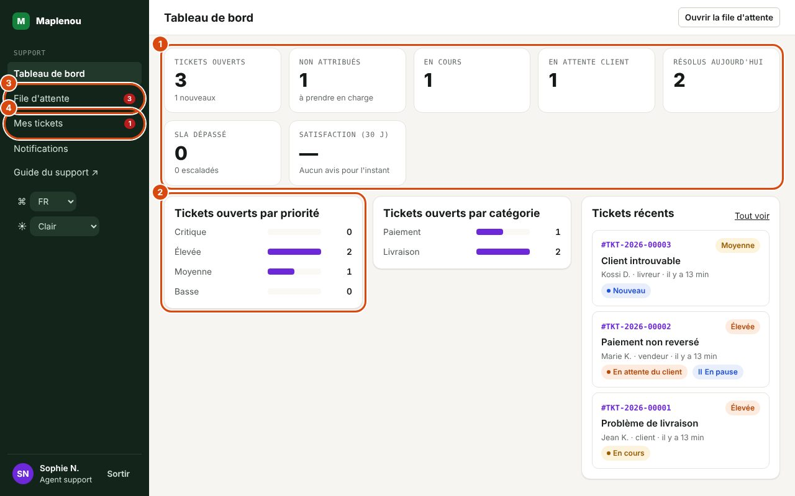
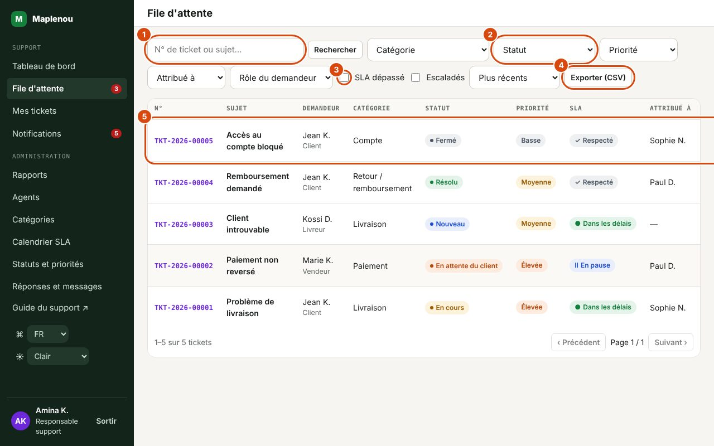

# Travail quotidien

L'espace support s'organise autour d'un menu latéral. La section Support contient Tableau de bord, File d'attente, Mes tickets et Notifications. Les responsables et administrateurs voient en plus la section Administration (Rapports, Agents, Catégories, Calendrier SLA). Des pastilles indiquent le nombre de tickets ouverts (File d'attente), vos tickets ouverts (Mes tickets) et vos notifications non lues.

## Le tableau de bord

*Repères de la capture :*

1. Les compteurs : tickets ouverts, non attribués, en cours, en attente du client, résolus aujourd'hui, SLA dépassé, satisfaction. Chacun ouvre la file filtrée.
2. Tickets ouverts par priorité (puis par catégorie et les tickets récents).
3. File d'attente : tous les tickets, avec le nombre de tickets à traiter.
4. Mes tickets : les tickets qui vous sont attribués.

Le Tableau de bord donne la charge de travail de **toute l'équipe** (et non la vôtre seule). Chaque tuile est cliquable et ouvre la file d'attente déjà filtrée.

| Tuile | Ce qu'elle compte | Clic |
| --- | --- | --- |
| Tickets ouverts | Tickets Nouveau, Attribué, En cours ou En attente du client. La note « N nouveaux » donne le nombre de tickets Nouveau. | File filtrée sur Ouverts (tous) |
| Non attribués | Tickets ouverts que personne n'a pris (« à prendre en charge »). | File filtrée sur Non attribué |
| En cours | Tickets au statut En cours. | File filtrée sur ce statut |
| En attente client | Tickets au statut En attente du client. | File filtrée sur ce statut |
| Résolus aujourd'hui | Tickets marqués résolus depuis minuit (heure de Lomé). | File filtrée sur Résolu (tous les résolus) |
| SLA dépassé | Tickets ouverts dont l'échéance de première réponse ou de résolution est passée. La note « N escaladés » donne le nombre de tickets ouverts escaladés. | File filtrée sur SLA dépassé |

Sous les tuiles :

- Tickets ouverts par priorité : répartition des tickets ouverts entre Critique, Élevée, Moyenne et Basse ;
- Tickets ouverts par catégorie : répartition des tickets ouverts par catégorie ;
- Tickets récents : les cinq derniers tickets ouverts créés, avec leur statut et un badge SLA lorsqu'ils ne sont plus Dans les délais. Tout voir ouvre la file d'attente.

Le bouton Ouvrir la file d'attente en haut de l'écran mène directement à la file.

## La file d'attente

La File d'attente liste tous les tickets visibles par le support, 20 par page, du plus récent au plus ancien par défaut. Les colonnes sont N°, Sujet (avec le badge Escaladé le cas échéant), Demandeur (avec son rôle), Catégorie, Statut, Priorité, SLA, Attribué à et Créé le. Cliquez sur le numéro ou le sujet pour ouvrir le ticket.

La colonne SLA affiche l'état le plus défavorable entre la première réponse et la résolution (voir [SLA et calendrier](sla.md)).

## Rechercher et filtrer dans la file

*Repères de la capture :*

1. Rechercher : un numéro complet ou une partie du numéro ou du sujet.
2. Les filtres : Catégorie, Statut, Priorité, Attribué à, Rôle du demandeur.
3. SLA dépassé et Escaladés : seulement les tickets en retard ou escaladés.
4. Exporter (CSV) : la liste filtrée dans un fichier (responsables et administrateurs).
5. Une ligne : numéro, sujet, demandeur, catégorie, statut, priorité, état SLA, agent et date. Cliquez sur le numéro ou le sujet pour ouvrir le ticket.

| Contrôle | Utilisation |
| --- | --- |
| Rechercher | Tapez un numéro complet (par exemple `TKT-2026-00042`) pour retrouver exactement ce ticket, ou une partie du numéro ou du sujet, puis validez. Un ticket importé de l'ancien support se retrouve aussi par son ancien numéro (`TKT-2026-000017` : 6 chiffres, voir [Anciens tickets Maplenou](administration.md#anciens-tickets-maplenou)). |
| Catégorie | Une catégorie de ticket. |
| Statut | Un statut précis, ou Ouverts (tous) pour tous les tickets non résolus et non fermés. |
| Priorité | Critique, Élevée, Moyenne ou Basse. |
| Attribué à | Moi, Non attribué ou un agent nommé. |
| Rôle du demandeur | Client, Vendeur ou Livreur. |
| SLA dépassé (case) | Uniquement les tickets ouverts dont une échéance SLA est passée. |
| Escaladés (case) | Uniquement les tickets escaladés. |
| Tri | Plus récents, Plus anciens, Priorité (Critique d'abord) ou Dernière activité. |
| Réinitialiser | Efface tous les filtres. |

Les filtres combinés s'additionnent (par exemple Non attribué + Priorité Élevée). Si rien ne correspond, l'écran affiche « Aucun ticket ne correspond à ces filtres ».

!!! tip "Enregistrer une vue"
    Les filtres sont inscrits dans l'adresse de la page : ajoutez une vue filtrée à vos favoris ou envoyez son lien à un collègue pour qu'il voie la même liste.

## Mes tickets

Mes tickets affiche la même liste que la file d'attente, limitée aux tickets qui vous sont attribués. Tous les filtres sont disponibles sauf Attribué à. Pour ne voir que le travail restant, choisissez Statut → Ouverts (tous).

## Les notifications

L'écran Notifications regroupe les notifications dans l'application. Les onglets Toutes et Non lues filtrent la liste ; Tout marquer comme lu vide le compteur. Cliquer sur une notification ouvre le ticket et la marque comme lue.

| Notification | Qui la reçoit |
| --- | --- |
| Nouveau ticket | Les responsables support actifs, à chaque création de ticket. |
| Ticket attribué | L'agent à qui le ticket vient d'être attribué (sauf s'il se l'est attribué lui-même). |
| Réponse du demandeur | L'agent attribué ; si le ticket n'est pas attribué, les responsables support actifs. |
| Demande de réouverture | L'agent attribué ; si le ticket n'est pas attribué, les responsables support actifs. |
| Ticket escaladé | Les responsables support actifs. |

Vous n'êtes jamais notifié de vos propres actions. Les notifications sont envoyées après l'enregistrement de l'action : un incident de notification n'annule jamais une action réussie sur un ticket (BR-020). Pensez donc à consulter la file d'attente, même sans notification.

## Les notifications push dans le navigateur

Pour être alerté sur votre ordinateur même quand l'espace support n'est pas affiché, activez les notifications push dans votre navigateur :

1. Ouvrez Notifications dans le menu latéral.
2. Dans la carte Notifications push, cliquez sur Activer les notifications push, puis autorisez les notifications quand le navigateur le demande.
3. Cliquez sur Envoyer une notification de test : une notification « Notification de test » doit apparaître après quelques secondes.

Cliquer sur une notification push ouvre le ticket concerné. Les textes des notifications push sont en français. Désactiver arrête les notifications push sur cet appareil ; la déconnexion les arrête aussi pour ce navigateur, ce qui compte sur un poste partagé.

Si la carte indique que les notifications sont bloquées, cliquez sur l'icône à gauche de l'adresse du site, autorisez les notifications, puis rechargez la page. Si elle indique que le navigateur ne les prend pas en charge ou qu'elles ne sont pas configurées, l'écran Notifications reste votre référence. Les applications mobiles demandent elles-mêmes l'autorisation d'afficher des notifications.

## Routine quotidienne conseillée

Cette routine est une suggestion d'organisation, pas une règle.

1. **Ouvrir le tableau de bord** et regarder les tuiles SLA dépassé et Non attribués.
2. **Traiter les urgences** : file filtrée sur SLA dépassé, puis tri par Priorité.
3. **Lire les notifications non lues**, en particulier les réponses des demandeurs et les demandes de réouverture.
4. **Avancer sur Mes tickets** (statut Ouverts (tous), tri Priorité) : répondre, demander les informations manquantes, marquer résolu ce qui est réglé.
5. **Prendre des tickets non attribués** selon votre charge, en commençant par les plus prioritaires et les plus anciens.
6. **Avant de partir**, laisser une note interne sur les tickets en cours qui demandent un suivi.

Pour les responsables : surveiller aussi la case Escaladés et la charge de chaque agent (colonne Tickets ouverts de l'écran Agents), et réattribuer si besoin.
