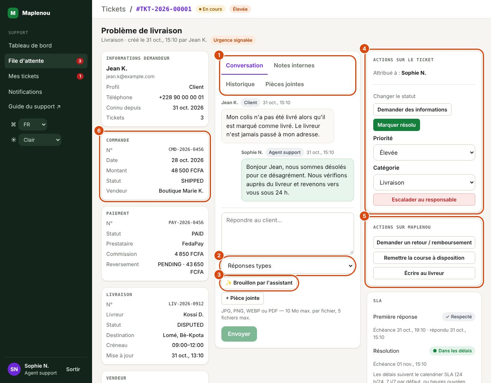

# Traiter un ticket

L'écran d'un ticket réunit tout ce qu'il faut pour le traiter sans changer d'outil : à gauche le demandeur et le contexte Maplenou (commande, paiement, livraison…), au centre les échanges, à droite les actions et le SLA. Seuls les boutons que vous avez le droit d'utiliser sur ce ticket sont affichés.

## Ouvrir un ticket et lire l'en-tête

*Repères de la capture :*

1. Les onglets Conversation, Notes internes, Historique et Pièces jointes.
2. Insérer une réponse type : un texte prêt à adapter.
3. Brouillon par l'assistant : une proposition de réponse à relire (jamais envoyée sans vous).
4. Actions sur le ticket : statut, priorité, catégorie, escalade.
5. Actions sur Maplenou : demande de retour, remise à disposition de la course, message au livreur.
6. Le contexte Maplenou : Commande, puis paiement, livraison et vendeur.

Ouvrez un ticket depuis la File d'attente, Mes tickets, le Tableau de bord ou une notification. L'en-tête affiche :

- le fil d'Ariane Tickets / numéro du ticket (format `TKT-année-numéro`, jamais réutilisé) ;
- le badge de statut, le badge de priorité et, s'il y a lieu, le badge Escaladé ;
- le sujet, puis la catégorie, la date de création et le nom du demandeur ;
- le badge Urgence signalée si le demandeur a coché l'urgence à la création. C'est une information pour vous aider à fixer la priorité : elle ne met **jamais** le ticket en Critique automatiquement (BR-037).

Si le ticket est attribué à un collègue, l'encadré Lecture seule rappelle que seul l'agent attribué ou un responsable peut le modifier.

## Consulter le demandeur et le contexte Maplenou

La colonne de gauche est réservée au support.

| Panneau | Informations |
| --- | --- |
| Informations demandeur | Nom, e-mail, Profil (Client, Vendeur ou Livreur), Téléphone, Connu depuis, nombre de Tickets du demandeur. |
| Commande | N°, Date, Montant, Statut, Vendeur. |
| Paiement | N°, Statut, Prestataire (FedaPay, Stripe), Commission, Reversement (statut et montant). |
| Livraison | N°, Livreur, Statut, Destination, Créneau, Mise à jour. |
| Vendeur | Boutique, Compte (statut du compte), Solde. |
| Remboursement | N°, Statut, Montant. |

!!! note "Fonctionnement de la commission (depuis novembre 2026)"
    La commission Maplenou est **comprise dans le prix affiché à l'acheteur** : 5 % du prix de base du vendeur
    (catégorie Standard) ou 3 % (catégorie Prix élevés), arrondie au FCFA par unité, livraison exclue. L'acheteur
    ne paie aucun supplément et le vendeur reçoit son prix de base : la commission n'est jamais retirée du
    reversement. Les commandes passées avant ce changement gardent l'ancien modèle (25 % / 22,5 % prélevés sur le vendeur).

    - Exemple (Standard) : prix de base 10 000 FCFA + commission 500 FCFA = **10 500 FCFA** affichés, livraison en plus.
    - **Frais mensuel vendeur** : 500 FCFA (Standard) ou 2 000 FCFA (Prix élevés). Les 3 premières ventes finalisées
      sont sans frais ; à partir de la 4ᵉ, **un seul** frais par mois, seulement pour un mois avec au moins une vente
      finalisée. Il est déduit du solde disponible **avant** le versement (8 000 FCFA disponibles − 500 FCFA = 7 500 FCFA
      versés) ; si le solde ne suffit pas, le reste demeure dû pour le prochain versement. Un même frais n'est jamais
      prélevé deux fois.
    - Une commande **annulée ou remboursée** ne compte pas comme vente ; la commission comprise dans son prix est
      remboursée avec elle.
    - Le vendeur choisit sa catégorie à l'inscription ; Maplenou peut demander une correction si elle ne correspond
      pas aux produits. Un changement approuvé s'applique au 1er du mois suivant, aux nouvelles commandes seulement.
    - Le vendeur est notifié à la 4ᵉ vente (début du frais), à chaque déduction et à chaque remboursement comportant
      une commission. Dans l'application, il voit le résumé de ses frais (catégorie, montant, mois, statut),
      l'historique des déductions et le montant net estimé avant un retrait.

Les panneaux n'apparaissent que si le ticket est lié à une référence. À la création, le demandeur peut lier une commande ou une livraison qui le concerne (un client : une commande qu'il a achetée ; un vendeur : une commande qu'il a vendue ; un livreur : une livraison qui lui est confiée). Les références de paiement, livraison, vendeur et remboursement sont ensuite déduites automatiquement de la commande.

!!! info "Service momentanément indisponible"
    Chaque panneau est chargé séparément. Si un service Maplenou ne répond pas, le panneau affiche « Service momentanément indisponible. » ; le reste du ticket reste utilisable. « Référence introuvable. » signifie que la référence liée n'a pas été retrouvée.

Les actions dans les autres modules (rembourser, reprogrammer une livraison, contacter le livreur depuis l'application) ne sont pas disponibles depuis le ticket : aucune règle approuvée ne les définit encore.

## Prendre en charge ou attribuer le ticket

Le panneau Actions sur le ticket indique Attribué à : suivi du nom de l'agent ou de Non attribué.

- **Agent** : sur un ticket non attribué, cliquez sur Prendre en charge. Le ticket vous est attribué et passe de Nouveau à Attribué.
- **Responsable** : Prendre en charge (ticket non attribué) ou M'attribuer ce ticket (ticket déjà attribué) ; la liste Attribuer à un agent → Choisir un agent… attribue le ticket à un agent ou responsable actif. Chaque option indique la charge de l'agent, sous la forme « Nom (3 ouverts) ».
- **Administrateur** : peut attribuer à un agent avec Attribuer à un agent, mais ne peut pas se l'attribuer.

Chaque attribution ou réattribution est enregistrée dans l'historique (BR-013) et l'agent qui reçoit le ticket est notifié.

## Ajuster la priorité et la catégorie

Dans Actions sur le ticket :

- Priorité : choisissez Basse, Moyenne, Élevée ou Critique. Le changement est immédiat, sauf pour Critique qui ouvre la fenêtre Passer en priorité Critique ? : indiquez un Motif (le champ suggère « Ex. fraude présumée »), puis Confirmer Critique. Tout changement de priorité recalcule le SLA (voir [SLA et calendrier](sla.md)).
- Catégorie : choisissez une catégorie active ; le message « Catégorie modifiée. » confirme.

Les deux changements sont inscrits dans l'historique avec l'ancienne et la nouvelle valeur (BR-008).

## Répondre dans la conversation

L'onglet Conversation contient les messages visibles par le demandeur, dont sa description initiale. Écrivez dans le champ Répondre au client… puis cliquez sur Envoyer.

- Votre première réponse visible enregistre la **première réponse** du SLA ; si le ticket est Attribué, il passe automatiquement En cours.
- Le demandeur est notifié de chaque réponse.
- En cas d'échec d'envoi, un message propose Réessayer : le message n'est jamais enregistré deux fois.
- Un message compte au plus 5 000 caractères.

Pour répondre ou changer le statut d'un ticket non attribué, prenez-le d'abord en charge.

## Écrire une note interne

L'onglet Notes internes sert aux échanges entre membres du support : investigation, passation, demande d'avis. Écrivez dans le champ Note visible uniquement par le support… puis cliquez sur Ajouter la note.

!!! danger "Jamais visible par le demandeur"
    Les notes internes et leurs pièces jointes ne sont **jamais** visibles par le demandeur (BR-016), ni dans l'application, ni dans les notifications. À l'inverse, tout ce que vous écrivez dans l'onglet Conversation est visible par lui : vérifiez l'onglet actif avant d'envoyer.

Une note interne ne compte pas comme première réponse pour le SLA.

## Joindre des fichiers

Sous le champ de saisie (conversation ou note), + Pièce jointe ajoute des fichiers au message :

- formats acceptés : JPG, JPEG, PNG, WEBP, PDF ;
- 10 Mo maximum par fichier, 5 fichiers maximum par message, 50 Mo maximum au total par ticket (DEC-003).

Le type est vérifié sur le contenu réel du fichier : un fichier renommé est refusé. L'onglet Pièces jointes liste tous les fichiers du ticket avec leur taille, leur auteur et leur date ; ceux qui proviennent d'une note interne portent la mention Note interne. Cliquez sur un fichier pour le télécharger.

## Changer le statut

La zone Changer le statut propose uniquement les changements autorisés depuis le statut actuel :

| Bouton | Effet |
| --- | --- |
| Démarrer le traitement | Attribué → En cours |
| Demander des informations | → En attente du client ; le demandeur est notifié que le support a besoin d'informations |
| Reprendre le traitement | En attente du client → En cours |
| Marquer résolu | → Résolu, après confirmation dans Marquer le ticket comme résolu ? |
| Clôturer le ticket | Résolu → Fermé, après confirmation dans Clôturer le ticket ? |

Les fenêtres de confirmation proposent un Commentaire (historique, optionnel), enregistré dans l'historique. Le détail des transitions est dans [Statuts et transitions](statuses-and-transitions.md).

!!! warning "Clôturer est définitif"
    Un ticket Fermé ne peut plus être rouvert par le demandeur : il devra créer un nouveau ticket (BR-052, BR-053). Ne clôturez qu'un ticket résolu dont le demandeur n'a plus besoin.

## Escalader

Escalader au responsable signale le ticket aux responsables support. Le motif est obligatoire. Voir [Escalade](escalation.md).

## Consulter l'historique

L'onglet Historique retrace chaque événement important avec son auteur et sa date : Ticket créé, Statut modifié, Priorité modifiée, Catégorie modifiée, Attribué, Réattribué, Message envoyé, Note interne ajoutée, Pièce jointe ajoutée, Ticket escaladé, Réouverture demandée, Réouverture acceptée, Réouverture refusée, SLA recalculé. Les changements affichent l'ancienne et la nouvelle valeur.

L'historique ne peut être ni modifié ni supprimé (BR-018). Le demandeur en voit une version réduite : création, changements de statut, de priorité et de catégorie, pièces jointes des messages visibles et étapes de réouverture (avec le motif et la note de décision). Il ne voit pas les attributions, les notes internes, les escalades, les recalculs SLA ni vos commentaires et motifs.

## Lire le panneau SLA

Sous les actions, le panneau SLA affiche l'état de la Première réponse et de la Résolution, chacune avec son échéance, et la date de réponse ou de résolution une fois atteinte. Après une réouverture, une ligne dépliable liste les périodes de résolution. Voir [SLA et calendrier](sla.md).

## Utiliser une réponse type ou un brouillon de l'assistant

Sous la zone de réponse de l'onglet Conversation :

- la liste Réponses types insère un texte préparé par les responsables (voir [Administration](administration.md#reponses-types-et-textes-des-notifications)) ;
- le bouton ✨ Brouillon par l'assistant (si l'aide IA est activée) rédige une réponse à partir du guide utilisateur, dans votre langue, signée de votre nom. Les titres des sections utilisées s'affichent à côté.

Dans les deux cas le texte est seulement **inséré** : relisez-le, adaptez-le au demandeur, puis cliquez sur Envoyer. L'assistant ne reçoit que le sujet, la description et les messages publics du ticket — jamais le nom, le téléphone, l'e-mail ni les données de paiement.

## Suggestion de catégorie et de priorité

Quand l'aide IA est activée, l'assistant lit chaque nouveau ticket et propose une catégorie et une priorité dans la carte ✨ Suggestion de l'assistant, avec un indice de confiance et une courte raison. Cliquez sur Appliquer pour changer la catégorie et la priorité (inscrit dans l'historique), ou sur Ignorer. Rien n'est appliqué sans vous ; le demandeur ne voit jamais la suggestion.

## Agir sur Maplenou depuis le ticket

La carte Actions sur Maplenou apparaît quand le ticket vous est attribué (ou pour un responsable) et qu'il est lié à une commande ou à une livraison :

| Bouton | Ce que fait Maplenou |
| --- | --- |
| Demander un retour / remboursement | ouvre une demande de retour au nom de l'acheteur (motif d'au moins 10 caractères, état du produit, boutique concernée si la commande en a plusieurs) ; les règles habituelles s'appliquent : 30 jours après la livraison, une seule demande par boutique ; le vendeur décide ensuite |
| Remettre la course à disposition | retire la course au livreur actuel pour qu'un autre la prenne ; impossible si le livreur est déjà en route |
| Écrire au livreur | envoie votre message dans la conversation support du livreur, dans l'app Maplenou, avec le numéro du ticket et votre nom |

Maplenou peut refuser une demande : son message s'affiche (par exemple « Le délai de retour de 30 jours après livraison est dépassé »). Acceptée ou refusée, chaque demande est listée sous Actions envoyées et dans l'historique du ticket.

## Si l'action échoue

- « Le ticket a été modifié entre-temps. Rechargez puis réessayez. » : un collègue a modifié le ticket en même temps que vous. Rechargez la page et refaites l'action si elle est toujours utile.
- « Transition impossible : … » : le changement de statut demandé n'est pas autorisé depuis le statut actuel.
- « Le ticket doit être attribué à un agent support actif. » : l'agent choisi est désactivé ou n'est pas attribuable.
