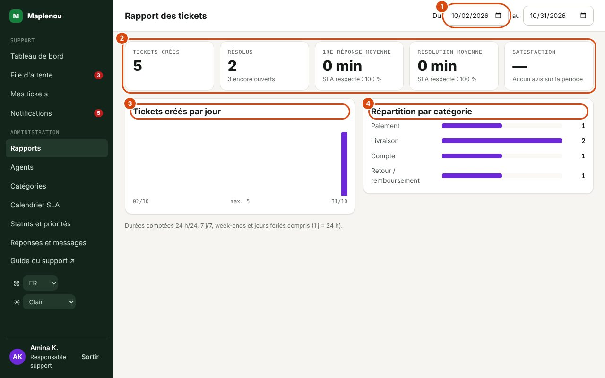

# Rapports

L'écran Rapports (titre Rapport des tickets) donne un bilan simple de l'activité du support sur une période. Il est réservé aux responsables support et aux administrateurs.

## Choisir la période

*Repères de la capture :*

1. La période : Du … au (366 jours au plus).
2. Les chiffres clés : tickets créés, résolus, durées moyennes, respect du SLA, satisfaction.
3. Tickets créés par jour.
4. Répartition par catégorie.

En haut de l'écran, renseignez les dates Du … au … . Par défaut, le rapport couvre les 30 derniers jours, aujourd'hui inclus. Le rapport se met à jour dès que vous changez une date.

- La période ne peut pas dépasser **366 jours** ; au-delà, le message « Période invalide (366 jours maximum). » s'affiche.
- La date de fin ne peut pas précéder la date de début.
- Le rapport porte sur les **tickets créés pendant la période** : un ticket créé avant la période et résolu pendant n'y figure pas.

## Contenu du rapport

| Indicateur | Ce qu'il mesure |
| --- | --- |
| Tickets créés | Nombre de tickets créés sur la période. |
| Résolus | Parmi eux, ceux qui sont actuellement résolus ou fermés (un ticket rouvert et pas encore résolu à nouveau n'est pas compté). La note « N encore ouverts » compte ceux qui sont encore Nouveau, Attribué, En cours ou En attente du client. |
| 1re réponse moyenne | Temps moyen entre la création et la première réponse visible du support, pour les tickets qui ont reçu une réponse. |
| Résolution moyenne | Temps moyen entre la création et la résolution, pour les tickets résolus. |
| SLA respecté : … % (sous la 1re réponse) | Part des tickets ayant reçu une première réponse dont la réponse est arrivée avant ou à l'échéance. |
| SLA respecté : … % (sous la résolution) | Part des tickets résolus qui l'ont été avant ou à l'échéance de résolution. Pour un ticket rouvert puis résolu à nouveau, c'est la dernière résolution qui compte, comparée à l'échéance de la dernière période de résolution. |
| Tickets créés par jour | Histogramme du nombre de tickets créés chaque jour de la période. |
| Répartition par catégorie | Nombre de tickets de la période par catégorie. |

Si aucun ticket n'a été créé sur la période, la répartition affiche « Aucun ticket sur la période. » ; un indicateur sans donnée affiche « — ».

## Lire les durées et les pourcentages

- Les durées suivent le calendrier SLA, **24 h/24 et 7 j/7** depuis le 29 octobre 2026 (DEC-CS10-16, voir [SLA et calendrier](sla.md)) : tout le temps écoulé compte, nuits, week-ends et jours fériés compris. Un ticket créé le vendredi à 19 h et qui reçoit sa première réponse le lundi à 9 h compte donc 62 h de première réponse.
- L'affichage regroupe les heures par **1 j = 10 h**, comme le rappelle la note en bas de l'écran : `45 min`, `3 h 20`, `2 j 4 h`. Les 62 h de l'exemple s'affichent donc `6 j 2 h`. Cette note mentionne encore les heures ouvrées (lun.–ven., 8 h–18 h) de l'ancienne règle : en mode 24 h/24, lisez chaque `j` comme 10 heures de temps écoulé.
- Les pourcentages SLA se comparent aux délais de la priorité du ticket (voir [SLA et calendrier](sla.md)). Un faible taux de première réponse respectée peut signaler des tickets restés trop longtemps non attribués ; un faible taux de résolution respectée, des tickets qui stagnent ou attendent le client (le délai continue de courir en En attente du client).
- Les tickets encore ouverts n'entrent ni dans la résolution moyenne ni dans le taux de résolution respectée : sur une période récente, ces indicateurs sont donc partiels. Comparez de préférence des périodes terminées.

## Limites du rapport

Le rapport est volontairement simple : l'analyse avancée est exclue du périmètre actuel. Il indique la **satisfaction** de la période (moyenne des notes de 1 à 5 et part des notes 4 ou 5) ; le tableau de bord montre celle des 30 derniers jours. Pour travailler les données dans un tableur, utilisez Exporter (CSV) dans la file d'attente : le fichier reprend les filtres affichés. Pour la situation en temps réel, utilisez le [tableau de bord](daily-work.md).

!!! note "En attente de validation"
    Le contenu de ce rapport de base (indicateurs listés ci-dessus) attend la confirmation du responsable du projet (décision DEC-CS03-16).
