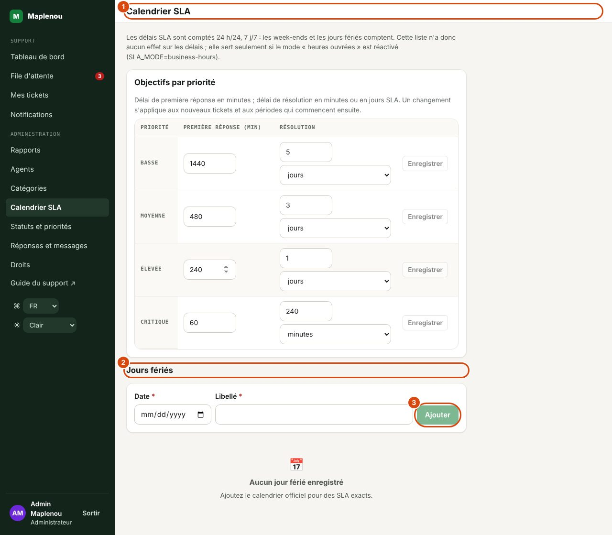

# SLA et calendrier

Chaque ticket reçoit deux engagements de délai (SLA) fixés selon sa priorité : un délai de **première réponse** et un délai de **résolution** (BR-029 à BR-031). Les délais sont comptés à partir de la création du ticket (BR-033), **24 h/24 et 7 j/7** depuis la décision du responsable du projet du 29 octobre 2026 (DEC-CS10-16). Le SLA est visible uniquement par le support.

## Délais par priorité

| Priorité | Première réponse | Résolution |
| --- | ---: | ---: |
| Basse | 24 heures | 5 jours |
| Moyenne | 8 heures | 3 jours |
| Élevée | 4 heures | 1 jour |
| Critique | 1 heure | 4 heures |

Ces délais sont ceux de la décision approuvée DEC-001. Un ticket Critique suit toujours le SLA Critique (BR-039). Pour les délais exprimés en jours, **1 jour = 24 heures** : 5 jours = 120 heures.

## Calendrier 24 h/24, 7 j/7

*Repères de la capture :*

1. Calendrier SLA : le mode de calcul des délais.
2. Jours fériés : utilisés seulement en mode « heures ouvrées ».
3. Ajouter : un jour férié (date et libellé).

Les délais courent en permanence (DEC-CS10-16) :

- **tous les jours**, y compris le samedi et le dimanche ;
- **à toute heure**, de jour comme de nuit (heure de Lomé) ;
- **jours fériés compris** : la liste de l'écran Calendrier SLA n'a plus d'effet sur les délais (l'écran le rappelle en haut de page).

Un ticket créé un samedi soir commence donc à consommer son délai immédiatement.

!!! example "Exemple"
    Un ticket Élevée est créé le vendredi à 22 h. Première réponse (4 h) : échéance le **samedi à 2 h**. Résolution (1 jour = 24 h) : échéance le **samedi à 22 h**.

Les échéances sont calculées à la création du ticket, puis de nouveau lors d'un changement de priorité ou d'une réouverture acceptée (voir plus bas). Un ticket créé avant le passage au mode 24 h/24 garde les échéances calculées à sa création tant qu'aucun de ces événements ne les recalcule.

## Ancien mode « heures ouvrées »

Jusqu'au 29 octobre 2026, les délais ne couraient que pendant les heures ouvrées (BR-032, DEC-CS03-05) : du lundi au vendredi, de 8 h à 18 h (heure de Lomé), hors jours fériés enregistrés dans Calendrier SLA, avec 1 jour ouvré = 10 heures ouvrées. Ce mode reste disponible : l'équipe technique peut le réactiver par un paramètre du serveur (`SLA_MODE=business-hours`). L'écran Calendrier SLA affiche alors de nouveau la règle des heures ouvrées, et les jours fériés de la liste comptent de nouveau.

## Ce qui compte comme première réponse et comme résolution

- **Première réponse** : le premier message **visible par le demandeur** envoyé par un membre du support dans l'onglet Conversation. Une note interne, une attribution ou un changement de statut ne comptent pas.
- **Résolution** : le passage du ticket au statut Résolu.

## États SLA

Chaque délai a un état, affiché sous forme de badge :

| Badge | Signification |
| --- | --- |
| Dans les délais | L'échéance n'est pas atteinte et moins de 75 % du délai est écoulé. |
| Échéance proche | Au moins 75 % du délai est écoulé et l'échéance n'est pas encore passée. |
| Délai dépassé | L'échéance est passée sans l'action attendue, ou l'action a été faite après l'échéance (BR-035). |
| Respecté | L'action attendue (réponse ou résolution) a été faite avant l'échéance. |

Où les voir :

- dans le panneau SLA du ticket : un état pour la Première réponse et un pour la Résolution, avec l'échéance (« Échéance … ») et la date de réponse ou de résolution ;
- dans la colonne SLA de la file : l'état le plus défavorable des deux (dans l'ordre Délai dépassé, Échéance proche, Dans les délais, Respecté) ;
- dans la tuile et le filtre SLA dépassé : les tickets **ouverts** dont l'échéance de première réponse (sans réponse) ou de résolution est passée.

## Changement de priorité : recalcul du SLA

Changer la priorité recalcule le SLA applicable, tout en conservant l'ancienne priorité dans l'historique (BR-034) :

- **première réponse** : si le support n'a pas encore répondu, l'échéance est recalculée depuis la création du ticket avec la nouvelle priorité ; si la première réponse a déjà eu lieu, elle ne change pas ;
- **résolution** : l'échéance est recalculée avec la nouvelle priorité depuis le début de la période de résolution en cours (la création du ticket, ou la dernière réouverture).

L'historique enregistre Priorité modifiée et SLA recalculé (anciennes et nouvelles échéances).

!!! warning "Passer en Critique un ticket ancien"
    Comme le calcul repart de la création du ticket, passer en Critique un ticket créé il y a plus d'une heure sans réponse le met immédiatement en Délai dépassé pour la première réponse. Répondez sans attendre.

## Réouverture : nouvelle période de résolution

Quand une réouverture est acceptée, l'historique SLA d'origine est conservé et une **nouvelle période de résolution** commence au moment de l'acceptation, avec le délai de résolution de la priorité actuelle (BR-055). Le délai de première réponse n'est pas recalculé.

Dans le panneau SLA, la ligne dépliable « N périodes de résolution (réouvertures) » liste chaque période avec sa priorité, son début, son échéance et sa fin.

## En attente du client : le délai de résolution est en pause

Depuis la décision DEC-CS11-03, le statut En attente du client **met en pause** le délai de résolution : le panneau SLA affiche En pause et « Délai de résolution en pause depuis le … (en attente du client). ». Quand le demandeur répond (le ticket repasse En cours) ou que vous reprenez le traitement, l'échéance est repoussée du temps passé en attente. Le délai de première réponse, lui, n'est jamais mis en pause.

Les statuts ajoutés par un administrateur (par exemple « En attente du vendeur ») peuvent aussi mettre le délai en pause : c'est la case Délai en pause de l'écran Statuts et priorités.

En pratique : demandez toutes les informations utiles en une seule fois et relancez le demandeur si nécessaire (voir [Bonnes pratiques](good-practices.md)).

## Objectifs modifiables

Les délais du tableau ci-dessus sont les valeurs de départ. Les administrateurs les modifient par priorité dans Calendrier SLA, section Objectifs par priorité (première réponse en minutes, résolution en minutes ou en jours). Un changement s'applique aux nouveaux tickets et aux périodes qui commencent ensuite.
