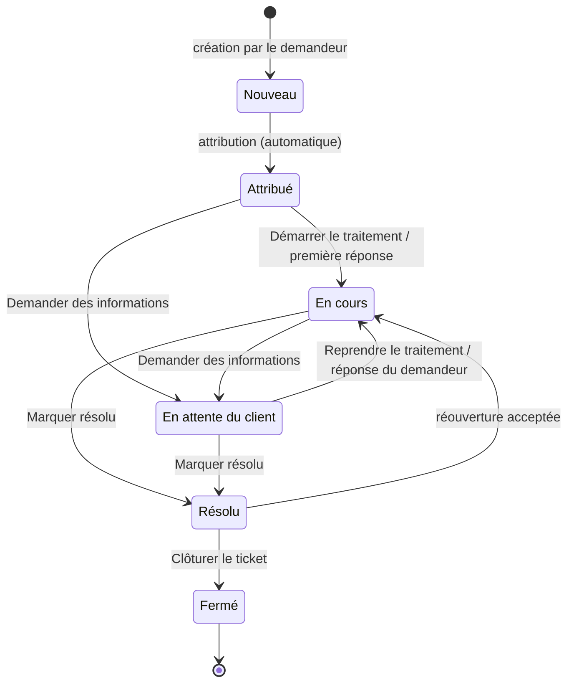

# Statuts et transitions

Un ticket suit un cycle de vie contrôlé : seuls certains changements de statut sont autorisés (BR-010). L'écran du ticket ne propose que les boutons valides depuis le statut actuel ; toute autre demande est refusée et le statut reste inchangé.

## Les six statuts

| Statut | Signification | Ouvert ? |
| --- | --- | :---: |
| Nouveau | Ticket créé par le demandeur, personne ne l'a encore pris. Tout ticket commence ici (BR-009). | Oui |
| Attribué | Un agent est responsable du ticket mais n'a pas encore commencé à le traiter. | Oui |
| En cours | Le support traite activement la demande. | Oui |
| En attente du client | Le support attend une information ou une action du demandeur. | Oui |
| Résolu | Le problème est traité. Le demandeur peut encore demander une réouverture. | Non |
| Fermé | Ticket finalisé. Plus aucune action possible ; une nouvelle demande nécessite un nouveau ticket. | Non |

Les tickets « ouverts » sont ceux que comptent la tuile Tickets ouverts et le filtre Ouverts (tous).

## Diagramme des transitions autorisées

## Tableau des transitions et qui peut les faire

| De | Vers | Comment | Qui |
| --- | --- | --- | --- |
| Nouveau | Attribué | Automatique lors de la première attribution (Prendre en charge ou Attribuer à un agent). Il n'existe pas de bouton de statut pour cette étape. | Agent (sur un ticket non attribué), responsable, administrateur (attribution à un agent) |
| Attribué | En cours | Démarrer le traitement, ou automatiquement à la première réponse visible du support | Agent attribué, responsable, administrateur |
| Attribué ou En cours | En attente du client | Demander des informations | Agent attribué, responsable, administrateur |
| En attente du client | En cours | Reprendre le traitement, ou automatiquement quand le demandeur répond | Agent attribué, responsable, administrateur ; le demandeur indirectement par sa réponse |
| En cours ou En attente du client | Résolu | Marquer résolu (avec confirmation) | Agent attribué, responsable, administrateur |
| Résolu | Fermé | Clôturer le ticket (avec confirmation), seulement s'il n'y a pas de demande de réouverture en attente | Agent attribué, responsable, administrateur |
| Résolu | En cours | Uniquement en acceptant une demande de réouverture du demandeur (Rouvrir (En cours)) | Agent attribué, responsable, administrateur |

Chaque changement de statut est enregistré dans l'historique avec son auteur, sa date et, le cas échéant, votre commentaire (BR-017). Le demandeur est notifié des changements de statut de son ticket.

## Transitions interdites

- Nouveau → Fermé est explicitement interdit (BR-010) : un ticket doit être traité et résolu avant d'être fermé.
- Résolu → un statut actif sans demande de réouverture acceptée est interdit, y compris pour le support (BR-049). Le demandeur ne peut pas rouvrir directement.
- Fermé est définitif : aucun changement de statut n'est possible, ni par le support, ni par le demandeur (BR-052). Une nouvelle demande nécessite un nouveau ticket (BR-053).
- Un agent ne peut pas changer le statut d'un ticket attribué à un collègue, ni d'un ticket non attribué tant qu'il ne l'a pas pris en charge.

En cas de tentative refusée, l'application affiche « Transition impossible : … » avec les deux statuts concernés.

## Changements automatiques

| Événement | Changement |
| --- | --- |
| Première attribution d'un ticket Nouveau | Nouveau → Attribué |
| Première réponse visible du support sur un ticket Attribué | Attribué → En cours |
| Réponse du demandeur sur un ticket En attente du client | En attente du client → En cours |
| Réouverture acceptée | Résolu → En cours |

Une note interne ne change jamais le statut. Un ticket Résolu que le demandeur ne fait pas rouvrir est **fermé automatiquement après 7 jours** (DEC-CS11-04) ; l'historique indique « Fermé automatiquement ». Les administrateurs peuvent ajouter des statuts et changer les passages possibles (voir [Administration](administration.md#statuts-et-priorites)).

!!! note "Statut cible d'une réouverture"
    La règle BR-051 prévoit qu'une réouverture acceptée ramène le ticket En cours, sauf si le support choisit explicitement un autre statut actif valide. L'écran propose aujourd'hui uniquement Rouvrir (En cours).
