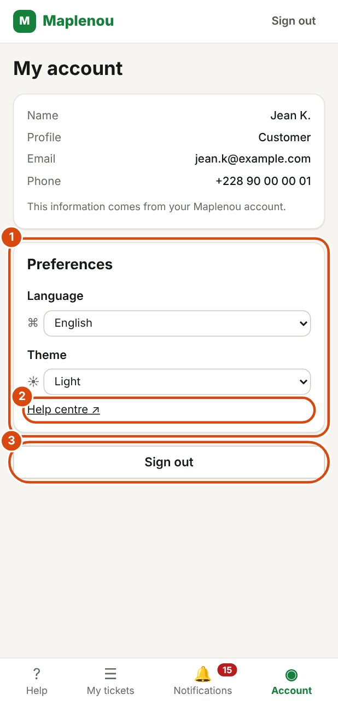

# Account and preferences

The Account page brings together your details, your display preferences and signing out. Open it from the navigation bar.

## View your account information

*Marks on the screenshot:*

1. Preferences: the language of the app.
2. Help centre: opens this guide in a new tab.
3. Sign out.

The My account page shows:

| Information | Content |
| --- | --- |
| Name | Your name |
| Profile | Your role: Customer, Seller or Delivery driver |
| Email | Your email address (a dash "—" if none is set) |
| Phone | Your phone number (a dash "—" if none is set) |

This information is read-only. As the page says: This information comes from your Maplenou account. To correct it, update your Maplenou account: it cannot be changed in customer service.

## Change the app language

The app is available in Français (French) and English.

1. Open Account.
2. In the Preferences section, choose the Language.

On a large screen, you can also use the language choice in the header (`FR` or `EN`).

The change is immediate, and your next notifications also arrive in this language. On your first visit, the app uses your browser's language if it is French or English, and French otherwise.

## Change between light and dark theme

The theme changes the app's colours. There are three choices:

| Theme | Effect |
| --- | --- |
| System | Follows your device's light or dark setting |
| Light | Light background, whatever the device setting |
| Dark | Dark background, more comfortable in a dim place |

1. Open Account.
2. In the Preferences section, choose the Theme.

On a large screen, you can also use the theme choice in the header.

## Where your preferences are saved

The language and the theme are remembered in the browser you use. They stay in place on your next visit, even after signing out.

If you use another device or another browser, choose your language and theme again.

## Open the help centre from your account

In the Preferences section, the Help centre link opens this guide in a new tab. It is the easiest way to reach it from a phone.

## Sign out

- On the Account page, click Sign out.
- On every screen, you can also click Sign out in the header.

You return to the sign-in screen.

!!! tip "Shared device"
    On a shared computer or phone, always sign out at the end of your visit.
