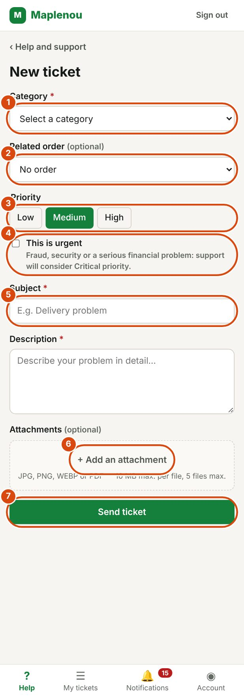

# Create a ticket

A ticket is your request for help. This page explains how to create one, field by field, and what happens after you send it.

## Create a ticket step by step

*Marks on the screenshot:*

1. Category (required).
2. Related order (optional): the list of your orders.
3. The priority: Low, Medium or High.
4. This is urgent: fraud, security or a serious financial problem.
5. Subject, then the Description just below (required).
6. Add an attachment: photos or PDF.
7. Send ticket.

1. Open the Help screen from the navigation bar.
2. Click Create a ticket. If you are a delivery driver, the button is called Report an incident.
   You can also click a category on the help screen, or + New in My tickets.
3. Choose the Category of your request (required).
4. If your request is about an order or a delivery, choose it in Related order or Related delivery (optional).
5. Choose the Priority: Low, Medium or High. Medium is selected by default.
6. Tick This is urgent only for fraud, a security issue or a serious financial problem.
7. Write a short Subject (required, up to 200 characters).
8. Write the Description of the problem (required, up to 5,000 characters).
9. If needed, add files with + Add an attachment (optional).
10. Click Send ticket. For a delivery driver, the button is called Send report.

While the ticket is being sent, the button shows Sending…. Do not close the page.

!!! note "Required fields"
    If a required field is empty, a message appears below it: Choose a category., Enter a subject. or Describe your problem. Fill it in, then send again.

## Choose the right category

The category helps support route your request. Each ticket has one category.

| Category | When to choose it |
| --- | --- |
| Order | A problem with an order |
| Payment | A payment, a commission or a payout |
| Delivery | Tracking a delivery or a delivery incident |
| Seller | A problem with a seller |
| Account | Access to your account or managing it |
| Return/Refund | A return, an exchange or a refund |
| Other | Any other request |

!!! note "Category names in the app"
    The category names come from Maplenou's settings. They may appear in French in the app, for example *Commande* (Order), *Livraison* (Delivery) or *Retour / remboursement* (Return/Refund).

If you are a delivery driver, the Delivery category is already selected. You can change it if needed.

If you are unsure, choose the closest category, or Other. Support can correct the category after you send the ticket.

## Give the related order or delivery

The reference field is optional, but it helps support find your case much faster.

- **Customer or seller**: the field is called Related order. The list shows your orders, with their reference, date and amount in FCFA.
- **Delivery driver**: the field is called Related delivery. The list shows your deliveries, with their reference, the customer's name and the destination.

Choose the order or delivery from the list. If your request is not about an order, leave No order (or No delivery).

## What to do if the order is not accepted

Customer service checks that the order or delivery you chose really concerns you. If it does not, the ticket is not created and the message The ticket was not created appears with the reason:

| Message shown | What it means | What to do |
| --- | --- | --- |
| "Order or delivery not found in your references." | The reference is not one of your orders or deliveries. | Choose another reference, or none. |
| "The delivery does not belong to this order." | The delivery is not part of the order given. | Check the reference you chose. |
| "The order cannot be checked right now. Try again or create the ticket without an order." | The check is temporarily unavailable. | Try again later, or send the ticket without an order and give the reference in the description. |

The rest of your information stays in the form: you do not have to type it again.

!!! tip "Your order is not in the list?"
    Leave No order and write the order reference in the description. Support will be able to find it.

## Choose the priority and report urgency

The priority shows how urgent your request is. You can choose Low, Medium or High.

The Critical priority is reserved for support: you cannot choose it yourself. If your problem is very serious, tick This is urgent. As the form says: Fraud, security or a serious financial problem: support will consider Critical priority.

Ticking This is urgent does not make the ticket critical automatically. Support reviews your request and decides on the priority. Support can also change the priority you chose.

!!! warning "Keep urgency for serious cases"
    Use This is urgent for fraud, a security risk or a serious financial problem. For an ordinary request, a suitable priority is enough.

## Attach files to the ticket {#attachments}

A photo or a document often helps support: a photo of a damaged parcel, a screenshot of an error message, a payment receipt…

Click + Add an attachment and choose your files. The selected files appear below the button, with their size. To remove a file, click the cross next to its name.

| Rule | Limit |
| --- | --- |
| Accepted formats | JPG, JPEG, PNG, WEBP and PDF |
| Size of one file | 10 MB maximum |
| Number of files | 5 maximum per send (the ticket or each message) |
| Total size for the ticket | 50 MB maximum for all the ticket's attachments |

If a file does not meet these rules, a message tells you before sending, for example:

- File type not allowed for “photo.heic”. Accepted formats: JPG, PNG, WEBP, PDF.
- The file “invoice.pdf” exceeds 10 MB.
- Maximum 5 attachments per message.
- The total size of the ticket's attachments would exceed 50 MB.

An empty file is also refused. Only you and support can open your ticket's attachments.

## After sending: the ticket number

When the ticket is created, the Ticket created successfully! screen appears with the Ticket number, for example `TKT-2026-00125`.

- Write this number down: it uniquely identifies your request. Give it if you contact Maplenou about this problem.
- Click View my ticket to open the ticket, or Back to help.

Your ticket starts with the New status. You receive the Ticket created notification. Your description becomes the first message of the conversation, together with the attached files. Then follow your request in [Follow my tickets](follow-tickets.md).

If creation fails for another reason, the message Could not create the ticket. Please try again. appears. Check your internet connection and send again.

## Tips for a good description

A clear description lets support help you faster, without having to ask you for details.

- **One problem per ticket.** For two different problems, create two tickets.
- **A precise subject.** For example "Parcel arrived damaged" rather than "Problem".
- **The facts, in order.** What happened, when, and what you have already tried.
- **Useful references.** Order number, amount, date, seller's name, or the number of an earlier ticket.
- **The outcome you expect.** For example a refund, an exchange or a new delivery.
- **Evidence.** Add a photo or a screenshot when you can.

!!! warning "Never share your secrets"
    Never write your password or a secret code in a ticket or a message.
