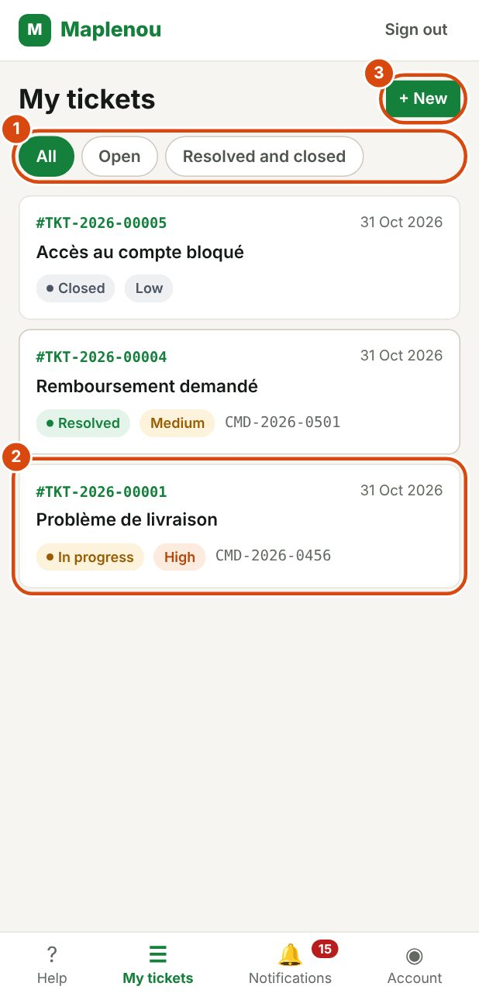
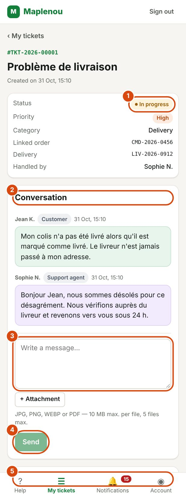

# Follow my tickets

This page explains how to find your tickets, understand their status and talk with support.

## See the list of my tickets

*Marks on the screenshot:*

1. The filters All, Open and Resolved and closed.
2. A ticket: number, date, subject and status. Tap it to open it.
3. + New: create another ticket.

Open My tickets from the navigation bar or from the help screen. The most recently updated tickets are shown first.

Each ticket in the list shows:

- its number, for example `#TKT-2026-00125`, and the date of its last update;
- its subject;
- its status and priority;
- the reference of the related order or delivery, if there is one.

Click a ticket to open its details. If you have many tickets, click See more at the bottom of the list to show more.

You only see your own tickets. Nobody other than you and Maplenou support can access them.

## Filter my tickets

Three tabs at the top of the list let you filter your tickets:

| Tab | Tickets shown |
| --- | --- |
| All | All your tickets |
| Open | Tickets still being handled |
| Resolved and closed | Tickets with the Resolved and Closed statuses |

If no ticket matches, the message No tickets match this filter appears. If you have not created any ticket yet, the message You don't have any tickets yet appears with a Create a ticket link.

## Read the details of a ticket

*Marks on the screenshot:*

1. The ticket's status, with its priority, category and the person handling it.
2. Conversation: your messages and the support's replies.
3. Your message: write your reply (you can add an Attachment).
4. Send.
5. Ticket history: every step (creation, assignment, status changes).

The details of a ticket bring together all the information about your request:

- the number, the subject and the creation date (Created on …);
- the Status, the Priority and the Category;
- the Linked order or the Delivery, if you gave one;
- Handled by: the name of the support agent handling your ticket, or Awaiting assignment if it is not assigned yet;
- the Conversation with support;
- the Ticket history: the important steps of your ticket, with their date (creation, status changes, messages, reopening…).

To go back to the list, click ‹ My tickets.

## Understand ticket statuses

The status shows where your request stands. It changes as the request is handled.

| Status | What it means | What you should do |
| --- | --- | --- |
| New | Your ticket is registered. It is not assigned to an agent yet. | Nothing. You can add details in the conversation. |
| Assigned | A support agent has taken on your ticket. Their name appears in Handled by. | Wait for their reply. |
| In progress | Support is working on your request. | Read support's messages and reply if needed. |
| Waiting for customer | Support needs information from you to continue. | Reply in the conversation. Work resumes as soon as you reply. |
| Resolved | Support considers the problem solved. | Check. If the problem is not solved, [request reopening](reopen-and-close.md). |
| Closed | The ticket is permanently finished. | Nothing. If the problem comes back, create a new ticket. |

The usual path is: New → Assigned → In progress → Resolved → Closed. The ticket can go through Waiting for customer several times if support needs information.

You do not change a ticket's status yourself: support does. Your reply to a request for information automatically puts the ticket back In progress.

## Reply to support in the conversation

The conversation contains all the messages between you and support. Each message shows its author's name, their role and the date.

1. Open the ticket.
2. In the Conversation section, type your message in the Write a message… field.
3. If needed, add files with + Attachment.
4. Click Send.

The message Message sent. confirms it was sent. Support receives a notification.

You can write in the conversation as long as the ticket is not Closed.

!!! tip "Message not sent?"
    If sending fails, the message Could not send. Please try again. appears with a Retry button. Your text is kept. Click Retry: even if you retry several times, the message is only saved once.

## Reply when support asks for information

When support needs information, the ticket moves to the Waiting for customer status. You receive the Information requested notification.

In the ticket, an Action required box appears: Support is waiting for information from you. Reply below so we can continue.

1. Read support's latest message to see what is needed.
2. Type your reply in the conversation (field Provide the requested information…).
3. Add the requested files, if needed.
4. Click Send.

As soon as you reply, the ticket goes back to the In progress status and the agent is notified.

!!! tip "Reply quickly"
    Until you reply, support cannot move forward with your request.

## Add attachments to a reply

You can attach files to each message, with the + Attachment button below the message field.

The rules are the same as when you create the ticket:

- JPG, JPEG, PNG, WEBP or PDF formats;
- 10 MB maximum per file;
- 5 files maximum per message;
- 50 MB maximum for all the ticket's attachments.

Sent files appear below the message, with their name and size. Click a file to download it. The full rules and error messages are in [Attach files to the ticket](create-ticket.md#attachments).

## Add information you forgot

You cannot change a ticket's subject or description after sending it. To correct or complete your request, write a new message in the ticket's conversation. Do not create a second ticket for the same problem.

## Maplenou's own statuses

The support team can add statuses that describe your situation better, for example "Waiting for the seller". They are shown like the others. During these waits, as during Waiting for customer, the resolution time limit is paused: the time the ticket waits for someone else is not counted against support.
