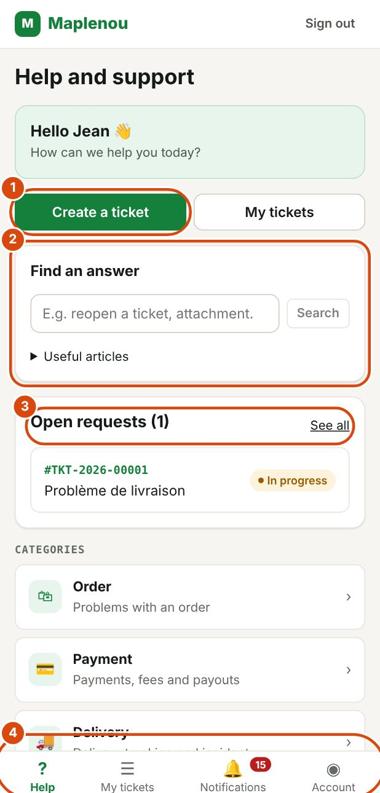

# Maplenou customer service help centre

Welcome to the Maplenou customer service user guide. It explains, step by step, how to ask support for help and follow your request.

## Who this guide is for

This guide is for everyone who uses the Maplenou marketplace and needs support:

- **customers**, for a problem with an order, a payment, a delivery, a return or their account;
- **sellers**, for their orders, payments, commissions and payouts;
- **delivery drivers**, to report a delivery incident (customer absent, wrong address, damaged parcel…).

In this guide, you are the **requester**: the person who opens the request. Maplenou support agents handle it.

## How customer service works

Each request for help is a **ticket**. You create it in the app, support takes it on, and you talk with support in the ticket's conversation until the problem is solved.

1. You create a ticket and receive a number, for example `TKT-2026-00125`.
2. A support agent takes on your ticket.
3. You exchange messages and files in the conversation.
4. Support resolves the ticket, then closes it.

A [notification](notifications.md) tells you about each important step.

## Quick links to the main tasks

*Marks on the screenshot:*

1. Create a ticket: opens the form of a new request.
2. Find an answer: searches this guide directly.
3. Open requests: your open tickets; See all shows the full list.
4. The bottom menu: Help, My tickets, Notifications (with the number of unread ones) and Account.

- **Getting started**

    Sign in, discover the help screen, change the language and theme.

    [Getting started](getting-started.md)

- **Create a ticket**

    Choose a category, describe the problem, attach files.

    [Create a ticket](create-ticket.md)

- **Follow my tickets**

    Understand the statuses, reply to support, add information.

    [Follow my tickets](follow-tickets.md)

- **Notifications**

    Know when support replies or changes the status of a ticket.

    [Notifications](notifications.md)

- **Reopening and closing**

    What to do if the problem comes back after it was resolved.

    [Reopening and closing](reopen-and-close.md)

- **Account and preferences**

    Your details, language, theme and signing out.

    [Account and preferences](account-and-preferences.md)

Have a specific question? See the [FAQ](faq.md) or the [glossary](glossary.md).

## Find an answer quickly

Two tools help you find information without reading the whole guide.

**Search.** Press the <kbd>/</kbd> key on your keyboard, or click the search field at the top of the page, then type a few words, for example "attachment" or "reopening". The results take you straight to the right section.

**The assistant.** Click the Ask a question button at the bottom right of the screen. Type your question in your own words, for example "How do I reopen a resolved ticket?". The assistant answers from this guide and lists the sections it used as references: click them to read the details.

!!! note "The assistant can make mistakes"
    The assistant only answers from this guide. Always check its answer in the cited sections. It does not know about your tickets: for a question about your own request, write to support in the ticket's conversation.

## Open this guide from the app

In the customer service app, the Help centre link opens this guide in a new tab. It is in the header on a large screen, and on the Account page on a phone.

The guide is available in French and English. Use the language selector at the top of the page to switch: you stay on the same page.

## Search for an answer from the app

On the app's Help page, the Find an answer box searches this guide directly.

1. Type a few words, for example "reopen a ticket".
2. Click Search.
3. Open a result: the guide section opens in a new tab.

Below the search, Useful articles lists the most read pages. If nothing answers your question, create a ticket.
