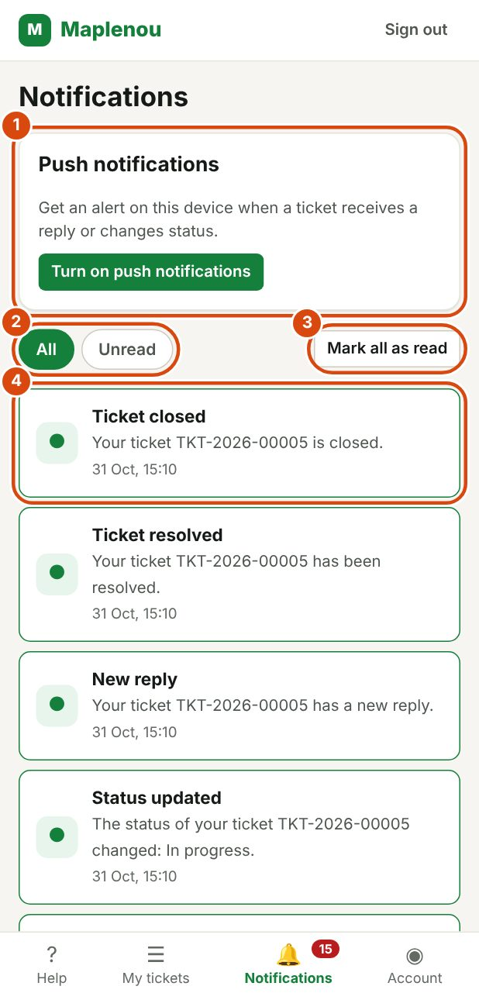

# Notifications

Notifications tell you when something important happens on your tickets. You do not need to open each ticket to see whether it has changed.

## When you receive a notification

You receive a notification in the following cases:

| Notification | When it arrives |
| --- | --- |
| Ticket created | Your ticket has just been created. It confirms the ticket number. |
| New reply | Support has written a new message in your ticket. |
| Information requested | Support needs information from you: the ticket is Waiting for customer. |
| Status updated | Your ticket's status has changed, for example to Assigned or In progress. |
| Ticket resolved | Support has resolved your ticket. |
| Ticket closed | Your ticket is closed. |
| Reopening request handled | Support has approved or refused your reopening request. |

Each notification shows the number of the ticket concerned and the date.

You are not notified about your own actions: for example, you do not receive a notification for a message you sent. Only creating a ticket gives you a confirmation notification.

## See your notifications

*Marks on the screenshot:*

1. Push notifications: get an alert on this device.
2. The filters All and Unread.
3. Mark all as read.
4. A notification (the dot means it is unread): tap it to open the ticket.

Open Notifications in the navigation bar. The most recent notifications are at the top of the list.

Click a notification to open the ticket concerned. The notification is then marked as read.

Two tabs let you filter the list:

- All: all your notifications;
- Unread: only the ones you have not opened yet.

If there is nothing to show, the message No notifications or No unread notifications appears.

## Spot unread notifications

A red counter on the Notifications entry of the navigation bar shows how many notifications are unread. It disappears when all your notifications are read.

In the list, an unread notification is marked with a dot (●) and a coloured border. A read notification is marked with a tick (✓).

## Mark all as read

To mark all your notifications as read at once, click Mark all as read at the top of the list. The message All notifications are marked as read. confirms it.

Your notifications stay in the list: only the unread counter is reset.

## Get push notifications in your browser

Push notifications alert you on your computer or phone, even when the app page is not in front of you.

To turn them on in your browser:

1. Open Notifications in the navigation bar.
2. In the Push notifications card, click Turn on push notifications.
3. When the browser asks whether the site may show notifications, choose **Allow**.

The message Push notifications are on for this device. confirms it. To check that everything works, click Send a test notification: a "Notification de test" notification appears after a few seconds.

When you click a push notification, the app opens the ticket concerned. Push notification texts are in French.

To stop receiving them on this device, click Turn off. When you sign out, this browser also stops receiving your push notifications: the next person who uses it does not receive yours.

### If notifications are blocked

If you refused the permission, the card says that notifications are blocked for this site. Click the icon to the left of the site address, allow notifications, then reload the page.

If the card says that your browser does not support push notifications, or that they are not configured yet, your notifications stay visible on the Notifications page.

### In the mobile apps

The Maplenou mobile apps ask you themselves for permission to show notifications. Accept it to receive alerts on your phone.

## If a notification does not arrive

A notification is only an alert: your ticket is always up to date, even if a notification arrives late or not at all.

The Notifications page of the app is always available. If in doubt, open the ticket directly in My tickets to see its status and the latest messages.
