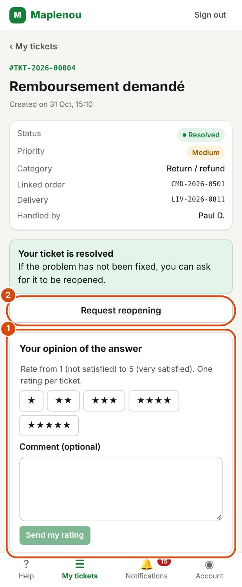

# Reopening and closing

When support has fixed your problem, they **resolve** and then **close** the ticket. This page explains what to do if the problem is not really fixed.

## Resolved or closed: the difference

| Status | What you can do |
| --- | --- |
| Resolved | Support thinks the problem is solved. You can still write in the conversation and **request reopening** of the ticket. |
| Closed | The ticket is permanently finished. You can no longer write or request reopening. For a new problem, create a new ticket. |

Support resolves and closes tickets. You cannot close a ticket yourself. A resolved ticket that you do not ask to reopen closes automatically after 7 days.

## When to request reopening of a ticket

Request reopening if your ticket is Resolved but the problem is not fixed, or has come back.

You can request reopening:

- only for **your own** tickets;
- only when the ticket has the Resolved status;
- when no other reopening request is already under review for this ticket.

Once the ticket is Closed, you can no longer request reopening.

## Request reopening step by step

*Marks on the screenshot:*

1. Your opinion of the answer: 1 to 5 stars and an optional comment, then Send my rating.
2. Request reopening: if the problem is not solved.

1. Open the resolved ticket in My tickets.
2. The Your ticket is resolved box appears: If the problem has not been fixed, you can ask for it to be reopened.
3. Click Request reopening.
4. In the Why is the problem not resolved? field, explain what is wrong (required, up to 1,000 characters).
5. Click Send request. To give up, click Cancel.

The message Reopening request sent. confirms it was sent.

!!! tip "Writing in the conversation is not enough"
    A message in the conversation of a resolved ticket does not reopen it. For support to resume work, use the Request reopening button.

## What happens after a reopening request

Your request is not approved automatically: a member of support reviews it and decides.

During the review, the ticket stays Resolved and the Reopening request under review box appears, with the date you sent it. You cannot send another request while this one is under review.

When support has decided, you receive the Reopening request handled notification.

- **Request approved**: the ticket is reopened. It usually goes back to the In progress status and support resumes work.
- **Request refused**: the ticket stays Resolved. In the ticket, the message Your previous request was refused. appears, with support's explanation when they gave one. You can make a new request if the problem persists.

Your request and support's decision appear in the Ticket history.

## A closed ticket cannot be reopened

A Closed ticket is final. In the ticket, the This ticket is closed box says so: A closed ticket can no longer be reopened. If the problem persists, create a new ticket.

1. Click New ticket in this box.
2. Fill in the form as for any ticket (see [Create a ticket](create-ticket.md)).
3. In the description, give the number of the old ticket, for example `TKT-2026-00125`. Support will be able to find its history.

You can still view a closed ticket, its conversation and its attachments in My tickets, on the Resolved and closed tab.

## Automatic closure after 7 days

When a ticket is Resolved and you do not ask to reopen it, it becomes Closed by itself 7 days later. If the problem comes back before, ask for reopening (see above); afterwards, create a new ticket quoting the old number.

## Rate the answer

On a Resolved or Closed ticket, the Your opinion of the answer box lets you rate the help you received, once.

1. Choose a rating from 1 (not satisfied) to 5 (very satisfied).
2. Add a comment if you wish.
3. Click Send my rating.

Your rating helps the team improve; it changes nothing on the ticket. Once sent, it replaces the box and cannot be changed.
