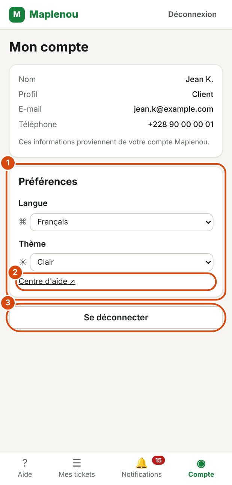

# Compte et préférences

La page Compte regroupe vos informations, vos préférences d'affichage et la déconnexion. Ouvrez-la depuis la barre de navigation.

## Consulter les informations de votre compte

*Repères de la capture :*

1. Préférences : la langue de l'application.
2. Centre d'aide : ouvre ce guide dans un nouvel onglet.
3. Se déconnecter.

La page Mon compte affiche :

| Information | Contenu |
| --- | --- |
| Nom | Votre nom |
| Profil | Votre rôle : Client, Vendeur ou Livreur |
| E-mail | Votre adresse e-mail (un tiret « — » si elle n'est pas renseignée) |
| Téléphone | Votre numéro de téléphone (un tiret « — » s'il n'est pas renseigné) |

Ces informations sont en lecture seule. Comme l'indique la page : Ces informations proviennent de votre compte Maplenou. Pour les corriger, mettez à jour votre compte Maplenou : elles ne se modifient pas dans le service client.

## Changer la langue de l'application

L'application est disponible en Français et en English (anglais).

1. Ouvrez Compte.
2. Dans la section Préférences, choisissez la Langue.

Sur un grand écran, vous pouvez aussi utiliser le choix de langue de l'en-tête (`FR` ou `EN`).

Le changement est immédiat, et vos prochaines notifications arrivent aussi dans cette langue. À votre première visite, l'application utilise la langue de votre navigateur si c'est le français ou l'anglais, et le français sinon.

## Changer le thème clair ou sombre

Le thème change les couleurs de l'application. Trois choix sont possibles :

| Thème | Effet |
| --- | --- |
| Système | Suit le réglage clair ou sombre de votre appareil |
| Clair | Fond clair, quel que soit le réglage de l'appareil |
| Sombre | Fond sombre, plus confortable dans un lieu peu éclairé |

1. Ouvrez Compte.
2. Dans la section Préférences, choisissez le Thème.

Sur un grand écran, vous pouvez aussi utiliser le choix de thème de l'en-tête.

## Où sont enregistrées vos préférences

La langue et le thème sont mémorisés dans le navigateur que vous utilisez. Ils restent en place à votre prochaine visite, même après une déconnexion.

Si vous utilisez un autre appareil ou un autre navigateur, choisissez de nouveau votre langue et votre thème.

## Ouvrir le centre d'aide depuis votre compte

Dans la section Préférences, le lien Centre d'aide ouvre ce guide dans un nouvel onglet. C'est le moyen le plus simple d'y accéder depuis un téléphone.

## Se déconnecter

- Dans la page Compte, cliquez sur Se déconnecter.
- Sur tous les écrans, vous pouvez aussi cliquer sur Déconnexion dans l'en-tête.

Vous revenez à l'écran de connexion.

!!! tip "Appareil partagé"
    Sur un ordinateur ou un téléphone partagé, déconnectez-vous toujours à la fin de votre visite.
