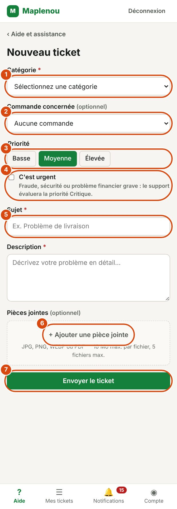

# Créer un ticket

Un ticket est votre demande d'aide. Cette page explique comment le créer, champ par champ, et ce qui se passe après l'envoi.

## Créer un ticket étape par étape

*Repères de la capture :*

1. Catégorie (obligatoire).
2. Commande concernée (facultatif) : la liste de vos commandes.
3. La priorité : Basse, Moyenne ou Élevée.
4. C'est urgent : fraude, sécurité ou problème financier grave.
5. Sujet, puis la Description juste en dessous (obligatoires).
6. Ajouter une pièce jointe : photos ou PDF.
7. Envoyer le ticket.

1. Ouvrez l'écran Aide depuis la barre de navigation.
2. Cliquez sur Créer un ticket. Si vous êtes livreur, le bouton s'appelle Signaler un incident.
   Vous pouvez aussi cliquer sur une catégorie de l'écran d'aide, ou sur + Nouveau dans Mes tickets.
3. Choisissez la Catégorie de votre demande (obligatoire).
4. Si votre demande concerne une commande ou une livraison, choisissez-la dans Commande concernée ou Livraison concernée (facultatif).
5. Choisissez la Priorité : Basse, Moyenne ou Élevée. Moyenne est choisie par défaut.
6. Cochez C'est urgent uniquement en cas de fraude, de problème de sécurité ou de problème financier grave.
7. Écrivez un Sujet court (obligatoire, 200 caractères au maximum).
8. Écrivez la Description du problème (obligatoire, 5 000 caractères au maximum).
9. Si besoin, ajoutez des fichiers avec + Ajouter une pièce jointe (facultatif).
10. Cliquez sur Envoyer le ticket. Pour un livreur, le bouton s'appelle Envoyer le signalement.

Pendant l'envoi, le bouton affiche Envoi en cours…. Ne fermez pas la page.

!!! note "Champs obligatoires"
    Si un champ obligatoire est vide, un message s'affiche sous le champ : Choisissez une catégorie., Indiquez un sujet. ou Décrivez votre problème. Complétez-le, puis envoyez de nouveau.

## Choisir la bonne catégorie

La catégorie aide le support à orienter votre demande. Chaque ticket a une seule catégorie.

| Catégorie | Quand la choisir |
| --- | --- |
| Commande | Un problème lié à une commande |
| Paiement | Un paiement, une commission ou un reversement |
| Livraison | Le suivi d'une livraison ou un incident de livraison |
| Vendeur | Un problème avec un vendeur |
| Compte | L'accès à votre compte ou sa gestion |
| Retour / remboursement | Un retour, un échange ou un remboursement |
| Autre | Toute autre demande |

Si vous êtes livreur, la catégorie Livraison est déjà choisie. Vous pouvez la changer si besoin.

Si vous hésitez, choisissez la catégorie la plus proche, ou Autre. Le support peut corriger la catégorie après l'envoi.

## Indiquer la commande ou la livraison concernée

Le champ de référence est facultatif, mais il aide beaucoup le support à retrouver votre dossier.

- **Client ou vendeur** : le champ s'appelle Commande concernée. La liste montre vos commandes, avec leur référence, leur date et leur montant en FCFA.
- **Livreur** : le champ s'appelle Livraison concernée. La liste montre vos livraisons, avec leur référence, le nom du client et la destination.

Choisissez la commande ou la livraison dans la liste. Si votre demande ne concerne aucune commande, laissez Aucune commande (ou Aucune livraison).

## Que faire si la commande n'est pas acceptée

Le service client vérifie que la commande ou la livraison choisie vous concerne bien. Si ce n'est pas le cas, le ticket n'est pas créé et le message Le ticket n'a pas été créé s'affiche avec la raison :

| Message affiché | Ce que cela signifie | Que faire |
| --- | --- | --- |
| « Commande ou livraison introuvable dans vos références. » | La référence ne fait pas partie de vos commandes ou livraisons. | Choisissez une autre référence, ou aucune. |
| « La livraison indiquée ne correspond pas à cette commande. » | La livraison n'appartient pas à la commande indiquée. | Vérifiez la référence choisie. |
| « Impossible de vérifier la commande pour le moment. Réessayez ou créez le ticket sans commande. » | La vérification est momentanément indisponible. | Réessayez plus tard, ou envoyez le ticket sans commande et donnez la référence dans la description. |

Vos autres informations restent dans le formulaire : vous n'avez pas à tout ressaisir.

!!! tip "Votre commande n'est pas dans la liste ?"
    Laissez Aucune commande et écrivez la référence de la commande dans la description. Le support pourra la retrouver.

## Choisir la priorité et signaler une urgence

La priorité indique l'urgence de votre demande. Vous pouvez choisir Basse, Moyenne ou Élevée.

La priorité Critique est réservée au support : vous ne pouvez pas la choisir vous-même. Si votre problème est très grave, cochez C'est urgent. Comme l'indique le formulaire : Fraude, sécurité ou problème financier grave : le support évaluera la priorité Critique.

Cocher C'est urgent ne rend pas le ticket automatiquement critique. Le support étudie votre demande et décide de la priorité. Il peut aussi modifier la priorité que vous avez choisie.

!!! warning "Réservez l'urgence aux cas graves"
    Utilisez C'est urgent pour une fraude, un risque de sécurité ou un problème financier grave. Pour une demande ordinaire, une priorité adaptée suffit.

## Joindre des fichiers au ticket {#attachments}

Une photo ou un document aide souvent le support : photo d'un colis endommagé, capture d'écran d'un message d'erreur, reçu de paiement…

Cliquez sur + Ajouter une pièce jointe et choisissez vos fichiers. Les fichiers choisis s'affichent sous le bouton, avec leur taille. Pour retirer un fichier, cliquez sur la croix à côté de son nom.

| Règle | Limite |
| --- | --- |
| Formats acceptés | JPG, JPEG, PNG, WEBP et PDF |
| Taille d'un fichier | 10 Mo au maximum |
| Nombre de fichiers | 5 au maximum par envoi (le ticket ou chaque message) |
| Taille totale du ticket | 50 Mo au maximum pour toutes les pièces jointes du ticket |

Si un fichier ne respecte pas ces règles, un message l'indique avant l'envoi, par exemple :

- Format non autorisé pour « photo.heic ». Formats acceptés : JPG, PNG, WEBP, PDF.
- Le fichier « facture.pdf » dépasse 10 Mo.
- Maximum 5 pièces jointes par message.
- La taille totale des pièces jointes du ticket dépasserait 50 Mo.

Un fichier vide est aussi refusé. Seuls vous et le support pouvez ouvrir les pièces jointes de votre ticket.

## Après l'envoi : le numéro de ticket

Quand le ticket est créé, l'écran Ticket créé avec succès ! s'affiche avec le Numéro du ticket, par exemple `TKT-2026-00125`.

- Notez ce numéro : il identifie votre demande de façon unique. Donnez-le si vous contactez Maplenou au sujet de ce problème.
- Cliquez sur Voir mon ticket pour ouvrir le ticket, ou sur Retour à l'aide.

Votre ticket commence avec le statut Nouveau. Vous recevez la notification Ticket créé. Votre description devient le premier message de la conversation, avec les fichiers joints. Ensuite, suivez votre demande dans [Suivre mes tickets](follow-tickets.md).

Si la création échoue pour une autre raison, le message Création impossible. Réessayez. s'affiche. Vérifiez votre connexion Internet et envoyez de nouveau.

## Conseils pour une bonne description

Une description claire permet au support de vous aider plus vite, sans avoir à vous demander de précisions.

- **Un seul problème par ticket.** Pour deux problèmes différents, créez deux tickets.
- **Un sujet précis.** Par exemple « Colis reçu endommagé » plutôt que « Problème ».
- **Les faits, dans l'ordre.** Ce qui s'est passé, quand, et ce que vous avez déjà essayé.
- **Les références utiles.** Numéro de commande, montant, date, nom du vendeur, ou numéro d'un ancien ticket.
- **Le résultat attendu.** Par exemple un remboursement, un échange ou une nouvelle livraison.
- **Des preuves.** Ajoutez une photo ou une capture d'écran quand c'est possible.

!!! warning "Ne partagez jamais vos secrets"
    N'écrivez jamais votre mot de passe ni un code secret dans un ticket ou un message.
