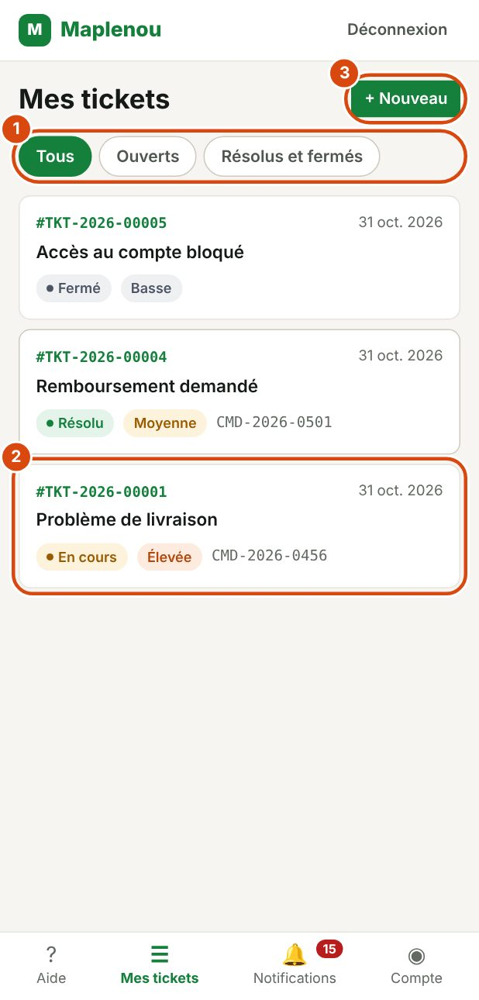
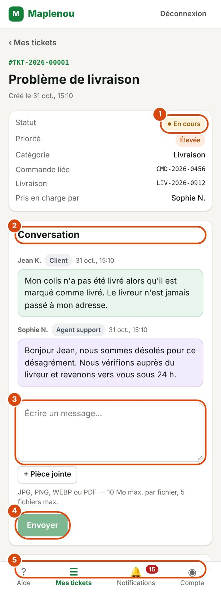

# Suivre mes tickets

Cette page explique comment retrouver vos tickets, comprendre leur statut et échanger avec le support.

## Voir la liste de mes tickets

*Repères de la capture :*

1. Les filtres Tous, Ouverts et Résolus et fermés.
2. Un ticket : numéro, date, sujet et statut. Touchez-le pour l'ouvrir.
3. + Nouveau : créer un autre ticket.

Ouvrez Mes tickets depuis la barre de navigation ou depuis l'écran d'aide. Les tickets les plus récemment mis à jour apparaissent en premier.

Chaque ticket de la liste affiche :

- son numéro, par exemple `#TKT-2026-00125`, et la date de sa dernière mise à jour ;
- son sujet ;
- son statut et sa priorité ;
- la référence de la commande ou de la livraison liée, s'il y en a une.

Cliquez sur un ticket pour ouvrir son détail. Si vous avez beaucoup de tickets, cliquez sur Voir plus en bas de la liste pour en afficher d'autres.

Vous ne voyez que vos propres tickets. Personne d'autre que vous et le support Maplenou n'y a accès.

## Filtrer mes tickets

Trois onglets en haut de la liste permettent de filtrer vos tickets :

| Onglet | Tickets affichés |
| --- | --- |
| Tous | Tous vos tickets |
| Ouverts | Les tickets encore en traitement |
| Résolus et fermés | Les tickets aux statuts Résolu et Fermé |

Si aucun ticket ne correspond, le message Aucun ticket dans ce filtre s'affiche. Si vous n'avez encore créé aucun ticket, le message Vous n'avez encore aucun ticket s'affiche avec un lien Créer un ticket.

## Lire le détail d'un ticket

*Repères de la capture :*

1. Le statut du ticket, avec sa priorité, sa catégorie et la personne qui s'en occupe.
2. Conversation : vos messages et les réponses du support.
3. Votre message : écrivez votre réponse (vous pouvez ajouter une Pièce jointe).
4. Envoyer.
5. Suivi du ticket : chaque étape (création, prise en charge, changements de statut).

Le détail d'un ticket regroupe toutes les informations de votre demande :

- le numéro, le sujet et la date de création (Créé le …) ;
- le Statut, la Priorité et la Catégorie ;
- la Commande liée ou la Livraison, si vous en avez indiqué une ;
- Pris en charge par : le nom de l'agent support qui traite votre ticket, ou En attente d'attribution s'il n'est pas encore attribué ;
- la Conversation avec le support ;
- le Suivi du ticket : les étapes importantes de votre ticket, avec leur date (création, changements de statut, messages, réouverture…).

Pour revenir à la liste, cliquez sur ‹ Mes tickets.

## Comprendre les statuts d'un ticket

Le statut indique où en est votre demande. Il change au fil du traitement.

| Statut | Ce que cela signifie | Ce que vous devez faire |
| --- | --- | --- |
| Nouveau | Votre ticket est enregistré. Il n'est pas encore attribué à un agent. | Rien. Vous pouvez ajouter des précisions dans la conversation. |
| Attribué | Un agent support a pris votre ticket en charge. Son nom apparaît dans Pris en charge par. | Attendre sa réponse. |
| En cours | Le support travaille sur votre demande. | Lire les messages du support et répondre si besoin. |
| En attente du client | Le support a besoin d'informations de votre part pour continuer. | Répondre dans la conversation. Le traitement reprend dès votre réponse. |
| Résolu | Le support considère que le problème est réglé. | Vérifier. Si le problème n'est pas réglé, [demander la réouverture](reopen-and-close.md). |
| Fermé | Le ticket est terminé définitivement. | Rien. Si le problème revient, créer un nouveau ticket. |

Le parcours habituel est : Nouveau → Attribué → En cours → Résolu → Fermé. Le ticket peut passer plusieurs fois par En attente du client si le support a besoin d'informations.

Vous ne changez pas vous-même le statut d'un ticket : c'est le support qui le fait. Votre réponse à une demande d'informations remet automatiquement le ticket En cours.

## Répondre au support dans la conversation

La conversation contient tous les messages échangés entre vous et le support. Chaque message affiche le nom de son auteur, son rôle et la date.

1. Ouvrez le ticket.
2. Dans la section Conversation, écrivez votre message dans le champ Écrire un message….
3. Si besoin, ajoutez des fichiers avec + Pièce jointe.
4. Cliquez sur Envoyer.

Le message Message envoyé. confirme l'envoi. Le support reçoit une notification.

Vous pouvez écrire dans la conversation tant que le ticket n'est pas Fermé.

!!! tip "Le message n'est pas parti ?"
    Si l'envoi échoue, le message Envoi impossible. Réessayez. s'affiche avec un bouton Réessayer. Votre texte est conservé. Cliquez sur Réessayer : même si vous réessayez plusieurs fois, le message n'est enregistré qu'une seule fois.

## Répondre quand le support demande des informations

Quand le support a besoin d'informations, le ticket passe au statut En attente du client. Vous recevez la notification Informations demandées.

Dans le ticket, un encadré Action requise s'affiche : Le support attend des informations de votre part. Répondez ci-dessous pour que le traitement reprenne.

1. Lisez le dernier message du support pour savoir ce qui est demandé.
2. Écrivez votre réponse dans la conversation (champ Apportez les informations demandées…).
3. Ajoutez les fichiers demandés, si besoin.
4. Cliquez sur Envoyer.

Dès votre réponse, le ticket repasse au statut En cours et l'agent est averti.

!!! tip "Répondez vite"
    Tant que vous n'avez pas répondu, le support ne peut pas avancer sur votre demande.

## Ajouter des pièces jointes dans une réponse

Vous pouvez joindre des fichiers à chaque message, avec le bouton + Pièce jointe sous le champ de message.

Les règles sont les mêmes qu'à la création du ticket :

- formats JPG, JPEG, PNG, WEBP ou PDF ;
- 10 Mo au maximum par fichier ;
- 5 fichiers au maximum par message ;
- 50 Mo au maximum pour toutes les pièces jointes du ticket.

Les fichiers envoyés apparaissent sous le message, avec leur nom et leur taille. Cliquez sur un fichier pour le télécharger. Le détail des règles et des messages d'erreur est dans [Joindre des fichiers au ticket](create-ticket.md#attachments).

## Ajouter une information oubliée

Vous ne pouvez pas modifier le sujet ni la description d'un ticket après l'envoi. Pour corriger ou compléter votre demande, écrivez un nouveau message dans la conversation du ticket. Ne créez pas un second ticket pour le même problème.

## Statuts propres à Maplenou

L'équipe support peut ajouter des statuts qui décrivent mieux votre situation, par exemple « En attente du vendeur ». Ils s'affichent comme les autres. Pendant ces attentes, comme pendant En attente du client, le délai de résolution est mis en pause : le temps où le ticket attend une autre personne n'est pas compté contre le support.
