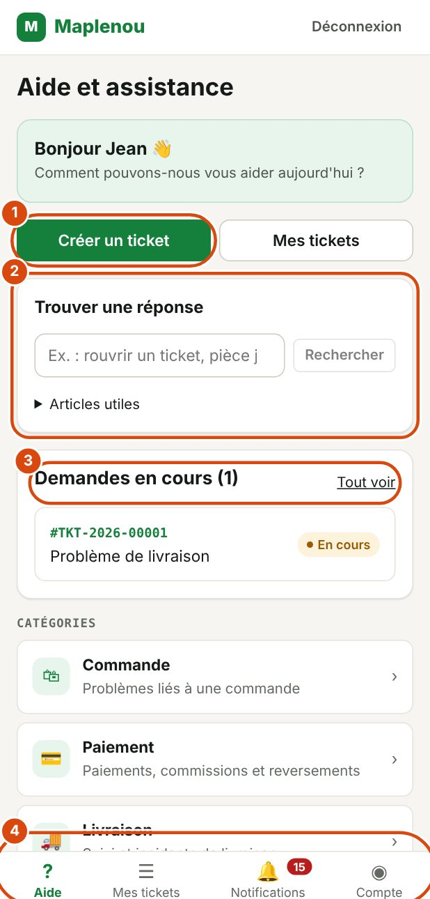

# Centre d'aide du service client Maplenou

Bienvenue dans le guide utilisateur du service client Maplenou. Il explique comment demander de l'aide au support et suivre votre demande, étape par étape.

## À qui s'adresse ce guide

Ce guide est destiné à toutes les personnes qui utilisent la place de marché Maplenou et ont besoin du support :

- **les clients**, pour un problème de commande, de paiement, de livraison, de retour ou de compte ;
- **les vendeurs**, pour leurs commandes, paiements, commissions et reversements ;
- **les livreurs**, pour signaler un incident de livraison (client absent, adresse erronée, colis endommagé…).

Dans ce guide, on vous appelle le **demandeur** : c'est vous qui ouvrez la demande. Les agents du support Maplenou la traitent.

## Comment fonctionne le service client

Chaque demande d'aide est un **ticket**. Vous le créez dans l'application, le support le prend en charge, et vous échangez avec lui dans la conversation du ticket jusqu'à ce que le problème soit réglé.

1. Vous créez un ticket et recevez un numéro, par exemple `TKT-2026-00125`.
2. Un agent support prend votre ticket en charge.
3. Vous échangez des messages et des fichiers dans la conversation.
4. Le support résout le ticket, puis le ferme.

Vous êtes averti à chaque étape importante par une [notification](notifications.md).

## Accès rapide aux tâches principales

*Repères de la capture :*

1. Créer un ticket : ouvre le formulaire d'une nouvelle demande.
2. Trouver une réponse : cherche directement dans ce guide.
3. Demandes en cours : vos tickets ouverts ; Tout voir affiche la liste complète.
4. Le menu du bas : Aide, Mes tickets, Notifications (avec le nombre de non lues) et Compte.

- **Premiers pas**

    Se connecter, découvrir l'écran d'aide, changer la langue et le thème.

    [Premiers pas](getting-started.md)

- **Créer un ticket**

    Choisir une catégorie, décrire le problème, joindre des fichiers.

    [Créer un ticket](create-ticket.md)

- **Suivre mes tickets**

    Comprendre les statuts, répondre au support, ajouter des informations.

    [Suivre mes tickets](follow-tickets.md)

- **Notifications**

    Savoir quand le support vous répond ou change le statut d'un ticket.

    [Notifications](notifications.md)

- **Réouverture et fermeture**

    Que faire si le problème revient après la résolution.

    [Réouverture et fermeture](reopen-and-close.md)

- **Compte et préférences**

    Vos informations, la langue, le thème, la déconnexion.

    [Compte et préférences](account-and-preferences.md)

Vous avez une question précise ? Consultez les [questions fréquentes](faq.md) ou le [glossaire](glossary.md).

## Trouver une réponse rapidement

Deux outils vous aident à trouver l'information sans parcourir tout le guide.

**La recherche.** Appuyez sur la touche <kbd>/</kbd> de votre clavier, ou cliquez sur le champ de recherche en haut de la page, puis tapez quelques mots, par exemple « pièce jointe » ou « réouverture ». Les résultats mènent directement à la bonne section.

**L'assistant.** Cliquez sur le bouton Poser une question en bas à droite de l'écran. Écrivez votre question avec vos mots, par exemple « Comment rouvrir un ticket résolu ? ». L'assistant répond à partir de ce guide et indique les sections utilisées comme références : cliquez dessus pour lire le détail.

!!! note "L'assistant peut se tromper"
    L'assistant répond uniquement à partir de ce guide. Vérifiez toujours sa réponse dans les sections citées. Il ne connaît pas vos tickets : pour une question sur votre propre demande, écrivez au support dans la conversation du ticket.

## Ouvrir ce guide depuis l'application

Dans l'application du service client, le lien Centre d'aide ouvre ce guide dans un nouvel onglet. Il se trouve dans l'en-tête sur un grand écran, et dans la page Compte sur un téléphone.

Le guide existe en français et en anglais. Utilisez le sélecteur de langue en haut de la page pour passer d'une langue à l'autre : vous restez sur la même page.

## Chercher une réponse depuis l'application

Sur la page Aide de l'application, l'encadré Trouver une réponse cherche directement dans ce guide.

1. Tapez quelques mots, par exemple « rouvrir un ticket ».
2. Cliquez sur Rechercher.
3. Ouvrez un résultat : la section du guide s'affiche dans un nouvel onglet.

Sous la recherche, Articles utiles donne les pages les plus consultées. Si rien ne répond à votre question, créez un ticket.
