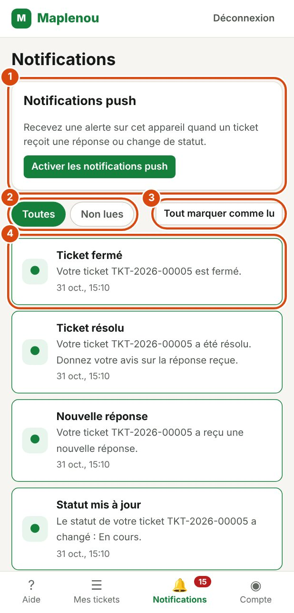

# Notifications

Les notifications vous préviennent quand quelque chose d'important se passe sur vos tickets. Vous n'avez pas besoin d'ouvrir chaque ticket pour savoir s'il a changé.

## Quand recevez-vous une notification

Vous recevez une notification dans les cas suivants :

| Notification | Quand elle arrive |
| --- | --- |
| Ticket créé | Votre ticket vient d'être créé. Elle confirme son numéro. |
| Nouvelle réponse | Le support a écrit un nouveau message dans votre ticket. |
| Informations demandées | Le support a besoin d'informations de votre part : le ticket est En attente du client. |
| Statut mis à jour | Le statut de votre ticket a changé, par exemple vers Attribué ou En cours. |
| Ticket résolu | Le support a résolu votre ticket. |
| Ticket fermé | Votre ticket est fermé. |
| Demande de réouverture traitée | Le support a accepté ou refusé votre demande de réouverture. |

Chaque notification indique le numéro du ticket concerné et la date.

Vous n'êtes pas averti de vos propres actions : par exemple, vous ne recevez pas de notification pour un message que vous avez envoyé. Seule la création d'un ticket donne lieu à une notification de confirmation.

## Voir vos notifications

*Repères de la capture :*

1. Notifications push : recevoir une alerte sur cet appareil.
2. Les filtres Toutes et Non lues.
3. Tout marquer comme lu.
4. Une notification (le point indique qu'elle n'est pas lue) : touchez-la pour ouvrir le ticket.

Ouvrez Notifications dans la barre de navigation. Les notifications les plus récentes sont en haut de la liste.

Cliquez sur une notification pour ouvrir le ticket concerné. La notification est alors marquée comme lue.

Deux onglets permettent de filtrer la liste :

- Toutes : toutes vos notifications ;
- Non lues : seulement celles que vous n'avez pas encore ouvertes.

S'il n'y a rien à afficher, le message Aucune notification ou Aucune notification non lue s'affiche.

## Repérer les notifications non lues

Un compteur rouge sur l'entrée Notifications de la barre de navigation indique le nombre de notifications non lues. Il disparaît quand toutes vos notifications sont lues.

Dans la liste, une notification non lue est marquée d'un point (●) et d'un cadre de couleur. Une notification lue est marquée d'une coche (✓).

## Tout marquer comme lu

Pour marquer toutes vos notifications comme lues en une fois, cliquez sur Tout marquer comme lu en haut de la liste. Le message Toutes les notifications sont marquées comme lues. confirme l'action.

Vos notifications restent dans la liste : seul le compteur de non lues est remis à zéro.

## Recevoir les notifications push dans le navigateur

Les notifications push vous alertent sur votre ordinateur ou votre téléphone, même quand la page de l'application n'est pas ouverte devant vous.

Pour les activer dans votre navigateur :

1. Ouvrez Notifications dans la barre de navigation.
2. Dans la carte Notifications push, cliquez sur Activer les notifications push.
3. Quand le navigateur vous demande si le site peut afficher des notifications, choisissez **Autoriser**.

Le message Notifications push activées sur cet appareil. confirme l'activation. Pour vérifier que tout fonctionne, cliquez sur Envoyer une notification de test : une notification « Notification de test » apparaît après quelques secondes.

Quand vous cliquez sur une notification push, l'application s'ouvre sur le ticket concerné. Les textes des notifications push sont en français.

Pour ne plus en recevoir sur cet appareil, cliquez sur Désactiver. Quand vous vous déconnectez, ce navigateur cesse aussi de recevoir vos notifications push : la personne suivante qui l'utilise ne reçoit pas les vôtres.

### Si les notifications sont bloquées

Si vous avez refusé l'autorisation, la carte indique que les notifications sont bloquées pour ce site. Cliquez sur l'icône à gauche de l'adresse du site, autorisez les notifications, puis rechargez la page.

Si la carte indique que votre navigateur ne prend pas en charge les notifications push, ou qu'elles ne sont pas encore configurées, vos notifications restent visibles dans la page Notifications.

### Sur les applications mobiles

Les applications mobiles Maplenou vous demandent elles-mêmes l'autorisation d'afficher des notifications. Acceptez-la pour recevoir les alertes sur votre téléphone.

## Si une notification n'arrive pas

Une notification est un simple avertissement : votre ticket est toujours à jour, même si une notification arrive en retard ou n'arrive pas.

La page Notifications de l'application est toujours disponible. En cas de doute, ouvrez directement le ticket dans Mes tickets pour voir son statut et les derniers messages.
