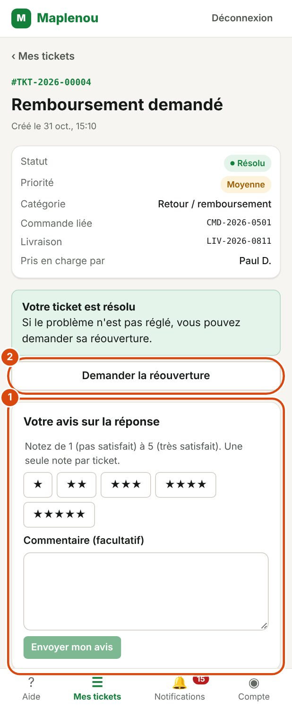

# Réouverture et fermeture

Quand le support a réglé votre problème, il **résout** puis **ferme** le ticket. Cette page explique quoi faire si le problème n'est pas vraiment réglé.

## Résolu ou fermé : la différence

| Statut | Ce que vous pouvez faire |
| --- | --- |
| Résolu | Le support pense que le problème est réglé. Vous pouvez encore écrire dans la conversation et **demander la réouverture** du ticket. |
| Fermé | Le ticket est terminé définitivement. Vous ne pouvez plus écrire ni demander la réouverture. Pour un nouveau problème, créez un nouveau ticket. |

C'est le support qui résout et ferme les tickets. Vous ne pouvez pas fermer un ticket vous-même. Un ticket résolu que vous ne faites pas rouvrir se ferme automatiquement au bout de 7 jours.

## Quand demander la réouverture d'un ticket

Demandez la réouverture si votre ticket est Résolu mais que le problème n'est pas réglé, ou qu'il est revenu.

Vous pouvez demander la réouverture :

- uniquement pour **vos propres** tickets ;
- uniquement quand le ticket est au statut Résolu ;
- quand aucune autre demande de réouverture n'est déjà en cours d'examen pour ce ticket.

Une fois le ticket Fermé, il n'est plus possible de demander sa réouverture.

## Demander la réouverture étape par étape

*Repères de la capture :*

1. Votre avis sur la réponse : de 1 à 5 étoiles et un commentaire facultatif, puis Envoyer mon avis.
2. Demander la réouverture : si le problème n'est pas réglé.

1. Ouvrez le ticket résolu dans Mes tickets.
2. L'encadré Votre ticket est résolu s'affiche : Si le problème n'est pas réglé, vous pouvez demander sa réouverture.
3. Cliquez sur Demander la réouverture.
4. Dans le champ Pourquoi le problème n'est-il pas résolu ?, expliquez ce qui ne va pas (obligatoire, 1 000 caractères au maximum).
5. Cliquez sur Envoyer la demande. Pour renoncer, cliquez sur Annuler.

Le message Demande de réouverture envoyée. confirme l'envoi.

!!! tip "Écrire dans la conversation ne suffit pas"
    Un message dans la conversation d'un ticket résolu ne le rouvre pas. Pour que le support reprenne le traitement, utilisez le bouton Demander la réouverture.

## Ce qui se passe après une demande de réouverture

Votre demande n'est pas acceptée automatiquement : un membre du support l'examine et décide.

Pendant l'examen, le ticket reste Résolu et l'encadré Demande de réouverture en cours d'examen s'affiche, avec la date d'envoi. Vous ne pouvez pas envoyer une autre demande tant que celle-ci est en cours.

Quand le support a décidé, vous recevez la notification Demande de réouverture traitée.

- **Demande acceptée** : le ticket est rouvert. Il repasse en général au statut En cours et le support reprend le traitement.
- **Demande refusée** : le ticket reste Résolu. Dans le ticket, le message Votre précédente demande a été refusée. s'affiche, avec l'explication du support quand il en a donné une. Vous pouvez faire une nouvelle demande si le problème persiste.

Votre demande et la décision du support apparaissent dans le Suivi du ticket.

## Un ticket fermé ne peut pas être rouvert

Un ticket Fermé est définitif. Dans le ticket, l'encadré Ce ticket est fermé l'indique : Un ticket fermé ne peut plus être rouvert. Si le problème persiste, créez un nouveau ticket.

1. Cliquez sur Nouveau ticket dans cet encadré.
2. Remplissez le formulaire comme pour tout ticket (voir [Créer un ticket](create-ticket.md)).
3. Dans la description, indiquez le numéro de l'ancien ticket, par exemple `TKT-2026-00125`. Le support pourra retrouver l'historique.

Vous pouvez toujours consulter un ticket fermé, sa conversation et ses pièces jointes dans Mes tickets, onglet Résolus et fermés.

## Fermeture automatique après 7 jours

Quand un ticket est Résolu et que vous ne demandez pas sa réouverture, il passe tout seul à Fermé 7 jours plus tard. Si le problème revient avant, demandez la réouverture (voir plus haut) ; après, créez un nouveau ticket en citant l'ancien numéro.

## Donner votre avis sur la réponse

Sur un ticket Résolu ou Fermé, l'encadré Votre avis sur la réponse vous permet de noter l'aide reçue, une seule fois.

1. Choisissez une note de 1 (pas satisfait) à 5 (très satisfait).
2. Ajoutez un commentaire si vous le souhaitez.
3. Cliquez sur Envoyer mon avis.

Votre note aide l'équipe à s'améliorer ; elle ne change rien au ticket. Une fois envoyée, elle s'affiche à la place de l'encadré et ne peut plus être modifiée.
